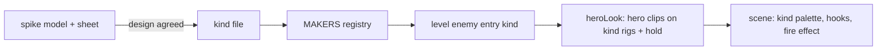
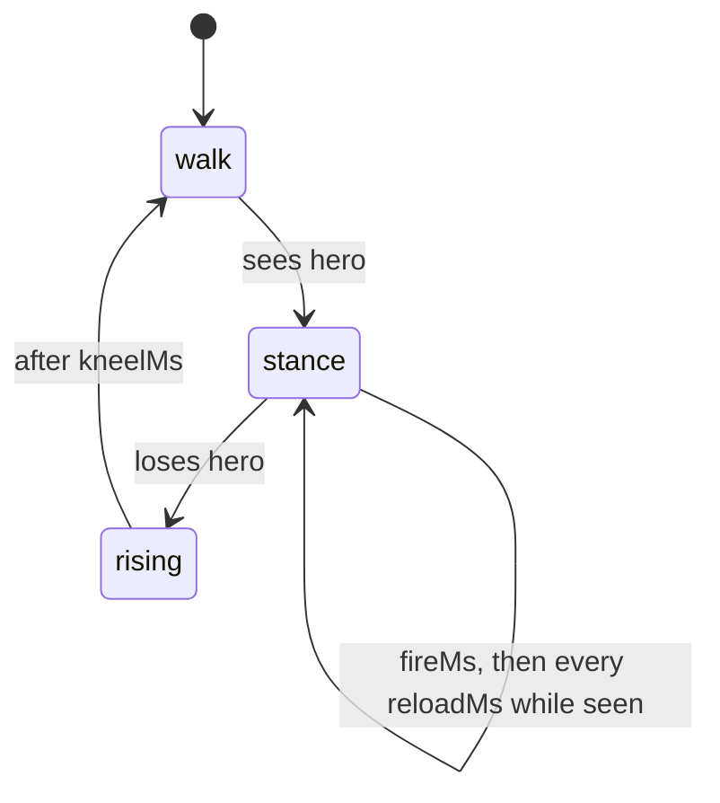

# Blueprint: add a humanoid enemy kind

New humanoid enemy for any mission. Built first for rocket robot, grey trooper, rocket droid and cave trooper (2026-11-03). Copy this recipe for the next one.

## Rules

- Body and legs stay the gun walker rig (`XBOT.buildSide({ farLimbs, propBehindArm, enemy })` in spikes, `createRigs(lod, true)` in game). Only colours, head, arm add-ons, weapon and back gear differ.
- Walk, idle, shoot and hit come from hero clips. Write no gait or pose code. Spikes walk with `GAIT.walkAt(t)` (`spikes/shared/gait.js`), game with `heroLook`.
- Own fire effect drawn in the kind hooks from the burst time. No yellow star (that is the walker's, `muzzle`).
- Weapon points level in the side view at the shoot pose. Check it through `locate(rigs.side, "hand", pose)`, not by eye.
- Spike first, port second. Spike is the design source; the game must match it.

## Pieces

| Piece | Spike | Game |
|---|---|---|
| Model | `spikes/shared/enemies-<mission>.js` (IIFE, `window.ENEMIES.<NAME>`) | `src/game/robot/kinds/<kind>.ts` returning an `EnemyKind` |
| Sheet / registry | `spikes/enemy-design/<mission>.js` adds `ENEMY_KINDS.<kind>` (`label`, `mission`, `palette`, `ownKeys`, `figures`, `game`) | `MAKERS` in `src/game/robot/kinds.ts` |
| Original references | `ORIGINALS.enemies.<kind>` in `spikes/shared/originals.js` | none |
| Add-on joints | hook nodes pushed into the rig groups | `addHooks(rigs.side, { head: ["helmet"], arm: ["pauldron"] })` |
| Add-on drawing | `P.*` in the hook | `P.*` through `paintHook(lineW, draw, frame?)` |
| Weapon | `GUN.model` | `createWeaponModel` |
| Hold | `XBOT.solve` for the far hand | `holdPoses(side, front, carry, support)` |
| Placement | sheet figures | enemy entry with `"kind"` in a level `enemies` list |

## `EnemyKind` fields

- `palette` - rig keys plus own keys; `rigKeys(own, prefix)` maps a `<prefix>A0`... set onto the rig keys.
- `rigs`, `hold` - see Pieces.
- `muzzle` - hand-hook point for the yellow star; walker only.
- `hooks(look, lineW, fire)` - replaces the gun hooks; draw the weapon on `hand` only while `look.gun === "hand"`; `fire` is seconds since the attack started, null otherwise.
- `clips` - hero clip overrides; `stanceShot(stance, settle)` makes a `shoot` clip that settles into a kneel or brace and gets up from `STANCE_HOLD`.
- `laser` - hand-hook point; a red beam to the hero while it attacks.
- `launch` - hand-hook point a rocket leaves from; else the rocket `muzzle` cells.

## Rocket kinds

An enemy entry with `rocket` fires rockets instead of bursts. Behaviour and flight law in CLAUDE.md (`level/rockets.ts`). Keep the kind stance settle equal to `kneelMs`, and any reload art in the kind file equal to `fireMs` / `reloadMs`.

## Checks

- Spike sheet tab: walk next to `#walker` "Enemy, walk" matches legs and body.
- Sandbox: one enemy of the kind, clear of lift shafts and the right strip (cols 40+), since `enemy.test.ts` checks patrols and several tests fire on floors 4 and 14 east.
- `sandboxLevel.test.ts` counts sandbox enemies; update it.
