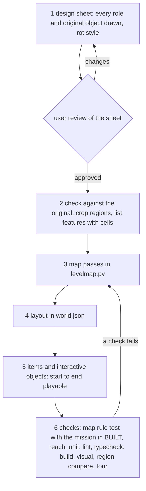

# Blueprint: compose a mission map

How to build the map of any mission: the steps in order, each with a gate, then the rules every map follows. The rules were worked out on mission 1 (`mesto`); they speak in roles, so they apply to all missions.

Each rule ends with its source. `[test]` marks a rule that `src/game/level/mapRules.test.ts` enforces on every mission in its `BUILT` list.

| Tag | Source |
|---|---|
| [S] | map fine-tuning session, 2026-10-27 and 2026-10-28 (user rulings and findings) |
| [R: name] | `docs/requirements.md` decision row of that name (date in the row) |
| [F] | mesto map fixes spec, `docs/superpowers/specs/2026-10-21-mesto-map-fixes-design.md` |
| [M] | auto-memory note of an earlier session |
| [T] | `docs/research/tools/levelmap.py` config notes or tests |
| [CLAUDE.md] | project instructions |
| [H: id date] | your own message in an earlier session (transcript id, first 8 characters); a forked session repeats some messages under a second id |
| [U] | user ruling on the missions 2-4 maps, 2026-11-03: keep mechanics, drop draft art, design step first, redo vesnice first |

## Steps

Do the steps in order. A step starts only once the gate of the step before it passes. Vesnice goes first; jungle and jeskyne start only once vesnice meets the definition of done. [U]

### 1. Design sheet

- Fill the role table (below) with the mission's own vector assets: every role gets at least one. Mesto assets do not count, except the shared lift machine (deck, shaft, panel). [U] [R: Missions 2-4 art]
- Draw every original map object of the mission (`config/levels/<id>/objects.json`), interactive or not, plus every new role asset (`"origin": "new"` entry). [H: 94261352 2026-10-20] [S]
- Rot style on every building and structure: grain, rust drips, pooled dirt, worn edge chips, scorched hole rims (`G` in `src/game/env/grime.ts`, spike `ENV.G`). Items and people stay clean. [M] [CLAUDE.md]
- Draw in the spike first (`spikes/shared/env-<id>.js`), then port to `src/game/env/<id>.ts` and add the ids to the mission id list. [F] [CLAUDE.md]
- List every asset in the env-design sheet, `spikes/env-design/?mission=<id>`, and judge its size against the sheet hero (game height, 1.9 cells). [S]
- Gate: the user reviews the sheet and approves it. No layout work before that. [U]

### 2. Check against the original

- Crop the original map region by region with a cell grid: `node tools/map/crop.mjs <map png> <col> <row> <cols> <rows> <out.png> [scale]` (decoded maps in `docs/research/gamedata/png/maps/`, 24 px per cell, local only). [U]
- List every feature of each region with its cells: floors, walls, lifts, ladders, buildings, pipes, clutter, signs, lights, objects.
- Map each feature to a planned asset of the sheet, or state why it is skipped.
- Gate: every feature has an asset or a stated skip.

### 3. Map passes

- Change the map only in `levelmap.py` (`sky`, `patches`, `borderFills`, `unseen`, `holes`, `plankGaps`, `liftSplits`, `width`), never in `map.json`. Before a change, regenerate and diff: the output must match the committed file. [F] [T] [S]
- Apply the traversal, reach and wall rules below.
- Gate: `reach.test.ts` passes with `GATED` updated.

### 4. Layout

- Lay out sky, far layer, buildings, walls, supports, pipes, clutter, signs, lights and lift panels in `config/levels/<id>/world.json`, the terrain look in `terrainArt` (`wall`, `ledge`, `girder`, `top`, `deep`) and the backdrop `haze`. [CLAUDE.md]
- Apply the scenery, clutter and art rules below.
- Gate: the mission joins `BUILT` in `mapRules.test.ts`, with its role table in `RULES`, and every rule passes.

### 5. Items and interactive objects

- Place every item and interactive object as a prop, with its tasks, so a player gets from the start to the level end. Ready to play means map, items and interactive objects; enemies come later. [U]
- Every use spot shows a visible object where the hero stands to use it; art drawn far from its use spot leaves players lost. [H: 61b4052c 2026-10-20] [R: Crane level]
- Gate: a route test passes from the start to the level end.

### 6. Checks

- `npx vitest run` twice (the whole-map tile test is slow), with the mission in `BUILT` and in `reach.test.ts`; `npx eslint .`, `npx tsc --noEmit`, `npx vite build`, `npm run test:visual`. [S] [F]
- Compare each region: the original crop next to an in-game screenshot with fog off (`c2080isdebugging`) at the same cells.
- Add a Tour line of one `moveto(x,y)` per region to `docs/tours.md` and look at each spot in game. [CLAUDE.md] [M]

## Roles

Every layout asset has one role (`[test]`). Each mission's design sheet fills its column; the same table lives as `RULES` in `mapRules.test.ts`.

| Role | What | Mesto | Vesnice | Jungle | Jeskyne | Vezeni |
|---|---|---|---|---|---|---|
| sky | sky behind everything | `skyBackground` | `villageBackdrop` | | `caveBackdrop` | `prisonSky` |
| far | far layer filling open sky between floors | `skylineTower`, `midgroundRuins` | `farPalms`, `farRuins` | | `farStalagmites` | `farPrisonBlocks` |
| filler | map edge and never reached solid (terrain wall) | `brickWall` | `crateWall` | | `caveRock` | `prisonBrick` |
| wall | structure walls the hero walks along | `brickWall`, `graffitiWall`, `tunnelWall`, `metroPlatformWall` | `rivetWall`, `plankWall` | | `rockRibs`, `lavaFall` | `shaftMasonry`, `cellBlockWall` |
| fence | fences the hero walks along | `chainFence` | `chainFence` (mesh states) | | `safetyRail` | `prisonFence` |
| floor | floor runs and floor plates | `streetWalkway`, `tunnelFloor`, `hazardPlate`, `liftLanding` | `grassyWalkway`, `steelDeckPlate`, `liftLanding` | | `caveFloor`, `liftLanding` | `meshFloor`, `wallWalk`, `liftLanding` |
| girder | free-standing floor runs and elevated decks | `girderBridge` | `trussWalkway` | | `rockLedge` | `scrapCatwalk` |
| building | buildings and towers | `windowBuilding`, `ruinedBuilding`, `colonnadeBuilding`, `facadeTower`, `gantryBuilding` | `villageHouse`, `stiltBuilding`, `powerHouse` | | `metalPillars` | `prisonTower`, `pillarHall` |
| support | supports, columns, masts, stairs | `latticePylon`, `craneMast`, `staircase` | `latticeMast`, `watchtower` | | `ropeColumn` | `concretePillar` |
| pipe | pipes and pipe columns | `pipeColumn`, `pipeBend`, `ceilingPipe` | `pipeColumn` (bronze state), `overheadPipeline` | | `minePipe` | `corridorPipe`, `ventPipe` |
| machine | big machines and vehicles in the backdrop | `fuelTank`, `metroTrain` | `transformer`, `storageTank` (horizontal state), `fuelTank`, `powerPlant` | | `pressureTank` | `ventMachinery` |
| rubble | heaps and fallen structure | `rubblePile`, `fallenGirders` | `rockCliff`, `rubbleHeap` | | `screeHeap` | `prisonDump` |
| mounted | wall-mounted things | `floorVent` (props `wireBox`, `codeLock`) | `warningLamp`, `junctionBox` | | `caveLamp` | `ceilingStrip`, `wallGrille`, `wallBeacon` |
| bigClutter | big ground clutter | `carWreck` | `militaryWreck` | | `mineWreck` | `cellBunk` |
| smallClutter | small ground clutter | `barrel`, `tyres`, `brickPile` | `fuelDrum`, `sandbags`, `shellCrate` | | `powderKeg`, `toolCrate` | `cellLocker`, `slopBin` |
| sign | signs and lights | `signPost`, `barSign`, `stripLight` | `warningLamp` | | `explosiveSign`, `caveLamp` | `subSign`, `wallBeacon` |
| panel | lift panel | `liftPanel` (prop `damagedLift`) | `liftPanel` | | `liftPanel` | `liftPanel` |

Per mission, `RULES` also lists the assets hung from the ceiling (mesto `stripLight`, `ceilingPipe`), the props that draw a lift panel, the clutter bar and named exemptions, each with its reason. A mission may add the role `hazard` (lava and chasm mist drawn as scenery, not grimed; jeskyne `lavaPit`, `chasm`) and `seenFrom`: spots a jump reaches that the strict reach graph leaves out, added to the sight union.

## Source data

- Collision, lifts, items, objects and enemies come from the decoded original level data; the scenery is laid out over the decoded map image. [R: Mission 1 layout] [R: Levels 2-4 layout]
- The original map (dev overlay, key `o` on `game.html`) is the reference for every fix that has an original counterpart. [F]
- All missions use the same converter and reach tests; a task that changes the map applies a whole-map variant over the base, never stacked on another variant. [R: Levels 2-4 layout] [H: 94261352 2026-10-20]
- A wall a task removes is a gate prop (`taskWalls`), not a map row, so the passage is walkable once the task opens it. [T]
- A broken lift keeps its repaired stops, locked by its `enabledBy` flag with a hint. [T]
- Art passes keep gameplay: same walkable floors, same reach, same tasks. [F]

## Traversal

- Lifts are the common way between floors; ladders are rare, a unique route. No pits or drops as an intended way to move; survivable floor edges may stay open. [R: Level traversal]
- A lift's two stop floors connect only through that lift: no walk, ladder, other lift, jump or survivable drop between them. Each lift starts at its spawn-side stop. A reach test checks every lift. [R: Elevator at the hero's level]
- Every lift has two stops; a three-stop lift becomes two lifts side by side; an unused middle stop is dropped. [R: Lift stops] [T]
- A floor beside a shaft on a row where its lift does not stop gets a wall up to the floor above, so it does not read as a landing. [R: Lift shaft sides]
- A lift shaft is open from two rows above its top stop down to its bottom stop, and the bottom stop is solid, so the hero never drops through with the deck away. [R: Lift art] [test]
- Every lift stop shows a floor or a wall on both sides of the shaft: no bare pit around a top or bottom stop. The shaft of a split lift half that stops on the same row counts. [U] [test]
- Map obstacles stop the hero from falling past a lift to its other stop, so a lift always waits at the hero's level. [H: 0841ea1e 2026-10-19]
- A wall beside a lift is as high as the lift. [H: 736b19e6 2026-10-20]
- Every panel calls its lift from the other end of the shaft, since the hero can ride and then jump down. [H: b21fdc09 2026-10-23]
- Walkable art stays walkable: no blocker inside art the hero should walk over (the mesto crashed ship pad walks up to its wall at col 22; the crane mast does not stop the hero). [S] [T]

## Reach and sight

- Reachable means the strict reach graph with every task gate open. The generous graph lets the hero step off a moving lift deck past a wall, so a pocket only it reaches is unreachable (mesto floor 44 west of lift 67, the removed middle stop of lift 122). [S]
- Before filling a pocket, confirm in game (`moveto`, jumps) that the hero cannot enter it. [F]
- After each map change, update `GATED` in `reach.test.ts`: runs a fill buries leave the lists, new fill tops nobody reaches join `never`. [F] [S]
- Fog shows a floor only from above or from the side, never from below, so an unvisited upper floor reads the same everywhere. [H: 661a389c 2026-10-23] [CLAUDE.md]

## Walls, sky and edges

- A cell the player never sees and that has something solid above it becomes filler. Sight is the game fog sight unioned over every reached floor, ladder and lift row (`unseen`). Check the union again after the fill: no cell seen before may turn unseen. [S]
- Open sky stays open: sky above the top floor of a column, and the explicit `sky` rects (mesto: the sky over the crashed ship). [S]
- No ceiling row at the map top: the sky is open above the level; an invisible ceiling above the top row is fine. [H: 0841ea1e 2026-10-19]
- An outer wall at the map edge fills solid on to the edge over cells the hero never reaches, so the view shows filler, not sky (`borderFills`). Edge walls are so thick that the view shows only filler. [R: Map borders] [H: 736b19e6 2026-10-20]
- Underground cells the hero never reaches are solid; tunnels keep the original tunnel height (mesto: street slab 7 rows thick, metro 4 rows high). [R: Mission 1 underground] [T]
- Never reached sealed pockets are solid and drawn as the original towers; pockets the player cannot enter are walled in, also where only the generous reach graph enters them. [R: Mesto map art] [F] [S]
- Drop never reached roofs and planks that float in the sky; a wall then runs up to the map top where it ended at that roof. Wall in corners beside tall towers at the map edge. [S]
- No bare wall column ends in the sky: in the original it is the edge of a tall building, so a building drawn over it covers it to its top. [F]
- Floors end where the original ends them, at a visible wall. [F] [T]
- Crop the right map edge where every column beyond is filler or never reached (`width`). Keep the left columns: cropping them would shift every x coordinate of the mission. [S]
- Every edge the hero touches shows a wall; every blocker the hero can touch has visible art. [R: Mesto map art] [F]
- Every floor end closes with a wall (named exemptions: mesto crane gap, open sky over the crashed ship). [S] [test]
- No invisible blockers (`|`). Mesto keeps its old ones only under a lift bottom stop or visible art; every other mission has none. [S] [test]
- Walls mostly reach the floor above; a wall column above the ground reaches the floor above it. The test splits walls into row rectangles, so a fill that makes two rows end at the same column can merge them into one tall wall whose top lands on a lift landing; shape the fill so it does not. A wall whose top is a floor the hero walks counts as ground (cave rock masses). [H: 51ca5370 2026-10-19] [T] [S] [test]
- A nook a removed lift stop leaves behind is filled down to the floor. [H: 17637e34 2026-10-23]

## Scenery placement (`world.json`)

- Drop every scenery item whose whole box lies in never seen cells. Nobody maintains art the player cannot see. [S] [test]
- Every item stands on solid floor: each column under its base is a solid cell, never past a floor end, over a hole or over a lift shaft. Girder decks, things meant to sit behind a lift shaft and things hung from the ceiling are exempt. [S] [test]
- Building and wall dressing stays off cells the hero reaches (named exemption: the mesto ship pad tower, whose roof is the pad). [S] [test]
- No two front items (clutter, panels, signs, mounted things) or two back items (walls, fences, buildings, floors, supports, pipes) of the dressing overlap by more than 10% of the smaller box. A front item over a back item is layering, not a clash. Ceiling lights are left out, since their box runs down to the floor, and so is filler (a stone fill behind a rock cliff, so the rock reads as one mass against the wall edge). Where two items collide (a door over a lift panel or a ledge stair), move one 1 or 2 tiles off its original cell. [H: 3ea5cd5a 2026-11-03] [test]
- Art meets the ceiling where the structure does (pillars, gates, pipe columns run through floors); a gate's art fills every blocker cell it owns up to the ceiling (prop `art.top`); girders end on a leg, column or building, never on a free end. [R: Mesto map art] [F]
- A building never ends in an open window or gallery bay at its sides: each storey ends in a solid pier or wall. A building is a building, not walls around one, and it reaches the ground (a roof floor is a building down to the street). [R: Scenery placement] [H: 736b19e6 2026-10-20] [T]
- Wall-mounted things sit on a wall, support or other solid object; where the backdrop has none, a short wall stands behind them. [R: Scenery placement]
- A pipe never ends in view: a wall or building listed after it covers its end. A wall pipe runs only along a wall edge (mesto `brickWall` state 0 ends a run, state 1 fills inside it). Pipes are continuous (no gap, no shrunken piece) and keep one design; a pipe column through a floor is one column. [R: Scenery placement] [H: 26768559 2026-10-21] [F]
- A sign never hangs over a pipe; a fence is never broken by an overlap. [H: 26768559 2026-10-21] [H: ddd24ca7 2026-10-23]
- A floor that reaches a lift shaft from both sides, or from one side up to a wall, runs on behind it, darkened like a far limb, with the pattern of the floor beside it. Floor and scenery art never covers a lift shaft. [R: Scenery placement] [R: Lift art] [H: e1a65539 2026-10-22]
- A lift panel stands in the cell touching the shaft at every lift stop, on the original side; where that cell is taken (another shaft, a door), it may stand on the other side. Panels come last in the dressing, so they draw in front of walls and fences. [R: Mesto map art] [H: 3ea5cd5a 2026-11-03] [H: 71bebef1 2026-10-21] [test]
- Non-blocking tall scenery stays in the backdrop under the depth haze, so it never reads as solid. [R: Sandbox reskin]
- Background art never looks like a movement blocker (a column on the big stair read as a wall), and scenery on a floor never looks like a pickup item (light brown crates confused players). [H: 0841ea1e 2026-10-19] [H: 47630b39 2026-10-23]
- A crashed vehicle never sticks into a wall and has clean sky above it. [H: 736b19e6 2026-10-20]
- Fill empty sky between floors with the far layer: first in `backdrop`, flat dark, varied `w`, `h`, state and `flip`, tall enough to pass behind the floor above. [S]

## Ground clutter

- Every built mission lays at least as much clutter as mesto on reached floors: 14 small, 13 big. All clutter stands on reached floors. [S] [test]
- Clutter sits at a building edge, never in front of the middle of a facade, and never in front of a solid wall cell (a box may run 0.4 cell past its drawing, so less is allowed). At most 15% of its width covers a building: the test cannot check this yet, since an asset box spans every state (the car box is a truck long), so judge it on screen. Keep clutter clear of lifts, lift panels, props and other clutter. [S] [M] [test: edge and wall]
- Draw order [S]:

| Layer | Role | Place |
|---|---|---|
| Back | far | first in `backdrop` |
| Behind all assets | bigClutter | `backdrop`, right after the far layer (jeskyne: after the rock ribs too, which run behind whole floors) |
| In front of all assets | smallClutter | end of `dressing`, before the panel block |
| Front | panel | last in `dressing` [test] |

- Vehicles stand on any floor the player can walk, never underground. [S]
- Mesto density: at least 3 trucks and 10 cars. Where building edges run out, a big clutter item may stand beside another, at most 3 per cluster. [S]
- Scale against the game hero: 1.9 cells = 45.6 units (1 cell = 24 units). Mesto cars draw at full size (about 2 hero heights long), trucks and brick piles at 1.3, tyres at 0.7. [S]

## Art direction

- Every mission feels rotting: grain, rust drips, pooled dirt and worn edges on every surface, holes read through a scorched ring and lit broken rim; grime static scenery freely (cached tiles), keep per-frame props cheap, keep 60 fps. Every asset of a structure or building role (far, filler, wall, fence, floor, girder, building, support, pipe, machine, rubble) calls the grime helpers. [M] [U] [test]
- Art is vector, drawn as code, not original assets. [CLAUDE.md]
- Damage reads through the colours around it (scorch, rim), not only through a missing part; grime must not hurt performance. [H: 7d0fbc31 2026-10-22]
- A prop state the player can undo looks undoable, not destroyed: a pulled fuse leaves an intact box with an empty slot and a red lamp, not a smashed box. Only a one-way state (blasted, burnt) looks broken. [U]
- Underground: lower ceiling, darker, lights mounted on the ceiling; mesto bricks stay until its map looks are revisited. [H: 608a310d 2026-10-21]

## New assets

- Every new map object of a mission gets its own vector variant before the map uses it; original screenshots are only references. [H: 94261352 2026-10-20] [R: Missions 2-4 art]
- Add an `objects.json` entry with `"origin": "new"`, so the env-design sheet lists it under the new non-interactive group; run `node spikes/shared/build-config.mjs`. [S]
- Keep every scenery and terrain drawing inside its asset box plus one cell: a tile paints only the scenery whose box meets it, so a glow outside the box is cut off at tile seams. [CLAUDE.md]
- An asset whose id clashes with another mission gets a mission name (`explosiveTank`, `caveCardDoor`), since all missions share one id registry. [CLAUDE.md]
- A mission sets its terrain look in `world.json` `terrainArt` and its backdrop `haze`; missing parts fall back to the mesto assets. [CLAUDE.md]

## Definition of done

First version, to be refined in later iterations.

- The user approved the design sheet, and it fills every role with the mission's own assets.
- Every feature of the original map has an asset or a stated skip.
- The mission is in `BUILT` and every map rule test passes, plus reach, unit, lint, typecheck, build and visual checks.
- Every region matches its original crop in an in-game screenshot with fog off.
- A player gets from the start to the level end with map, items and interactive objects (no enemies yet).
- `docs/tours.md` holds the region Tour line, and each spot was looked at in game.
