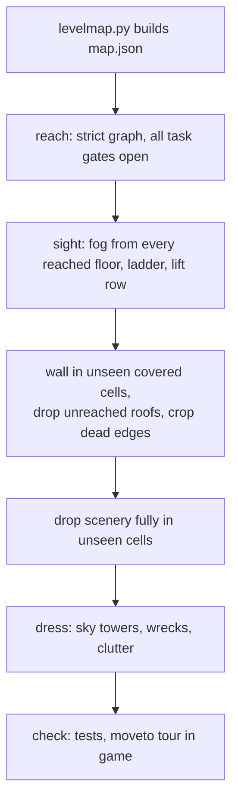

# Blueprint: compose a mission map

Rules for shaping a map and dressing it with scenery, worked out on mission 1 (`mesto`, 2026-10-27). Apply them to every mission map.

## Map shape (`docs/research/tools/levelmap.py`)

- Change the map only in `levelmap.py` (`sky`, `patches`, `borderFills`, `unseen`, `width`), never in `map.json`. Before a change, regenerate and diff: the output must match the committed file.
- Reachable means the strict reach graph with every task gate open. The generous graph lets the hero step off a moving lift deck past a wall, so a pocket only it reaches is unreachable (floor 44 west of lift 67, the middle stop of lift 122).
- A cell the player never sees and that has something solid above it becomes wall (bricks). Sight is the game fog sight unioned over every reached floor, ladder and lift row (`unseen`). Check the union again after the fill: no cell seen before may turn unseen.
- Open sky stays open: sky above the top floor of a column, and the explicit `sky` rects (the sky over the crashed ship).
- Drop never reached roofs and planks that float in the sky (west roof, roof over floor 16). A wall then runs up to the map top where it ended at that roof (col 127 skyscraper).
- Wall in pockets the player cannot enter, and corners beside tall towers at the map edge.
- Crop the right map edge where every column beyond is wall or never reached (`width`). Keep the left columns: cropping them would shift every x coordinate of the mission (scenery, props, enemies, lifts, tasks, tests, `moveto` notes), so they stay even when unused (user, 2026-10-27).
- Walkable art stays walkable: no blocker inside art the hero should walk over (the crashed ship pad walks up to its wall at col 22).
- A wall column above the ground reaches the floor above it (`mesto.test.ts`). The test splits walls into row rectangles, so a fill that makes two rows end at the same column can merge them into one tall wall whose top lands on a lift landing. Shape the fill so it does not.
- After each map change, update `GATED` in `reach.test.ts`: runs a fill buries leave the lists, new fill tops that nobody reaches join `never`.

## Scenery (`config/levels/<id>/world.json`)

- Drop every scenery item whose whole box lies in unseen cells. Nobody maintains art the player cannot see.
- Every item stands on solid floor: each column under its base is a solid cell, never past a floor end, over a hole or over a lift shaft. Elevated girder decks on pylons and things meant to sit behind a lift shaft are exempt.
- Fill empty sky between floors with `skylineTower` backdrop: first in `backdrop`, flat dark, varied `w`, `h`, state and `flip`, tall enough to pass behind the floor above.
- Ground clutter sits at a building edge, never in front of the middle of a facade. At most 15% of its width covers a backdrop building, none covers a solid wall cell. Keep it clear of lifts, lift panels, props and other clutter, and only on reached floors.
- Draw order:

| Layer | Items | Place |
|---|---|---|
| Back | `skylineTower` | first in `backdrop` |
| Behind all assets | big clutter: `carWreck` (cars, trucks) | `backdrop`, right after the sky towers |
| In front of all assets | small clutter: `barrel`, `tyres`, `brickPile` | end of `dressing`, before the `liftPanel` block |
| Front | `liftPanel` | last in `dressing` (test) |

- Density on mesto: at least 3 trucks and 10 cars. Where building edges run out, a car may stand beside another wreck, at most 3 wrecks per cluster.
- Scale against the game hero: 1.9 cells = 45.6 units (1 cell = 24 units). Cars draw at full size (about 2 hero heights long), trucks and brick piles at 1.3, tyres at 0.7.

## New assets

- Draw in the spike first (`spikes/shared/env-*.js`), then port to `src/game/env/` and register the id in `assets.ts`.
- Add an `objects.json` entry with `"origin": "new"`, so the env-design sheet lists it under the new non-interactive group; run `node spikes/shared/build-config.mjs`.
- Judge size on the env-design sheet against its hero, which has game height.

## Check

- `npm test` twice (the whole-map tile test is slow), lint, typecheck, build.
- Report one `moveto(x,y)` per changed spot and a Tour line; look at each in the game with fog off.
