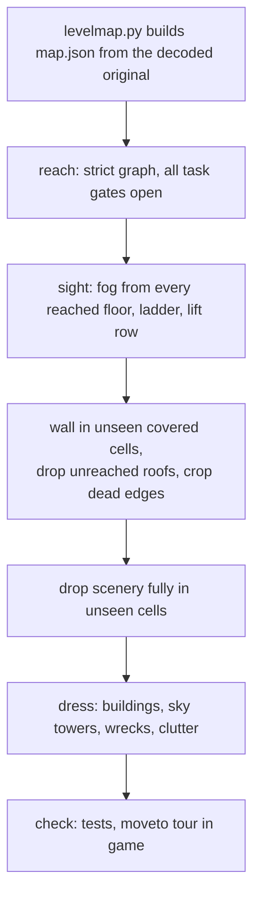

# Blueprint: compose a mission map

Rules for shaping a map and dressing it with scenery. Most were worked out on mission 1 (`mesto`); apply them to every mission map.

Each rule ends with its source:

| Tag | Source |
|---|---|
| [S] | map fine-tuning session, 2026-10-27 (user rulings and findings) |
| [R: name] | `docs/requirements.md` decision row of that name (date in the row) |
| [F] | mesto map fixes spec, `docs/superpowers/specs/2026-10-21-mesto-map-fixes-design.md` |
| [M] | auto-memory note of an earlier session |
| [T] | `docs/research/tools/levelmap.py` config notes or tests |
| [CLAUDE.md] | project instructions |

## Source data

- Collision, lifts, items, objects and enemies come from the decoded original level data; Claude lays out the scenery over the decoded map image. [R: Mission 1 layout] [R: Levels 2-4 layout]
- The original map (dev overlay, key `o` on `game.html`) is the reference for every fix that has an original counterpart. [F]
- Change the map only in `levelmap.py` (`sky`, `patches`, `borderFills`, `unseen`, `holes`, `plankGaps`, `width`), never in `map.json`. [F] [T]
- Before a change, regenerate and diff: the output must match the committed file. [S]

## Traversal

- Lifts are the common way between floors; ladders are rare, a unique route. No pits or drops as an intended way to move; survivable floor edges may stay open. [R: Level traversal]
- A lift's two stop floors connect only through that lift: no walk, ladder, other lift, jump or survivable drop between them. Each lift starts at its spawn-side stop. A reach test checks every lift. [R: Elevator at the hero's level]
- Every lift has two stops; a three-stop lift becomes two lifts side by side. [R: Lift stops]
- A floor beside a shaft on a row where its lift does not stop gets a wall up to the floor above, so it does not read as a landing. [R: Lift shaft sides]
- A bottom stop is solid (`|` blockers in its shaft cells), so the hero never drops through with the deck away. [R: Lift art]
- Walkable art stays walkable: no blocker inside art the hero should walk over. The crashed ship pad walks up to its wall at col 22. [S]

## Reach and sight

- Reachable means the strict reach graph with every task gate open. The generous graph lets the hero step off a moving lift deck past a wall, so a pocket only it reaches is unreachable (floor 44 west of lift 67, the removed middle stop of lift 122). [S]
- Before filling a pocket, confirm in game (`moveto`, jumps) that the hero cannot enter it. [F]
- After each map change, update `GATED` in `reach.test.ts`: runs a fill buries leave the lists, new fill tops nobody reaches join `never`. [F] [S]

## Walls, sky and edges

- A cell the player never sees and that has something solid above it becomes wall (bricks). Sight is the game fog sight unioned over every reached floor, ladder and lift row (`unseen`). Check the union again after the fill: no cell seen before may turn unseen. [S]
- Open sky stays open: sky above the top floor of a column, and the explicit `sky` rects (the sky over the crashed ship). [S]
- An outer wall at the map edge fills solid on to the edge over cells the hero never reaches, so the view shows wall, not sky (`borderFills`, every map). [R: Map borders]
- Cells under the street that the hero never reaches are solid brick; the street slab is 7 rows thick, so metro tunnels are 4 rows high. [R: Mission 1 underground]
- Never reached sealed pockets are solid. [R: Mesto map art] [F] Pockets the player cannot enter are walled in, also where only the generous reach graph enters them. [S]
- Drop never reached roofs and planks that float in the sky (west roof, roof over floor 16); a wall then runs up to the map top where it ended at that roof (col 127 skyscraper). [S] This replaces the west roof drawn on a tower and the open sky east of the skyscraper. [F, superseded]
- Wall in corners beside tall towers at the map edge (cols 128-142, rows 0-16). [S]
- Crop the right map edge where every column beyond is wall or never reached (`width`). Keep the left columns: cropping them would shift every x coordinate of the mission (scenery, props, enemies, lifts, tasks, tests, `moveto` notes). [S]
- Every edge the hero touches shows a wall; every blocker the hero can touch has visible art. [R: Mesto map art] [F]
- A wall column above the ground reaches the floor above it (`mesto.test.ts`). The test splits walls into row rectangles, so a fill that makes two rows end at the same column can merge them into one tall wall whose top lands on a lift landing. Shape the fill so it does not. [T] [S]

## Scenery placement (`world.json`)

- Drop every scenery item whose whole box lies in unseen cells. Nobody maintains art the player cannot see. [S]
- Every item stands on solid floor: each column under its base is a solid cell, never past a floor end, over a hole or over a lift shaft. Elevated girder decks and things meant to sit behind a lift shaft are exempt. [S]
- Art meets the ceiling where the structure does (pillars, gates, pipe columns run through floors); girders end on a leg, column or building, never on a free end. [R: Mesto map art] [F]
- A building never ends in an open window or gallery bay at its sides: each storey ends in a solid pier or wall. [R: Scenery placement]
- Wall-mounted things (vent, wire box, code lock) sit on a wall, column or other solid object; where the backdrop has none, a short `brickWall` stands behind them. [R: Scenery placement]
- A pipe never ends in view: a wall or building listed after it covers its end. A wall pipe runs only along a wall edge (`brickWall` state 0 ends a run, state 1 fills inside it). [R: Scenery placement]
- A floor that reaches a lift shaft from both sides, or from one side up to a wall, runs on behind it, darkened. Floor and scenery art never covers a lift shaft. [R: Scenery placement] [R: Lift art]
- A lift panel stands in the cell beside the shaft at every lift stop, on the original side. [R: Mesto map art]
- Non-blocking tall scenery stays in the backdrop under the depth haze, so it never reads as solid. [R: Sandbox reskin]
- Fill empty sky between floors with `skylineTower` backdrop: first in `backdrop`, flat dark, varied `w`, `h`, state and `flip`, tall enough to pass behind the floor above. [S]

## Ground clutter

- Clutter sits at a building edge, never in front of the middle of a facade. At most 15% of its width covers a backdrop building, none covers a solid wall cell. Keep it clear of lifts, lift panels, props and other clutter, and only on reached floors. [S] [M]
- Draw order [S]:

| Layer | Items | Place |
|---|---|---|
| Back | `skylineTower` | first in `backdrop` |
| Behind all assets | big clutter: `carWreck` (cars, trucks) | `backdrop`, right after the sky towers |
| In front of all assets | small clutter: `barrel`, `tyres`, `brickPile` | end of `dressing`, before the `liftPanel` block |
| Front | `liftPanel` | last in `dressing` (test) |

- Density on mesto: at least 3 trucks and 10 cars. Where building edges run out, a car may stand beside another wreck, at most 3 wrecks per cluster. [S]
- Scale against the game hero: 1.9 cells = 45.6 units (1 cell = 24 units). Cars draw at full size (about 2 hero heights long), trucks and brick piles at 1.3, tyres at 0.7. [S]

## Art direction

- Mission 1 feels rotting: grain, rust drips, pooled dirt and worn edges on every surface, holes read through a scorched ring and lit broken rim; grime static scenery freely (cached tiles), keep per-frame props cheap, keep 60 fps. [M]
- Art is vector, drawn as code, not original assets. [CLAUDE.md]

## New assets

- Draw in the spike first (`spikes/shared/env-*.js`), then port to `src/game/env/` and register the id in `assets.ts`. [F] [CLAUDE.md]
- Add an `objects.json` entry with `"origin": "new"`, so the env-design sheet lists it under the new non-interactive group; run `node spikes/shared/build-config.mjs`. [S]
- Judge size on the env-design sheet against its hero, which has game height. [S]

## Check

- `npm test` twice (the whole-map tile test is slow), lint, typecheck, build; `npm run test:visual` when a ported asset changes. [S] [F]
- Report one `moveto(x,y)` per changed spot and a Tour line; look at each in the game with fog off. [CLAUDE.md] [M]
