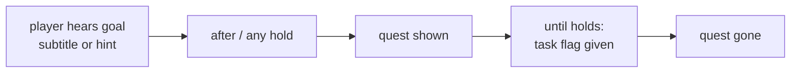

# Blueprint: quest list for a mission

The inventory screen `OBJECTIVES` box lists the level quest and open subquests. It reminds the player of what the game already told them. It never solves anything. Built for mission 1 (`mesto`, 2026-10-31). Follow this recipe for all missions.

## Rules

1. **Remind, never spoil.** Each time the game tells the player what to do to unblock progress (story subtitle, object `hint`, lift `hint`), that goal gets a quest.
2. **Name the goal, not the solution.** "Find a way to open the locked door.", not "Open the card door with an access card." Never name the item or the place that solves it. Exception (user's call): an NPC request may name what the NPC asked for ("Bring the bar man the holoplan.").
3. **Show only after the player hears it.** A quest shows only after the subtitle or hint that tells it. A pickup alone never shows a quest, so an item never tells what it is for.
4. **Gone when done.** A done quest leaves the list. Nothing is marked done.
5. **Short.** Short imperative sentence, one line in both languages ("Repair the lift." / "Oprav výtah.").
6. **Level quest first.** One quest with `after: []` from the start until the level ends. It shows marked `>`, subquests marked `-`.

## Data

`quests` list in `config/levels/<id>/tasks.json`, next to `tasks`. Loader and logic: `src/game/level/quests.ts`.

| Field | Meaning |
|---|---|
| `text` | English text. Czech goes in `CS` in `src/game/i18n.ts`, keyed by this text |
| `after` | tokens that must all hold to show it |
| `any` | optional; at least one of these tokens must also hold |
| `until` | token that hides it once it holds |

Tokens are `flag:*` or `item:*` (item held). Every use of an object adds `flag:tried:<object id>`. A press on a locked lift adds `flag:tried:<enabledBy name>` (lift `enabledBy: "flag:upperFloorsOpen"` gives `flag:tried:upperFloorsOpen`).

## Which token for what

| Player hears it from | `after` / `any` | `until` |
|---|---|---|
| Story subtitle of a task (rebel: "Find the bar man") | that task's `gives` flag (`flag:rebelTalked`) | first use of the target object (`flag:tried:barDoor`) or the flag that ends it |
| Object `hint` (failed use) | `flag:tried:<object id>` | the flag the unblocking task `gives` |
| Lift `hint` (locked lift) | `flag:tried:<enabledBy name>` in `any`, with the panel object try | the lift `enabledBy` flag |
| Hint that names two needs (train door: power and crowbar) | add the door try to the `any` of each need quest | each need's own flag |

Use the `gives` flag, not `task:<id>`, for `until`: the `c2080isunstoppable` cheat sets blocker flags without doing tasks, and the quest must still clear.

## Steps

1. List every text that tells the player what to do: task `subtitle` and `hint` in `tasks.json`, lift `hint` in `map.json`, prop `shootable.subtitle` in `world.json`.
2. Write one quest per goal by the rules above; merge two texts about one goal into one quest (`any`).
3. Add the Czech text for each quest to `CS` in `src/game/i18n.ts`; `i18n.test.ts` fails on a missing one.
4. Extend the rule tests in `src/game/level/quests.test.ts` to the mission: every task `hint` and lift `hint` has a quest (`reminds every mesto hint until its task is done`), every quest has `until`, no quest shows on an item token (`never shows a mesto quest for an item picked up alone`).
5. Update the missions snapshot (`npx vitest run src/game/level/missions.test.ts -u`) when the mission JSON is snapshot-tested.
6. Check in game: `c2080isquestioned` lists every quest at once (box grows up from the bottom to fit), in English and Czech; then try a few objects with `moveto(x,y)` and Enter, and press `I` to see the real list.
7. Give the user a table: quest (EN, CS), shows from, ends when, `moveto` spot.

## Mission 1 example

| # | Quest (EN) | Quest (CS) | Shows from | Ends when |
|---|---|---|---|---|
| 1 | Find a way out of the city. | Najdi cestu ven z města. | start | level complete |
| 2 | Find the bar man. | Najdi barmana. | rebel talked | first use of the bar door |
| 3 | Bring the bar man the holoplan. | Přines barmanovi holoplán. | first use of the bar door | holoplan traded |
| 4 | Bring the bar man the ship part he wants. | Přines barmanovi součástku lodi, kterou chce. | holoplan traded | decoder held |
| 5 | Get the switchboard working. | Zprovozni rozvaděč. | switchboard or train door tried | metro powered |
| 6 | Find a way to open the train door. | Najdi způsob, jak otevřít dveře vlaku. | train door tried | train door open |
| 7 | Find a way past the coded lock. | Najdi způsob, jak obejít kódový zámek. | code lock tried | plasma off |
| 8 | Repair the lift. | Oprav výtah. | lift panel or broken lift tried | lift repaired |
| 9 | Find a way to open the locked door. | Najdi způsob, jak otevřít zamčené dveře. | card door tried | door open |
| 10 | Open the acid tank tap. | Otevři kohout nádrže s kyselinou. | acid tank tried | acid poured |
| 11 | Unlock the crane. | Odemkni jeřáb. | crane tried | level complete |

Quest 5 names the switchboard on a train door try: the player walks past the switchboard before reaching the train door, so it tells nothing new.
