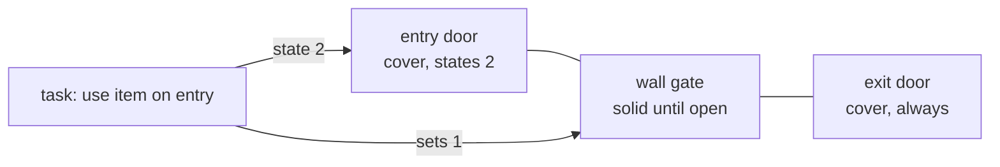

# Blueprint: walk through a wall inside a vehicle

Hero walks into an open door, disappears inside a body (train, ship, pipe), passes a wall and comes out of another door. Built first for the mission 1 metro train (2026-10-20). Copy this recipe for any similar passage.

## Pieces

| Piece | Mesto metro | Role |
|---|---|---|
| Entry object | `trainDoor` prop (object, crowbar task) | Door the hero opens. Gets a `cover` with `states` (only while open) |
| Wall gate | `metroTunnel` prop (gate, `tunnelGate` asset) | Thick wall drawn over the body. `solidStates` + `cells` block until the entry opens |
| Far body | `trainCarriage` prop (gate, no states) | Body continues behind the wall, exit door always open, closed door at far end. Gets a `cover` without `states` (always on) |
| Task | `openTrainDoor` | `sets` the wall gate open. Only the entry needs the item |

Draw order matters: list the body and entry props before the wall prop in `world.json`, so the wall paints over the body.

## The `cover` prop field

`cover: { clip: [x0, x1], reach: [r0, r1], rows, states? }`, all in cells, on the prop floor (`y`). Logic in `src/game/level/cover.ts`.

- `clip` - x span hidden from the hero drawing (`coverClips`, clipped in `drawHero`, `render/scene.ts`). Start and end at the inner edge of each slid-open leaf, so the leaf covers the hero, not the frame.
- `reach` - hero centre range where that prop's clip is active. One prop covers its own doorway side: exit side from the exit door outer frame to the wall, entry side from the wall to the entry door outer frame.
- `rows` - body height above the floor; cover acts only for a hero within it.
- `states` - prop states that turn the cover on; missing = always on.

Side effects, same field:

- Jump: a hero whose box overlaps any `clip` cannot jump (`jump` in `hero/hero.ts`).
- Airborne: a hero in the air cannot move into a `clip` span (`enters` in `physics`), so no jumping into the body.
- Enemies: patrols stop before every `reach` span on their floor and spawn outside it (`keptOut` in `level/enemy.ts`, fed by `keepOutOf`).

## Getting the numbers

Units: 1 cell = 24 asset units. A prop draws centred on its `x`: asset origin = `x * 24 - (box left + box right) / 2`. Make the asset box centre the door centre, so prop `x` is the door centre.

Door art (`TD` in `env/machines.ts`): door `0..48` from origin, frame `-2..50`, open leaves `0..12` and `36..48`.

| Value | Formula | Metro |
|---|---|---|
| exit door origin | prop x * 24 - 24 | 1284 |
| clip start | exit origin + 36 (right leaf inner edge) / 24 | 55 |
| clip end | entry origin + 12 (left leaf inner edge) / 24 | 60.5 |
| exit reach start | exit origin - 2 (outer frame) / 24 | 53.417 |
| wall edge | wall art left / 24 | 56.125 |
| entry reach end | entry origin + 50 (outer frame) / 24 | 62.083 |

Wall: fill the gap between the two door frames, leave about 1 unit each side. Gate `cells` cover the full wall width.

## Checklist

1. Spike first: body and wall assets in `spikes/shared/env-*.js`, then port to `src/game/env/`, run `node spikes/shared/build-config.mjs`.
2. `objects.json`: entry for each new asset (states, `task`, note "not an original object" if ours).
3. `world.json`: props in draw order, `cover` on each door side, gate `cells`.
4. `tasks.json`: the entry task `sets` the wall gate open.
5. Tests in the mission test (see `mesto train passage` in `src/game/level/mesto.test.ts`): cover active per side, walk through with gates open, jump stopped, enemy patrols outside `reach`.
6. Update the mission snapshot (`missions.test.ts -u`) and check `reach.test.ts` still passes.
7. Browser: stand in each doorway, the leaf must cover the hero and the gun.
