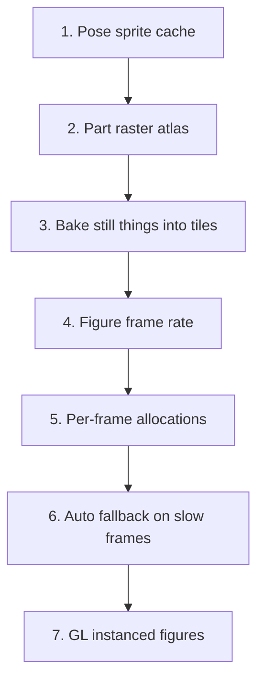

# Engine competitors

Similar engines and remakes, what each one does for speed, and which ideas fit our renderer (`docs/rendering.md`). Researched 2026-11-03 from official blogs, docs and source code. Numbers are the sources' own; none of them were measured on our game. **[inferred]** marks our reading, not a source claim.

Our bottleneck, measured (`docs/rendering.md` Speed): hero and enemy vector drawing takes most GPU time, and without a GPU the `main` mode drops to 15 fps at 4x CPU slowdown. Each rig part costs one `fill`, one `fill` per tone band and one `stroke` (`drawPart` in `src/engine/rig/draw.ts`), every frame, for every visible figure.

## Who is who

| Engine | Kind | Art | Threads | Backend |
|---|---|---|---|---|
| Construct 3 | commercial engine, visual editor | sprites | whole engine in a Worker (Auto) | WebGPU default since r458, WebGL |
| Phaser 4 | open source framework | sprites, Graphics | main thread | WebGL, Canvas fallback |
| PixiJS 8 | open source renderer | sprites, Graphics | main thread | WebGPU, WebGL, Canvas 2D (8.16) |
| Excalibur.js 0.30 | open source TypeScript engine | sprites, rastered vectors | main thread | WebGL, Canvas 2D fallback |
| PrinceJS | Prince of Persia remake on Phaser CE | prebaked atlases | main thread | WebGL, Canvas |
| REminiscence | native Flashback engine rewrite | bitmap characters, polygon films | native | software |
| Another World | native polygon engine (1991) | flat polygons | native | software, Amiga blitter |
| Skele2D | pre-alpha bone engine | Canvas 2D code | main thread | Canvas 2D |
| Spine, DragonBones | skeletal animation runtimes | textured bones | host engine | host engine |

## Construct 3

- **Worker mode**: the whole engine runs in a Worker on `OffscreenCanvas`; input comes from the main thread with "no significant impact" on latency. It was turned off again after Chrome bugs: input stopped under load, rendering stopped after a resize, a GPU memory leak, ChromeOS tab crashes, a WebGL1 crash and inaccurate frame timestamps. On by default since r189 (2020). Today `Use worker` is Auto: a project with JavaScript code runs on the main thread. [blog](https://www.construct.net/en/blogs/ashleys-blog-2/performance-isolation-html5-1512), [architecture](https://www.construct.net/en/blogs/construct-official-blog-1/architecture-construct-runtime-911)
- **Batching**: quads are queued back to front; a batch grows while texture, opacity, blend and shader stay the same. [renderer](https://www.construct.net/en/blogs/ashleys-blog-2/construct-webgl-renderer-works-917)
- **WebGPU**: 14 texture slots per batch and per-quad colour; artificial benchmarks fit over 17x the sprites at 60 fps with texture swaps and about 10x with opacity and colour changes. A user reports WebGPU slower than WebGL on mobile. [WebGPU](https://www.construct.net/en/blogs/construct-official-blog-1/introducing-constructs-new-1768), [bug 7874](https://github.com/Scirra/Construct-bugs/issues/7874)
- **Render cells**: viewport-sized cells per layer with z-sorted lists, merged and cached while nothing changes. 30,000 sprites on 6400 x 6400: 35 to 60 fps (Nexus 5). Off by default: it only pays for large static layers. [render cells](https://www.construct.net/en/blogs/ashleys-blog-2/render-cells-work-921)
- **Collision cells**: range checks 11.6 ms to 1.5 ms. [RTS devlog](https://www.construct.net/en/blogs/ashleys-blog-2/rts-devlog-optimizing-1604)
- **Fill rate**: every layer with its own texture costs about one fullscreen sprite; transparent pixels still cost. Timer readings at low load are skewed by power states. [tips](https://www.construct.net/en/make-games/manuals/construct-3/tips-and-guides/performance-tips)

## Phaser 4

- **Renderer**: index buffers (4 vertices per quad instead of 6), fewer batch breaks, shaders ask only for the texture units they use. A batch breaks on shader, blend, filter or a full batch (16,384 quads). Keep draw calls to "a few hundred". [renderer news](https://phaser.io/news/2026/04/phaser-4-renderer-faster-cleaner-and-built-for-modern-games), [rendering concepts](https://phaser.io/tutorials/phaser-4-rendering-concepts)
- **Vectors**: Graphics batch apart from sprites; complex Graphics are "expensive" in Canvas and WebGL; `generateTexture` bakes rarely changing vector art. [Graphics](https://docs.phaser.io/phaser/concepts/gameobjects/graphics)
- **GPU layers**: `SpriteGPULayer` keeps static sprites in a GPU buffer, one draw call, motion by easing in the shader ("up to 100x", no baseline). `TilemapGPULayer` draws a whole map layer as one quad. [SpriteGPULayer](https://phaser.io/news/2026/05/phaser4-spritegpulayer-performance), [Phaser 3 vs 4](https://phaser.io/news/2026/05/phaser-3-vs-phaser-4)
- **Uploads** are the main bottleneck: `Text` uploads a texture on every change. [rendering concepts](https://phaser.io/tutorials/phaser-4-rendering-concepts)
- **Frame pacing**: rAF with a delta smoothed over 10 frames, `panicMax`, pause on a hidden tab. [TimeStep](https://docs.phaser.io/api-documentation/class/core-timestep)

## PixiJS 8

- **Instruction reuse**: a render group rebuilds its draw instructions only when its tree changes; otherwise only transforms and changed objects update. Bunnymark, 100k sprites, all moving: CPU 50 to 15 ms, GPU 9 to 2 ms; still: CPU 21 to 0.12 ms. [v8 launch](https://pixijs.com/blog/pixi-v8-launches)
- **Vectors built once**: Graphics record into a `GraphicsContext`, triangulated on first draw and rebuilt only when dirty; transform, alpha and tint do not rebuild it. Many Graphics share one context; "prefer swapping contexts" over `clear()` for frame animation. Under about 100 points a Graphics batches like a sprite; hundreds of complex ones are slow, switch those to generated textures. [Graphics](https://pixijs.com/8.x/guides/components/scene-objects/graphics), [tips](https://pixijs.com/8.x/guides/concepts/performance-tips)
- **`cacheAsTexture()`**: renders a container to a texture once. [cache as texture](https://pixijs.com/8.x/guides/components/scene-objects/container/cache-as-texture)
- **Texture GC**: unused textures dropped after 3600 frames. [GC](https://pixijs.com/8.x/guides/concepts/garbage-collection)
- **WebGPU** "does not automatically guarantee improved performance over WebGL". **Canvas 2D renderer** back in 8.16 for old hardware. [8.16](https://pixijs.com/blog/8.16.0)

## Excalibur.js

- **Raster cache**: `Polygon`, `Circle`, `Text` and `Canvas` draw with Canvas 2D into a private bitmap only when dirty, then blit it; `quality` supersamples. Re-rastering is expensive (texture upload). [graphics](https://excaliburjs.com/docs/graphics), [performance](https://excaliburjs.com/docs/performance)
- **Instanced images**: one `drawArraysInstanced` per batch, up to 20,000 images; "2x performance of draws", 100k bunnies at 30 fps on a Surface Pro. [0.30](https://excaliburjs.com/blog/excalibur-0-30-0-released)
- **Draw sorting**: draws sorted by z, then renderer, so same-renderer calls pack while painter order holds. [source](https://github.com/excaliburjs/Excalibur/blob/main/src/engine/graphics/context/excalibur-graphics-context-webgl.ts)
- **No hot-loop allocations**: cached transforms, no new matrices per frame; 0.30 claims 2-3x over 0.29. [2025 post](https://excaliburjs.com/blog/happy-new-year-excalibur-2025/)
- **Auto fallback**: switches to Canvas 2D after 100 frames at 20 fps or less; "usually faster without hardware acceleration". [performance](https://excaliburjs.com/docs/performance)

## PrinceJS

- Characters and tiles are prebaked atlases; guard palette variants are separate sheets, so nothing is recoloured at runtime. [Preloader.js](https://github.com/oklemenz/PrinceJS/blob/master/src/Preloader.js)
- World logic ticks at 12.5 Hz (the original rate), films at 120 ms; sprites change frame only on the tick while Phaser renders at display rate. Wall colours are composed once per tile at level build. [source](https://github.com/oklemenz/PrinceJS)

## REminiscence (Flashback)

- Each frame copies the back layer to the front and draws sprites on top; only dirty blocks reach the screen. Characters are prerendered bitmaps. [game.cpp, video.cpp](https://github.com/cyxx/REminiscence)
- Films are flat polygons in delta-encoded vertex lists over a 32-entry palette; a still part is saved to an aux page once and restored by copy. Game capped at 30 Hz, films 12 fps.

## Another World

- Four framebuffers: two for double buffering, two caching composed backgrounds. Each frame copies the background (981 polygons drawn once) and draws only what moves. A thing that stops moving is drawn into the background, so later frames skip it. The second buffer keeps the last screen for a quick return. 16 colours, palette swaps for lightning, 20 fps target. [polygons](https://fabiensanglard.net/another_world_polygons/), [code review](https://fabiensanglard.net/anotherWorld_code_review/), [Amiga](https://fabiensanglard.net/another_world_polygons_amiga500/)

## Skele2D

- Poses are point maps blended with `lerp`; every entity draws itself with Canvas 2D each frame; no caching or culling. Nothing to reuse for speed. [repo](https://github.com/1j01/skele2d)

## Spine and DragonBones

- **Spine**: clipping "is very expensive and should be avoided"; hide attachments instead of alpha 0; animate a few skeletons and render many from their poses; update skeletons round-robin. The WebGL batcher flushes only on texture change, blend change or a full buffer. [metrics](https://esotericsoftware.com/spine-metrics), [PolygonBatcher](https://github.com/EsotericSoftware/spine-runtimes/blob/4.2/spine-ts/spine-webgl/src/PolygonBatcher.ts)
- **DragonBones**: `cacheFrameRate` precomputes every bone matrix per animation frame, so playback skips the transform maths (costs memory, disables bone offsets). Cocos shared cache bakes transforms and textures; it pays from 3 instances of one skeleton and action. [Armature.ts](https://github.com/DragonBones/DragonBonesJS), [Cocos](https://docs.cocos.com/creator/3.8/manual/en/editor/components/dragonbones.html)

## What everyone agrees on

1. **Never draw complex vectors every frame.** Bake them once: bitmaps (PrinceJS, Flashback, Excalibur raster, Phaser `generateTexture`, Pixi `cacheAsTexture`) or tessellated geometry reused with new transforms (Pixi `GraphicsContext`). We are the only one that fills every rig path every frame.
2. **Draw only what changed over a cached background** (Another World, Flashback, Construct render cells). We do this for the map (tiles) and films (`stillLayer`); figures and props on top are the rest.
3. **Batch by state** (texture, blend, colour) and keep draw calls in the hundreds.
4. **Keep a 2D fallback** and switch to it automatically when the GPU path is slow (Excalibur, Pixi 8.16, Construct Auto).
5. **Avoid per-frame allocations** (Excalibur, Pixi).

## Tweaks for our game

Ranked by expected gain for the 15 fps no-GPU case and GPU time. **[inferred]** throughout; each needs the speed matrix before and after.

| # | Tweak | From | What changes | Gain | Cost and risk |
|---|---|---|---|---|---|
| 1 | Pose sprite cache | Flashback, PrinceJS, DragonBones, Excalibur raster | Draw each figure to an `OffscreenCanvas` keyed by kind, clip, clip time quantized to the clip's frame grid, facing, scale, lines and tint; a figure then costs one `drawImage`. Muzzle flash, hit star and held effects stay live on top. Same pattern as prop sprites (`putSprite`, `SPRITES_KEPT`). | Largest: removes every per-part fill and stroke for repeated poses; 27 droids of one kind share sprites. | Memory (LRU like `putSprite`); gait blends and tweened clip time need key quantization, or motion loses smoothness; first draw of each pose still pays full cost. |
| 2 | Part raster atlas | Excalibur, Pixi `GraphicsContext` | Raster each rig part (fill, bands, stroke) once per LOD, scale and palette; draw the rig as one `drawImage` per part with its joint transform. | Several draws per part become one; poses stay continuous. | Rotated bitmaps soften edges (supersample, as Excalibur `quality`); outlines no longer join across parts the same way; visual test diffs expected. |
| 3 | Bake still things into tiles | Another World | Scrap, wrecks and broken guards draw into the cached tile layer once they stop changing, instead of every frame. | Fewer per-frame props in fights. | Tile invalidation on change and on `resetWorld`. |
| 4 | Figure frame rate | PrinceJS 12.5 Hz, Flashback films 12 fps, Spine round-robin | Redraw a distant or idle enemy's pose sprite at a lower rate; the hero keeps full rate. | Works with 1; cuts cache misses. | Visible stepping if the rate is too low; the user signed off on display-rate tweening (`render/tween.ts`). |
| 5 | Per-frame allocations | Excalibur, Pixi | `shade()` joins all palette values into a signature string on every tinted or dimmed node; `drawRig` calls `getTransform()` (a new `DOMMatrix`) per figure. Cache the signature per palette object, pass the unit scale down. | Small CPU and GC gain. | Low. |
| 6 | Auto fallback on slow frames | Excalibur | If `gl` mode runs at or under 20 fps for 100 frames, restart the painter in `worker` mode. | Guards against slow or buggy GPU drivers (Construct's WebGPU and worker bug history). | Needs a painter restart path like the worker failure one. |
| 7 | GL instanced figures | Pixi, Excalibur, Phaser `SpriteGPULayer` | Tessellate each part once into a vertex buffer and draw all figures in the WebGL2 layer with per-instance matrix and colour. | Largest on GPU. | Big rewrite: tone bands, outlines and hooks in shaders; `gl` mode only, no help without a GPU. Do only if 1 and 2 fall short. |

### Bitmap quality on high-DPI screens

Baking figures into bitmaps (tweaks 1 and 2) loses no sharpness on a high-DPI screen if the bitmap is drawn 1:1 in device pixels. Prop sprites already work this way (`putSprite` in `render/environment.ts`): the key holds the scale from the context transform, which includes the device pixel ratio, and the sprite is drawn with an identity transform at a rounded device pixel. The cached map tiles follow the same rule and match direct drawing pixel for pixel (`docs/rendering.md` Map art tiles).

| Risk | When it happens | Fix |
|---|---|---|
| Blur from scaling | the bitmap was made at another scale than it is drawn at (zoom, resize, DPR change) | key by device scale (`Math.fround`, as tiles); rebuild on change, never stretch an old bitmap |
| Position snapping | a direct vector draw antialiases at a fractional pixel; a bitmap drawn at a rounded pixel moves in whole device pixels | at DPR 2 one step is half a CSS pixel, finer than on a DPR 1 screen; if still visible, key by a quarter pixel offset (4x memory) |
| Soft edges on rotation | tweak 2 only: part bitmaps are rotated with their joints, so edges are resampled | raster parts at 2x and draw them scaled down (Excalibur `quality`); tweak 1 has no rotation, the pose is baked |
| Memory | bitmap size grows with DPR squared | **[inferred]** at the reference screen a cell is about 64 CSS px, so a hero sprite is about 130 x 130 CSS px: about 70 KB at DPR 1, 270 KB at DPR 2, 600 KB at DPR 3; an LRU of 256 sprites is about 70 MB at DPR 2. Cap the cache by bytes, not count |
| First-draw cost | every new pose still draws as vectors once, then the copy | warm common poses (idle, walk cycle) while the loop is paused, like films (`whenIdle`) |

So high-DPI screens cost memory and first-draw time, not sharpness. A high-DPI screen also makes vector drawing slower in the first place (the `main` mode no-GPU row at DPR 2 runs at 25 fps against 59 at DPR 1), so these screens gain the most from the cache.

Status (2026-11-03): 1, 4 and 5 are built (`docs/rendering.md` Per-frame vector art). Measured, 1 and 4 gain less than ranked above: without a GPU the frame is pixel-bound (native raster and compositing, fog and tile copies), figures are about 4% of CPU (`docs/rendering.md` Speed). 6 was built and removed with the `gl` mode, which was no faster than `worker` and stalled in Firefox (`docs/rendering.md` Render modes); 7 needed that mode and is dropped. 2 and 3 wait for a case where figures are the bottleneck.

Not worth it now: WebGPU (Pixi and Construct users report no gain or losses on some GPUs; our GPU rows already hold 60 fps), Construct render cells (our tile bucketing covers the static case), moving simulation into the worker (Construct's input and timing bugs).

## Migrate to a framework?

Asked 2026-11-03 before starting the tweaks. Answer: no, keep our engine and do the tweaks.

- **No framework fixes the slow case.** That case is a machine without a GPU, where `main` mode drops to 15 fps at 4x CPU slowdown. PixiJS (8.16) and Excalibur fall back to Canvas 2D there, the API we already use. Their speed comes from sprite batching on a GPU.
- **On a GPU we already hold 60 fps** in `worker` mode at 6x CPU slowdown.
- **The fix is the same either way:** bake vectors into bitmaps (tweak 1). In a framework it would be built on top of their engine; here it reuses `putSprite`.
- **Cost of moving:**
  - About 13,500 lines of Canvas 2D art would need porting to a different vector API: `src/game/env` 8,400, `src/game/cutscene` 5,200, with grime patterns, gradients and tone bands.
  - These would be rebuilt or kept as custom code: fog of war, tile collision, lifts and cover, input record and replay, sound synth, films, saves, the render worker.

| | Tweak 1 (pose sprite cache) | Migrate to PixiJS or Phaser |
|---|---|---|
| Work | days | months (about 25,000 lines touched) |
| Helps machines without a GPU | yes, the main target | no, same Canvas 2D fallback |
| Look | kept, same drawing code | at risk, art redone |

## Our engine against frameworks, for the next game

### What ours does that frameworks don't

- **Art as code at any resolution.** Assets are TypeScript drawing functions with a state and a size (`size` option), so one asset makes every variant, every scale and every device pixel ratio. Frameworks centre on sprite sheets; their vector APIs (Pixi and Phaser `Graphics`) are documented as slow when complex.
- **Deterministic fixed step with input record and replay** (`src/engine/input.ts`, `loop.ts`). Phaser and Pixi step with a smoothed variable delta; Phaser has a fixed step only inside Arcade physics.
- **Render modes chosen per machine** (`main`, `worker`, with fallback on worker failure). Construct is the only competitor with worker rendering, and it has turned it off twice for browser bugs.
- **Built for this genre:** fog of war, cinematic films in the engine, cover, lifts, rig poses solved from clip data, sounds synthesized from recipes (no audio files).

### What frameworks do better

- **Editors and tooling:** scene, tilemap and animation editors (Construct, Phaser with Tiled, Spine). We edit JSON and code.
- **Physics:** Arcade and Matter in Phaser, Box2D-style options elsewhere. We have tile collision only.
- **Sprite throughput:** batched WebGL or WebGPU sprites in the tens of thousands.
- **Browser and device bug fixes** maintained by others: mobile GPUs, touch input, context loss, audio unlock quirks.
- **Docs, community and hiring:** many developers already know Phaser or PixiJS.
- **Not an advantage: the spike pipeline.** Designing assets in spike pages and porting them did not carry over smoothly; every port needed many in-game tweaks after it landed (user, 2026-11-03). The `test:visual` checks only prove the port matches the spike, not that it works in the game. Count the spikes as a cost, not a reason to keep the engine.

### When to reuse ours

| Next game | Pick |
|---|---|
| Vector or procedural art, cinematic platformer, adventure, few on-screen actors | our engine |
| Needs exact replays, record and playback tests, or deterministic netcode | our engine |
| Pixel art or hand-drawn sprite sheets with many actors | Phaser or PixiJS |
| Physics puzzles, ragdolls, vehicles | Phaser (Matter) or a physics library on PixiJS |
| Team of non-programmers, visual scripting | Construct |
| Mobile first, many devices to support | a framework, for its device bug fixes |

### Extracting a reusable engine

Planned for later (2026-11-03): turn the engine into a package anyone can use, with Colony 2080 as one of its consumers. Today only `src/engine` (about 1,600 lines) is game-agnostic. Do the speed tweaks first, so the sprite cache API is designed once.

1. **Boundary.** List what is generic and what is Colony 28.
2. **Move generic parts into the engine:**
    - render modes (`render/painter.ts`, `renderWorker.ts`, `sync.ts`, `frame.ts`)
    - tile cache and tile worker (`render/tiles.ts`, `tileWorker.ts`, `tilesAside.ts`)
    - fog of war (`fog.ts`, `render/fog.ts`)
    - sprite cache (`putSprite`)
    - camera and tweening (`render/tween.ts`)
    - sound mixer and cue queue
    - idle job queue
3. **Cut game imports.** Those parts import `World`, `Hero`, enemy kinds, `ASSETS` and `config/` directly; replace them with interfaces or plugin hooks: a world adapter, an asset registry, a layer list. This and step 4 are the heaviest.
4. **Generalise game-tied systems:**
    - tile grid with one-way floors
    - lifts, ladders and cover as optional modules
    - hero and enemy state machines as examples, not core
    - films as a timeline plus a scene API
5. **One entry point:** `createEngine({ canvas, world, assets, modes, ... })`. Today `startRun` (`src/game/run.ts`) mixes engine, game, HUD and store setup.
6. **Package:** separate package (`@<scope>/engine`), ESM build with type declarations, own Vite and Vitest config, no React or Zustand, semantic versions and a changelog.
7. **Workers from a package:** render and tile workers must load from the package (Vite `?worker` URLs or blob workers) and work with the user's bundler.
8. **Docs:** getting started, concepts (fixed step, render modes, layers, fog), API reference (TypeDoc); `docs/rendering.md` becomes engine docs.
9. **Examples:** a minimal platformer and a vector-art demo; Colony 2080 moves onto the package.
10. **Tests:** engine-only unit tests, plus a browser matrix (Chrome, Firefox, Safari, with and without a GPU), since the worker path depends on the browser.
11. **Tooling:** at least a level JSON schema; an editor is optional but expected by users of other engines (see What frameworks do better).
12. **Open source basics:** license, contribution guide, issue templates, CI (lint, typecheck, tests, build), npm publishing.
