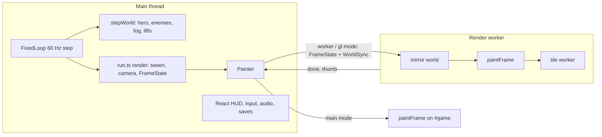
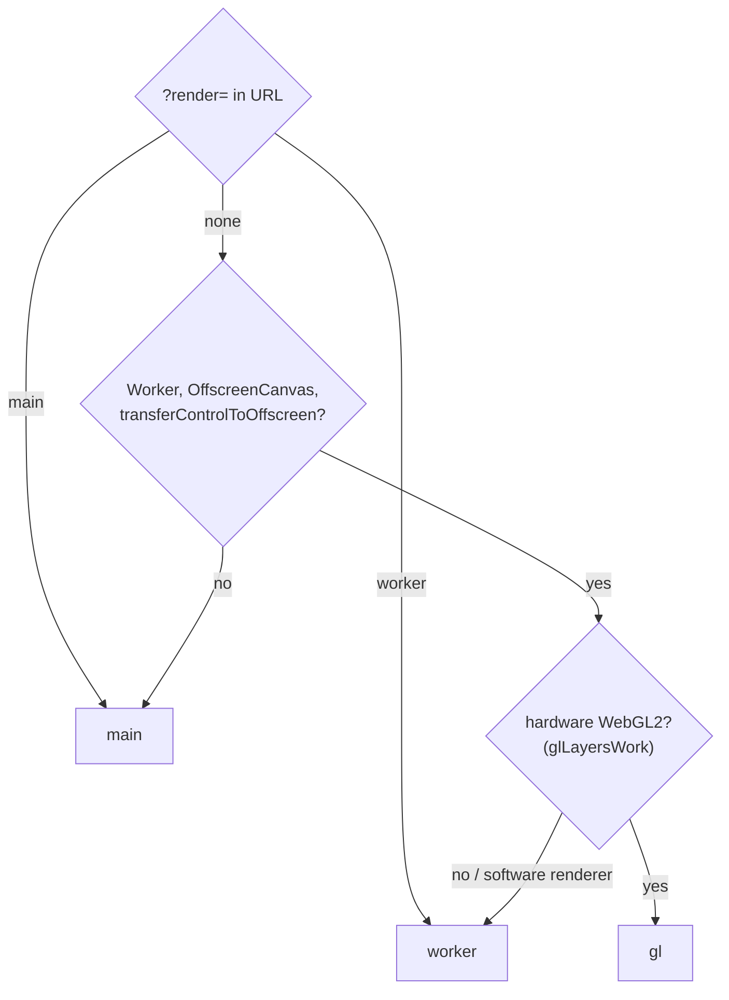
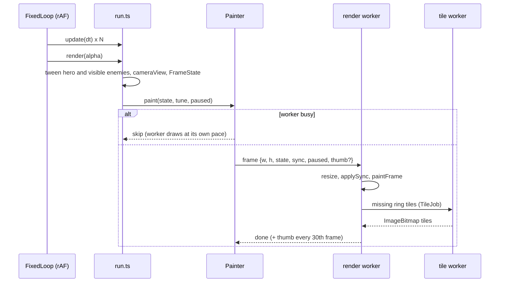
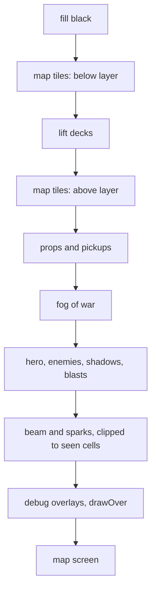
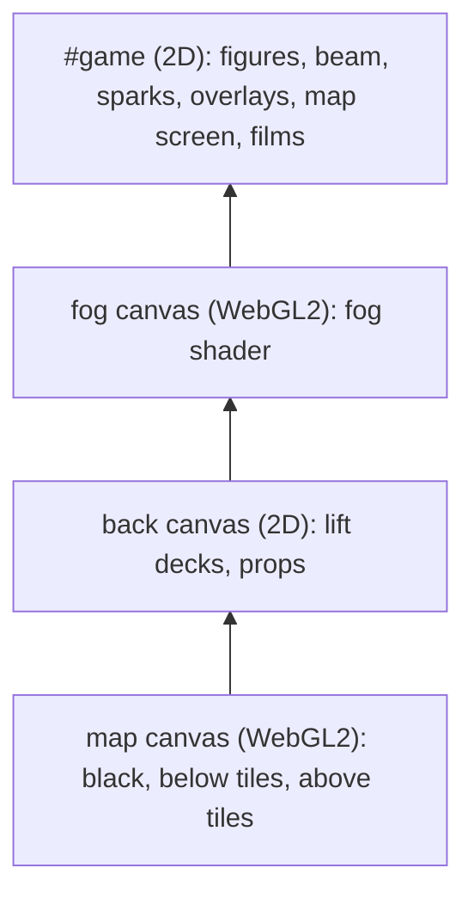
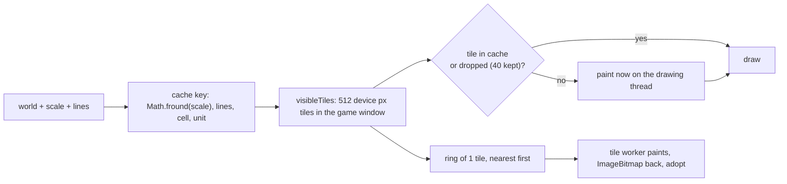
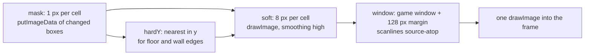
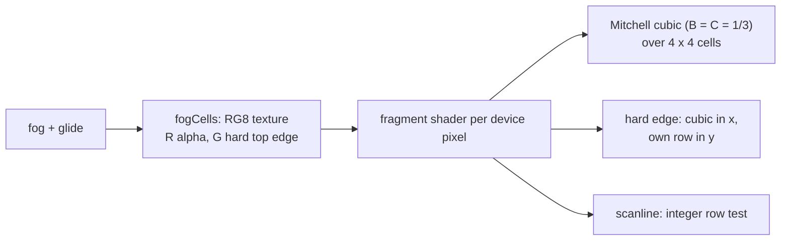
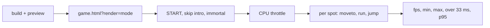

# Rendering engine

How the game page and the sandbox draw a frame: threads, canvases, caches, fog and the speed budget. Code lives in `src/game/render/`, the shared runner in `src/game/run.ts`, game-agnostic helpers in `src/engine/render/`.

Goal: 30 fps hard floor on weak machines (old laptops), 60 fps on anything with a working GPU. HUD (SVG, React) is not part of this pipeline; it sits over the canvas.

## Big picture

- Simulation stays on the main thread: input, `stepWorld`, sound cues, saves and the store all need it.
- Drawing is one function, `paintFrame` (`render/frame.ts`). It runs on the main thread or in the render worker, same code.
- Map art tiles paint in a third thread, the tile worker (`render/tileWorker.ts`), in every mode.

## Render modes

`createPainter` (`render/painter.ts`) picks the mode once, at start.

| Mode | Who draws | Canvases | When |
|---|---|---|---|
| `main` | main thread, Canvas 2D | `#game` | old browsers, `?render=main`, after a worker failure |
| `worker` | render worker, Canvas 2D | `#game` (transferred) | no GPU, or `?render=worker` |
| `gl` | render worker, WebGL2 map and fog, Canvas 2D for the rest | 3 layer canvases under `#game`, all transferred | hardware GPU |

- `glLayersWork` (`render/gl.ts`) opens a WebGL2 context with `failIfMajorPerformanceCaveat` and rejects software renderers by name (`SOFTWARE_GL`: SwiftShader, llvmpipe, ...). Chrome without GPU still hands out SwiftShader WebGL, so the name check is what keeps a GPU-less machine on `worker`.
- A worker error or a throw inside the worker posts `failed`; the painter drops the worker, swaps `#game` for a fresh canvas (a transferred canvas can't get a main thread context) and continues in `main` mode. Console: `render worker failed, drawing on the main thread`.
- `?render=main|worker|gl` is for speed tests and debugging.

## One frame

- `FrameState` (`render/frame.ts`): `game` (tweened hero, visible tweened enemies, view, game window, sight span, debug overlays, map screen), `film` (id, time, skip text, view to prefetch tiles for) or `black` (settings screen).
- `WorldSync` (`render/sync.ts`) carries world state the drawing reads: lift `y` / `vy`, props, beam, sparks every frame; flags, grid blocks (`TileGrid.blocks` / `adoptBlocks`), fog arrays and tuning (movement config, clips) only when they changed. The mirror world in the worker is built once from `world.source` with `loadSandbox`, like the tile worker.
- A replaced fog object (restart, fog cheat) is sent with `fresh: true`; the mirror then makes a new `Fog`, so fog caches keyed by the object start clean. Same version on a kept fog object keeps the caches.
- Backpressure: one frame in flight. While the worker draws, later main thread frames send nothing; input and simulation keep the main thread pace.
- Hero and enemy looks (`heroLook`) are computed where the drawing runs, from the tweened bodies, so no pose data crosses threads.

## Layers and draw order

2D modes (`main`, `worker`) draw all into one canvas, in this order, clipped to the game window:

`gl` mode splits the same order over 4 stacked canvases (DOM order, bottom first). The browser compositor blends them on the GPU.

- Lift decks move above the `above` tiles in `gl` mode. Safe: `above` dressing is clipped out of every lift shaft box and no ladder runs through a shaft.
- Films and the settings screen fill `#game` black over the whole canvas, so the layers under it never show.
- `drawOver` (sandbox and dev only: original map overlay, key `o`) draws on an extra main thread canvas over `#game` in worker modes; production passes none.

## Map art tiles

The static map is cached as bitmaps; a frame only copies them.

- Two layers, `below` (sky, backdrop, haze, terrain, underground shade, dressing, shaft art) and `above` (ladders, dressing outside lift shafts). Each tile paints only the items indexed to it (`bucketByTile`).
- Tiles of the game window paint at once on the drawing thread; the margin ring comes from the tile worker. Without Worker support the ring paints on the drawing thread, 1 tile per frame plus more while 4 ms (`PREFETCH_MS`) last.
- The first view after start or a resize is never freed (`keepHome`), so a respawn at spawn paints nothing.
- Key uses the float32 scale, the value Chromium keeps in the context transform, so a frame never misses its own tiles.
- Opaque fog skip (`openRects` in `render/fog.ts`): with covered `opacity` 1, a frame copies tile pixels only within `SOFT_BLUR_CELLS` + 1 cells of a seen or remembered cell. 2D modes clip `drawImage` source rects; `gl` mode uses one scissor rect per open rect.
- `gl` mode uploads each tile bitmap once as a texture (`NEAREST`, one texel per device pixel, integer offsets, so it looks exactly like the 2D copy) and frees textures unused for 120 frames.

## Per-frame vector art

Drawn every frame, culled to the view:

- Lift decks (`liftDeck` at the deck height), props and pickups. A prop without animation and not a guard draws from a sprite cached per asset, state, scale, lines and top (`putSprite`, 48 kept).
- Hero and enemies: rig trees (`engine/rig/draw.ts`), flat tone bands, cached `Path2D` per part and LOD. Enemy kinds come from `robot/kinds.ts` (`kindOf`: rigs, palette, hooks, muzzle).
- Effects: shadows, muzzle flash, hit star, landing dust, blasts and scrap, beam, sparks (beam and sparks clipped to `seenPath`, the seen cells).
- Bodies are tweened between the last two 60 Hz steps (`render/tween.ts`), so motion follows the display rate.

Measured on a GPU, these figures cost most of the GPU time: skipping hero and enemies raised WSL GPU fps 31 to 46, skipping tiles or fog changed nothing.

## Fog of war

Data (`src/game/fog.ts`): `revealed` (ever seen), `seen` (in sight now), `seenCells`, `version` (bumps when sight changes), `anchorY` (eased sight floor). Look per cell: seen 0, remembered `rememberedOpacity`, covered `opacity`, all in `color`, with `scanlineColor` lines every `scanlineGapPx` device px.

Sight edge glide (`glideOf`): the two edge columns of each sight row fade by how much of the cell lies within `sightSpan` of the drawn hero x, in quarter cell steps (`GLIDE_STEPS`), so a moving hero changes the fog at most 4 times per cell.

### 2D pipeline (`main`, `worker`)

- A fog version change repaints only the cells the sight left or entered plus `SOFT_BLUR_CELLS` around them, split into a left and right box.
- Hard edges (`hardEdges`): a horizontal cell edge where either cell is a wall or floor stays hard, so nothing on a floor above the sight shows through.
- Pans copy a shifted part of the window canvas until the view leaves its 128 px margin.

### WebGL pipeline (`gl`)

- `fogCells` rebuilds the whole cell texture (width x height x 2 bytes, mesto 23 KB) only when version or glide change; the shader samples it with `texelFetch`.
- Mitchell matches the 2D chain (mask to soft with "high" smoothing, soft to window bilinear): edge profiles match within 3 of 765 brightness.
- Scanline test uses integer maths; a float `mod` misses rows from rounding.
- Hard edges are exact in WebGL; the 2D chain blurs them over about 3 px from its last bilinear copy.

## Films

`paintFilm`: black fill, `film.render`, then the robot vision or the security camera look (`cutscene/looks.ts`), then the skip hint. While a film plays, `askTiles` asks the tile worker for the view the film returns to, so the first frame after it paints nothing. Each drawing thread loads films on demand (`loadFilm`); a missing film shows black until loaded. Film and look caches warm as idle jobs, one per frame, only while the loop is paused: main thread queue in `main` mode, worker queue (`warm` message, `paused` flag) in worker modes.

## Save pictures

Saves store a 96 px JPEG of the game window. `main` mode copies `#game`. Worker modes can't read a transferred canvas, so the worker sends an `ImageBitmap` thumbnail of all layers every 30th game frame (not with the map screen open), and `picture()` encodes the latest one.

## Code without a DOM

Everything `paintFrame` reaches runs in a worker, so drawing code never calls `document`. Offscreen canvases come from `surface()` / `context2d()` (`engine/render/surface.ts`: `OffscreenCanvas`, else a DOM canvas for tests and old browsers). Debug overlays take the device pixel ratio as an argument.

Every mode, the main thread too, uses `OffscreenCanvas`, so all modes draw the same pixels. `OffscreenCanvas` rasterises some gradients and stretched strips a few pixels differently from a DOM canvas, so the spike film caches (`spikes/shared/cutscenes.js` `surface`, `spikes/shared/robot-view.js`) use it too, and `npm run test:visual` compares like with like.

## Speed

Budget per frame at 30 fps: 33 ms. Measured with Playwright (`busyPerFrame` traces and rAF frame times), production build served by `vite preview`, game window 1366 x 768, hero running through 14 spots of mesto, CPU slowed with `Emulation.setCPUThrottlingRate`.

- Test static builds; the dev server reloads on other sessions' file edits.
- WSL GPU (`--use-angle=gl`, D3D12 bridge) caps the game near 30 fps whatever the code does; a plain page reaches 57. Measure GPU numbers on Windows Chrome (`chrome.exe --headless=new --mute-audio --remote-debugging-port=...`, Playwright `connectOverCDP`), mirrored WSL networking reaches it on `localhost`. Without `--mute-audio` the headless run plays the game sounds on the Windows speakers.
- `ctx.filter` costs Chrome about a second per frame on a software GPU; tint with a shaded palette instead.
- Canvas to canvas copies cost per call, not per pixel; fewer, larger copies win.

### How a run measures

1. Build (`npx vite build`) and serve with `npx vite preview --port <port> --strictPort`. Check that the port answers with this build: a preview left over from another session keeps the port and serves old code.
2. Open `game.html?render=<mode>`, pick `START` on the settings screen, close the intro film with Esc, enter `c2080isforever`.
3. Set `Emulation.setCPUThrottlingRate` to the slowdown.
4. For each spot (`start 77,59 24,70 23,51 11,41 33,44 66,37 130,37 81,44 54,30 32,23 83,23 121,16 51,10`): `moveto` there, wait 1.5 s, drop those frames, then run right 2 s, run left 2 s, jump, and wait 1 s. Collect rAF timestamps for that part.
5. From the frame times of all spots:
    - `fps`: 1000 / mean frame time.
    - `min` / `max`: worst and best spot fps.
    - `>33 ms`: share of frames over 33.4 ms.
    - `p95`: 95th percentile frame time in ms.

### Results (2026-11-03)

GPU: Windows Chrome 156, hardware GPU, over CDP.

| CPU slowdown | DPR | mode | fps | min / max | >33 ms | p95 ms |
|---|---|---|---|---|---|---|
| 4x | 1 | `main` | 58 | 56 / 60 | 0% | 16.8 |
| 4x | 1 | `worker` | 60 | 60 / 60 | 0% | 16.8 |
| 4x | 1 | `gl` | 60 | 60 / 60 | 0% | 16.8 |
| 6x | 1 | `main` | 50 | 37 / 58 | 4% | 33.4 |
| 6x | 1 | `worker` | 60 | 60 / 60 | 0% | 16.8 |
| 6x | 1 | `gl` | 60 | 60 / 60 | 0% | 16.8 |
| 4x | 2 | `main` | 59 | 56 / 60 | 0% | 16.8 |
| 4x | 2 | `worker` | 60 | 60 / 60 | 0% | 16.8 |
| 4x | 2 | `gl` | 60 | 60 / 60 | 0% | 16.8 |

No GPU: WSL Playwright Chromium with `--disable-gpu --disable-gpu-compositing` (software raster). `gl` is not offered there (`glLayersWork` rejects SwiftShader), so `worker` is the auto mode.

| CPU slowdown | DPR | mode | fps | min / max | >33 ms | p95 ms |
|---|---|---|---|---|---|---|
| 1x | 1 | `main` | 59 | 53 / 60 | 0% | 16.8 |
| 1x | 1 | `worker` | 60 | 60 / 60 | 0% | 16.7 |
| 2x | 1 | `main` | 41 | 27 / 50 | 12% | 33.4 |
| 2x | 1 | `worker` | 60 | 60 / 60 | 0% | 16.7 |
| 4x | 1 | `main` | 15 | 12 / 18 | 92% | 100.1 |
| 4x | 1 | `worker` | 60 | 60 / 60 | 0% | 16.7 |
| 1x | 2 | `main` | 25 | 16 / 30 | 48% | 66.7 |
| 1x | 2 | `worker` | 60 | 60 / 60 | 0% | 16.8 |

- On a GPU every mode holds the 30 fps floor; `worker` and `gl` hold 60 even at 6x slowdown, `main` drops to 50.
- Without a GPU `main` misses the floor at 4x slowdown and at DPR 2; `worker` holds 60 in every row.
- The rAF times come from the main thread. In worker modes they show that input and simulation keep pace; the worker draws at its own pace and skips frames while busy (one frame in flight), so a slow worker shows as late pictures, not as low fps here.
- `setCPUThrottlingRate` is not checked to slow worker threads as much as the main thread, so the worker rows at 4x and 6x may be optimistic. Real weak hardware is the open check.
