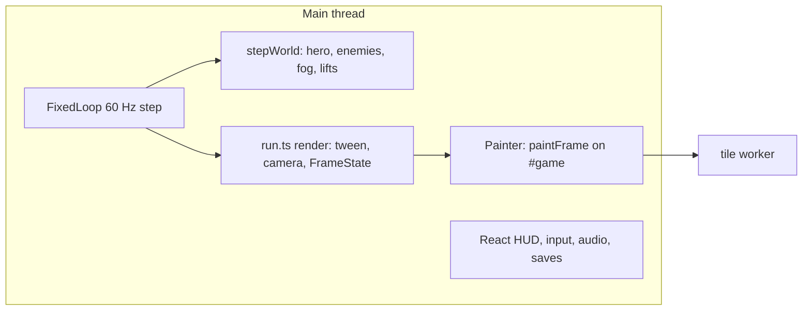
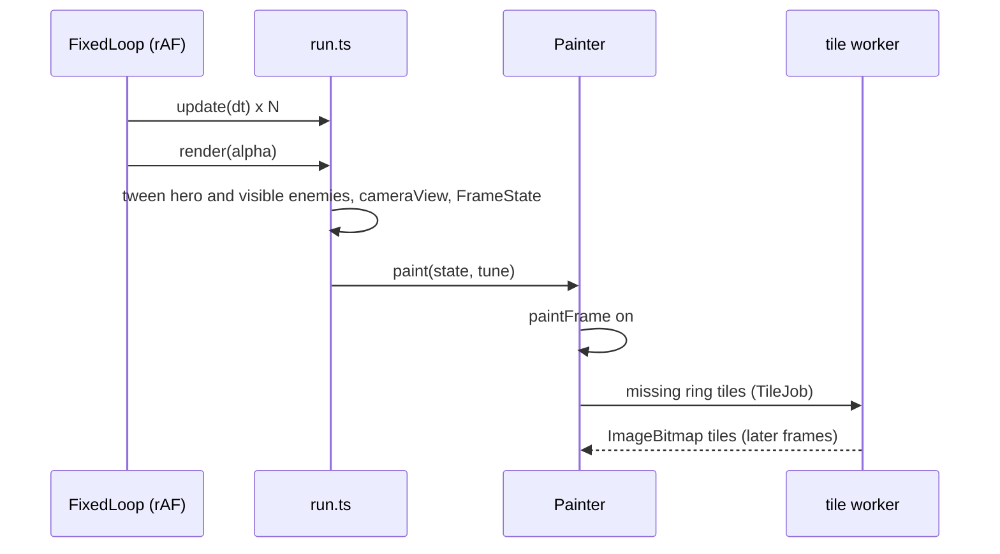
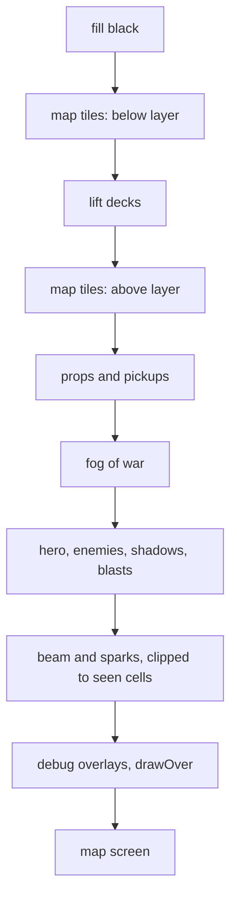
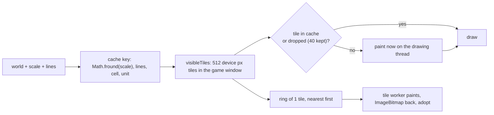
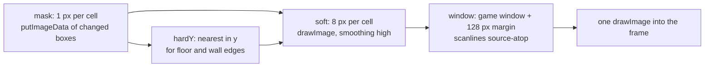
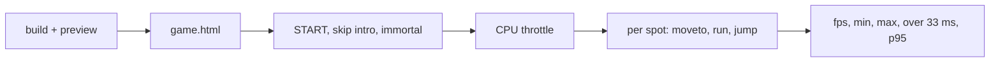

# Rendering engine

How the game page and the sandbox draw a frame: threads, canvases, caches, fog and the speed budget. Code lives in `src/game/render/`, the shared runner in `src/game/run.ts`, game-agnostic helpers in `src/engine/render/`.

Goal: 30 fps hard floor on weak machines (old laptops), 60 fps on anything with a working GPU. HUD (SVG, React) is not part of this pipeline; it sits over the canvas.

## Big picture

- Simulation and drawing run on the main thread. Drawing is one function, `paintFrame` (`render/frame.ts`), called by the painter (`render/painter.ts`).
- Map art tiles paint in a second thread, the tile worker (`render/tileWorker.ts`).

## Tried and removed

- Render worker (2026-11-03 to 2026-11-06): `paintFrame` in a worker on the transferred `#game`, world mirrored by `WorldSync`. Firefox draws a worker canvas on the CPU (Skia `SkBitmapDevice`, Firefox Profiler with `DOM Worker`), so the worker took over 16.7 ms and got a frame only every second vsync (median 33.5 ms): running panned unevenly. On the main thread with DOM canvases, Windows Firefox and Chrome both run smooth (user check). Found by bisect against `e3d1f78`.
- WebGL2 mode (map tiles as textures, fog as a shader), removed 2026-11-03: no faster than the worker (Windows GPU: 3.2 ms against 2.4 ms per frame), and in Firefox it stalled about 100 ms every few cells of a run.

## One frame

- `FrameState` (`render/frame.ts`): `game` (tweened hero, visible tweened enemies, view, game window, sight span, debug overlays, map screen), `film` (id, time, skip text, view to prefetch tiles for) or `black` (settings screen).
- Hero and enemy looks (`heroLook`) are computed in `paintFrame` from the tweened bodies.

## Layers and draw order

All draws into one canvas, in this order, clipped to the game window:

- `drawOver` (sandbox and dev only: original map overlay, key `o`) draws last inside the game window; production passes none.

## Map art tiles

The static map is cached as bitmaps; a frame only copies them.

- Two layers, `below` (sky, backdrop, haze, terrain, underground shade, dressing, shaft art) and `above` (ladders, dressing outside lift shafts). Each tile paints only the items indexed to it (`bucketByTile`).
- Tiles of the game window paint at once on the drawing thread; the margin ring comes from the tile worker. Without Worker support the ring paints on the drawing thread, 1 tile per frame plus more while 4 ms (`PREFETCH_MS`) last.
- The first view after start or a resize is never freed (`keepHome`), so a respawn at spawn paints nothing.
- Key uses the float32 scale, the value Chromium keeps in the context transform, so a frame never misses its own tiles.
- Opaque fog skip (`openRects` in `render/fog.ts`): with covered `opacity` 1, a frame copies tile pixels only within `SOFT_BLUR_CELLS` + 1 cells of a seen or remembered cell. Frames clip `drawImage` source rects to them.

## Per-frame vector art

Drawn every frame, culled to the view:

- Lift decks (`liftDeck` at the deck height), props and pickups. A prop without animation and not a guard draws from a sprite cached per asset, state, scale, lines and top (`putSprite`, 48 kept).
- Hero and enemies: rig trees (`engine/rig/draw.ts`), flat tone bands, cached `Path2D` per part and LOD. Enemy kinds come from `robot/kinds.ts` (`kindOf`: rigs, palette, hooks, muzzle).
- Figure sprites (`render/figures.ts`): `drawFigure` keys a figure by kind, rig view, palette, gun look, line width, pose (joint angles in half degrees, offsets in half units, scales in hundredths, tints) and the linear part of the device transform. The first time a key shows, the figure draws as vectors; the second time it is drawn into an offscreen canvas (`surface()`) trimmed to its ink; after that it costs one `drawImage` at a whole device pixel. Sprites are kept in least recently used order up to `FIGURE_BYTES` (48 MB). Not cached: a figure in its hit flash, and a kind with hooks while it fires (its hooks draw the fire). Muzzle flash, hit star, shadow, dust and blasts stay live on top.
- Enemy poses step at `ENEMY_POSE_HZ` (60 Hz, the game step, `render/frame.ts`: clip and gait time floored before `heroLook`) while their positions still follow the display rate, so their poses repeat and hit the sprite cache. The hero poses at display rate, so on a 60 Hz screen both move alike. The walk cycle is a whole number of pose steps (0.7 s, 42 steps; `render/framePose.test.ts`), so walk poses repeat every cycle. 30 Hz (until 2026-11-07) made droid legs visibly step against the hero's (user).
- Effects: shadows, muzzle flash, hit star, landing dust, blasts and scrap, beam, sparks (beam and sparks clipped to `seenPath`, the seen cells).
- Bodies are tweened between the last two 60 Hz steps (`render/tween.ts`), so motion follows the display rate.

Measured on the WSL GPU bridge, skipping hero and enemies raised fps 31 to 46. Without a GPU, figures are a small part: a CPU profile of `main` mode at 4x slowdown shows figure drawing at about 4% of CPU with the sprite cache (80-90% hits), against about 57% native canvas raster and compositing and 17% `drawImage` of fog and tiles.

## Fog of war

Data (`src/game/fog.ts`): `revealed` (ever seen), `seen` (in sight now), `seenCells`, `version` (bumps when sight changes), `anchorY` (eased sight floor). Look per cell: seen 0, remembered `rememberedOpacity`, covered `opacity`, all in `color`, with `scanlineColor` lines every `scanlineGapPx` device px.

Sight edge glide (`glideOf`): the two edge columns of each sight row fade by how much of the cell lies within `sightSpan` of the drawn hero x, in quarter cell steps (`GLIDE_STEPS`), so a moving hero changes the fog at most 4 times per cell.

### Pipeline

- A fog version change repaints only the cells the sight left or entered plus `SOFT_BLUR_CELLS` around them, split into a left and right box.
- Hard edges (`hardEdges`): a horizontal cell edge where either cell is a wall or floor stays hard, so nothing on a floor above the sight shows through.
- Pans copy a shifted part of the window canvas until the view leaves its 128 px margin.

## Films

`paintFilm`: black fill, `film.render`, then the robot vision or the security camera look (`cutscene/looks.ts`), then the skip hint. While a film plays, `askTiles` asks the tile worker for the view the film returns to, so the first frame after it paints nothing. Each drawing thread loads films on demand (`loadFilm`); a missing film shows black until loaded. Film and look caches warm as idle jobs, one per frame, only while the loop is paused.

## Save pictures

Saves store a 96 px JPEG of the game window, copied from `#game`.

## Code without a DOM

Map art also paints in the tile worker, so drawing code never calls `document`. Offscreen canvases come from `surface()` / `context2d()` (`engine/render/surface.ts`): a DOM canvas on the main thread, `OffscreenCanvas` in a worker. Debug overlays take the device pixel ratio as an argument.

Firefox draws an `OffscreenCanvas` onto a page canvas slowly on the main thread (bisect, 2026-11-06), so the main thread keeps DOM canvases. `OffscreenCanvas` also rasterises some gradients and stretched strips a few pixels differently from a DOM canvas; the spike film caches (`spikes/shared/cutscenes.js` `surface`, `spikes/shared/robot-view.js`) use DOM canvases too, so `npm run test:visual` compares like with like.

## Speed

Budget per frame at 30 fps: 33 ms. Measured with Playwright (`busyPerFrame` traces and rAF frame times), production build served by `vite preview`, game window 1366 x 768, hero running through 14 spots of mesto, CPU slowed with `Emulation.setCPUThrottlingRate`.

- Test static builds; the dev server reloads on other sessions' file edits.
- WSL GPU (`--use-angle=gl`, D3D12 bridge) caps the game near 30 fps whatever the code does; a plain page reaches 57. Measure GPU numbers on Windows Chrome (`chrome.exe --headless=new --mute-audio --remote-debugging-port=...`, Playwright `connectOverCDP`), mirrored WSL networking reaches it on `localhost`. Without `--mute-audio` the headless run plays the game sounds on the Windows speakers.
- `ctx.filter` costs Chrome about a second per frame on a software GPU; tint with a shaded palette instead.
- Canvas to canvas copies cost per call, not per pixel; fewer, larger copies win.
- Ideas from other engines, ranked for our renderer: `docs/engine-competitors.md`.

### How a run measures

1. Build (`npx vite build`) and serve with `npx vite preview --port <port> --strictPort`. Check that the port answers with this build: a preview left over from another session keeps the port and serves old code.
2. Open `game.html`, pick `START` on the settings screen, close the intro film with Esc, enter `c2080isforever`.
3. Set `Emulation.setCPUThrottlingRate` to the slowdown.
4. For each spot (`start 77,59 24,70 23,51 11,41 33,44 66,37 130,37 81,44 54,30 32,23 83,23 121,16 51,10`): `moveto` there, wait 1.5 s, drop those frames, then run right 2 s, run left 2 s, jump, and wait 1 s. Collect rAF timestamps for that part.
5. From the frame times of all spots:
    - `fps`: 1000 / mean frame time.
    - `min` / `max`: worst and best spot fps.
    - `>33 ms`: share of frames over 33.4 ms.
    - `p95`: 95th percentile frame time in ms.

### Results (2026-11-03)

Measured with the render worker, removed since (Tried and removed). `main` rows match today's renderer except for its `OffscreenCanvas` caches; `worker` rows are history.

GPU: Windows Chrome 156, hardware GPU, over CDP.

| CPU slowdown | DPR | mode | fps | min / max | >33 ms | p95 ms |
|---|---|---|---|---|---|---|
| 4x | 1 | `main` | 58 | 56 / 60 | 0% | 16.8 |
| 4x | 1 | `worker` | 60 | 60 / 60 | 0% | 16.8 |
| 6x | 1 | `main` | 50 | 37 / 58 | 4% | 33.4 |
| 6x | 1 | `worker` | 60 | 60 / 60 | 0% | 16.8 |
| 4x | 2 | `main` | 59 | 56 / 60 | 0% | 16.8 |
| 4x | 2 | `worker` | 60 | 60 / 60 | 0% | 16.8 |

No GPU: WSL Playwright Chromium with `--disable-gpu --disable-gpu-compositing` (software raster).

| CPU slowdown | DPR | mode | fps | min / max | >33 ms | p95 ms |
|---|---|---|---|---|---|---|
| 1x | 1 | `main` | 59 | 53 / 60 | 0% | 16.8 |
| 1x | 1 | `worker` | 60 | 60 / 60 | 0% | 16.7 |
| 2x | 1 | `main` | 41 | 27 / 50 | 12% | 33.4 |
| 2x | 1 | `worker` | 60 | 60 / 60 | 0% | 16.7 |
| 4x | 1 | `main` | 15 | 12 / 18 | 92% | 100.1 |
| 4x | 1 | `worker` | 60 | 60 / 60 | 0% | 16.7 |
| 1x | 2 | `main` | 25 | 16 / 30 | 48% | 66.7 |
| 1x | 2 | `worker` | 60 | 60 / 60 | 0% | 16.8 |

- On a GPU every mode holds the 30 fps floor; `main` drops to 50 at 6x slowdown.
- Without a GPU `main` misses the floor at 4x slowdown and at DPR 2; in `worker` mode the main thread keeps 60 in every row (the worker itself: Worker draw time below).
- The rAF times come from the main thread. In `worker` mode they show that input and simulation keep pace; the worker draws at its own pace and skips frames while busy (one frame in flight), so a slow worker shows as late pictures, not as low fps here.
- `setCPUThrottlingRate` slows only the page main thread, not workers (checked 2026-11-03: a loop took 4.2x longer on the main thread at rate 4, no longer in a worker). So the `worker` rows above only show that input and simulation keep pace; they say nothing about the worker on a slow CPU. Worker draw time is measured below instead.

### Worker draw time (2026-11-03, history)

The perf script wraps `Worker` in an init script: it timestamps each `frame` message and each `done` reply. `worker fps` is the rate of `done` replies, `draw ms` the mean send to `done` time (worker draw plus message hops). No CPU slowdown, since it does not reach workers; on a slower CPU, divide `worker fps` by the slowdown as an estimate. Spots: `81,44 30,59 44,59 62,70 128,44 107,44 start 24,70 121,16` (droids in view at most).

| Machine | DPR | mode | worker fps | draw ms | draw p95 ms |
|---|---|---|---|---|---|
| Windows GPU | 1 | `worker` | 60 | 2.4 | 4.7 |
| no GPU | 1 | `worker` | 55 | 10.0 | 17.8 |
| no GPU | 2 | `worker` | 24 | 31.0 | 54.7 |

- On a GPU the worker uses under a fifth of a 60 fps frame, so even a 5x slower CPU stays near 60.
- Without a GPU the worker misses the 30 fps floor at DPR 2 on this machine, and would at DPR 1 on a CPU about 2x slower. The cost grows with pixel count (DPR 2 is 3x DPR 1), so the next gain without a GPU is fewer pixels (render resolution scaling), not cheaper figures.
- Without a GPU the worker drew about as fast as `main` at 1x (55 against 59 fps at DPR 1, 24 against 25 at DPR 2), so removing it costs no-GPU machines little.

### Figure sprites (2026-11-03)

`main` mode, no GPU, rAF fps before (`HEAD` `7abe699`) and after the figure sprites and the 30 Hz enemy poses:

| Spots | CPU slowdown | before | after |
|---|---|---|---|
| 14 standard spots | 2x | 31 | 34 |
| 14 standard spots | 4x | 13 | 14 |
| droid spots | 1x | 56 | 57 |
| droid spots | 2x | 31 | 36 |
| droid spots | 4x | 12 | 13 |

No-GPU `worker` draw time moved from 10.9 to 10.0 ms at DPR 1 and 32.1 to 31.0 ms at DPR 2; on the GPU it stays within noise (2.3 to 2.4 ms).

### Planned: render resolution scaling

Not built. Without a GPU the frame cost grows with pixel count (Results and Worker draw time above), so drawing fewer device pixels is the next gain there.

- Render DPR: the game canvas draws at `devicePixelRatio * renderScale` instead of `devicePixelRatio`; CSS stretches it to the screen. The HUD (SVG) and React text stay at full DPR.
- One value for every user: `fit`, `cameraView`, the `lines` of the frame state and the hero badge position in `run.ts` read `devicePixelRatio` today; all of them read the render DPR instead. `drawOverlays` already derives its DPR from canvas size over client size.
- Steps: `renderScale` 1, 0.75, 0.5, never under 1 device pixel per CSS pixel unless DPR is 1. A step change refits and rebuilds the tile cache (its key holds the scale), so steps need hysteresis: step down after a run of slow frames, step up only after a long run of fast ones.
- Signal: rAF frame time.
- `?scale=` pins a step for tests.
- Done when the no-GPU row at DPR 2 reaches 30 fps or more (`main` 25 on 2026-11-03), with a visual check that figures and fog edges stay sharp enough at 0.75.
