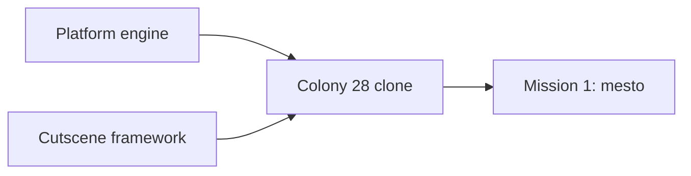

# colony2080 requirements (brainstorm draft)

Running list of decisions from brainstorming. Feeds the design doc in `docs/superpowers/specs/`. Research base: `docs/research/README.md`.

## Deliverables

Build in this order:

1. Reusable engine for 2D platform games.
2. Cutscene framework: tool and runtime to author and play animated vector scenes (item use, story scenes). Added as an extra requirement during brainstorming.
3. Colony 28 clone running on the engine.
4. First mission of the clone (level 1, `mesto`).

## Decided

| Topic | Decision | Who |
|---|---|---|
| Tech | TypeScript, Vite, React for UI shell, Zustand for engine-to-UI state | user |
| Next.js | Not used. Static browser game needs no server | Claude's call |
| Rendering | Custom engine in plain TypeScript on Canvas 2D. Engine does not depend on React | Claude's call |
| Web only | No DOS emulator, no three.js | user |
| Art | Redrawn, not 1:1 original assets. Not pixel art. Another World is too simplified as a blueprint: use detailed flat vector with multi-tone hard-edged shading (shadow, base, light, highlight) | user |
| Rot look | Mission 1 surfaces wear grime (`ENV.G` / `G`): grain everywhere, rust drips from edges and joints, dirt pooled at bottoms, worn edge chips, holes read as damage through a scorched ring and a thin broken lit rim. Signs wear off too. Items and people stay clean. Grime keeps 60 fps: free in cached tiles and prop sprites, light on animated assets (2026-10-22) | user (look), Claude's call (helpers, cost) |
| Scenery placement | Wall-mounted things (wall vent `floorVent`, wire box, code lock) sit on a wall, column or other solid object, never in free space; where the backdrop has none, a short `brickWall` piece (scenery `w`, `h`) stands behind them. A pipe never ends in view: its end goes behind a wall or building drawn over it (listed after the pipe in `world.json`). A pipe on a wall runs only along the wall edge: `brickWall` state 0 ends a run with its pipe, state 1 (plain bricks) fills inside a run or an infill. A floor that reaches a lift shaft from both sides, or from one side up to a wall, runs on behind it with its own pattern (walkway, girder, metro floor), darkened (original look). A building never ends in an open window or gallery bay at its sides: each storey ends in a solid pier or wall (2026-10-22) | user |
| Character design | Hero robot must match the original design (box cover, inventory render, cutscenes): top-heavy mech, big shoulder domes, caged box head, radiation badge, gunmetal core, boxy forearms with arm gun, boot-like shins | user |
| Art format | Vector (SVG / polygons), drawn as code | Claude's call |
| Design method | Redraw the hero by judgement from all references. Image-based tracing and auto-fitting were tried and dropped as too rough. Match shapes, not every shade; shading comes from our own style | user |
| Hero colour | Orange armour (box cover, `SKALA3`, `METROPAC`). Gold in `VSTUP` is sky lighting | Claude's call |
| Resolution | No 320x200 canvas. View scales to device | user |
| View size | Bigger view than original. Configurable limit, off at start | user |
| Fog of war | The original had none: its 320x200 screen showed everything in reach, which is intel we do not want, so fog covers the level. The hero uncovers the original playfield around it: `sightCells` (9) each side, 50% more than the original 6 cells from the hero to the left screen edge, 7 rows above the feet and 1.5 below: 50% more than the original playfield (290x169 px = about 12x7 tiles, one floor per screen), the rows above then lowered by 2 (2026-10-19). Walls and floors block the reveal: a cell is uncovered only when a line from the hero eye reaches its centre or a corner without crossing a solid cell; the blocking cell itself is uncovered (2026-10-19). Uncovered cells stay uncovered. Fog has two levels: cells in the current sight show everything; uncovered cells out of sight are remembered, terrain and props stay drawn under a lighter fog (60%), and they play like fog: enemies and sparks there are hidden (RTS-style old vision vs current vision) (2026-10-20). The sight eases to the hero's height when it stands or climbs and holds during a jump unless it leaves the sight. Fog and remembered cells hide enemies and end every shot that enters them, with no impact spark. An enemy at the fog edge draws whole, over the fog, once any cell of its body is in sight; with no cell in sight it is not drawn (2026-10-21). Every shot, hero or enemy, also ends the same way `sightCells` from its shooter (2026-10-19). Covered and remembered cells block enemy sight like walls, so an enemy out of the hero's current sight does not see or shoot the hero (2026-10-18, 2026-10-20). Look: near-black blue-grey, opaque over unexplored cells so no detail shows through (2026-10-20), with soft cell edges and faint scanlines. An edge between a cell above and a cell below is hard where either cell is a wall or floor, so nothing standing on a floor above the sight shows through the fade (user: items on the floor above showed from below, 2026-10-22). The left and right sight edges glide with the hero: each edge cell is drawn partly clear by how much of it lies within `sightCells` of the drawn hero, while gameplay sight stays per cell, so the edge no longer steps a whole cell as the hero runs (user: running felt choppy revealing new map, 2026-10-21). Values in `config/camera.json`; on in the sandbox, panel Environment toggle | user (cover, persistence, shots, hidden enemies, whole enemy at the edge, walls block, shot range), Claude's call (look, follow, rows, eye height, corner test) |
| Cutscenes | Cloned as in-engine animated vector scenes, not video files. Start with one short item-use clip to tune the visual | user (format: Claude's call) |
| Level logic | Tasks form a dependency web (requires / consumes / gives), not a fixed list | user |
| Config | Parts of the app defined as JSON in `config/` during brainstorming | user |
| Hero head | Square helmet with tall rod antennae on both sides (old Optimus Prime style). Centre crest is a straight, low mohawk ridge starting on the forehead, shorter than the antennae. Face sits inside the helmet: square dark mask, eyes level on one line, square orange cheek notches that belong to the helmet. Side view: simple dark face window, one eye, no extra details | user |
| Hero arms | Stacked glossy deltoid and short bicep bulbs, then a slim boxy forearm centred on the arm axis. Sharp edges on arms, forearms and legs. Side-view shoulder bulbs slimmer than front | user |
| Hero proportions | Human-like: waist narrower than chest, hips narrower than shoulders, thigh about as long as shin. All views share one scale: head, shoulders, hips, knees, feet on the same lines | user |
| Hero knees | Shield knee pads with 5 holes, chrome like ribs and hip bar | user |
| Hero hands | Every finger modelled: knuckle cap, segment, joint, tip, on a dark palm. Thumb behind the hand in front view, in front in back view, at the front edge but covered by the fingers in side view | user |
| Hero hips | Steel hip bar mostly covered by thigh armour, only its top third visible. U-shaped thigh armour with steel piston on front and back. Rear hip plate visible from back, at the hip rear in side view, and as edges from front | user |
| Hero torso (side) | Thin and boxy: tapered dark core with narrow front and back shells (mirror images, one gentle wave on the lower edge). Head centred over the torso | user |
| Hero badge | Radiation badge on the robot's left chest only: visible in front view and left-facing side view, same height in both | user |
| Design sheet views | Front, side facing right, side facing left (mirrored), back. Side views show near limbs only. Animation may show far limbs darker | user (animation: Claude's call) |
| Robot model | One shared source for design sheet and cutscenes: part tree with named rig joints (hips, knees, shoulders, elbows, body) and hooks for held items | Claude's call |
| Cutscene format | Shots with camera keyframes plus keyframe tracks (pose angles, prop values) with easing. First clip (agreed): crowbar opens train door, 3.95 s, 2 shots: side view draws the crowbar from a hip "pocket" and raises it, back view pries the door open. No walk section | user (clip), Claude's call (format) |
| Held props | Held with both hands. Prop renders inside the grip (behind the fist, sticking out both sides). Side view: far hand solved onto the shaft next to the near hand. Back view: both arms follow one shared pry pull (same angle change for both, so biceps move in sync, large swing); the crowbar runs from the hidden left hand through the right fist to the door seam. Right forearm and hand drawn behind shoulder and torso, using the front-view right hand. One crowbar size in both views; robot keeps its x across the cut (2026-10-18) | user (two hands, sync, layering), Claude's call (method) |
| Design status | Hero robot design and the crowbar animation are agreed (2026-10-17). Reference: `spikes/robot-design/`, `spikes/shared/cutscenes.js` (played from `spikes/movement/interaction.html`) | user |
| Phase 1b plan | `docs/superpowers/plans/2026-10-17-engine-core-movement-sandbox.md` (13 tasks, TDD, pixel check of the robot and gun port against the spikes). Reviewed with the user; executed subagent-driven. Camera: see Camera | user (review, execution), Claude's call (plan) |
| Spec and gun status | Design spec (`docs/superpowers/specs/2026-10-17-colony2080-design.md`) and gun look (`spikes/gun-design/`) approved (2026-10-17) | user |
| Prototype viewing | No local server: pages open via `file://` or the VS Code Live Preview extension. Shared scripts are classic scripts, not ES modules | user |
| Previews | No GIF previews in development. Check spikes live in the browser (2026-10-18) | user |
| Saves | As in the original: manual save and load at any time, 5 slots. Esc pause menu (save, load, mission select) over the frozen game, inside the game window like the map screen, so the HUD frame stays in view (2026-10-22); slots A-E in `localStorage`, named `City - ` plus typed text, each with the save time and a small picture; overwrite asks once. After the death animation GAME OVER (white capitals, blue outline) shows over the dimmed frozen game, so what killed the hero stays visible, with Load last save (greyed without a loadable save of the mission), Restart mission and Exit; mission select from the menu asks once; the sandbox keeps its automatic respawn. Every load is checked first: a save of another version or mission shape is refused as not fitting, a damaged one (missing or wrong fields) as damaged, and a load that still fails rolls back, so hand-made test saves never break the game (2026-10-20). Until release, a save made before a change to the saved state (a new enemy field, such as `unseen`) is refused as damaged, with no migration; dev saves are dropped (2026-10-22, user). With saves of a mission, its mission select bar opens a dropdown with New game and the saves (newest first) instead of starting the mission (2026-10-20). Spec: `docs/superpowers/specs/2026-10-20-saves-design.md` | user |
| Hero weapon | Model has fists. The gun is a held prop (like the crowbar) attached to the hand hook, not a forearm replacement | user |
| Gun | Six-barrel rotary gun, short body, barrels of one length. Carried level with the elbow at the hip and the forearm in front of the gun; across the chest in front view (support arm behind); slung on the back on ladders | user (look), Claude's call (method) |
| Gun barrel per view | Barrel keeps its true length unless the robot covers the muzzle; then it stretches until the muzzle clears the robot silhouette by one barrel thickness. Computed from robot shape and hold pose (`barrelFor` in `spikes/shared/gun.js`), never tuned by eye. Front view result 247 (side 196) approved (2026-10-18). Applies to every future gun | user (rule must be computed, result), Claude's call (method) |
| In-game robot | Simplified game LOD: tiny parts dropped, simple fingers kept, three-tone shading. Bulkier than the design sheet: shoulder domes 1.3x in every view, legs 1.45x in side views only, matching original side sprites (`docs/research/robot/sprites/`) (2026-10-18) | user |
| Robot design fixes | Head crest sits on the forehead in every view: front crest ends at y 34, side top plate wraps the forehead corner, back crest big enough to survive game LOD. Fingers: pointed segment on top (at the palm), all three segments the same width, palm as wide as the fingers. Side hand centered under the forearm; forearm tucks under the elbow dome and pivots at its top. Outlines 1.4 (was 2.2) for high-res robot and gun on every page, 1 at game size (2026-10-18), game size 0.6 (2026-10-20) | user |
| Shoulder pads | Front and back view pads sit on top of everything and stay still while the arm moves, like the original; both arms move in by `shoulderIn` so the pads overlap the torso. Crowbar cutscene outline follows the robot screen size (2026-10-20) | user |
| Enemy design | Hero robot built with `enemy: true` and recoloured to greyscale (`XBOT.shade`, brightness 1.1, saturation 0). Red eyes kept. No antennas, head crest or radiation badge. Plain legs: no horizontal stripes, no shin slots, knees in the same grey as the leg. Plain back: no panel lines on torso or head. Sandbox enemy uses the same variant (`createRigs(lod, true)`, `ENEMY_PALETTE` in `src/game/render/scene.ts`) (2026-10-18) | user |
| Environment design | Every level 1 object gets one vector view plus a view per behavioural state (door open, valve fitted, lift moving), drawn in the hero's 4-tone style next to 1-3 original crops (`spikes/env-design/`). First pass kept as is; refine in a later round (2026-10-18) | user (approach, keep), Claude's call (layout, guessed looks) |
| Shared animations | One action, one animation: a move reused in another context (duck punch, jumps, falls, deaths, hits, gun rest) uses the same shared pose, timing and effect. Context-only differences (body lean) are compensated, not re-keyed (2026-10-18) | user |
| Crouch and reach timing | Duck and kneel (pick up) share one leg pose (`crouch`); kneel leans the body 70 so the hand reaches the floor. Duck, kneel and use go down or reach in 0.25 s and back in 0.3 s (`ACTION_TIME` in `spikes/movement/moves.js`). Kneel and use do not hold at the bottom or at the panel. The item is taken and the panel switches when the hand gets there (0.25 s, `pickup` and `use` clip events) (2026-10-19) | user (shared legs, timing, no hold), Claude's call (lean 70) |
| Weapon variants | Every move has a fists and a gun version; overview pages switch between them | user |
| Movement set | Full set in the engine (walk, run, jumps, fall, duck, kneel, use, hide, shoot, punch, ladder, lift, hit, death); mission 1 uses what level 1 needs. List: design spec | user |
| Ladder dismount | Left / Right on a ladder drops the robot off: it turns that way and falls at walk speed | user |
| Ladder catch | Up pressed while falling or jumping, with the feet in a ladder column, grabs the ladder and the robot climbs on. Works from any fall height and the fall does no damage (2026-10-19) | user |
| Sandbox reskin | The sandbox draws only from env assets ported to `src/game/env/` (spike stays the design source, `npm run test:visual` compares port and spike). Assets that needed other sizes gained a `size` option in the spike first. The sky is open (no ceiling art). Non-blocking tall scenery stays in the backdrop under a depth haze so it never reads as solid. The "player hiding beside" state is unused in game: the real hero shows the hide pose. The punching bag and shooting target props are dropped (2026-10-19) | user (reskin, drop props), Claude's call (haze, sky, port) |
| Ladder asset | The spike library has a `ladder` asset (rails and rungs at `RUNG` spacing, non-interactive, `objects.json` entry) because no original sprite exists. Drawn over wall fill where it crosses a ledge (2026-10-19) | Claude's call |
| Sandbox map | 48 x 32 cells, top half unchanged (floors 4 and 14), lower half floors 7 cells apart (21, 28), several lifts and ledges and girders, built from the ported assets. The extra strip on the right has no lifts, ladders, props or enemies (2026-10-19) | user (size, more lifts), Claude's call (layout) |
| Camera | The camera follows the hero on both axes: the hero stays in the view centre, and at a map edge the view stops while the hero keeps moving. The view shows 32 x 13 cells (`view` in `config/camera.json`), zoomed in from the 40 x 16 the old map filled (2026-10-21). Replaces "no scrolling camera" of phase 1b (2026-10-19) | user (rule, zoom), Claude's call (view size) |
| Sandbox enemies | Besides the top left enemy (respawns after 5 s), three more patrol lower floors and never respawn (`respawnMs: null`). None on a lift deck or in the right strip, none sees the hero at spawn (2026-10-19) | user (extra enemies, no respawn), Claude's call (placement) |
| Level traversal | Elevators are the common way between floors; ladders are rare, a unique route. No pits or drops as an intended way to move: survivable floor edges may stay open, deadly drops are not blocked because death resets the map (2026-10-19) | user |
| Elevator at the hero's level | The hero never reaches a shaft whose deck is at the other stop. Map rule: a lift's two stop floors connect only through that lift (no walk, ladder, other lift, jump or survivable drop between them, either direction); each lift starts at its spawn-side stop (`start` in the level config); obstacles block any bypass; the hero cannot jump while its lift moves. A reachability test checks every lift (2026-10-19) | user (rule, obstacles), Claude's call (test, no jump on a moving lift) |
| Lift art | Floor and scenery art never covers a lift shaft. Under each lift's bottom stop a floor is drawn behind the lift, so no hole or pit shows under its deck. The bottom stop is solid too: mesto fills its shaft cells with `|` blockers, as in the original, so the hero never drops through with the deck away (2026-10-20). Only one floor shows at a bottom stop: the solid cell under it draws no second floor (2026-10-21) | user (rule, solid), Claude's call (floor look) |
| Death resets the map | When the hero dies, the whole map resets on respawn (sandbox, and mission 1 on Restart mission after game over; Load last save restores the save instead): lifts to their start stops, props, every enemy (non-respawning ones too) and fog. Hero ammo carries over (2026-10-19) | user |
| Melee | Punches only, no kick. Fists are a selectable weapon (slot 2). Each punch hits once: the nearest enemy ahead on the same floor with its center within 1.4 cells (original 34 px). A punch does 1 enemy hit, so 7 punches kill a regular enemy; the original needs 3 (0.5 of 2.0 hp, death below 1.0, `KLEV1.EXE` seg 5), lowered (2026-10-19). Like the original (`KLEV1.EXE` seg 7), no punch while walking: shoot is ignored mid-walk and a hero that stops with shoot held punches. While shoot is held the punches loop and direction neither turns nor walks the hero; after release the punch ends at `cancelAt` (2026-10-21) | user |
| Weapon switch | A weapon key swaps the weapon at once in any live state (walk, run, jump, attack, duck ...) with no switch clip, so it never blocks other input; an empty weapon swaps the same way (see E-Blaster). While hidden the switch clip plays in front view, matching the hide look (hero stays hidden and tinted): the gun appears in the hanging hand and both hands move straight into the front carry, with no lift; holster plays it reversed. The old side-view switch clip is gone and any other input or releasing hide cuts it short with the swap applied | user |
| Hide look | Front view with dark tint. While hidden, an arrow turns the hero to that side without leaving cover; head and face shift toward the facing so the side to step out on reads at game size (2026-10-19) | user (feature), Claude's call (look) |
| Energy and shields | Energy runs 0-100 and starts full. Enemies fire bursts of 9 shots (see Sandbox enemy) and one enemy shot takes 1, like the original 1 per fire tick (2026-10-19). Shields (0-5) are a reserve: when energy reaches 0 with a shield left, one shield is spent and energy refills to 100; with none left the hero dies. A new game starts with 0 shields. The original has no separate reserve value: its shields are the reserve ("spare resources"). Rounded from the original (`docs/research/reports/10-level1-enemies.md`, `11-reserve-energy.md`): start 98 capped to max 90, one enemy burst 9, a shield refills from below 10 to 90, death at 0. The original rounding makes shields cancel most droid damage; we drop that (2026-10-18) | user (rounding), research |
| Ammo | Machine gun starts with 350 (original level 1 start, `docs/research/reports/10-level1-enemies.md`), `ammo` in `config/hero/movement.json`. Each hero shot spends one. At 0 the gun stops firing with no muzzle flash, the hero switches away (see E-Blaster), and the gun cannot be drawn until ammo is above 0. Ammo carries over a respawn. Sandbox panel Run section sets live ammo (2026-10-18) | user (empty gun), research (start) |
| E-Blaster | Mission 1 bonus weapon in slot 3 (key 3), with its own held model and the gun clips and carry. Holding fire keeps a flickering lightning beam on from the muzzle, never while hidden. It runs on 32 Hz ticks: each tick spends 1 ammo and deals `blaster.damage` (0.47 hits) to every enemy in range whose shot box the beam line crosses, like gun shots, so it pierces; a kill takes about 0.48 s, the original 5:14 ratio to the gun. 400 ammo on pickup, no refills, kept on respawn (`blaster` in `config/hero/movement.json`). An empty E-Blaster switches to the gun, an empty gun to the E-Blaster, both empty to fists. Only the held weapon is drawn. Sandbox: a `weapon` prop on the spawn floor, picked with the pick-up key like items; it does not change the selected weapon and stays hidden while the hero owns the E-Blaster, also after a map reset. Panel Run section: `Blaster` button and `blaster ammo` input; a value above 0 gives the E-Blaster (2026-10-19). Spec: `docs/superpowers/specs/2026-10-19-eblaster-design.md` | user (mirror the original, own model, hidden switch, only the held weapon shown), research (beam, ammo, empty rules), Claude's call (damage, ticks, placement) |
| E-Blaster feel | Beam strands may line up into a regular diamond chain (accepted look). With fire held, an empty weapon switches to the next one and keeps firing (2026-10-19) | user |
| Weapon range | Every weapon range is `sightCells` (`config/hero/movement.json`): when sight changes, shot and beam range change with it (2026-10-19) | user |
| Duck vs shots | Ducking does not dodge shots: the hero takes hits ducked or standing. The original shows no crouch-to-dodge (`docs/research/reports/08-video-level1.md`) | user |
| Hide input | Hold Shift to stay hidden, release to step out. Works anywhere except on a moving lift. Hide wins over walk, run and shooting: the hero hides on the frame Shift is held even with an arrow down, and walks on after release if the arrow is still held. Shoot still held on release resumes the attack at once with the held weapon: gun or E-Blaster fire, fists punch (2026-10-19) | user |
| Robot polygons | Robot part polygons stay drawing code in `spikes/shared/xbot.js` and its port, the same way as the gun and env assets: spike is the design source, `test:visual` keeps the port pixel-identical, `config/robots/xbot.json` holds only parameters (2026-10-19) | user |
| Home page | `index.html` shows the game name, a mission select (mission 1 link; with saves of the mission a dropdown of New game and the saves) and dev links to the sandbox and every spike page (2026-10-19). Missions 2-4 and the cheats page are dev only: the published mission select hides them, and the published game page opens mission 1 for them; the sandbox stays published (2026-10-20) | user |
| No original game online | The published website never references the original game: no images, screenshots, file names, citations, Czech in-game names or texts. Those stay in the development files only; the build makes production variants of the spike pages and config without them and fails on any leak. Code names (`xbot`, `C28_CONFIG`, `mesto`) may stay (2026-10-19) | user (rule, scope as recommended) |
| Default keys | Original layout stays default (Alt run, Ctrl shoot, `config/controls.json`) after trying the sandbox, despite browser shortcut overlap; keys stay configurable (2026-10-19). Hide is X, not the original Shift: Shift pressed 5 times opens the Windows Sticky Keys prompt (2026-10-20) | user |
| Run input | Alt toggles run mode: one press runs, the next walks; the mode stays until pressed again. Run mode is on at start and survives respawn. Holding Alt + arrow + Up was unreliable (key chords, browser shortcuts) | user |
| Run speed | The run clip plays the spike `RUN` stride in 0.5 s instead of its 0.66 s gait cycle: 5.07 cells/s (about 2.8 robot heights per second) instead of 3.84. Faster cadence over the same stride, so feet stay planted; running jump keeps its 6.5 cells/s (2026-10-21) | user |
| Jump while shooting | Up while shooting the gun jumps (duck jump when ducked) and the fire keeps its cadence. Shoot in the air fires the gun, and landing with Shoot held goes straight back to shooting. Gun only for now | user (jump and shoot), Claude's call (gun only, landing) |
| Move while shooting | Shoot plus an arrow with the gun walks (or runs in run mode) that way and keeps firing, Shoot alone stands and fires, switching keeps the fire cadence. Duck shooting turns in place. Landing while firing picks walk or stand by the arrow held | user (walk and turn while shooting), Claude's call (run, duck turn, landing) |
| Lift input | One Up or Down press starts a ride to the next stop; the lift stops there on its own. Up and Down call the lift only when the hero stands fully on the deck and the lift can go that way, also mid-walk or mid-run (the lift wins over a run jump, 2026-10-20); otherwise they do their own action (Up jumps or climbs, Down ducks or kneels), so no spot leaves the arrows dead: deck edge, top stop on Up, bottom stop on Down. A locked lift shows its hint, then the arrow does its own action too. While it moves the hero cannot jump, hide or step off (stops at the deck edge) but can walk, run and shoot on the deck (2026-10-19) | user |
| Sandbox enemy | The top left enemy (more in Sandbox enemies) patrols the top left platform from wall to edge and never steps off: the player robot in its enemy variant (see Enemy design) with the gun. It stops and shoots (bursts of 9 shots in 280 ms with 400 ms standing between them, about 13 energy per s like the original 9-tick bursts; each shot hits the hero it sees at once) when it sees the hero on its floor ahead within `sightCells` (9, the hero sight) with no wall or fog between; an enemy that comes out of fog first stands `reactMs` (250 ms) before it fires; one already in sight fires at once, also at a hero that stops hiding, and after a hit turn (2026-10-22, user); a hidden or dead hero is not seen. A hit makes it turn to the hero `reactMs` (250 ms, the original turns to a hero behind it after about 0.22 s) after the first hit and walk on that way, then it shoots if it sees the hero (2026-10-19). 16 hero shots (`shot.damage` 7/16, the low end of the 16-26 rounds per kill in the videos; the original takes 7 hits, weakened) or 7 punches destroy it (`docs/research/reports/10-level1-enemies.md`) in a vortex blast like the original (video A 4:22: fireballs grow into a swirling cloud, collapse into one rotating disc and end as a red spinning ring), and it leaves a scrap pile (`LEV1.GRA` f22, video A 4:22). It comes back after 5 s. It does not block the hero | user (look, death, respawn, platform, patrol, stop and shoot, sight range, hit reaction), research (hit count), user (fire rate, punch damage) |
| Enemy sight of a jumping hero, hit slow | Droids, flyers and firing guards see a hero in the air like a walking one: on their floor, or airborne up to 1.5 cells above it (`JUMP_REACH`, above the 1.2 cell running jump). So a jumping hero is shot, followed when it jumps past behind a droid that saw it, and dived on by flyers. Within `hitSlowMs` (600 ms) of the last hit a hero in run mode walks and jumps a walking jump; a hit during a running jump drops it to walk speed at once, so a hero shot mid-gap may fall in. An immortal hero takes no hits, so it is never slowed (2026-10-22) | user |
| Sandbox shots | Every shot, hero or enemy, is instant hit-scan like the original (`docs/research/reports/10-level1-enemies.md`); no bullet flies or is drawn (2026-10-20). A hero shot hits the first enemy or shootable prop ahead within its range, with an impact spark there; a wall ends it with a spark on the wall face. Walls stop shots, props the hero walks through let them pass. An enemy shot hits the hero it sees on the tick it fires, so a hidden hero takes nothing and a ducked one is hit. Visible: muzzle flash and impact spark (2026-10-20) | user |
| Dev server | Sandbox and game run on the Vite dev server (`npm run dev`); spikes keep opening from `file://` | user |
| Story year | Story set in 2080, alien invasion 5 years earlier (2075). Departs from the original's 2013 / 2018 / 2028 | user |
| Spike vs sandbox | Spikes own the look (shapes, poses, gait, timing of pose changes). The sandbox owns physics (gravity, speeds, jump heights, air time) through `config/hero/movement.json`. Spike motion numbers stay in the spikes as reference; small drift between them is accepted | user |
| Idle and turn | Idle is fully still. Turn flips between side views at once (no front view, no squash) | user |
| Input response | Arcade style: every move acts on the press, no wind-up (jumps leave the floor at once, no crouch before takeoff or after landing). Less natural, more playable | user |
| Death | Drop the gun, fall on the back, body flat on the floor. The hero explodes while he collapses: the enemy vortex blast plays from the first death frame over the falling body, with the explosion sound, in every death clip (2026-10-22) | user |
| Shoot stance | Shooting robots (hero and gun walker enemies) stand on the idle legs, no leg split (2026-10-22) | user |
| Inventory key | `I` instead of Tab | user |
| Phase order | Movement overview page first (non-interactive, one looping cell per move). Engine, movement sandbox and cutscenes later | user |
| HUD frame | Clean vector redraw of the original frame layout, no pixels. Brown-tinted metal with 3D bevels, gradient edges and screws. Top bar: 4 separate plates (weapons, `C2080` badge, `RUN`, inventory) joined by 4 rods per gap; the plates run to the screen edges, no rods or border outside them. Top bar 14.688 units high (20.4 x 0.72), the game view starts right under it; the circuit pattern of the side panels fills its background (2026-10-21). Each plate has one raised border; its grid panel (or badge window) sits in it as a sunken screen with no frame of its own, 0.9 units of plate metal on every side; the badge window fills its plate the same way, a screw in each window corner (2026-10-21). Plate metal is lighter toward the bottom than the bottom bar, no dark lower shade. Each plate keeps equal empty space at both ends of its grid panel, no screws on the weapons plate. The weapons grid spaces its 3 slots (gun, fist, bonus) with the same gap as its ends; the inventory plate is as wide as the longest item name in `config/items.json` needs with its icon (cropped to ink), plus 2 grid cells of padding a side (2026-10-21). The empty hand, item icons, speaker, runner and map centre on one slot midline. Grid panels: dark backing with thin dim amber lines. Side panels: 11 units wide, content aligned to the bottom, dim green circuit pattern (repeating tile, each panel starts its own tile so no cut pattern shows at the game view edge) from the top edge down; no pipes, screws, edge lines, game view bevel or inner shadow. Left: thin square-ended glass life tube (fill yellow at top, red at bottom), red level marker, `E` key. Right: reserve glass tube (static art, always full, as in the original), 5 shield lights, `S` key. `E` / `S` keys 9 units square; the life tube and the shield plate run into the key, no bottom border. Shield lights follow the original: 7-unit black channel with perforated 1-unit rails, 5 x 8.6 lamps with black gaps; lit lamp has ochre rim, yellow body, bright centre line with 2 white dots and an amber glow over the rails; unlit lamp is olive with brown sides and horizontal stripes. No lamps in the top bar. Active weapon icon shows at full colour with a soft amber glow; the others are desaturated and darkened. Ammo counters follow the original: small digits only (no `N:`, no leading zeros), right-aligned to the right edge of the weapon icon at the bottom of the slot so more digits grow leftward. Counters and `RUN` share one muted amber with no glow in every state. Plates are 2 units apart. `RUN` plate 18 units wide, `RUN` centred above its key. Key hints (2026-10-21): each key label sits centred on the plate bottom strip (-O-) under its weapon icon, the speaker, the runner and the item plate, labelled from `config/controls.json` (`1` / `2` / `3`, `S`, `ALT`, `ENTER  /  I`). No tab is drawn over the frame: the frame edges bend around the label, the grid panel edge notches up and the plate edge bulges down, with round corners. Every label has the same side space (2.2 units past its Orbitron text width) and 2.47 units above and below the strip centre. The sound and run slots are as wide as their icons, so the weapons and toggles panels keep one weapon gap between panel edge and icon. Unlit labels use the `E` / `S` letter style; the selected weapon's key and `ALT` in run mode turn red with a dark-red edge and a soft red halo, tab background unchanged. Spike `spikes/hud-design/`, sandbox `src/game/hud/` | user |
| HUD map slot | The toggles plate holds sound, run, hide, map and menu, in that order (2026-10-21, hide and menu 2026-10-22). The map slot shows a folded map when the hero can open the map screen (the mission's map item is held, or the mission needs none), else a question mark. Like sound and run, the icon glows and its `M` key label turns red only while the map screen is open. Hide (`X`): an eye, crossed, glowing and with `X` red only while the hero hides; the eye keeps one outline in both states. Menu (`ESC`): three thin bars, glowing and with `ESC` red only while the pause, save or load screen is open | user |
| Item art | Every item has its own env asset, no placeholder, drawn in `spikes/shared/env-props.js` after its original inventory preview (`preview` in `config/items.json`, a rotating 3D render in `GRAFIKA/PR*.GRA`). The ground and HUD crowbar follows `PRPAC` too; the cutscene crowbar (`spikes/shared/cutscenes.js`) is drawn separately and keeps its agreed look (2026-10-19) | user (no placeholder, follow the originals) |
| HUD inventory | The inventory holds picked items from `config/items.json` and shows the newest in place of the hand, drawn from its env asset with its name (or the hand and `nothing`), plus an `ENTER  /  I` key label; death empties it (2026-10-19) | user (feature), Claude's call (look) |
| HUD badge | `C2080` instead of the original `C28` | user |
| HUD weapon icons | Slot 1 is the rotary gun from the gun model, slot 2 the robot's side forearm and fist, pointing right. Slot 3 is the E-Blaster (vector icon with a blue arc and its ammo counter); its grid stays empty until the pickup | user |
| HUD wide screens | The frame takes the screen aspect. Extra width over 16:10 goes to the badge plate, which stretches while its window stays centred and keeps its size. Screens narrower than 16:10 keep the 320 width and grow taller: the side panels and the game view stretch, the side columns and bottom bar stay at the bottom, so the frame always fills the screen (2026-10-19) | user |
| HUD fonts | Orbitron 900 (badge, keys, key hints) and Share Tech Mono (counters, item names), bundled with `@fontsource` | Claude's call |
| Automap | Not in the HUD. `M` opens a map screen in the game window and pauses the game: explored cells (fog `revealed`) on a grid, walls, ladders, lifts (shaft rod between the end stops, deck bar at each stop), hero marker; `M` / Esc close. Mission 1 needs the holo plan in the inventory, else a hint; the sandbox map is always open. Explored cells reset with the fog on death (2026-10-20) | user (screen), Claude's call (look, gate) |
| Cutscene playback | A use whose task names a `cutscene` plays it instead of the use clip: a whole-screen security camera film (tint, grain, scanlines, dead pixels, corner brackets, camera label, REC dot, timestamp; black bars off 16:9) over the game and HUD area while the game is frozen; Esc or Enter skips; the task applies at the end. First one: crowbar on the train door, in the sandbox (col 15.5 on the spawn floor) and mission 1. Every mission 1 scene of the original has its film, one shot per original clip, our vector look: the mission start (new game only, not on load), the rebel shot down (first time the hero comes near him), every task use with an original clip, the hull cover shot off, the crowbar, crane key, controller, ship part and E-Blaster pickups and the crane ride at the level end. Uses without an original clip keep the robot's use clip. The acid tank film adds a melt shot of the guard (not in the original). The metro ride clips are left out: our hero walks the tunnel (2026-10-20). The security camera look covers third-person shots only; shots that show what the robot sees (the pickups, the dying rebel's face, the code lock, the valve close-up, the acid valve, the wake-up hand) use the robot's own vision instead: red monochrome, scanlines, flicker, target lock, scrolling readout and heading tape over the whole screen, no corner texts or frame (2026-10-20, user). Shot B grips the bar like shot C (chest height, 367 units apart), shot C pulls harder (2026-10-20). Spec: `docs/superpowers/specs/2026-10-20-crowbar-cutscene-design.md` | user |
| Metro tunnel wall | The tunnel gate at cols 56-59 is a plain wall up to the hall ceiling, no lamp. The light train runs behind it: the entry door (crowbar) on its right, the carriage (`trainCarriage`) on its left with an always open middle door next to the wall and a closed door near its far end. The crowbar opens only the entry door and with it the gate. The train body covers the hero: he is cut off as he steps into a doorway and hidden between the doors, so he walks through the wall inside the train. A jumping hero cannot enter the train and a hero inside cannot jump. Enemies never enter the train (2026-10-20) | user |
| Sound | Sound effects only, synthesized in code (no original samples): one recipe per original sound at 11025 Hz, 8-bit, played at the original per-event rate in game, sandbox and films. No music, no voices (voice events stay silent). `S` toggles sound; HUD toggles plate shows speaker and runner side by side. No landing sound, in game or films (`land` recipe kept unused). Every sound plays at one low loudness (`LEVEL` 0.02 on loudest 50 ms RMS, never boosted), per-event `vol` spread halved in dB; droid and guard shots sound in every mission (original: mission 1 droids silent, guards silent). Spec: `docs/superpowers/specs/2026-10-20-sound-design.md` | user |
| Film speed | Films stay in-engine vector scenes, no pre-rendered video. Static layers are cached, each film and both looks render once offscreen while the game is idle, and the robot shades with flat tone bands instead of gradients (same look, about 1.5x faster at film size) (2026-10-20) | user |
| Mission 1 scope | Playable `game.html`: walk, pick up items, use every object, reach the level end. The 27 chrome droids and 17 flyers at their original cells and patrols (no respawn; flyers added 2026-10-20); the shoot guard stands at its original cell on the crane level, blocks the crane key, fires heavy bursts and falls only to the E-Blaster (2026-10-20), every original scene plays as a film (see Cutscene playback, 2026-10-20), E-Blaster not placed (2026-10-19). The acid guard stands as a gate on floor 30 (cols 109-111) and blocks the way to the crane-level lift until the acid tank is used, which turns it into a wreck (2026-10-20). It fires no bursts: like the original code zone (columns 109-125 on floor 30, `docs/research/reports/10-level1-enemies.md`) a hero stepping off the lift onto columns 107-125 takes 5 energy at once, is pushed back one cell onto the deck and the guard plays its firing art for 1.4 s; the zone starts two columns before the original 109, right at the lift edge, so the guard fires as the hero steps out (user). The guard is not there at first and its cells do not block the fog. The first step off the lift plays the robot view film `acidGuardComes` (after the original `ZABIJ.ANM`: the guard walks in under a sunset sky between a lattice tower and a dark building, faces the hero and fires bursts at the camera), then it stands at its post; later entries only repel (user) (2026-10-20) | user |
| Enemy looks | Flyer follows the original pod and carries a side-mounted rotary gun variant. Acid guard is a compact BattleTech-style walker built on the flyer hull: the original stepped red visor with a brow, backward knees with the gun walker leg shapes, a small arm link to each box cannon, no top box; about 1.2x the hero height; front and side views carry the same parts (2026-10-20). Shoot guard is a crouched Terminator, Alien and dinosaur mashup at about 1.5x the hero height, no bones: a level Alien capsule head (straight top flush with the forehead, rounded back, two grooves, three evenly spaced rivets), a humanoid face with a slim red visor and a small sharp-cornered jaw, short fat back pipes with rounded ends in front of the shell, a rounded pelvis with round hip joints, the acid guard leg armour on humanoid knees posed like the original (front leg crouched, rear leg braced back) with larger raised knee pads, a tail that drops then trails, muted gold trim lines of one width on the shoulder, pelvis, thighs, shins and knee pads, and the grey enemy robot arm at 1.35x in the guard gunmetal holding an olive rifle with the upper arm vertical and the elbow at 90 degrees (2026-10-20) | user |
| Flyer behaviour | Cruises above its floor on a slow wave at twice the droid speed and flies over gaps. When it sees the hero on its floor it dives toward the hero to gun height and fires droid-style bursts. It dives only while it sees the hero. Losing the hero before gun height sends it back to its hover; once at gun height it never climbs again. Hero shots and beams hit it at any height above its floor, like the original hit-scan that ignores height, with the spark on its hull (2026-10-20); punches still reach it only once it dives. Like the droid it never turns to a hero behind it that it has not seen, so an unseen hero can sneak around it; a hero it has seen and that runs past it, still in range and not hidden, is followed: it turns reactMs later (2026-10-20, user). It leaves no wreck and uses the droid hits. First placed in the sandbox at the right end of the spawn floor for tuning, mission 1 later (2026-10-20) | user (sandbox first, behaviour after the original), Claude's call (swoop, numbers) |
| Mission 1 layout | Map, lifts, items, objects and droids come from the decoded original level data, scenery is laid out by Claude over the decoded map image (2026-10-19) | user (original layout), Claude's call (scenery) |
| Mission 1 underground | The street (row 59) is the ground floor; everything under it is underground. The street slab runs 7 rows thick (rows 59-65), so the metro tunnels are 4 rows high, like the original tunnel art. Underground rows draw darker, with strip lights mounted on the tunnel ceiling. Cells under the street that the hero never reaches are solid brick (2026-10-21). Slab look stays brick for now, map look revisited later | user (ground floor, low ceiling, darker, mounted lights, solid unreachable cells, brick), Claude's call (shade, light spots) |
| Dead ends | From level 4 the original lets the player make an unrecoverable mistake (Score 44 walkthrough, `docs/research/reports/06-cz-walkthroughs.md`), and the jump at marker 13 kills without warning unless exact. Keep each such trap and warn before it: a subtitle before an action that cannot be undone or a deadly exact jump, so the player can save first (2026-10-20) | user |
| Levels 2-4 layout | Same as mission 1: collision, lifts, items, objects and enemies come from the decoded original level data (`MAPY/M2x..M4x.MAP` and `KLEV1.EXE`, which runs every level via `-levelN`), one converter and one set of reach tests (2026-10-20) | user |
| Mission 2 art | Vesnice objects drawn as our vector variants (`spikes/shared/env-vesnice.js`, ported to `src/game/env/vesnice*.ts`) and laid out over the decoded map in `config/levels/vesnice/world.json`; guard post on the code wall (col 52), pods at the teleport pads, thin power bridge with no plank art under it (`bare` cells), empty lift stops drawn as slim landings, block strips under cliffs. Guessed looks: pickups, small items, guard post boom, blasted and damaged states (2026-10-20) | user (scope: mission 2 only), Claude's call (looks) |
| Stand jump height | `jump.standHeight` 1.1 cells (was 1.0) so a standing jump lands on a one-way floor one row up, as the original 32 px jump climbs one 24 px row (2026-10-20) | Claude's call |
| Subtitles | Our own English wording in yellow at the bottom of the game window, one line per use or hint; the level end shows a caption with a link to the mission select (2026-10-19) | user |
| Stack inventory | Every picked item stays; the newest picked is shown. The inventory screen on `I` shows any held item. A use needs the shown item and keeps it, as in the original, unless the task consumes it; only the bar trade of the ship part for the decoder does, then the newest remaining is shown (2026-10-19) | user |
| Inventory screen | `I` opens a full-screen inventory after the original layout (item list, X-BOT statistics, big robot, static item picture), English labels, game paused; Up / Down move, ENTER shows the item in the HUD and closes, `I` / Esc close. Spec: `docs/superpowers/specs/2026-10-19-inventory-screen-design.md` (2026-10-19) | user |
| Shootable props | A prop with `shootable` takes hero shots and beams; after `hits` hits it changes state and gives its flags (the crashed ship hull). Other props block neither the hero nor shots (2026-10-19) | user (rule), Claude's call (hit count) |
| Crane level | No roof over the crane: plank row 10 stays open over it (cols 22-30) and its chain runs up to the map top. No mast wall at cols 36-38: a control panel marks the winch use spot (x 40, floor 10) and does not stop the hero, who can walk west and drop through the gap to floor 16 past lift 14 (2026-10-20). The crane always hangs level on both cables; no broken look (2026-10-20) | user |
| Switchboard | The repaired switchboard shows its wires inside the panel and the lit lamp only; no cable hangs from the box to the floor, in any state (2026-10-20) | user |
| Debug cheats | The `;` cheat box also takes `moveto(x,y)` (hero to that cell, world.json coordinates; `moveto(start)` to the mission start, 2026-10-21) and `c2080ispowerful` (the mission's special weapon at full ammo, its pickup gone, no film) and `c2080isrich` (every item of the mission once: map items, hidden ones too, and task items; weapons not, no film; a task that gives a held item adds no second one) and `c2080isdebugging` (immortality on, fog off, special weapon and every item, every later film skipped with its task applied, and the sandbox debug panel opens on the game page, where its fog of war checkbox turns fog back on; entering it again keeps all on). `cheats.html`, linked from the home Dev list, lists every code; dev only, left out of the published site, while the cheat box itself works in the published game (2026-10-20; debug panel 2026-10-21) | user |
| Debug start | `npm run dev:debug` and `npm run preview:debug` start every run with `c2080isdebugging` on (Vite mode `debugging`, `VITE_START_CHEAT` in `.env.debugging`); plain `dev`, `build` and `preview` start without a cheat (2026-10-20) | user |
| Cheat buttons | The debug panel (sandbox, and game page after `c2080isdebugging`) has a Cheats section: one button per cheat code, a `moveto` x, y form and a `moveto(start)` button, run like a typed code; disabled while recording or replaying, since cheats bypass input (2026-10-21) | user |
| Map borders | An outer wall at the map edge fills solid on to the edge over cells the hero never reaches, so the view there shows wall (bricks, the pipe may stay), not sky; every map, each with its own fills (`borderFills` in `levelmap.py`). Mission 1 crashed ship: open sky above it, on a building roof that reaches the street, no wall left of its lift and no walls around the building (2026-10-20) | user |
| Lift shaft sides | A floor beside a lift shaft on a row where the lift does not stop gets a wall from that floor up to the floor above, so it does not look like a landing (`wall_passed_floors` in `levelmap.py`; today only mesto lift 67, row 44) |
| Mesto map art | Art meets the ceiling where the structure does (pillars, gates, pipe columns run through floors); girders end on a leg, column or building; never reached sealed pockets are solid and drawn as the original towers; every edge the hero touches shows a wall; a lift panel (a slim floor cabinet half the hero height, warning triangle, readout and three small buttons inside its screen) stands right beside the shaft at every lift stop, on the original side where the original has one (2026-10-21). Spec: `docs/superpowers/specs/2026-10-21-mesto-map-fixes-design.md` | user |

## Config drafts

| File | Defines |
|---|---|
| `config/controls.json` | Original key bindings |
| `config/camera.json` | View limit (off), camera `view` (32 x 13 cells) and fog of war (on) |
| `config/levels/mesto/level.json` | Level 1 map grid and metadata |
| `config/levels/mesto/tasks.json` | Level 1 task dependency web |
| `config/levels/mesto/map.json` | Level 1 playable map 160 x 80, lifts with stops, task walls, droid cells and patrols, spawn; generated by `docs/research/tools/levelmap.py`, never hand-edited |
| `config/levels/mesto/world.json` | Level 1 props (items, objects, gates, shootable), backdrop and dressing scenery |
| `config/items.json` | Every level 1 item: HUD name, Czech name, icon (env asset, tilt, scale) |
| `config/levels/mesto/enemies.json` | Level 1 enemies: type, cell, floor, patrol range, confidence |
| `config/levels/mesto/objects.json` | Level 1 environment objects (52): name, interactive flag, map marker, task, sheet, states, description |
| `config/robots/xbot.json` | Hero palette, frame axes, proportions, level lines, joint and hook names (part polygons stay in code) |
| `config/cutscenes/crowbar-door.json` | Agreed crowbar clip: stage, clip window, robot placement and pry swing, palette, keyframe tracks |
| `config/cutscenes/*.json` | One per mission 1 film: title, camera label, duration, palette, stage and keyframe tracks; `source` names the original clips and trigger |

## Known issues to handle later

- Static cache: a tile in view that is not cached yet paints on the spot, so a camera jump to a new spot still paints every visible tile in one frame. In play that happens only at start, on a resize and on dev teleports: each layer never frees the tiles of its first view after start or a resize, so a respawn far from spawn paints nothing (2026-10-20). Measured before that (`/game.html`, dev server, software GPU, fog off: 1920 x 1080 about 34 tiles, 50-67 ms; 3840 x 2160 about 108 tiles, 167-183 ms). Each layer keeps its last 40 dropped tiles (about one 4K screen, 1 MB each), nearest the old view centre first, so a jump back (respawn, lift up and back) reuses them (2026-10-19): back to spawn at 1080p 100 ms and 64 tile paints down to 33-50 ms and none; at 4K 183-317 ms and 140 paints down to 83-100 ms and 60. Live tile memory: 1080p 57 MB plus up to 34 MB kept (91 MB), 4K 140 MB plus up to 80 MB (220 MB). Mesto at 1920 x 1080 with per-tile buckets (2026-10-19, busy machine): one layer tile paints in 0.8 ms median, 21 ms worst (full scan 1.0 ms, 20 ms), so the scan was never the cost. The slow teleport frame was the fog, not the hero rig or the droids: fog redrew a whole-map canvas at device size (7205 x 3602 at 1080p, 415 MB at 4K) on every reveal. Now it keeps the cell mask and an 8 px per cell soft copy, and paints only the game window, again only when the fog or the view moves (2026-10-19). On `/game.html` at 1920 x 1080 (dev server, software GPU, 6 teleports): teleport frame 480-650 ms (3-5 such frames per jump) down to one frame of 67-91 ms, about the fog-off cost (tile paints); walking worst frame 428 ms down to 43 ms; idle frame 15 ms down to 4 ms (fog off 4-5 ms). A panning frame now repaints the fog window (about 10 ms on the software GPU), so walking median went from 14 to 21 ms there. A fog version change (each cell the running hero crosses) no longer remakes the mask and soft canvases at full map size: only the cells the sight left or entered repaint, pixel for pixel the same as a full repaint; fog-only bench at a 1860 x 1100 window: version change frame 28 ms down to 12 ms, the same as a panning frame (2026-10-21). The fog window now keeps a 128 px margin, so panning copies a shifted part of it instead of repainting it (2026-10-21).
- Flyer fight lag (2026-10-21): every hit on a flyer drew it for 0.25 s under a canvas `filter` (brightness, saturate); Chrome lagged at every start of shooting a flyer, any weapon (user). Measured flyer draw 1.5 ms plain, 978 ms filtered (software GPU). The flash now uses a shaded palette in 16 steps: 0.7 ms, same look within 12/255 on a few edge pixels. A sweep for the same kind of cost found no other canvas `filter` or shadow, and pixel readbacks (`getImageData`) only in one-off icon and gun-pose builds; per frame during a fight the enemy blast draws in 1.9 ms, the E-Blaster beam in 2.8 ms, and a HUD counter change adds no frame time (software GPU).
- Main-thread freezes (2026-10-21): a sound renders on its first play or warm-up, in one go on the main thread; Chrome froze 1-2 s in fights (user). `envelope` and `sweep` in `src/engine/audio/synth.ts` scanned every point per sample; a binary search gives bit-identical sounds, all sounds 7.6 s down to 0.8 s, worst one (`flyover`) 1.3 s down to 0.09 s (dev server, software GPU). The inventory and HUD icon art drew on 2400 px stages and read every pixel back: it now finds the ink on a 1/8 size probe first and draws full size only there, inventory art 1.1 s down to 0.27 s and HUD icons 0.36 s down to 0.06 s; same sizes, a few edge pixels shade differently. Fight lag came back (2026-10-21, user): the sound warm-up never ran. `whenIdle` asked for an idle callback with no timeout, and a render loop that fills each frame never leaves the browser idle (0 idle callbacks in 3 s on `/game.html`, software GPU), so each sound still rendered on its first play mid-fight (`takeoff` 175 ms, `flyover` 87 ms; 85-92 ms frames at the first flyer and blast). `whenIdle` now passes a 200 ms timeout: every sound is warm 12 s after the first key, and fight frames show no sound render. Film and inventory art warm-ups use the same call.
- Startup and walking hitches (2026-10-22, user: animations slow, smoothness gone from the first moves): the 200 ms `whenIdle` timeout pushed 40-111 ms warm jobs (sounds, films, inventory art) into play frames, and the margin ring forced at least one 50-70 ms tile paint per layer per frame (1280 x 800, dev server, software GPU: 24 of 608 frames over 16 ms in the first 13 s, the first frame after the intro 435 ms). Sounds now render in a Worker, film and inventory warm jobs run only while the loop is paused, and margin tiles paint in a Worker on `OffscreenCanvas` (pixel for pixel the same as main-thread tiles), asked for already during the intro film. After: first frame after the intro 94 ms (first blits, fog build), walking 5 of 500 frames over 20 ms, no long task in play.
- Mission 1 accepted flaws (2026-10-19, user): death resets all task progress only without a save (saves 2026-10-20). Fix in a later session. Spec: `docs/superpowers/specs/2026-10-19-mission-1-mesto-design.md`.
- Jeskyne one-way drops (2026-10-20): report 16 dead end 4 [inferred] says drops from floors 36, 43 and 55 reach floor 63 before the rod. Our map keeps wall columns as `#` (col 34 rows 43-54, col 52 rows 44-54), and they stop those falls, so without the rod the hero is stranded on floor 55 and the lower half opens only with lift 1. Check in a play test of the original.

## Spikes

| Path | What it settled |
|---|---|
| `spikes/robot-design/` | Hero design sheet (front, side, back), palette, level guides, reference frames |
| `spikes/shared/xbot.js` | Shared robot model and renderer |
| `spikes/shared/cutscenes.js` | Cutscene keyframe format, camera shots, two-handed lever prop handling, synced arms. An interaction triggers its cutscene in `spikes/movement/interaction.html` (cell plays both; click opens the player) |
| `spikes/movement/` | Movement overview: movement, interaction and fight pages, every move looping in its own cell, Fists / Gun switch |
| `spikes/gun-design/` | Gun design sheet: side, held side and front, slung back, game size, references |
| `spikes/enemy-design/` | Enemy design sheet: greyscale tint sliders, palette overrides, full and game size, face-off with the hero, references |
| `spikes/shared/gun.js` | Shared gun model and hold poses |
| `spikes/env-design/` | Level 1 environment sheet: vector variant per object state next to original crops, hero for scale, LOD and tile grid toggles |
| `spikes/shared/env.js` | Shared environment asset registry and drawing primitives; assets in `env-props.js`, `env-structures.js`, `env-buildings.js`, `env-machines.js` |
| `spikes/items-design/` | Item look: every `config/items.json` item with its spinning original preview, our asset, HUD icon, game LOD and other states |
| `spikes/hud-design/` | HUD frame look: controls for aspect, weapon, ammo, life, run, shields and item; side by side with original screenshots |
| `spikes/sound-design/` | Sound sheet: every synthesized sound with play, rate and vol, waveform and spectrogram; in dev, the original next to it |

## Open

- Environment sheet: all 52 objects and the `ladder` drawn, first pass kept, revisit a look only on new evidence from the original (2026-10-20, user). The sandbox uses a subset (ported to `src/game/env/`). Guessed looks (no original sprite or unclear): code lock, E-Blaster pickup on the ground, hazard plate purpose, staircase treads. Marker 6 is either the valve wheel near the E-Blaster or the water pipe; both are drawn.
- Sandbox HUD shows live life, shields, weapon and ammo (see Ammo). Shields start at `energy.shields` in `config/hero/movement.json`.
- Missions 2-4 (`vesnice`, `jungle`, `jeskyne`): items, props, tasks and films are not built; each loads its map, enemies, hazards and conveyors. Vesnice has its own art (sky, backdrop, dressing); its interactive objects stand as non-interactive dressing in state 0 until the tasks phase (2026-10-20). Jungle and jeskyne have no own art yet (sky, backdrop, hazard looks such as spikes and lava). Map `variants` are not applied in game yet.
- Vesnice tasks phase: teleport 3 must send lift 3 back to its top stop and set `flag:teleportLinked` (report 14).
- Vesnice `bridgeGap` death hazard is a guess: whether falling through the M22 bridge gap kills or lands on floor 50 is open (report 14).
