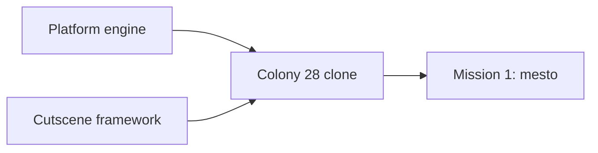

# colony2080 requirements (brainstorm draft)

Running list of decisions from brainstorming. Feeds the design doc in `docs/superpowers/specs/`. Research base: `docs/research/README.md`.

## Deliverables

Build in this order:

1. Reusable engine for 2D platform games.
2. Cutscene framework: tool and runtime to author and play animated vector scenes (item use, story scenes). Added as an extra requirement during brainstorming.
3. Colony 28 clone running on the engine.
4. First mission of the clone (level 1, `mesto`).

## Decided

| Topic | Decision | Who |
|---|---|---|
| Tech | TypeScript, Vite, React for UI shell, Zustand for engine-to-UI state | user |
| Next.js | Not used. Static browser game needs no server | Claude's call |
| Rendering | Custom engine in plain TypeScript on Canvas 2D. Engine does not depend on React | Claude's call |
| Web only | No DOS emulator, no three.js | user |
| Art | Redrawn, not 1:1 original assets. Not pixel art. Another World is too simplified as a blueprint: use detailed flat vector with multi-tone hard-edged shading (shadow, base, light, highlight) | user |
| Character design | Hero robot must match the original design (box cover, inventory render, cutscenes): top-heavy mech, big shoulder domes, caged box head, radiation badge, gunmetal core, boxy forearms with arm gun, boot-like shins | user |
| Art format | Vector (SVG / polygons), drawn as code | Claude's call |
| Design method | Redraw the hero by judgement from all references. Image-based tracing and auto-fitting were tried and dropped as too rough. Match shapes, not every shade; shading comes from our own style | user |
| Hero colour | Orange armour (box cover, `SKALA3`, `METROPAC`). Gold in `VSTUP` is sky lighting | Claude's call |
| Resolution | No 320x200 canvas. View scales to device | user |
| View size | Bigger view than original. Configurable limit, off at start | user |
| Fog of war | The original had none: its 320x200 screen showed everything in reach, which is intel we do not want, so fog covers the level. The hero uncovers the original playfield around it: `sightCells` (9) each side, 50% more than the original 6 cells from the hero to the left screen edge, 9 rows above the feet and 1.5 below, also 50% more than the original playfield (290x169 px = about 12x7 tiles, one floor per screen) (2026-10-19). Walls and floors block the reveal: a cell is uncovered only when a line from the hero eye reaches its centre or a corner without crossing a solid cell; the blocking cell itself is uncovered (2026-10-19). Uncovered cells stay uncovered. The sight eases to the hero's height when it stands or climbs and holds during a jump unless it leaves the sight. Fog hides enemies and stops every shot that enters it: the bullet vanishes with no impact spark. Every bullet, hero or enemy, also vanishes the same way `sightCells` from its shooter (2026-10-19). Covered cells block enemy sight like walls, so an enemy in fog does not see or shoot the hero (2026-10-18). Look: near-black blue-grey at 97% with soft cell edges and faint scanlines. Values in `config/camera.json`; on in the sandbox, panel Environment toggle | user (cover, persistence, shots, hidden enemies, walls block, shot range), Claude's call (look, follow, rows, eye height, corner test) |
| Cutscenes | Cloned as in-engine animated vector scenes, not video files. Start with one short item-use clip to tune the visual | user (format: Claude's call) |
| Level logic | Tasks form a dependency web (requires / consumes / gives), not a fixed list | user |
| Config | Parts of the app defined as JSON in `config/` during brainstorming | user |
| Hero head | Square helmet with tall rod antennae on both sides (old Optimus Prime style). Centre crest is a straight, low mohawk ridge starting on the forehead, shorter than the antennae. Face sits inside the helmet: square dark mask, eyes level on one line, square orange cheek notches that belong to the helmet. Side view: simple dark face window, one eye, no extra details | user |
| Hero arms | Stacked glossy deltoid and short bicep bulbs, then a slim boxy forearm centred on the arm axis. Sharp edges on arms, forearms and legs. Side-view shoulder bulbs slimmer than front | user |
| Hero proportions | Human-like: waist narrower than chest, hips narrower than shoulders, thigh about as long as shin. All views share one scale: head, shoulders, hips, knees, feet on the same lines | user |
| Hero knees | Shield knee pads with 5 holes, chrome like ribs and hip bar | user |
| Hero hands | Every finger modelled: knuckle cap, segment, joint, tip, on a dark palm. Thumb behind the hand in front view, in front in back view, at the front edge but covered by the fingers in side view | user |
| Hero hips | Steel hip bar mostly covered by thigh armour, only its top third visible. U-shaped thigh armour with steel piston on front and back. Rear hip plate visible from back, at the hip rear in side view, and as edges from front | user |
| Hero torso (side) | Thin and boxy: tapered dark core with narrow front and back shells (mirror images, one gentle wave on the lower edge). Head centred over the torso | user |
| Hero badge | Radiation badge on the robot's left chest only: visible in front view and left-facing side view, same height in both | user |
| Design sheet views | Front, side facing right, side facing left (mirrored), back. Side views show near limbs only. Animation may show far limbs darker | user (animation: Claude's call) |
| Robot model | One shared source for design sheet and cutscenes: part tree with named rig joints (hips, knees, shoulders, elbows, body) and hooks for held items | Claude's call |
| Cutscene format | Shots with camera keyframes plus keyframe tracks (pose angles, prop values) with easing. First clip (agreed): crowbar opens train door, 3.95 s, 2 shots: side view draws the crowbar from a hip "pocket" and raises it, back view pries the door open. No walk section | user (clip), Claude's call (format) |
| Held props | Held with both hands. Prop renders inside the grip (behind the fist, sticking out both sides). Side view: far hand solved onto the shaft next to the near hand. Back view: both arms follow one shared pry pull (same angle change for both, so biceps move in sync, large swing); the crowbar runs from the hidden left hand through the right fist to the door seam. Right forearm and hand drawn behind shoulder and torso, using the front-view right hand. One crowbar size in both views; robot keeps its x across the cut (2026-10-18) | user (two hands, sync, layering), Claude's call (method) |
| Design status | Hero robot design and the crowbar animation are agreed (2026-10-17). Reference: `spikes/robot-design/`, `spikes/shared/cutscenes.js` (played from `spikes/movement/interaction.html`) | user |
| Phase 1b plan | `docs/superpowers/plans/2026-10-17-engine-core-movement-sandbox.md` (13 tasks, TDD, pixel check of the robot and gun port against the spikes). Reviewed with the user; executed subagent-driven. Camera: see Camera | user (review, execution), Claude's call (plan) |
| Spec and gun status | Design spec (`docs/superpowers/specs/2026-10-17-colony2080-design.md`) and gun look (`spikes/gun-design/`) approved (2026-10-17) | user |
| Prototype viewing | No local server: pages open via `file://` or the VS Code Live Preview extension. Shared scripts are classic scripts, not ES modules | user |
| Previews | No GIF previews in development. Check spikes live in the browser (2026-10-18) | user |
| Saves | As in the original: manual save and load at any time, 5 slots | user |
| Hero weapon | Model has fists. The gun is a held prop (like the crowbar) attached to the hand hook, not a forearm replacement | user |
| Gun | Six-barrel rotary gun, short body, barrels of one length. Carried level with the elbow at the hip and the forearm in front of the gun; across the chest in front view (support arm behind); slung on the back on ladders | user (look), Claude's call (method) |
| Gun barrel per view | Barrel keeps its true length unless the robot covers the muzzle; then it stretches until the muzzle clears the robot silhouette by one barrel thickness. Computed from robot shape and hold pose (`barrelFor` in `spikes/shared/gun.js`), never tuned by eye. Front view result 247 (side 196) approved (2026-10-18). Applies to every future gun | user (rule must be computed, result), Claude's call (method) |
| In-game robot | Simplified game LOD: tiny parts dropped, simple fingers kept, three-tone shading. Bulkier than the design sheet: shoulder domes 1.3x in every view, legs 1.45x in side views only, matching original side sprites (`docs/research/robot/sprites/`) (2026-10-18) | user |
| Robot design fixes | Head crest sits on the forehead in every view: front crest ends at y 34, side top plate wraps the forehead corner, back crest big enough to survive game LOD. Fingers: pointed segment on top (at the palm), all three segments the same width, palm as wide as the fingers. Side hand centered under the forearm; forearm tucks under the elbow dome and pivots at its top. Outlines 1.4 (was 2.2) for high-res robot and gun on every page, 1 at game size (2026-10-18) | user |
| Enemy design | Hero robot built with `enemy: true` and recoloured to greyscale (`XBOT.shade`, brightness 1.1, saturation 0). Red eyes kept. No antennas, head crest or radiation badge. Plain legs: no horizontal stripes, no shin slots, knees in the same grey as the leg. Plain back: no panel lines on torso or head. Sandbox enemy uses the same variant (`createRigs(lod, true)`, `ENEMY_PALETTE` in `src/game/render/scene.ts`) (2026-10-18) | user |
| Environment design | Every level 1 object gets one vector view plus a view per behavioural state (door open, valve fitted, lift moving), drawn in the hero's 4-tone style next to 1-3 original crops (`spikes/env-design/`). First pass kept as is; refine in a later round (2026-10-18) | user (approach, keep), Claude's call (layout, guessed looks) |
| Shared animations | One action, one animation: a move reused in another context (duck punch, jumps, falls, deaths, hits, gun rest) uses the same shared pose, timing and effect. Context-only differences (body lean) are compensated, not re-keyed (2026-10-18) | user |
| Crouch and reach timing | Duck and kneel (pick up) share one leg pose (`crouch`); kneel leans the body 70 so the hand reaches the floor. Duck, kneel and use go down or reach in 0.25 s and back in 0.3 s (`ACTION_TIME` in `spikes/movement/moves.js`). Kneel and use do not hold at the bottom or at the panel. The item is taken and the panel switches when the hand gets there (0.25 s, `pickup` and `use` clip events) (2026-10-19) | user (shared legs, timing, no hold), Claude's call (lean 70) |
| Weapon variants | Every move has a fists and a gun version; overview pages switch between them | user |
| Movement set | Full set in the engine (walk, run, jumps, fall, duck, kneel, use, hide, shoot, punch, ladder, lift, hit, death); mission 1 uses what level 1 needs. List: design spec | user |
| Ladder dismount | Left / Right on a ladder drops the robot off: it turns that way and falls at walk speed | user |
| Ladder catch | Up pressed while falling or jumping, with the feet in a ladder column, grabs the ladder and the robot climbs on. Works from any fall height and the fall does no damage (2026-10-19) | user |
| Sandbox reskin | The sandbox draws only from env assets ported to `src/game/env/` (spike stays the design source, `npm run test:visual` compares port and spike). Assets that needed other sizes gained a `size` option in the spike first. The sky is open (no ceiling art). Non-blocking tall scenery stays in the backdrop under a depth haze so it never reads as solid. The "player hiding beside" state is unused in game: the real hero shows the hide pose. The punching bag and shooting target props are dropped (2026-10-19) | user (reskin, drop props), Claude's call (haze, sky, port) |
| Ladder asset | The spike library has a `ladder` asset (rails and rungs at `RUNG` spacing, non-interactive, `objects.json` entry) because no original sprite exists. Drawn over wall fill where it crosses a ledge (2026-10-19) | Claude's call |
| Sandbox map | 48 x 32 cells, top half unchanged (floors 4 and 14), lower half floors 7 cells apart (21, 28), several lifts and ledges and girders, built from the ported assets. The extra strip on the right has no lifts, ladders, props or enemies (2026-10-19) | user (size, more lifts), Claude's call (layout) |
| Camera | The camera follows the hero on both axes: the hero stays in the view centre, and at a map edge the view stops while the hero keeps moving. The view shows 40 x 16 cells (`view` in `config/camera.json`), the area the old map filled. Replaces "no scrolling camera" of phase 1b (2026-10-19) | user (rule), Claude's call (view size) |
| Sandbox enemies | Besides the top left enemy (respawns after 5 s), three more patrol lower floors and never respawn (`respawnMs: null`). None on a lift deck or in the right strip, none sees the hero at spawn (2026-10-19) | user (extra enemies, no respawn), Claude's call (placement) |
| Level traversal | Elevators are the common way between floors; ladders are rare, a unique route. No pits or drops as an intended way to move: survivable floor edges may stay open, deadly drops are not blocked because death resets the map (2026-10-19) | user |
| Elevator at the hero's level | The hero never reaches a shaft whose deck is at the other stop. Map rule: a lift's two stop floors connect only through that lift (no walk, ladder, other lift, jump or survivable drop between them, either direction); each lift starts at its spawn-side stop (`start` in the level config); obstacles block any bypass; the hero cannot jump while its lift moves. A reachability test checks every lift (2026-10-19) | user (rule, obstacles), Claude's call (test, no jump on a moving lift) |
| Death resets the map | When the hero dies, the whole map resets on respawn: lifts to their start stops, props, every enemy (non-respawning ones too), bullets and fog. Hero ammo carries over (2026-10-19) | user |
| Melee | Punches only, no kick. Fists are a selectable weapon (slot 2). Each punch hits once: the nearest enemy ahead on the same floor with its center within 1.4 cells (original 34 px). A punch does the damage of one bullet, so 7 punches kill a regular enemy; the original needs 3 (0.5 of 2.0 hp, death below 1.0, `KLEV1.EXE` seg 5), lowered (2026-10-19) | user |
| Weapon switch | A weapon key swaps the weapon at once in any live state (walk, run, jump, attack, duck ...) with no switch clip, so it never blocks other input; an empty weapon swaps the same way (see E-Blaster). While hidden the switch clip plays in front view, matching the hide look (hero stays hidden and tinted): the gun appears in the hanging hand and both hands move straight into the front carry, with no lift; holster plays it reversed. The old side-view switch clip is gone and any other input or releasing hide cuts it short with the swap applied | user |
| Hide look | Front view with dark tint. While hidden, an arrow turns the hero to that side without leaving cover; head and face shift toward the facing so the side to step out on reads at game size (2026-10-19) | user (feature), Claude's call (look) |
| Energy and shields | Energy runs 0-100 and starts full. Enemies fire bursts of 9 bullets (see Sandbox enemy) and one enemy bullet takes 1, like the original 1 per fire tick (2026-10-19). Shields (0-5) are a reserve: when energy reaches 0 with a shield left, one shield is spent and energy refills to 100; with none left the hero dies. A new game starts with 0 shields. The original has no separate reserve value: its shields are the reserve ("spare resources"). Rounded from the original (`docs/research/reports/10-level1-enemies.md`, `11-reserve-energy.md`): start 98 capped to max 90, one enemy burst 9, a shield refills from below 10 to 90, death at 0. The original rounding makes shields cancel most droid damage; we drop that (2026-10-18) | user (rounding), research |
| Ammo | Machine gun starts with 350 (original level 1 start, `docs/research/reports/10-level1-enemies.md`), `ammo` in `config/hero/movement.json`. Each hero bullet spends one. At 0 the gun stops firing with no muzzle flash, the hero switches away (see E-Blaster), and the gun cannot be drawn until ammo is above 0. Ammo carries over a respawn. Sandbox panel Run section sets live ammo (2026-10-18) | user (empty gun), research (start) |
| E-Blaster | Mission 1 bonus weapon in slot 3 (key 3), with its own held model and the gun clips and carry. Holding fire keeps a flickering lightning beam on from the muzzle, never while hidden. It runs on 32 Hz ticks: each tick spends 1 ammo and deals `blaster.damage` (0.47 hits) to every enemy in range whose body box the beam line crosses, like bullets, so it pierces; a kill takes about 0.48 s, the original 5:14 ratio to the gun. 400 ammo on pickup, no refills, kept on respawn (`blaster` in `config/hero/movement.json`). An empty E-Blaster switches to the gun, an empty gun to the E-Blaster, both empty to fists. Only the held weapon is drawn. Sandbox: a `weapon` prop on the spawn floor, picked with the pick-up key like items; it does not change the selected weapon and stays hidden while the hero owns the E-Blaster, also after a map reset. Panel Run section: `Blaster` button and `blaster ammo` input; a value above 0 gives the E-Blaster (2026-10-19). Spec: `docs/superpowers/specs/2026-10-19-eblaster-design.md` | user (mirror the original, own model, hidden switch, only the held weapon shown), research (beam, ammo, empty rules), Claude's call (damage, ticks, placement) |
| E-Blaster feel | Beam strands may line up into a regular diamond chain (accepted look). With fire held, an empty weapon switches to the next one and keeps firing (2026-10-19) | user |
| Weapon range | Every weapon range is `sightCells` (`config/hero/movement.json`): when sight changes, bullet and beam range change with it (2026-10-19) | user |
| Duck vs bullets | Ducking does not dodge bullets: the hero takes hits ducked or standing. The original shows no crouch-to-dodge (`docs/research/reports/08-video-level1.md`) | user |
| Hide input | Hold Shift to stay hidden, release to step out. Works anywhere except on a moving lift. Hide wins over walk, run and shooting: the hero hides on the frame Shift is held even with an arrow down, and walks on after release if the arrow is still held. Shoot still held on release resumes the attack at once with the held weapon: gun or E-Blaster fire, fists punch (2026-10-19) | user |
| Robot polygons | Robot part polygons stay drawing code in `spikes/shared/xbot.js` and its port, the same way as the gun and env assets: spike is the design source, `test:visual` keeps the port pixel-identical, `config/robots/xbot.json` holds only parameters (2026-10-19) | user |
| Home page | `index.html` shows the game name, a mission select (mission 1 link, no target yet) and dev links to the sandbox and every spike page (2026-10-19) | user |
| No original game online | The published website never references the original game: no images, screenshots, file names, citations, Czech in-game names or texts. Those stay in the development files only; the build makes production variants of the spike pages and config without them and fails on any leak. Code names (`xbot`, `C28_CONFIG`, `mesto`) may stay (2026-10-19) | user (rule, scope as recommended) |
| Default keys | Original layout stays default (Alt run, Ctrl shoot, Shift hide, `config/controls.json`) after trying the sandbox, despite browser shortcut overlap; keys stay configurable (2026-10-19) | user |
| Run input | Alt toggles run mode: one press runs, the next walks; the mode stays until pressed again. Run mode is on at start and survives respawn. Holding Alt + arrow + Up was unreliable (key chords, browser shortcuts) | user |
| Jump while shooting | Up while shooting the gun jumps (duck jump when ducked) and the fire keeps its cadence. Shoot in the air fires the gun, and landing with Shoot held goes straight back to shooting. Gun only for now | user (jump and shoot), Claude's call (gun only, landing) |
| Move while shooting | Shoot plus an arrow with the gun walks (or runs in run mode) that way and keeps firing, Shoot alone stands and fires, switching keeps the fire cadence. Duck shooting turns in place. Landing while firing picks walk or stand by the arrow held | user (walk and turn while shooting), Claude's call (run, duck turn, landing) |
| Lift input | One Up or Down press starts a ride to the next stop; the lift stops there on its own. On the lift Up and Down only call the lift (no jump, no duck). While it moves the hero cannot jump, hide or step off (stops at the deck edge) but can walk, run and shoot on the deck (2026-10-19) | user |
| Sandbox enemy | The top left enemy (more in Sandbox enemies) patrols the top left platform from wall to edge and never steps off: the player robot in its enemy variant (see Enemy design) with the gun. It stops and shoots (bursts of 9 bullets in 280 ms with 400 ms standing between them, about 13 energy per s like the original 9-tick bursts, bullets like the hero's, starting at its body so a hero closer than its muzzle is hit) when it sees the hero on its floor ahead within `sightCells` (9, the hero sight) with no wall or fog between; a hidden or dead hero is not seen. A hit makes it turn to the hero `reactMs` (250 ms, the original turns to a hero behind it after about 0.22 s) after the first hit and walk on that way, then it shoots if it sees the hero (2026-10-19). 16 hero bullets (`shot.damage` 7/16, the low end of the 16-26 rounds per kill in the videos; the original takes 7 hits, weakened) or 7 punches destroy it (`docs/research/reports/10-level1-enemies.md`) in a vortex blast like the original (video A 4:22: fireballs grow into a swirling cloud, collapse into one rotating disc and end as a red spinning ring), and it leaves a scrap pile (`LEV1.GRA` f22, video A 4:22). It comes back after 5 s. It does not block the hero | user (look, death, respawn, platform, patrol, stop and shoot, sight range, hit reaction), research (hit count), user (fire rate, punch damage) |
| Sandbox shots | Hero gun shots are visible: muzzle flash, tracer and impact spark as in the spike `fire()`. The original fires instant hits with a muzzle flash and a small bolt (`docs/research/reports/08-video-level1.md`). Projectiles collide only with what blocks the hero's movement: walls stop them, props the hero walks through let them pass | user |
| Dev server | Sandbox and game run on the Vite dev server (`npm run dev`); spikes keep opening from `file://` | user |
| Story year | Story set in 2080, alien invasion 5 years earlier (2075). Departs from the original's 2013 / 2018 / 2028 | user |
| Spike vs sandbox | Spikes own the look (shapes, poses, gait, timing of pose changes). The sandbox owns physics (gravity, speeds, jump heights, air time) through `config/hero/movement.json`. Spike motion numbers stay in the spikes as reference; small drift between them is accepted | user |
| Idle and turn | Idle is fully still. Turn flips between side views at once (no front view, no squash) | user |
| Input response | Arcade style: every move acts on the press, no wind-up (jumps leave the floor at once, no crouch before takeoff or after landing). Less natural, more playable | user |
| Death | Drop the gun, fall on the back, body flat on the floor | user |
| Inventory key | `I` instead of Tab | user |
| Phase order | Movement overview page first (non-interactive, one looping cell per move). Engine, movement sandbox and cutscenes later | user |
| HUD frame | Clean vector redraw of the original frame layout, no pixels. Brown-tinted metal with 3D bevels, gradient edges and screws. Top bar: 4 separate plates (weapons, `C2080` badge, `RUN`, inventory) joined by 4 rods per gap; the plates run to the screen edges, no rods or border outside them. Top bar 20.4 units high, the game view starts right under it. Each plate has one raised border; its grid panel (or badge window) sits in it as a sunken screen with no frame of its own. Plate metal is lighter toward the bottom than the bottom bar, no dark lower shade. Each plate keeps equal empty space at both ends of its grid panel, no screws on the weapons plate. The weapons grid spaces its 3 slots (gun, fist, bonus) with the same gap as its ends; the inventory plate is as wide as the longest item name in `config/items.json` needs. Grid panels: dark backing with thin dim amber lines. Side panels: 11 units wide, content aligned to the bottom, dim green circuit pattern (repeating tile, each panel starts its own tile so no cut pattern shows at the game view edge) from the top edge down; no pipes, screws, edge lines, game view bevel or inner shadow. Left: thin square-ended glass life tube (fill yellow at top, red at bottom), red level marker, `E` key. Right: reserve glass tube (static art, always full, as in the original), 5 shield lights, `S` key. `E` / `S` keys 9 units square; the life tube and the shield plate run into the key, no bottom border. Shield lights follow the original: 7-unit black channel with perforated 1-unit rails, 5 x 8.6 lamps with black gaps; lit lamp has ochre rim, yellow body, bright centre line with 2 white dots and an amber glow over the rails; unlit lamp is olive with brown sides and horizontal stripes. No lamps in the top bar. Active weapon icon shows at full colour with a soft amber glow; the others are desaturated and darkened. Ammo counters follow the original: small digits only (no `N:`, no leading zeros), right-aligned to the right edge of the weapon icon at the bottom of the slot so more digits grow leftward. Counters and `RUN` share one muted amber with no glow in every state. Plates are 2 units apart. `RUN` plate 18 units wide, `RUN` centred above its key. Key hints (2026-10-19): the screen's bottom border rises into a small tab centred under each weapon icon (partly covering it) and under `RUN`, labelled from `config/controls.json` (`1` / `2` / `3`, `ALT`); a tab is at least 1.6 times the single-digit width, label vertically centred between tab top and plate bottom. Unlit labels use the `E` / `S` letter style; the selected weapon's key and `ALT` in run mode turn red with a dark-red edge and a soft red halo, tab background unchanged. Spike `spikes/hud-design/`, sandbox `src/game/hud/` | user |
| Item art | Every item has its own env asset, no placeholder, drawn in `spikes/shared/env-props.js` after its original inventory preview (`preview` in `config/items.json`, a rotating 3D render in `GRAFIKA/PR*.GRA`). The ground and HUD crowbar follows `PRPAC` too; the cutscene crowbar (`spikes/shared/cutscenes.js`) is drawn separately and keeps its agreed look (2026-10-19) | user (no placeholder, follow the originals) |
| HUD inventory | The inventory holds picked items from `config/items.json` and shows the newest in place of the hand, drawn from its env asset with its name (or the hand and `nothing`), plus an ENTER key tab; death empties it (2026-10-19) | user (feature), Claude's call (look) |
| HUD badge | `C2080` instead of the original `C28` | user |
| HUD weapon icons | Slot 1 is the rotary gun from the gun model, slot 2 the robot's side forearm and fist, pointing right. Slot 3 is the E-Blaster (vector icon with a blue arc and its ammo counter); its grid stays empty until the pickup | user |
| HUD wide screens | The frame takes the screen aspect. Extra width over 16:10 goes to the badge plate, which stretches while its window stays centred and keeps its size. Screens narrower than 16:10 keep the 320 width and grow taller: the side panels and the game view stretch, the side columns and bottom bar stay at the bottom, so the frame always fills the screen (2026-10-19) | user |
| HUD fonts | Orbitron 900 (badge, keys, key hints) and Share Tech Mono (counters, item names), bundled with `@fontsource` | Claude's call |
| Automap | Not in the HUD for now | user |
| Mission 1 scope | Playable `game.html`: walk, pick up items, use every object, reach the level end. Only the 27 chrome droids (no respawn, no flyers, no guards), no cutscenes (a use changes state at once), E-Blaster not placed (2026-10-19) | user |
| Mission 1 layout | Map, lifts, items, objects and droids come from the decoded original level data, scenery is laid out by Claude over the decoded map image (2026-10-19) | user (original layout), Claude's call (scenery) |
| Subtitles | Our own English wording in yellow at the bottom of the game window, one line per use or hint; the level end shows a caption with a link to the mission select (2026-10-19) | user |
| Stack inventory | Every picked item stays, only the newest is shown and usable, every use consumes the used item. Some pickup orders can soft-lock (accepted, see Known issues) (2026-10-19) | user |
| Shootable props | A prop with `shootable` takes hero bullets and beams; after `hits` hits it changes state and gives its flags (the crashed ship hull). Other props block neither the hero nor bullets (2026-10-19) | user (rule), Claude's call (hit count) |

## Config drafts

| File | Defines |
|---|---|
| `config/controls.json` | Original key bindings |
| `config/camera.json` | View limit (off), camera `view` (40 x 16 cells) and fog of war (on) |
| `config/levels/mesto/level.json` | Level 1 map grid and metadata |
| `config/levels/mesto/tasks.json` | Level 1 task dependency web |
| `config/levels/mesto/map.json` | Level 1 playable map 160 x 80, lifts with stops, task walls, spawn; generated by `docs/research/tools/mestomap.py`, never hand-edited |
| `config/levels/mesto/world.json` | Level 1 props (items, objects, gates, shootable), backdrop and dressing scenery |
| `config/items.json` | Every level 1 item: HUD name, Czech name, icon (env asset, tilt, scale) |
| `config/levels/mesto/enemies.json` | Level 1 enemies: type, cell, floor, patrol range, confidence |
| `config/levels/mesto/objects.json` | Level 1 environment objects (52): name, interactive flag, map marker, task, sheet, states, description |
| `config/robots/xbot.json` | Hero palette, frame axes, proportions, level lines, joint and hook names (part polygons stay in code) |
| `config/cutscenes/crowbar-door.json` | Agreed crowbar clip: stage, clip window, robot placement and pry swing, palette, keyframe tracks |

## Known issues to handle later

- Static cache before mission 1: a tile in view that is not cached yet paints on the spot, so the worst frame is 24-36 ms (old full-world cache 10-16 ms), and a camera jump (respawn, teleport) at 4K paints about 35-40 tiles per layer at once. Cache memory follows the screen: about 150-175 MB at 4K on the mesto map. Each tile now paints from a per-tile bucket of terrain runs, ladders and scenery (`bucketByTile`). Mesto at 1920 x 1080 (2026-10-19, busy machine): one layer tile paints in 0.8 ms median, 21 ms worst (full scan 1.0 ms, 20 ms), so the scan was never the cost. A teleport frame on `/game.html` takes 450-580 ms, and about 75% of it is the hero rig draw (`drawHero` -> `drawPart`), not the static cache (`drawEnvironment` about 4%). Task 10b skips pose and draw of enemies outside the view plus 2 cells, but it did not move the numbers: on `/game.html` at 1920 x 1080 (dev server, 12 teleports) a teleport frame stays about 500 ms median (505 ms with the cull, 523 ms without, worst 536 vs 622 ms), idle frames 17 vs 20 ms median, so the droids were not the cost and the slow frame has another source (profile the teleport frame again).
- Level 4 dead ends: from level 4 the original lets the player make an unrecoverable mistake (Score 44 walkthrough, `docs/research/reports/06-cz-walkthroughs.md`). The level 4 jump at marker 13 must be exact or the player dies without warning. Decide how saving and level 4 design handle this when building them (e.g. warn, block the dead end, or rely on manual saves as the original does). Out of current scope (2026-10-19).
- Mission 1 accepted flaws (2026-10-19, user): newest-item-only inventory can soft-lock some pickup orders; card door may gate nothing; acid tank kills nothing; crane key lies free (no shoot guard); E-blaster missing; flyers missing; no cutscenes; death resets all task progress (no saves). Fix in a later session. Spec: `docs/superpowers/specs/2026-10-19-mission-1-mesto-design.md`.

## Spikes

| Path | What it settled |
|---|---|
| `spikes/robot-design/` | Hero design sheet (front, side, back), palette, level guides, reference frames |
| `spikes/shared/xbot.js` | Shared robot model and renderer |
| `spikes/shared/cutscenes.js` | Cutscene keyframe format, camera shots, two-handed lever prop handling, synced arms. An interaction triggers its cutscene in `spikes/movement/interaction.html` (cell plays both; click opens the player) |
| `spikes/movement/` | Movement overview: movement, interaction and fight pages, every move looping in its own cell, Fists / Gun switch |
| `spikes/gun-design/` | Gun design sheet: side, held side and front, slung back, game size, references |
| `spikes/enemy-design/` | Enemy design sheet: greyscale tint sliders, palette overrides, full and game size, face-off with the hero, references |
| `spikes/shared/gun.js` | Shared gun model and hold poses |
| `spikes/env-design/` | Level 1 environment sheet: vector variant per object state next to original crops, hero for scale, LOD and tile grid toggles |
| `spikes/shared/env.js` | Shared environment asset registry and drawing primitives; assets in `env-props.js`, `env-structures.js`, `env-buildings.js`, `env-machines.js` |
| `spikes/items-design/` | Item look: every `config/items.json` item with its spinning original preview, our asset, HUD icon, game LOD and other states |
| `spikes/hud-design/` | HUD frame look: controls for aspect, weapon, ammo, life, run, shields and item; side by side with original screenshots |

## Open

- Intro cutscene and dying-rebel scene: not part of current work (user, 2026-10-19); mission 1 scope decided later.
- Inventory screen on `I` (pick the item shown in the HUD, as the original "INVENTAR / X-BOT STATISTIKA" screen) comes in the next phase; until then `I` does nothing (2026-10-19).
- Crowbar cutscene polish, revisited once all level animations exist (2026-10-19): hands overhead in the side shot, at hip level in the back shot; a larger back-shot pry pull (`pullForeDeg`) so the door visibly follows it; grip order and hand spacing change across the cut (78 vs about 367 model units); the crowbar pokes out of the top of the shot B frame around 2.7 s.
- Environment sheet: all 52 objects and the `ladder` drawn, first pass kept, iterate later. The sandbox uses a subset (ported to `src/game/env/`). Guessed looks (no original sprite or unclear): code lock, E-Blaster pickup on the ground, hazard plate purpose, staircase treads. Marker 6 is either the valve wheel near the E-Blaster or the water pipe; both are drawn.
- Sandbox HUD shows live life, shields, weapon and ammo (see Ammo). Shields start at `energy.shields` in `config/hero/movement.json`.
- Collision source for levels (decoded map data or hand-authored) is decided in phase 4; out of current scope (2026-10-19).
