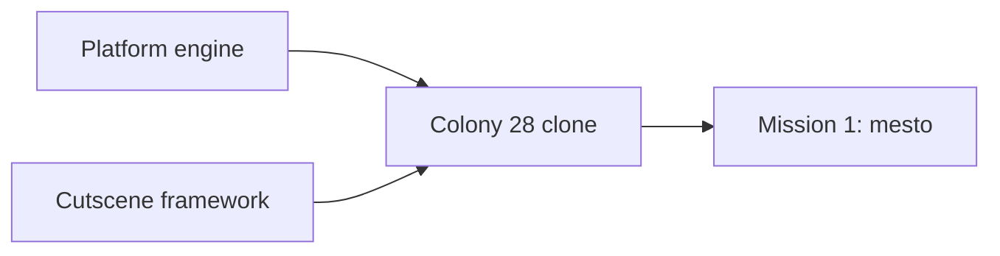

# colony2080 requirements (brainstorm draft)

Running list of decisions from brainstorming. Feeds the design doc in `docs/superpowers/specs/`. Research base: `docs/research/README.md`.

## Deliverables

Build in this order:

1. Reusable engine for 2D platform games.
2. Cutscene framework: tool and runtime to author and play animated vector scenes (item use, story scenes). Added as an extra requirement during brainstorming.
3. Colony 28 clone running on the engine.
4. First mission of the clone (level 1, `mesto`).

## Decided

| Topic | Decision | Who |
|---|---|---|
| Tech | TypeScript, Vite, React for UI shell, Zustand for engine-to-UI state | user |
| Next.js | Not used. Static browser game needs no server | Claude's call |
| Rendering | Custom engine in plain TypeScript on Canvas 2D. Engine does not depend on React | Claude's call |
| Web only | No DOS emulator, no three.js | user |
| Art | Redrawn, not 1:1 original assets. Not pixel art. Another World is too simplified as a blueprint: use detailed flat vector with multi-tone hard-edged shading (shadow, base, light, highlight) | user |
| Character design | Hero robot must match the original design (box cover, inventory render, cutscenes): top-heavy mech, big shoulder domes, caged box head, radiation badge, gunmetal core, boxy forearms with arm gun, boot-like shins | user |
| Art format | Vector (SVG / polygons), drawn as code | Claude's call |
| Design method | Redraw the hero by judgement from all references. Image-based tracing and auto-fitting were tried and dropped as too rough. Match shapes, not every shade; shading comes from our own style | user |
| Hero colour | Orange armour (box cover, `SKALA3`, `METROPAC`). Gold in `VSTUP` is sky lighting | Claude's call |
| Resolution | No 320x200 canvas. View scales to device | user |
| View size | Bigger view than original. Configurable limit, off at start | user |
| Fog of war | Configurable, off at start | user |
| Cutscenes | Cloned as in-engine animated vector scenes, not video files. Start with one short item-use clip to tune the visual | user (format: Claude's call) |
| Level logic | Tasks form a dependency web (requires / consumes / gives), not a fixed list | user |
| Config | Parts of the app defined as JSON in `config/` during brainstorming | user |
| Hero head | Square helmet with tall rod antennae on both sides (old Optimus Prime style). Centre crest is a straight, low mohawk ridge starting on the forehead, shorter than the antennae. Face sits inside the helmet: square dark mask, eyes level on one line, square orange cheek notches that belong to the helmet. Side view: simple dark face window, one eye, no extra details | user |
| Hero arms | Stacked glossy deltoid and short bicep bulbs, then a slim boxy forearm centred on the arm axis. Sharp edges on arms, forearms and legs. Side-view shoulder bulbs slimmer than front | user |
| Hero proportions | Human-like: waist narrower than chest, hips narrower than shoulders, thigh about as long as shin. All views share one scale: head, shoulders, hips, knees, feet on the same lines | user |
| Hero knees | Shield knee pads with 5 holes, chrome like ribs and hip bar | user |
| Hero hands | Every finger modelled: knuckle cap, segment, joint, tip, on a dark palm. Thumb behind the hand in front view, in front in back view, at the front edge but covered by the fingers in side view | user |
| Hero hips | Steel hip bar mostly covered by thigh armour, only its top third visible. U-shaped thigh armour with steel piston on front and back. Rear hip plate visible from back, at the hip rear in side view, and as edges from front | user |
| Hero torso (side) | Thin and boxy: tapered dark core with narrow front and back shells (mirror images, one gentle wave on the lower edge). Head centred over the torso | user |
| Hero badge | Radiation badge on the robot's left chest only: visible in front view and left-facing side view, same height in both | user |
| Design sheet views | Front, side facing right, side facing left (mirrored), back. Side views show near limbs only. Animation may show far limbs darker | user (animation: Claude's call) |
| Robot model | One shared source for design sheet and cutscenes: part tree with named rig joints (hips, knees, shoulders, elbows, body) and hooks for held items | Claude's call |
| Cutscene format | Shots with camera keyframes plus keyframe tracks (pose angles, prop values) with easing. First clip (agreed): crowbar opens train door, 3.95 s, 2 shots: side view draws the crowbar from a hip "pocket" and raises it, back view pries the door open. No walk section | user (clip), Claude's call (format) |
| Held props | Held with both hands. Prop renders inside the grip (behind the fist, sticking out both sides). Side view: far hand solved onto the shaft next to the near hand. Back view: both arms follow one shared pry pull (same angle change for both, so biceps move in sync, large swing); the crowbar runs from the hidden left hand through the right fist to the door seam. Right forearm and hand drawn behind shoulder and torso, using the front-view right hand | user (two hands, sync, layering), Claude's call (method) |
| Design status | Hero robot design and the crowbar animation are agreed (2026-10-17). Reference: `spikes/robot-design/`, `spikes/crowbar-scene/`, preview `spikes/crowbar-scene/previews/pry.gif` | user |
| Spec and gun status | Design spec (`docs/superpowers/specs/2026-10-17-colony2080-design.md`) and gun look (`spikes/gun-design/`) approved (2026-10-17) | user |
| Prototype viewing | No local server: pages open via `file://` or the VS Code Live Preview extension. Shared scripts are classic scripts, not ES modules | user |
| Saves | As in the original: manual save and load at any time, 5 slots | user |
| Hero weapon | Model has fists. The gun is a held prop (like the crowbar) attached to the hand hook, not a forearm replacement | user |
| Gun | Six-barrel rotary gun, short body, barrels of one length. Carried level with the elbow at the hip and the forearm in front of the gun; across the chest in front view (support arm behind); slung on the back on ladders | user (look), Claude's call (method) |
| In-game robot | Simplified game LOD: tiny parts dropped, simple fingers kept, three-tone shading | user |
| Weapon variants | Every move has a fists and a gun version; overview pages switch between them | user |
| Movement set | Full set in the engine (walk, run, jumps, fall, duck, kneel, use, hide, shoot, punch, ladder, lift, hit, death); mission 1 uses what level 1 needs. List: design spec | user |
| Melee | Punches only, no kick. Fists are a selectable weapon (slot 2) | user |
| Hide look | Front view with dark tint | user |
| Idle and turn | Idle is fully still. Turn switches views without squash | user |
| Death | Drop the gun, fall on the back, body flat on the floor | user |
| Inventory key | `I` instead of Tab | user |
| Phase order | Movement overview page first (non-interactive, one looping cell per move). Engine, movement sandbox and cutscenes later | user |

## Config drafts

| File | Defines |
|---|---|
| `config/controls.json` | Original key bindings |
| `config/camera.json` | View limit and fog of war, both off |
| `config/levels/mesto/level.json` | Level 1 map grid and metadata |
| `config/levels/mesto/tasks.json` | Level 1 items and task dependency web |
| `config/levels/mesto/enemies.json` | Level 1 enemies: type, cell, floor, patrol range, confidence |
| `config/robots/xbot.json` | Hero palette, frame axes, proportions, level lines, joint and hook names (part polygons stay in code) |
| `config/cutscenes/crowbar-door.json` | Agreed crowbar clip: stage, clip window, robot placement and pry swing, palette, keyframe tracks |

## Known issues to handle later

- Level 4 dead ends: from level 4 the original lets the player make an unrecoverable mistake (Score 44 walkthrough, `docs/research/reports/06-cz-walkthroughs.md`). The level 4 jump at marker 13 must be exact or the player dies without warning. Decide how saving and level 4 design handle this when building them (e.g. warn, block the dead end, or rely on manual saves as the original does).

## Spikes

| Path | What it settled |
|---|---|
| `spikes/robot-design/` | Hero design sheet (front, side, back), palette, level guides, reference frames |
| `spikes/shared/xbot.js` | Shared robot model and renderer |
| `spikes/crowbar-scene/` | Cutscene keyframe format, camera shots, two-handed lever prop handling, synced arms; `previews/pry.gif` |
| `spikes/movement/` | Movement overview: movement, interaction and fight pages, every move looping in its own cell, Fists / Gun switch |
| `spikes/gun-design/` | Gun design sheet: side, held side and front, slung back, game size, references |
| `spikes/shared/gun.js` | Shared gun model and hold poses |

## Open

- Robot part polygons still live in code (`spikes/shared/xbot.js`); only parameters are in `config/robots/xbot.json`.
- Intro cutscene and dying-rebel scene in mission 1 scope or not (cutscenes postponed).
- Default key layout: original Alt / Ctrl / Shift collide with browser shortcuts. Original stays default and keys are configurable; revisit after trying the sandbox.
