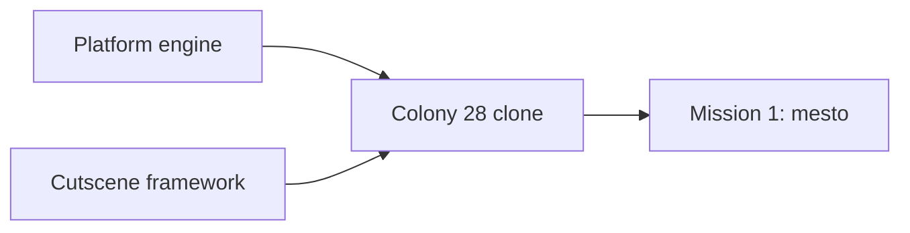

# colony2080 requirements (brainstorm draft)

Running list of decisions from brainstorming. Feeds the design doc in `docs/superpowers/specs/`. Research base: `docs/research/README.md`.

## Deliverables

Build in this order:

1. Reusable engine for 2D platform games.
2. Cutscene framework: tool and runtime to author and play animated vector scenes (item use, story scenes). Added as an extra requirement during brainstorming.
3. Colony 28 clone running on the engine.
4. First mission of the clone (level 1, `mesto`).

## Decided

| Topic | Decision | Who |
|---|---|---|
| Tech | TypeScript, Vite, React for UI shell, Zustand for engine-to-UI state | user |
| Next.js | Not used. Static browser game needs no server | Claude's call |
| Rendering | Custom engine in plain TypeScript on Canvas 2D. Engine does not depend on React | Claude's call |
| Web only | No DOS emulator, no three.js | user |
| Art | Redrawn, not 1:1 original assets. Not pixel art. Another World is too simplified as a blueprint: use detailed flat vector with multi-tone hard-edged shading (shadow, base, light, highlight) | user |
| Character design | Hero robot must match the original design (box cover, inventory render, cutscenes): top-heavy mech, big shoulder domes, caged box head, radiation badge, gunmetal core, boxy forearms with arm gun, boot-like shins | user |
| Art format | Vector (SVG / polygons), drawn as code | Claude's call |
| Design method | Redraw the hero by judgement from all references. Image-based tracing and auto-fitting were tried and dropped as too rough. Match shapes, not every shade; shading comes from our own style | user |
| Hero colour | Orange armour (box cover, `SKALA3`, `METROPAC`). Gold in `VSTUP` is sky lighting | Claude's call |
| Resolution | No 320x200 canvas. View scales to device | user |
| View size | Bigger view than original. Configurable limit, off at start | user |
| Fog of war | The original had none: its 320x200 screen showed everything in reach, which is intel we do not want, so fog covers the level. The hero uncovers the original playfield around it: 12 cells wide (6 each side, the original kept the hero 6 cells from the left screen edge), 6 rows above the feet and 1 below (playfield 290x169 px = about 12x7 tiles, one floor per screen). Uncovered cells stay uncovered. The sight eases to the hero's height when it stands or climbs and holds during a jump unless it leaves the sight. Fog hides enemies and stops every shot that enters it: the bullet vanishes with no impact spark. Covered cells block enemy sight like walls, so an enemy in fog does not see or shoot the hero (2026-10-18). Look: near-black blue-grey at 97% with soft cell edges and faint scanlines. Values in `config/camera.json`; on in the sandbox, panel Environment toggle | user (cover, persistence, shots, hidden enemies), Claude's call (look, follow, rows) |
| Cutscenes | Cloned as in-engine animated vector scenes, not video files. Start with one short item-use clip to tune the visual | user (format: Claude's call) |
| Level logic | Tasks form a dependency web (requires / consumes / gives), not a fixed list | user |
| Config | Parts of the app defined as JSON in `config/` during brainstorming | user |
| Hero head | Square helmet with tall rod antennae on both sides (old Optimus Prime style). Centre crest is a straight, low mohawk ridge starting on the forehead, shorter than the antennae. Face sits inside the helmet: square dark mask, eyes level on one line, square orange cheek notches that belong to the helmet. Side view: simple dark face window, one eye, no extra details | user |
| Hero arms | Stacked glossy deltoid and short bicep bulbs, then a slim boxy forearm centred on the arm axis. Sharp edges on arms, forearms and legs. Side-view shoulder bulbs slimmer than front | user |
| Hero proportions | Human-like: waist narrower than chest, hips narrower than shoulders, thigh about as long as shin. All views share one scale: head, shoulders, hips, knees, feet on the same lines | user |
| Hero knees | Shield knee pads with 5 holes, chrome like ribs and hip bar | user |
| Hero hands | Every finger modelled: knuckle cap, segment, joint, tip, on a dark palm. Thumb behind the hand in front view, in front in back view, at the front edge but covered by the fingers in side view | user |
| Hero hips | Steel hip bar mostly covered by thigh armour, only its top third visible. U-shaped thigh armour with steel piston on front and back. Rear hip plate visible from back, at the hip rear in side view, and as edges from front | user |
| Hero torso (side) | Thin and boxy: tapered dark core with narrow front and back shells (mirror images, one gentle wave on the lower edge). Head centred over the torso | user |
| Hero badge | Radiation badge on the robot's left chest only: visible in front view and left-facing side view, same height in both | user |
| Design sheet views | Front, side facing right, side facing left (mirrored), back. Side views show near limbs only. Animation may show far limbs darker | user (animation: Claude's call) |
| Robot model | One shared source for design sheet and cutscenes: part tree with named rig joints (hips, knees, shoulders, elbows, body) and hooks for held items | Claude's call |
| Cutscene format | Shots with camera keyframes plus keyframe tracks (pose angles, prop values) with easing. First clip (agreed): crowbar opens train door, 3.95 s, 2 shots: side view draws the crowbar from a hip "pocket" and raises it, back view pries the door open. No walk section | user (clip), Claude's call (format) |
| Held props | Held with both hands. Prop renders inside the grip (behind the fist, sticking out both sides). Side view: far hand solved onto the shaft next to the near hand. Back view: both arms follow one shared pry pull (same angle change for both, so biceps move in sync, large swing); the crowbar runs from the hidden left hand through the right fist to the door seam. Right forearm and hand drawn behind shoulder and torso, using the front-view right hand. One crowbar size in both views; robot keeps its x across the cut (2026-10-18) | user (two hands, sync, layering), Claude's call (method) |
| Design status | Hero robot design and the crowbar animation are agreed (2026-10-17). Reference: `spikes/robot-design/`, `spikes/crowbar-scene/` | user |
| Phase 1b plan | `docs/superpowers/plans/2026-10-17-engine-core-movement-sandbox.md` (13 tasks, TDD, pixel check of the robot and gun port against the spikes). Reviewed with the user; executed subagent-driven. No scrolling camera in 1b | user (review, execution), Claude's call (plan) |
| Spec and gun status | Design spec (`docs/superpowers/specs/2026-10-17-colony2080-design.md`) and gun look (`spikes/gun-design/`) approved (2026-10-17) | user |
| Prototype viewing | No local server: pages open via `file://` or the VS Code Live Preview extension. Shared scripts are classic scripts, not ES modules | user |
| Previews | No GIF previews in development. Check spikes live in the browser (2026-10-18) | user |
| Saves | As in the original: manual save and load at any time, 5 slots | user |
| Hero weapon | Model has fists. The gun is a held prop (like the crowbar) attached to the hand hook, not a forearm replacement | user |
| Gun | Six-barrel rotary gun, short body, barrels of one length. Carried level with the elbow at the hip and the forearm in front of the gun; across the chest in front view (support arm behind); slung on the back on ladders | user (look), Claude's call (method) |
| Gun barrel per view | Barrel keeps its true length unless the robot covers the muzzle; then it stretches until the muzzle clears the robot silhouette by one barrel thickness. Computed from robot shape and hold pose (`barrelFor` in `spikes/shared/gun.js`), never tuned by eye. Front view result 247 (side 196) approved (2026-10-18). Applies to every future gun | user (rule must be computed, result), Claude's call (method) |
| In-game robot | Simplified game LOD: tiny parts dropped, simple fingers kept, three-tone shading. Bulkier than the design sheet: shoulder domes 1.3x in every view, legs 1.45x in side views only, matching original side sprites (`docs/research/robot/sprites/`) (2026-10-18) | user |
| Robot design fixes | Head crest sits on the forehead in every view: front crest ends at y 34, side top plate wraps the forehead corner, back crest big enough to survive game LOD. Fingers: pointed segment on top (at the palm), all three segments the same width, palm as wide as the fingers. Side hand centered under the forearm; forearm tucks under the elbow dome and pivots at its top. Outlines 1.4 (was 2.2) for high-res robot and gun on every page, 1 at game size (2026-10-18) | user |
| Enemy design | Hero robot built with `enemy: true` and recoloured to greyscale (`XBOT.shade`, brightness 1.1, saturation 0). Red eyes kept. No antennas, head crest or radiation badge. Plain legs: no horizontal stripes, no shin slots, knees in the same grey as the leg. Plain back: no panel lines on torso or head. Sandbox enemy uses the same variant (`createRigs(lod, true)`, `ENEMY_PALETTE` in `src/game/render/scene.ts`) (2026-10-18) | user |
| Environment design | Every level 1 object gets one vector view plus a view per behavioural state (door open, valve fitted, lift moving), drawn in the hero's 4-tone style next to 1-3 original crops (`spikes/env-design/`). First pass kept as is; refine in a later round (2026-10-18) | user (approach, keep), Claude's call (layout, guessed looks) |
| Shared animations | One action, one animation: a move reused in another context (duck punch, jumps, falls, deaths, hits, gun rest) uses the same shared pose, timing and effect. Context-only differences (body lean) are compensated, not re-keyed (2026-10-18) | user |
| Weapon variants | Every move has a fists and a gun version; overview pages switch between them | user |
| Movement set | Full set in the engine (walk, run, jumps, fall, duck, kneel, use, hide, shoot, punch, ladder, lift, hit, death); mission 1 uses what level 1 needs. List: design spec | user |
| Ladder dismount | Left / Right on a ladder drops the robot off: it turns that way and falls at walk speed | user |
| Melee | Punches only, no kick. Fists are a selectable weapon (slot 2) | user |
| Hide look | Front view with dark tint | user |
| Energy and shields | Energy runs 0-100 and starts full. One enemy hit takes 10. Shields (0-5) are a reserve: when energy reaches 0 with a shield left, one shield is spent and energy refills to 100; with none left the hero dies. A new game starts with 0 shields. Rounded from the original (`docs/research/reports/10-level1-enemies.md`): start 98, one enemy burst 9, a shield refills from below 10 to 90, death below 10. The original rounding makes shields cancel most droid damage; we drop that (2026-10-18) | user (rounding), research |
| Ammo | Machine gun starts with 350 (original level 1 start, `docs/research/reports/10-level1-enemies.md`), `ammo` in `config/hero/movement.json`. Each hero bullet spends one. At 0 the gun stops firing with no muzzle flash, the hero holsters it and switches to fists, and the gun cannot be drawn until ammo is above 0. Ammo carries over a respawn. Sandbox panel Run section sets live ammo (2026-10-18) | user (empty gun), research (start) |
| Duck vs bullets | Ducking does not dodge bullets: the hero takes hits ducked or standing. The original shows no crouch-to-dodge (`docs/research/reports/08-video-level1.md`) | user |
| Hide input | Hold Shift to stay hidden, release to step out. Works anywhere except on a moving lift. Hide wins over walk, run and shooting: the hero hides on the frame Shift is held even with an arrow down, and walks on after release if the arrow is still held | user |
| Run input | Alt toggles run mode: one press runs, the next walks; the mode stays until pressed again. Holding Alt + arrow + Up was unreliable (key chords, browser shortcuts) | user |
| Jump while shooting | Up while shooting the gun jumps (duck jump when ducked) and the fire keeps its cadence. Shoot in the air fires the gun, and landing with Shoot held goes straight back to shooting. Gun only for now | user (jump and shoot), Claude's call (gun only, landing) |
| Move while shooting | Shoot plus an arrow with the gun walks (or runs in run mode) that way and keeps firing, Shoot alone stands and fires, switching keeps the fire cadence. Duck shooting turns in place. Landing while firing picks walk or stand by the arrow held | user (walk and turn while shooting), Claude's call (run, duck turn, landing) |
| Lift input | One Up or Down press starts a ride to the next stop; the lift stops there on its own. On the lift Up and Down only call the lift (no jump, no duck) | user |
| Sandbox enemy | One enemy patrols the top left platform from wall to edge and never steps off: the player robot in its enemy variant (see Enemy design) with the gun. It stops and shoots (every 500 ms, bullets like the hero's) when it sees the hero on its floor ahead within 14 cells with no wall or fog between; a hidden or dead hero is not seen. 14 hero bullets destroy it (14 machine-gun hits, `docs/research/reports/10-level1-enemies.md`) in a vortex blast like the original (video A 4:22: fireballs grow into a swirling cloud, collapse into one rotating disc and end as a red spinning ring), and it leaves a scrap pile (`LEV1.GRA` f22, video A 4:22). It comes back after 5 s. It does not block the hero | user (look, death, respawn, platform, patrol, stop and shoot), Claude's call (sight, fire period, hit count) |
| Sandbox shots | Hero gun shots are visible: muzzle flash, tracer and impact spark as in the spike `fire()`. The original fires instant hits with a muzzle flash and a small bolt (`docs/research/reports/08-video-level1.md`). Projectiles collide only with what blocks the hero's movement: walls stop them, props the hero walks through let them pass | user |
| Dev server | Sandbox and game run on the Vite dev server (`npm run dev`); spikes keep opening from `file://` | user |
| Story year | Story set in 2080, alien invasion 5 years earlier (2075). Departs from the original's 2013 / 2018 / 2028 | user |
| Spike vs sandbox | Spikes own the look (shapes, poses, gait, timing of pose changes). The sandbox owns physics (gravity, speeds, jump heights, air time) through `config/hero/movement.json`. Spike motion numbers stay in the spikes as reference; small drift between them is accepted | user |
| Idle and turn | Idle is fully still. Turn flips between side views at once (no front view, no squash) | user |
| Input response | Arcade style: every move acts on the press, no wind-up (jumps leave the floor at once, no crouch before takeoff or after landing). Less natural, more playable | user |
| Death | Drop the gun, fall on the back, body flat on the floor | user |
| Inventory key | `I` instead of Tab | user |
| Phase order | Movement overview page first (non-interactive, one looping cell per move). Engine, movement sandbox and cutscenes later | user |
| HUD frame | Clean vector redraw of the original frame layout, no pixels. Brown-tinted metal with 3D bevels, gradient edges and screws. Top bar: 3 separate plates (weapons, `C2080` badge, inventory) joined by 4 rods per gap; the outer ends show only short rod stubs. Each plate keeps equal empty space at both ends of its grid panel, no screws on the weapons plate. Grid panels: dark backing with thin dim amber lines. Side panels: 11 units wide, content aligned to the bottom, dim green circuit pattern (repeating tile, each panel starts its own tile so no cut pattern shows at the game view edge) from the top edge down; no pipes, screws, edge lines, game view bevel or inner shadow. Left: thin square-ended glass life tube (fill yellow at top, red at bottom), red level marker, `E` key. Right: reserve glass tube, 5 shield lights, `S` key. `E` / `S` keys 9 units square; the life tube and the shield plate run into the key, no bottom border. Shield lights follow the original: 7-unit black channel with perforated 1-unit rails, 5 x 8.6 lamps with black gaps; lit lamp has ochre rim, yellow body, bright centre line with 2 white dots and an amber glow over the rails; unlit lamp is olive with brown sides and horizontal stripes. Active weapon slot has a red lamp under it (lens, holder, glow); free space around it. Spike `spikes/hud-design/`, sandbox `src/game/hud/` | user |
| HUD badge | `C2080` instead of the original `C28` | user |
| HUD weapon icons | Slot 1 is the rotary gun from the gun model, slot 2 the robot's side forearm and fist, pointing right. Slot 3 (bonus weapon) stays empty until the E-Blaster is designed | user |
| HUD wide screens | The frame takes the screen aspect. Extra width over 16:10 becomes an empty plate between the weapons plate and the badge plate (below 8 units the weapons plate takes it). Screens narrower than 16:10 keep the 320 x 200 layout with black bars top and bottom | user (wide), Claude's call (narrow) |
| HUD fonts | Orbitron 900 (badge, keys) and Share Tech Mono (counters, item names), bundled with `@fontsource` | Claude's call |
| Automap | Not in the HUD for now | user |

## Config drafts

| File | Defines |
|---|---|
| `config/controls.json` | Original key bindings |
| `config/camera.json` | View limit (off) and fog of war (on) |
| `config/levels/mesto/level.json` | Level 1 map grid and metadata |
| `config/levels/mesto/tasks.json` | Level 1 items and task dependency web |
| `config/levels/mesto/enemies.json` | Level 1 enemies: type, cell, floor, patrol range, confidence |
| `config/levels/mesto/objects.json` | Level 1 environment objects (52): name, interactive flag, map marker, task, sheet, states, description |
| `config/robots/xbot.json` | Hero palette, frame axes, proportions, level lines, joint and hook names (part polygons stay in code) |
| `config/cutscenes/crowbar-door.json` | Agreed crowbar clip: stage, clip window, robot placement and pry swing, palette, keyframe tracks |

## Known issues to handle later

- Level 4 dead ends: from level 4 the original lets the player make an unrecoverable mistake (Score 44 walkthrough, `docs/research/reports/06-cz-walkthroughs.md`). The level 4 jump at marker 13 must be exact or the player dies without warning. Decide how saving and level 4 design handle this when building them (e.g. warn, block the dead end, or rely on manual saves as the original does).

## Spikes

| Path | What it settled |
|---|---|
| `spikes/robot-design/` | Hero design sheet (front, side, back), palette, level guides, reference frames |
| `spikes/shared/xbot.js` | Shared robot model and renderer |
| `spikes/crowbar-scene/` | Cutscene keyframe format, camera shots, two-handed lever prop handling, synced arms |
| `spikes/movement/` | Movement overview: movement, interaction and fight pages, every move looping in its own cell, Fists / Gun switch |
| `spikes/gun-design/` | Gun design sheet: side, held side and front, slung back, game size, references |
| `spikes/enemy-design/` | Enemy design sheet: greyscale tint sliders, palette overrides, full and game size, face-off with the hero, references |
| `spikes/shared/gun.js` | Shared gun model and hold poses |
| `spikes/env-design/` | Level 1 environment sheet: vector variant per object state next to original crops, hero for scale, LOD and tile grid toggles |
| `spikes/shared/env.js` | Shared environment asset registry and drawing primitives; assets in `env-props.js`, `env-structures.js`, `env-buildings.js`, `env-machines.js` |
| `spikes/hud-design/` | HUD frame look: controls for aspect, weapon, ammo, life, reserve, shields and item; side by side with original screenshots |

## Open

- Robot part polygons still live in code (`spikes/shared/xbot.js`); only parameters are in `config/robots/xbot.json`.
- Intro cutscene and dying-rebel scene in mission 1 scope or not (cutscenes postponed).
- Default key layout: original Alt / Ctrl / Shift collide with browser shortcuts. Original stays default and keys are configurable; revisit after trying the sandbox.
- Weapon slot 3 (level bonus weapon) is ignored until phase 3.
- Environment sheet: all 52 objects drawn, first pass kept, iterate later. Guessed looks (no original sprite or unclear): code lock, item pickups on the ground (crowbar, E-Blaster, ship part, controller, crane key), hazard plate purpose, staircase treads. Marker 6 is either the valve wheel near the E-Blaster or the water pipe; both are drawn.
- Environment primitives to add on the next round: olive and cloth / skin materials (now local colours in `env-structures.js`, `env-props.js`), a colour option for `P.hazard`, a thin-edge wall fill (big walls look stripy with `P.box` bands), shared line / beam helpers.
- Sandbox HUD shows live life, shields, weapon and ammo (see Ammo). Reserve (full) is fixed until phase 3 adds it. Shields start at `energy.shields` in `config/hero/movement.json`.
- TODO: E-Blaster (mission 1 bonus weapon, subway pickup) needs its own design sheet spike first, like `spikes/gun-design/`. Then add it to HUD slot 3 in `spikes/hud-design/`; until then the slot stays empty.
- Hero tuning values in `config/hero/movement.json` are first guesses until tuned in the sandbox.
- Collision source for levels (decoded map data or hand-authored) is decided in phase 4.
