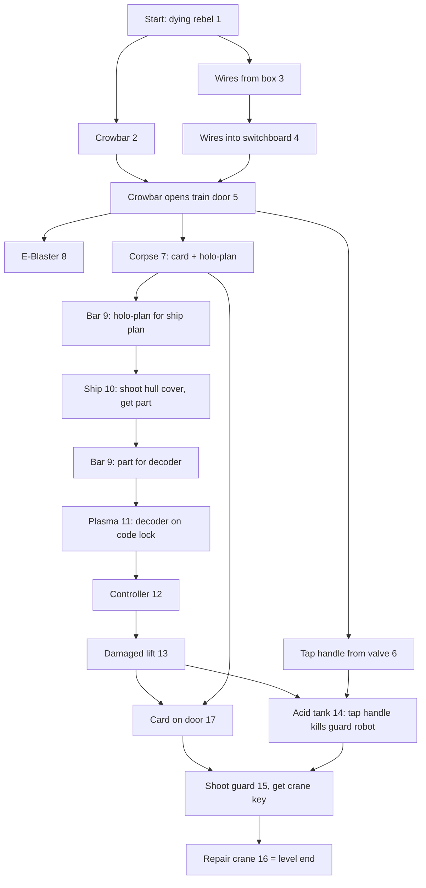

# Colony 28 research

Research base for the colony2080 clone. Collected 2026-10-16 by parallel research agents. Every fact in `reports/` cites its source.

## What the game is

- 1996/97 Czech MS-DOS cinematic side-scroller (5th Dimension / Napoleon Games), in the style of Another World and Flashback.
- Steam re-release 2026-02-20 (app 4381340): the DOS original in DOSBox, Czech only.
- Story: aliens conquered Earth, renamed it "Colony 28" and turned humans into androids. Player is a faulty yellow combat cyborg who kept his human mind and helps the resistance.
- No colony building. The name refers to Earth.

## Key facts

| Area | Fact | Source |
|---|---|---|
| Levels | 9 levels: mesto, vesnice, jungle, jeskyne, vezeni, sklad (+ timed `cas`), raketa, finis, dun (first-person 3D dungeon), then credits | 06, 09 |
| Level structure | Each level is one free-roam map. Tasks form a dependency web, not a fixed list | 06 |
| Map format | `MAPY/Mxy.MAP`: 160x80 cells, 2 bytes per cell (sheet, tile). Mx1..Mx8 are progress-state variants of one map | 09 |
| Tiles | 24x24 px, 104 per sheet, from `LEVx.GRA` (FLI). Map renders at 3840x1920 px | 09 |
| Screen | 320x200, 256 colours. Playfield 290x169 px (~12x7 tiles). One floor = one screen tall (7 tiles) | 04, 09 |
| Graphics files | All `.GRA` and `.ANM` are Autodesk FLI. 247 cutscene ANMs | 09 |
| Controls | Original key bindings, see `config/controls.json` | 07 |
| Combat | "Hide and Shoot": SHIFT steps into background, invulnerable while hidden. Scarce ammo, 3 machine-gun ammo types, unlimited melee | 02, 07 |
| Enemies | Fixed positions, stay dead. Types: plain robots, rocket robots, two-legged walker, flyers, teleporting flyers | 06, 07 |
| HUD | Riveted metal frame. Life + reserve energy bars, shield column, 2 weapon slots with ammo counters, inventory slot, automap | 04, 07, 09 |
| Scrolling | Smooth horizontal scroll with slow parallax. Vertical scroll on lifts. Not flip-screen | 08 |
| Hide visual | Player turns into a dark sprite beside a prop. Enemies ignore him until he steps out and fires | 08 |
| Item use | Every item or door use plays a short pre-rendered 3D clip | 06, 08 |
| Enemies (level 1) | 44 regular enemies (27 chrome droids = engine type 1, 17 flyers = type 2, confirmed in draw code), 2.0 hp each = 14 machine-gun or 4 E-blaster hits, each patrols a fixed range on its floor. Flyers hover 4 rows up, move twice as fast and leave no wreck. Neither fires projectiles: both deal instant damage during a 9-frame fire animation. Plus 2 guards: marker 15 shoot-only (80 hp), marker 14 acid-only. Placement is hard-coded in `KLEV1.EXE`; map column = engine x + 6. Full table: `config/levels/mesto/enemies.json` | 10 |
| Map screen | Automap needs the holo-plan item | 08 |
| Saves | Manual, any time, 5 slots | 07, 09 |
| Carry-over | Ammo, energy, shield carry between levels. Bonus weapons do not | 07 |
| Audio | Dark ambient soundtrack | 04 |

## Level 1 (mesto) task graph

Built from the Score 44 walkthrough map (`sources/cz-walkthroughs/img/1.jpg`). Numbers are the map markers. Three phases: free order in phase 1 and 3, strict chain in phase 2.

Unconfirmed: whether door 17 must come before acid tank 14, and whether the ship plan is a hard requirement.

## Hero robot references

- Armour is orange (box cover, `SKALA3`, `METROPAC`). Gold in `VSTUP` comes from sky lighting.
- The pale plate with 5 holes is a knee pad, not a foot sole (`SKALA3` frame 81 shows full legs).
- `SKALA3.ANM` frame 81 is the user-supplied front reference, decoded natively from game data.
- No original 3D model or large artwork exists: the CD image (`gamedata/raw/CD/Colony28.iso`) holds only game data, 37 S3M music tracks and sound effects. Best clean render is the box front (499x640).
- Head close-ups (`FINAL4`, `UPAD`, `SEBPIST`): side horns plus centre fin, dark faceted mask, red V visor.
- Side view (`METROPAC` f028): shoulder bulbs sit behind the chest, forearm angled forward.

## Open gaps

- Player and enemy sprite sizes and offsets (likely a table inside `KLEV1.EXE`).
- Object and trigger placement for levels 2-9 (level 1 enemy table decoded from `KLEV1.EXE`, report 10).
- Physics values (jump distance, speeds), animation frame counts. No jump, ladder or melee seen in level 1 footage.
- Invasion year: 2013 vs 2018 vs 2028 across sources.

## Contents

Binary and media folders are local only (copyrighted, large); the list lives in the repo root `.gitignore`.

| Path | What |
|---|---|
| `reports/01-official.md` | Steam store, tags, requirements |
| `reports/02-mechanics.md` | Gameplay mechanics |
| `reports/03-level-design.md` | Level structure, screenshots read |
| `reports/04-graphics-audio.md` | Art style, HUD, palette, audio |
| `reports/05-reception-story.md` | Reviews, story |
| `reports/06-cz-walkthroughs.md` | Full Czech walkthrough, all levels, translated |
| `reports/07-manual-magazines.md` | Controls, HUD, rules, magazine coverage |
| `reports/08-video-level1.md` | Level 1 screen by screen from YouTube footage, with timestamps |
| `reports/09-gamedata.md` | Decoded data file formats, maps, strings |
| `reports/10-level1-enemies.md` | Level 1 enemy roster and placement decoded from `KLEV1.EXE`, matched to footage |
| `tools/` | Python decoders: FLI (`fli.py`), map renderer (`rendermap.py`), tiles, strings |
| `sources/steam/` | Steam API and store page snapshots |
| `sources/cz-walkthroughs/` | Walkthrough pages and level map images |
| `sources/manual/` | Pages fetched while searching for the manual and magazines |
| `images/steam-screens/`, `images/steam-shots/` | Steam screenshots (full and small) |
| `gamedata/raw/` | Original game files from archive.org (`msdos_Colony_28_1997`) |
| `gamedata/png/` | Decoded graphics; `maps/all_levels_overview.png` shows every level |
| `gamedata/strings/` | Text dumped from the game executables |
| `robot/cutscenes/` | Robot frames from decoded game clips by view (front, 3/4, side, back, head, gun, hand, feet), contact sheets, `INDEX.md` |
| `robot/web/` | Robot images found online (title menu, box art, Steam), `INDEX.md` |
| `robot/video/` | Robot frames from gameplay videos, `INDEX.md` with sprite notes |
| `robot/sprites/` | Player sprite part sheets cut from `LEV1.GRA` |
| `robot/hires/` | Largest robot images found (box cover, magazine scan), `INDEX.md` |
| `robot/user/` | References supplied by the user |
| `gamedata/png/METROPAC/` | Original crowbar clip frames (reference for the crowbar scene) |
| `gamedata/raw/CD/` | Original CD image |
| `tools/enemies/` | Enemy table disassembly helpers and video-to-map locator scripts |
| `gamedata/disasm/` | `KLEV1.EXE` disassembly, decoded level 1 enemy table, verification disassembly in `verify/` (local only) |
| `gamedata/png/enemy-sprites/` | Rebuilt droid and flyer sprites from `LEV1.GRA` frames 21-24 (local only) |
| `tools/robot/` | Tracing and analysis scripts: grid overlays, tone tracing (`refine*.py`), material shapes (`shapes.py`), edge-snapping optimiser (`snap.py`), IoU check, renderers, headless screenshot scripts (`*.mjs`, need `playwright-core`) |
| `video/` | Six gameplay videos (`*.mp4`), contact sheets, picked frames (`frames-best/`), raw frames (`f5r7/`) |

## Playable reference

Original DOS version runs in the browser: https://archive.org/details/msdos_Colony_28_1997 . `colony28.exe <level>` jumps to a level, e.g. `colony28.exe mesto`.
