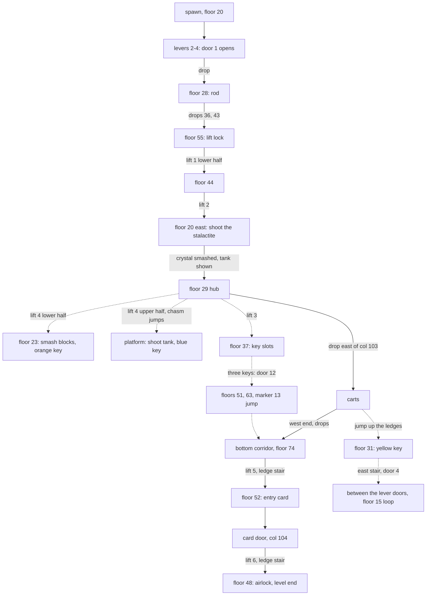

# Jeskyne map inventory

Step 2 of `docs/blueprints/map-composition.md` for jeskyne: every feature of the original map `map_M41.png` (24 px per cell) and its variants M42 and M43, cropped region by region with `tools/map/crop.mjs`, mapped to its asset of the design sheet (`docs/research/jeskyne-assets.md`, `config/levels/jeskyne/objects.json`) or a stated skip. Cells are `col,row`; a floor is named by its row in `config/levels/jeskyne/map.json`. Original facts come from `docs/research/reports/16-level4-layout.md`.

Every region also has: shale rock masses (terrain `wall` and `deep`, `caveRock`), pebble floor strips (terrain `ledge`, `caveFloor`), free-standing rock ledges (terrain `girder`, `rockLedge`), the far cave (`farStalagmites`) in the open dark between floors, the backdrop (`caveBackdrop`), a lift panel beside every lift stop (`liftPanel`) and ground clutter (`mineWreck`, `powderKeg`, `toolCrate`, none in the original). The original has no fence; `safetyRail` may line chasm and lava edges.

## Start, floors 20 and 28 (cols 12-43, rows 8-30)

| Feature | Cells | Asset |
|---|---|---|
| Shale column behind the spawn shaft | 31-36, 8-19 | `caveRock` dressing (sized), the hero falls in front of it |
| Shale pillar beside the drop to floor 28 | 15-19, 18-25 | `caveRock` dressing (sized) |
| Rib bands over floor 20 | 19-25 and 32-35, 16-19 | `rockRibs` (2) |
| Floor 20 | 20-39, 20 | terrain `caveFloor` |
| Lever bank, four levers | 28, 30, 38, 40, 20 | props `leverBank` (4) |
| Lever door 1 | 26, 17-19 | prop `leverDoor` |
| Machine room under floor 20 | 20-34, 21-27 | `metalPillars` |
| Pressure cylinders in it | 20-21 and 28-29, 23-27 | `pressureTank` (2) |
| Lamp glares in it | 22-23 and 25-26, 24-26 | `caveLamp` (2) |
| Rib band in it | 24-34, 23-27 | `rockRibs` |
| Floor 28, steel end cap | 15-30, 28 | terrain `caveFloor`, end cap state at col 15 |
| Rod | 27, 28 | item `rod` |
| Knobbly strands | 14, 16-27; 41, 16-34; 43, 16-33 | `ropeColumn` (3) |

## West drop chain and floor 44 (cols 19-71, rows 28-56)

| Feature | Cells | Asset |
|---|---|---|
| Rib band with dark hollow | 20-35, 30-35 (hollow 25-30) | `rockRibs` hollow state |
| Scree at its foot | 27-34, 34-35 | `screeHeap` |
| Floor 36 | 25-35, 36 | terrain `caveFloor` |
| Shale pillar | 20-23, 36-42 | `caveRock` dressing |
| Machine room front | 28-36, 39-42 | `metalPillars` |
| EXPLOSIVE plate, pipes on its top rail | 28-30, 39; 30-35, 39 | `explosiveSign`, `minePipe` |
| Lamp glare | 28, 39-40 | `caveLamp` |
| Rib bands beside the front | 25-28 and 34-37, 39-42 | `rockRibs` (2) |
| Floor 43 | 20-33, 43 | terrain `caveFloor` |
| Shale pillar | 36-39, 45-49 | `caveRock` dressing |
| Rib band and machine front with curved hull | 35-40 and 41-50, 50-54 | `rockRibs`, `metalPillars` hull state |
| Floor 55, lift lock | 35-51, 55; lock 34-36 | terrain `caveFloor`, prop `liftLock` |
| Knobbly strands | 19, 32-42; 40, 39-54; 47, 20-40; 52, 29-44 | `ropeColumn` (4) |
| Lift 2 shaft, head | 44-46, 20-44; head 45, 15-18 | shared lift, `shaftHead` |
| Lift 1 shafts (split), head | 49-51, 44-55 and 52-54, 29-44; head 50, 24-26 | shared lift (2), `shaftHead` (2: over each half) |
| Floor 44 | 44-69, 44 | terrain `caveFloor`, `liftLanding` at the top stops |
| Key door 12 | 57, 39-43 (original col 55, ruling) | prop `keyDoors` |
| Pressure cylinders over floor 44 | 57-58 and 61-62, 40-43 | `pressureTank` (2) |
| Lamp glares, rib band | 64-67, 40-43; 56-71, 40-43 | `caveLamp` (2), `rockRibs` |

## Middle, floors 20 east to 37 (cols 44-91, rows 13-41)

| Feature | Cells | Asset |
|---|---|---|
| Rib band and machine front over floor 20 east | 47-60, 16-19; front 49-53, 15-19 | `rockRibs`, `metalPillars` |
| Floor 20 east | 44-60, 20 | terrain `caveFloor`, `liftLanding` (lift 2 top) |
| Stalactite | 62-63, 16-18 | prop `stalactite` |
| Chasm under it | 60-67, 20-23 | `chasm` dressing, hazard `stalactiteChasm` (map.json) |
| Marker column in the chasm | 61-62, 20-24 | skipped: zone marker tiles (asset list) |
| Strands | 65-66, 15-28; 76, 30-38 | `ropeColumn` (2) |
| Rib band over floor 23 | 72-79, 18-22 | `rockRibs` |
| Floor 23, orange key | 71-80, 23; key 72 | terrain `caveFloor`, item `orangeKey` |
| Stone blocks | 81, 21-22 (on the col 81 rock cap) | prop `stoneBlocks` |
| Lift 4 shafts (split), head | 82-84, 23-29 and 86-88, 21-23; head 83, 16-18 | shared lift (2), `shaftHead` |
| Shale pillar | 87-91, 12-19 | `caveRock` dressing |
| Floor 21 west of the chasm | 86-94, 21 | terrain `caveFloor`, `liftLanding` (lift 4 top) |
| Rib band with dark hollow over floor 29 | 52-74, 25-28 (hollow 59-71) | `rockRibs` hollow state |
| Crystal | 62-64, 27-28; blocker col 63, 24-28 | prop `crystal` |
| Floor 29 hub | 49-103, 29 | terrain `caveFloor` |
| Rib band with lamps over floor 29 east | 85-103, 25-28; lamps 91, 94, 96, 98 | `rockRibs`, `caveLamp` (4) |
| Lift 3 shaft, head | 72-74, 29-37; head 73, 24-26 | shared lift, `shaftHead` |
| Floor 37, steel end cap, key slots | 58-74, 37; cap 57-58, 35-37; slots 57-59 | terrain `caveFloor` end cap, prop `keySlots` |
| Rib band and machine front over floor 37 | 58-75, 32-36; front 65-71, 32-36 | `rockRibs`, `metalPillars` |
| Floor 24 under the chasm | 93-101, 24 | terrain `caveFloor` |
| Black block | 82-87, 32-34 | skipped: tiles the converter does not decode |

## East, floors 15 to 31 (cols 86-140, rows 8-38)

| Feature | Cells | Asset |
|---|---|---|
| Floor 15 | 93-124, 15 | terrain `caveFloor` |
| Pressure cylinder | 96-97, 11-14 | `pressureTank` |
| Rib bands and machine fronts over floor 15 | 98-129, 10-14; fronts 100-103 and 108-122 | `rockRibs`, `metalPillars` |
| Curved hull plate, bent strut in them | 113-114, 11-14; 115-116, 10-13 | `metalPillars` hull and broken states |
| Rib band and machine fronts under floor 15 | 101-127, 16-20; fronts 110-121 | `rockRibs`, `metalPillars` |
| Ledge stair from floor 15 to floor 21 | 125-131, 16-20 | terrain `rockLedge` |
| Strand | 130, 11-20 | `ropeColumn` |
| Shale pillar | 134-137, 16-20 | `caveRock` dressing |
| Middle platform with rock post | 98-99, 20-23 | terrain `rockLedge` (1 cell), `ropeColumn` (h 2) |
| Chasm 8 | 91-104, 21-23 | `chasm` dressing, hazard `middleChasm` (map.json) |
| Explosive tank (M42 only) | 103-104, 19-20; blocker 103-104, 16-20 | prop `explosiveTank` |
| Floor 21 east | 101-131, 21 (rock caps 107-111) | terrain `caveFloor` |
| Blue key | 117, 21 | item `blueKey` |
| Lever doors 3 and 4 and their levers | 121 and 131, 16-20 (ruling); levers see Tasks | props `leverDoor` (2), `leverBank` (2) |
| Shale pillar | 104-107, 24-36 | terrain `caveRock` (map wall cols 107-116) |
| Rib band over floor 31 | 116-128, 26-30 | `rockRibs` |
| Floor 31, yellow key | 123-136, 31; key 135 | terrain `caveFloor`, item `yellowKey` |
| East ledge stair to floor 21 | 133-137, 22-30 | terrain `rockLedge` |
| Strand | 137, 15-30 | `ropeColumn` |
| Black cells east of col 139 | 139-156, 6-47 | filler `caveRock` (outside the original map) |

## Cart strip and exit, floors 39 to 56 (cols 86-156, rows 30-58)

| Feature | Cells | Asset |
|---|---|---|
| Ledge stair from the carts to floor 31 | 116-121, 31-38 | terrain `rockLedge` |
| Strand | 122, 31-38 | `ropeColumn` |
| Mine carts, X-truss stub | 97-130, 38-39; stub 92-97, 39 | `mineCarts` dressing, conveyor (map.json) |
| Cart crusher (new, the crush zone) | 123-125, 36-40 | `cartCrusher`, hazard `cartCrush` (map.json) |
| Floor 40 under the truss | 88-100, 40 | terrain `caveFloor` |
| Shale pillar | 116-120, 44-47 | `caveRock` dressing |
| Rib bands over floor 48 | 123-130, 135-139, 141-148, 43-47 | `rockRibs` (3) |
| Floor 48 | 123-151, 48 | terrain `caveFloor` |
| Airlock doors, exit zone | 133 and 141, 43-47; zone 136-139 | props `airlock` (2) |
| Strands | 115, 44-55; 152, 43-47 | `ropeColumn` (2) |
| Ledge stair from floor 56 to floor 48 | 116-122, 48-55 | terrain `rockLedge` |
| Rib band, floor 56 | 122-125, 52-55; 116-125, 56 | `rockRibs`, terrain `caveFloor` |
| Lift 6 shaft, head | 127-129, 56-74; head 128, 50-52 | shared lift, `shaftHead` |

## Lower west, floors 51 to 74 (cols 10-80, rows 44-76)

| Feature | Cells | Asset |
|---|---|---|
| Shale pillars | 72-75, 40-48; 76-80, 47-62 | `caveRock` dressing (2) |
| Floor 51 | 71-75, 51 | terrain `caveFloor` |
| Twisted cable | 62-63, 52-58 | `ropeColumn` twisted state |
| Rib band with hollow over floor 63 | 15-62, 58-62 (hollow 47-52) | `rockRibs` (2, hollow state) |
| Machine front with curved hull and bent strut | 18-23, 59-62 | `metalPillars` hull and broken states |
| Floor 63 | 17-60, 63 | terrain `caveFloor` |
| Ammo bonus | 59, 63 | prop `bonus` `ammo` |
| Rib band and machine front over floor 64 | 64-75, 59-63; front 69-73, 60-63 | `rockRibs`, `metalPillars` |
| Floor 64 | 65-79, 64 | terrain `caveFloor` |
| Ledge | 61-62, 67 | terrain `rockLedge` |
| Lava shaft, its marker columns | 12-15, 60-75; markers 11-12 | `lavaPit` dressing, hazard `lava`; markers skipped (asset list) |
| Marker 13 ledge, energy bonus | 16-20, 72; bonus 19 | terrain `rockLedge`, prop `bonus` `energy` |
| Rib band with hollow over the corridor | 18-34, 67-73 (hollow 19-24) | `rockRibs` hollow state |
| Lava curtain | 37-42, 68-73 | `lavaFall` |
| Rib band with hollow, machine front | 45-70, 69-73 (hollow 47-52); front 57-62 | `rockRibs` hollow state, `metalPillars` |
| Pressure cylinder, lamp | 70-71, 70-73; lamp 69-70 | `pressureTank`, `caveLamp` |
| Bottom corridor floor with lava gaps | 21-80, 74; gaps 44, 46-49, 52, 55, 62, 64-65, 67-68, 75 | terrain `caveFloor`, `lavaPit` dressing (gaps and strips under the floor), hazard `lava` |
| Lower pebble strip | 20-80, 76 | terrain `caveFloor` |
| M43 posts | 16-17, 61-62 | skipped: variant data quirk (report 16) |

## Lower east, floors 52 to 74 (cols 80-131, rows 46-76)

| Feature | Cells | Asset |
|---|---|---|
| Ledge stair from floor 66 to the card | 85-93, 53-66 | terrain `rockLedge` |
| Strands | 82, 43-60; 84, 53-66; 93, 58-64 | `ropeColumn` (3) |
| Rib band, floor 52, entry card | 90-100, 47-51; 96-100, 52; card 99 | `rockRibs`, terrain `caveFloor`, item `entryCard` |
| Rib band, floor 58 | 93-112, 53-57; 93-105, 58 | `rockRibs`, terrain `caveFloor` |
| Shale pillar | 109-112, 54-58 | `caveRock` dressing |
| Floor 66, shield bonus | 86-91 and 101-112, 66; bonus 89 | terrain `caveFloor`, prop `bonus` `shield` |
| Rib band | 101-104, 62-65 | `rockRibs` |
| Ledge stair | 108-114, 59-65 | terrain `rockLedge` |
| Strand | 113, 42-65 | `ropeColumn` |
| Lift 5 shaft, head | 97-99, 66-74; head 98, 59-61 | shared lift, `shaftHead` |
| Rib band with lamps and cylinder over the corridor | 80-99, 69-73; lamps 77-80; cylinder 86-87 | `rockRibs`, `caveLamp`, `pressureTank` |
| Card door | 104, 69-73 | prop `caveCardDoor` |
| Rib band with hollow | 105-123, 69-73 (hollow 115-119) | `rockRibs` hollow state |
| Bottom corridor floor with lava strips | 81-129, 74 (gap 92); strips 81-82, 85-87, 91-93, 105-110, 119-123 | terrain `caveFloor`, `lavaPit` dressing, hazard `lava` |
| M43 cell | 102, 72 | skipped: variant data quirk (report 16) |

## Counts

| Region | Features | Placed | Skipped |
|---|---|---|---|
| Start, floors 20 and 28 | 13 | 13 | 0 |
| West drop chain and floor 44 | 19 | 19 | 0 |
| Middle, floors 20 east to 37 | 21 | 19 | 2 |
| East, floors 15 to 31 | 20 | 20 | 0 |
| Cart strip and exit | 13 | 13 | 0 |
| Lower west | 19 | 18 | 1 |
| Lower east | 15 | 14 | 1 |

Missing art found by this pass: the lift shaft head over every shaft (three guide rods, clamp bar, stone counterweight), drawn as `shaftHead` in `spikes/shared/env-jeskyne-extra.js` (objects.json entry, support role). Every other feature has an asset on the sheet.

## Floors and lift stops

| Lift | Cols | Stops (floor rows) | Start | Lock | Original |
|---|---|---|---|---|---|
| 1 lower half | 49-51 | 44, 55 | 55 | `flag:liftLock` | lift 1 (55; after the rod 29, 44, 55), split |
| 1 upper half | 52-54 | 29, 44 | 44 | `flag:liftLock` | lift 1, split |
| 2 | 44-46 | 20, 44 | 44 | - | lift 2 |
| 3 | 72-74 | 29, 37 | 29 | - | lift 3 |
| 4 lower half | 82-84 | 23, 29 | 29 | - | lift 4 (21, 23, 29), split |
| 4 upper half | 86-88 | 21, 23 | 23 | - | lift 4, split; the original cart snap moves this half |
| 5 | 97-99 | 66, 74 | 74 | - | lift 5 |
| 6 | 127-129 | 56, 74 | 74 | - | lift 6, exit route |

Floors the hero walks: 15, 20, 21, 23, 24, 28, 29, 31, 36, 37, 39 (carts), 40, 43, 44, 48, 51, 52, 55, 56, 58, 63, 64, 66, 72, 74. Falls never hurt (`fallDeathCells` null, as the original); the lava, both chasms and the cart crush kill.

## Map passes

Step 3, done in `levelmap.py` (`EXTRAS[4]`); `map.json` is generated, never edited.

- Every lift top stop row is open in the shaft (`shaftBottomOnly`); the deck and `liftLanding` draw the stop.
- The crystal code wall (col 63, rows 24-28) is out of `rows` and listed in `taskWalls` (`openCells`); the `crystal` gate prop blocks it. Until that prop exists, the reach test opens floor 29 on both sides of it with the rod (`GATED`).
- Col 85 between the lift 4 halves is rock from the ceiling down to row 20, so the upper half stop 21 has a wall on its west side and floor 23 still runs under it.
- `rockUp` grows rock up to the rock or floor above at the floor 15 west end (col 92), east of the floor 15 stair (col 137) and the wall columns at cols 81 and 96.
- Left open, each named in `openEnds` of `mapRules.test.ts` with its reason: the start drops, both chasms, every ledge stair, the cart ends, the floor 29 drop to the carts, the floor 44 drop to floor 51 and the floor 51 drop (key route), the lava shaft lips, the corridor lava gaps, and the hanging columns at cols 76 and 89 (ruling). The col 85 wall at rows 53-65 stays short: growing it cuts the drop from floor 51. The doc list also named the stair tops (126,14; 128,15; 124,19; 133,20; 135,21), 101,23, 104,28 and 71,43: closing them cuts a route edge, so they stay open.
- Rock masses whose top is a floor the hero walks (rows 29, 43, 44, 56) count as ground in the wall rule; the world `ground` is row 74, so the corridor floor and the lava band under it need no wall rule exemption.
- `width` 157, `borderFills`, `unseen` and `liftSplits` were done before. No sky (`caveBackdrop` fills open cells).

## Layout

Step 4, in `config/levels/jeskyne/world.json`: sky `caveBackdrop`, haze `rgba(16, 10, 6, 0.45)`, `ground` 74, `terrainArt` wall and deep `caveRock`, ledge `caveFloor`, girder `rockLedge`. 184 scenery items: backdrop 96, dressing 88.

| Region | Items | What |
|---|---|---|
| Start, floors 20 and 28 | 11 | rib bands, machine room with two tanks and two lamps, floor 28 end cap, strand, far cave |
| West drop chain and floor 44 | 33 | hollow rib band and scree, machine front with EXPLOSIVE sign, riser pipe and lamp, hull front on floor 55, tanks and lamps over floor 44, strands, shaft heads of lift 1 and 2 |
| Middle, floors 20 east to 37 | 21 | rib bands and fronts over floors 20 east, 23, 29 and 37, lamps over floor 29 east, stalactite chasm mist, strand, shaft heads of lifts 3 and 4 |
| East, floors 15 to 31 | 25 | tank, rib bands and fronts over floors 15 and 21 (hull and broken strut states), middle chasm mist, platform post, rib band over floor 31, far cave |
| Cart strip and exit | 21 | mine carts and the crusher, rib bands over floor 48 between the airlocks, rib band on floor 56, strand, shaft head of lift 6 |
| Lower west | 47 | rib bands over floors 63 and 64, hull and bays fronts, lava fall, corridor ribs, tank and lamp, lava in every corridor gap and the lava shaft |
| Lower east | 26 | rib bands over floors 52, 58, 66 and the corridor, tank and lamps, strands, lava strips under the corridor, shaft head of lift 5 |

Every lift stop has a panel (16); every shaft has a `shaftHead` (8). Clutter on reached floors: 14 `mineWreck`, 19 `powderKeg` and `toolCrate`.

Layout choices:

- Rock ribs, fronts, tanks, lamps, pipes and signs stand in the backdrop under the haze; the dressing holds the scree, the floor end caps, strands, carts, crusher, lava, chasm mist, shaft heads, small clutter and panels, plus one rib band over the marker 13 ledge.
- The backdrop draws the far cave, then the rock ribs and the lava fall, then the mine wrecks, then the rest: a rib band runs along the whole floor behind it, so a wreck drawn before it would vanish.
- New role `hazard` (`lavaPit`, `chasm`): lava and mist drawn as scenery, not grimed. `mineCarts` is a girder (the walkable conveyor deck). `ropeColumn`, `shaftHead`, `cartCrusher`, `lavaPit` and `chasm` are in `hangs`: strands and heads hang from the cave roof, the crusher frame over the conveyor, lava and mist fill gaps.
- `seenFrom` adds the corridor west of the lava gaps and the marker 13 ledge as sight spots: running jumps and an exact jump reach them, the strict reach graph does not.
- `farStalagmites` and `lavaFall` got grime (grain on the far ground line and on the lava band seams), spike and port.
- Key door 12 takes col 57 on floor 44, so the two pressure tanks there move 2 cells east (cols 59 and 62).

Skipped, with reason:

- Shale pillars (31-36, 15-19, 20-23, 36-39, 72-75, 76-80, 87-91, 109-112, 116-120, 134-137): each stands behind a floor the hero walks or a drop he falls through, and shale behind the hero reads as a wall (map composition: background art never looks like a movement blocker).
- Strands at cols 41, 43, 47, 115, 137, 152 and 113: our map is rock there. Strand 52: lift 1 upper shaft. Strand 130: door 4 cell.
- Rib band 34-37 rows 39-42: floor 43 ends at col 34.
- Lower pebble strip, row 76: rock in our map.
- Lava under the marker 13 ledge (16-19, rows 73-75): no reached spot sees it.

Fixed in the props phase: the carts draw on rows 39-40, so a riding hero stands on their top; the sky (`caveBackdrop`) is the far cave rock over its whole height, no stalagmite ground or lava stripe; the key slots stand at cols 58-60.

## Props

Step 5, in `config/levels/jeskyne/world.json` (`props`) and `config/levels/jeskyne/tasks.json`. No film is built, so no task plays one. 31 props, 8 tasks (3 key slot tasks with 2 alternatives each), 5 quests.

| Prop | Kind | Cells | Spot |
|---|---|---|---|
| `bankLever1`-`bankLever4`, `leverDoor1` | toggle levers, combo gate | levers 28.5, 30.5, 36.5, 38.5 (col 40 is rock); door col 26, rows 17-19 | `moveto(29,20)` |
| `rod` | item | 27.5, 28 | `moveto(27,28)` |
| `dropWarning` | approach, no art | 31.5, 28; quiet with the rod or the lock released | `moveto(30,28)` |
| `liftLock` | object | 35-37, floor 55 (floor 55 starts at col 35) | `moveto(37,55)` |
| `stalactite` | shootable gate, `sets` crystal 1 | 62-63, rows 16-18, hung from the roof at row 13 (`art.top`) | `moveto(58,20)` |
| `crystal` | gate | col 63, rows 24-28 | `moveto(61,29)` |
| `stoneBlocks` | punch-only gate, 10 hits | col 81, rows 21-22 | `moveto(85,23)` |
| `orangeKey` | item | 72.5, 23 | `moveto(73,23)` |
| `explosiveTank` | shootable gate, `shownBy` `flag:stalactiteShot` | 103-104, rows 16-20 | `moveto(99,21)` |
| `blueKey` | item | 117.5, 21 | `moveto(117,21)` |
| `doorLever3`, `leverDoor3` | toggle lever, combo gate | lever 120.3; door col 121, rows 16-20 | `moveto(120,21)` |
| `leverDoor4`, `doorLever4` | combo gate, toggle lever | door col 131, rows 16-20; lever 132.6 on the rock cap | `moveto(132.6,21)` |
| `yellowKey` | item | 135.5, 31 | `moveto(135,31)` |
| `keySlots` | object | 58-60, floor 37 | `moveto(60,37)` |
| `keyDoors` | gate | col 57, rows 39-43 | `moveto(59,44)` |
| bonuses | energy, ammo, shield | 19.5, 72; 59.5, 63; 87.5, 66 (2 cells west of the original: a stair ledge covers col 89) | `moveto(19,72)` `moveto(59,63)` `moveto(87,66)` |
| `lavaWarning` | approach, no art | 17.5, 63 | `moveto(20,63)` |
| `entryCard` | item | 99.5, 52 | `moveto(99,52)` |
| `caveCardDoor` | object | door col 104, rows 69-73; used from cols 101-103 | `moveto(102,74)` |
| `airlockWest`, `airlockEast`, `exitAirlock` | gates, approach | doors cols 133 and 141, rows 43-47; exit zone cols 136-139 | `moveto(131,48)` |

Map changes of this phase (`levelmap.py`): the carts run at 5.5 cells/s (0.75 of the original, the ratio of our run to the original run), the lift 1 halves say their lock hint, and the middle platform over chasm 8 is two cells wide (cols 98-99, the original rock post): a running jump from floor 21 west reached the one-cell platform only with a 0.1-cell timing window.

Fall rule (user): a fall of more than 7 rows kills in every mission, so `levelmap.py` adds seven one-way step ledges where the route dropped further. Each catches the fall and the hero walks off its other end to the old landing; walls hanging above a ledge end keep that end open.

| Drop | Ledge | Check |
|---|---|---|
| floor 20 to 28, the rod | row 26, cols 15-18 | `moveto(17,26)` |
| floor 28 to 36, the lift lock | row 33, cols 32-35 | `moveto(34,33)` |
| floor 43 to 55 | row 49, cols 35-38 | `moveto(37,49)` |
| floor 29 east end to 39 | row 34, cols 104-105 | `moveto(105,34)` |
| floor 40 west end to the entry card stair | row 46, cols 86-88, then the col 89 rock top (row 48) | `moveto(87,46)` |
| floor 40 east end to 48, the entry card | row 46, cols 132-134 | `moveto(133,46)` |
| floor 51 to 64, the key route | row 57, cols 77-79 | `moveto(78,57)` |

Play check (headless, `moveto` hops): the levers open door 1 and lever 1 closes it again, the rod releases the lock, both lift 1 halves and lift 2 ride, the stalactite shot smashes the crystal and shows the tank, 10 punches break the blocks, the tank shot opens floor 21 east, the levers open doors 3 and 4, three keys open door 12, the card opens the card door, and walking or jumping into the exit zone closes the airlocks and ends the level. Both warnings fire for a jumping hero. Running on the carts gains about 0.4 cells/s on them; running jumps reach the west end in a few seconds.

Open items:

- Floor 31 ends at col 136 over open cave, so walking off its east end drops onto floor 48 in the exit zone: carts, ledges, yellow key floor, exit, skipping the card, the card door and lift 6. The original map has the same drop (M41, cols 137-141, rows 31-47 open); the report 16 route takes the card door. Keep or wall it off: user call.
- Key slots state 1 lights the yellow slot only, whichever key went in first.
- The tops of lever door 4 and key door 12 stand free of rock (the asset is one height).
- The chasm 8 jumps stay exact jumps: take off within about a cell of the floor 21 west edge.

## Tasks

The plan for step 5 (props in `config/levels/jeskyne/world.json`, tasks in a new `config/levels/jeskyne/tasks.json`). No mission 4 film is built: tasks play no film; the original film of each is named for later. Subtitles are English (missions 2-4 stay English).

### Start, end and bonuses

- Start: `spawn` (34.5, 20), floor 20 between door 1 and the col 40 rock (the original drop from (34, 14) is gone).
- Level end: the exit airlock on floor 48. Original: walking into cols 136-139 closes doors 6 and 7 (open at start) and level 5 starts.
- Bonuses: `energy` (19.5, 72) on the marker 13 ledge, `ammo` (59.5, 63), `shield` (89.5, 66).

### Items

| Item | Cell | Pickup film | Use |
|---|---|---|---|
| `rod` | 27.5, 28 | `sebtyc.anm` | lift lock, consumed |
| `orangeKey` | 72.5, 23 | `sebk42.anm` | key slots, consumed |
| `blueKey` | 117.5, 21 | `sebk43.anm` | key slots, consumed |
| `yellowKey` | 135.5, 31 | `sebk41.anm` | key slots, consumed |
| `entryCard` | 99.5, 52 | `sebk44.anm` (NALEZL JSI VSTUPNI KARTU) | card door, consumed |

All five are in `config/items.json` with their env assets. No task gives an item.

### Props

| Prop (`kind`) | Asset | Cells (blocker) | States | Notes |
|---|---|---|---|---|
| `lever1`-`lever4` (object) | `leverBank` | levers at 28, 30, 38, 40, floor 20 | 0 down, 1 up | |
| `door1` (gate) | `leverDoor` | col 26, rows 17-19 | `solidStates` [0, 1, 3]; 2 open | |
| `liftLock` (object) | `liftLock` | 34-36, floor 55 | 0 locked, 1 released | |
| `stalactite` (gate) | `stalactite` | 62-63, rows 16-18, over the chasm | 0 hanging, 2 gone | `shootable` hits 1 |
| `crystal` (gate) | `crystal` | col 63, rows 24-28 | `solidStates` [0]; 1 smashed | |
| `stoneBlocks` (gate) | `stoneBlocks` | col 81, rows 21-22 | `solidStates` [0, 1]; 2 broken | `shootable` hits 10 (two blocks, 5 punches each), fists only |
| `explosiveTank` (gate) | `explosiveTank` | 103-104, rows 16-20 | `solidStates` [0]; 2 destroyed | `shownBy` `flag:stalactiteShot` (ruling), `shootable` hits 1 |
| `leverDoor3`, `leverDoor4` (gate) | `leverDoor` | col 121 and col 131, rows 16-20 | `solidStates` [0]; 2 open | |
| `lever3`, `lever4` (object) | `leverBank` | see the lever doors task | 0, 1 | |
| `keySlots` (object) | `keySlots` | 57-59, floor 37 | 0 empty, 1 some keys, 2 all keys | |
| `keyDoors` (gate) | `keyDoors` | col 57, rows 39-43 | `solidStates` [0, 1]; 2 open | |
| `caveCardDoor` (object) | `caveCardDoor` | col 104, rows 69-73; used from cols 99-103 | `solidStates` [0, 1]; 2 open | |
| `airlockWest`, `airlockEast` (gate) | `airlock` | cols 133 and 141, rows 43-47 | 0 open (start), 2 closed | |
| `exitAirlock` (object) | none (between the doors) | 136-139, floor 48 | | see the exit task |

Hazards and the conveyor are already in `map.json`: `stalactiteChasm` (60-67, rows 20-22), `middleChasm` (91-104, row 21), `cartCrush` (123-125, rows 36-40), `lava` (row 74 down), `cartSparks`, the cart conveyor (97-130, row 39, 7.33 cells/s east).

### Task list

| Task | Object | Requires | Consumes | Gives | Sets | Map variant | Original film |
|---|---|---|---|---|---|---|---|
| pullLever2, 3, 4 (two alternatives each: the last of the three opens the door) | `lever2`-`lever4` | the other two lever flags (alternative A) or nothing (B) | - | `flag:lever2`-`4`, `flag:door1Open` (A) | own state 1; A: `door1` 2 | - | - |
| pullLever1 (the wrong lever) | `lever1` | - | - | - | own state 1; says "The lever moved, but nothing happened." | - | - |
| releaseLiftLock | `liftLock` | `item:rod` | `item:rod` | `flag:liftLock` | own state 1 | - | `xtyc.anm` (TYCI JSI PREPNUL MECHANICKOU POJISTKU) |
| shootStalactite (shot) | `stalactite` | gun hit | - | `flag:stalactiteShot` | `crystal` 1, `explosiveTank` shown | M42 | `krapnik1.anm` (SESTRELIL JSI KRAPNIK) |
| smashBlocks (punches) | `stoneBlocks` | 10 punches | - | `flag:blocksBroken` | own state 2 | - | - |
| shootTank (shot) | `explosiveTank` | gun hit, after `flag:stalactiteShot` | - | `flag:tankShot` | own state 2 | M43 | `barelbum.anm` (ZNICIL JSI BAREL S VYBUSNINOU) |
| openLeverDoor3 | `lever3` | - | - | `flag:leverDoor3Open` | `leverDoor3` 2 | - | - |
| openLeverDoor4 | `lever4` | - | - | `flag:leverDoor4Open` | `leverDoor4` 2 | - | - |
| insertYellowKey, insertOrangeKey, insertBlueKey (two alternatives each: the last key opens door 12) | `keySlots` | its key, plus the other two key flags (A) | its key | `flag:yellowIn` / `orangeIn` / `blueIn`, `flag:keyDoorsOpen` (A) | `keySlots` 1 (B) or 2 and `keyDoors` 2 (A) | - | `vkart1-3.anm` (POUZIL JSI ZLUTY / ORANZOVY / MODRY KLIC) |
| openCardDoor | `caveCardDoor` | `item:entryCard` | `item:entryCard` | `flag:cardDoorOpen` | own state 2; hint "You have nothing to open the door with." | - | none (OTEVREL JSI DVERE) |
| leaveCaves | `exitAirlock` | - | - | `flag:levelComplete` | `airlockWest` 2, `airlockEast` 2 | - | none (level 5 starts) |

Lifts 1 (both halves) carry `enabledBy` `flag:liftLock` and the hint "The lift is held by a mechanical safety lock."; `map.json` already has the flag.

### Order

Solid arrows are the shortest route the route test must walk; dotted arrows are the optional key route of the original (the keys and door 12 are the long way round, report 16). Lift 1 is the only way out of the start chain, so a hero who skips the rod is stranded on floor 55: warn on floor 28 east end without the rod (dead ends ruling). Warn before the marker 13 jump (west end of floor 63): the drop past the ledge lands in the lava.

### What the mechanics cannot express yet

- `shootable` has no `sets`: the stalactite shot must smash the `crystal` and show the `explosiveTank`. Add `sets` to `shootable` (the task `sets` code exists).
- `shootable` has `by: "beam"` but no fists-only `by: "punch"`, which the stone blocks need.
- `applyBlocks` ignores `shownBy`: a hidden gate still blocks. Harmless for the tank (floor 21 east is unreachable before the stalactite shot), but a hidden blocker breaks the rule that every blocker has visible art.
- No toggling levers: a task runs once, so the original combination (pull a wrong lever, pull it back) cannot be played. The plan makes lever 1 a harmless decoy.
- No walk-in trigger without a film: `approach` needs a `cutscene`. The exit zone becomes an Enter use (`exitAirlock`), and the two dead-end warnings need an `approach` with only a subtitle.
- Conveyor against the hero: the carts move east at 7.33 cells/s and our run is 6.0 cells/s (the original run beat the carts, 8 cells/s). A hero landing on the carts at cols 104-106 may not reach their west end to drop to the bottom corridor; check with running jumps in game, else lower the cart speed or move the landing.
- The original kills a tank shot fired from too close (cols 100-104); not modelled, so no warning is needed.
- Lever doors 3 and 4: the ruling puts both levers between the doors (door at col 121 with its lever east, door at col 131 with its lever west), where only the floor 15 loop reaches them, and that loop starts between the doors. The original has each lever on the outer side (lever col 123 west of door col 125, lever col 132 east of door col 130). Put lever 3 at col 120 (west of door col 121) and lever 4 on the col 132 rock cap (east of door col 131), or confirm the ruling.

## Region tour

One `moveto` per region, on a cell the hero stands on (also in `docs/tours.md`):

`moveto(34,20) moveto(40,55) moveto(68,29) moveto(115,21) moveto(128,48) moveto(40,63) moveto(100,74)`

| Region | Spot |
|---|---|
| Start, floors 20 and 28 | `moveto(34,20)` |
| West drop chain and floor 44 | `moveto(40,55)` |
| Middle, floors 20 east to 37 | `moveto(68,29)` |
| East, floors 15 to 31 | `moveto(115,21)` |
| Cart strip and exit | `moveto(128,48)` |
| Lower west | `moveto(40,63)` |
| Lower east | `moveto(100,74)` |
