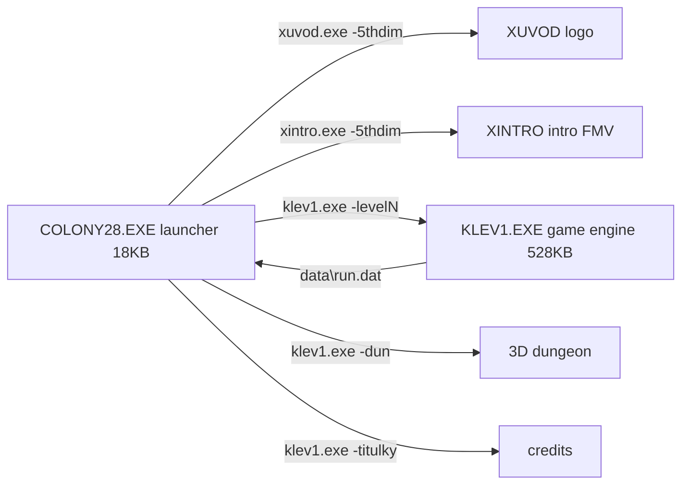

# 09 - Original game data analysis (Colony 28, DOS, 1996-12-24 build)

Source: archive.org `msdos_Colony_28_1997` -> `Colony_28_1997.zip` (558 MB). Files fetched one by one through the archive.org zip-member URL. 174 files (22 MB) are in `gamedata/raw/` (all small and medium files, plus samples of the big ones). The 462 MB `CD/Colony28.iso` and most `.ANM` cutscenes were NOT downloaded; the full file list is in `gamedata/ziplist.txt`. No downloaded program was run. Tools are in `gamedata/tools/`, run with `python3 -I` (or the scratchpad `venv/` that has Pillow+numpy, made with uv).

Demo: not looked for. The game data answered most questions without it.

## TL;DR

- **Every `.GRA` and `.ANM` file is a plain Autodesk FLI** (magic `0xAF11`, 320x200x8bpp, chunks COLOR(11)/LC(12)/BRUN(15)). All of them decode. My decoder is `tools/fli.py`.
- **Levels are tile maps**: `MAPY/Mxy.MAP` = 160 x 80 cells, 2 bytes per cell `(sheet, tile)`. Tiles are **24x24 px**, 104 per sheet (1-based), and come from `LEVx.GRA`. A map is 3840 x 1920 px. **All 9 levels render correctly** (PNGs below).
- `Mx1..Mx8` are not separate areas. They are **variants of the same level map showing progress state** (door opened, wall blown up). Only 2-204 cells differ between them.
- The playfield inside the HUD is **290 x 169 px (x 15-304, y 24-192)**, about 12 x 7 tiles. Floors in the maps are 7 tiles (168 px) apart, so one floor = one screen height.
- Engine: Borland Pascal 7 16-bit DPMI (RTM.EXE + DPMI16BI.OVL) with the MIDAS sound system. Music is S3M (one MOD). SFX are raw 8-bit unsigned PCM `.SND`.
- The final "dungeon" is a **pre-rendered first-person grid maze**: 26 cells, 312 FLI clips (turn and step animations, 6 frames each).
- All mission text sits in KLEV1.EXE in Czech plus partial English. It gives the full item list and the per-level puzzle chains.

## Program flow



COLONY28.EXE maps level-name keywords to engine parameters. Strings appear in name->level pairs:

| param | name (CZ) | meaning | music | background (LEVx.GRA f0) |
|---|---|---|---|---|
| level1 | mesto | city | MESTO.S3M | ruined skyline, red clouds (f1: lightning variant) |
| level2 | vesnice | village | VESNICE.S3M | ruined walls, palms |
| level3 | jungle | jungle | PRALES.S3M | dense jungle; f1 cloudy moon sky |
| level4 | jeskyne | caves | JEEPIE.S3M | rock wall, stalagmites |
| level5 | vezeni | prison | VEZENI.S3M | dark clouds |
| level6 | sklad | warehouse / depot | SKLAD.S3M | barred building, burning sky; airplane on airfield |
| level7 | raketa | rocket base | RAKETA.S3M | mountains, grass (f1 armored vehicle sprite) |
| level8 | finis | alien orbital base | FINIS.S3M | planet in space |
| level9 | (none) | LEV6 tiles recolored orange + M91 = M61 variant (67 cells differ) | ? | same as L6, red/orange |
| -dun | - | first-person dungeon | DUN.S3M | - |

Hypothesis: level9 is the "timed bomb, escape the warehouse" version of level 6 (string: "SPUSTIL JSI CASOVANOU BOMBU. MUSIS SE CO NEJRYCHLEJI DOSTAT VEN" = "You started the time bomb. Get out as fast as possible"). The order matches prior research (YouTube "Level 1 (mesto)").

Map variants per level: L1 6, L2 4, L3 4, L4 3, L5 6, L6 4, L7 8, L8 3, L9 1.

## Inventory

| path | count / size | format | content |
|---|---|---|---|
| COLONY28.EXE | 18 KB | NE (Borland DPMI16) | launcher, level-keyword table |
| KLEV1.EXE | 528 KB | NE (BP7 DPMI16) | whole game engine plus all mission text, MIDAS |
| XINTRO.EXE / XUVOD.EXE | 135 KB each | NE | intro FMV player / logo |
| SETUP.EXE | 132 KB | NE | sound setup (Czech UI, CP852), writes DATA/KOLONY.INI + KOLONY.SND |
| RTM.EXE, DPMI16BI.OVL | | Borland DOS extender | |
| LATIN2.VFT | 4096 B | 256 x 16-byte bitmap font (8x16) | Czech Latin-2 text font |
| KOLONIE.INI | 1024 B | 4 x 256 B records, starts `06 "C:\c28"` then byte pairs | probably progress/state (not keys). Unclear |
| DATA/KOLONY.INI | 86 B | text | "Sound Blaster Pro (DSP v3.xx)", "Klavesnice" (keyboard) = control method |
| DATA/KOLONY.SND | 14 B | binary | SB port/IRQ/DMA, mix rate 0xAC44 = 44100 |
| DATA/HUDBA.DAT | 1 B | flag | music on/off |
| DATA/ZVUK.S3M, ZVUK.SND | | S3M / PCM | setup test sounds |
| GRAFIKA/LEV1-9.GRA | 9 x ~0.8-1.06 MB | FLI, 40 frames | per-level asset bank (see below) |
| GRAFIKA/MAPA1-8.GRA | 3 frames | FLI | in-game automap screens (grey rooms on grid inside HUD) |
| GRAFIKA/DESKA*.GRA | 1 frame | FLI | HUD frame variants (DESKA2-7, DESKAR) |
| GRAFIKA/MENU, MENU2.GRA | 1 frame | FLI | save/load background (robot on red grid) |
| GRAFIKA/NABEH*.GRA, I2*.GRA, NIC*.GRA | 1-31 frames | FLI | inventory screen "INVENTAR / X-BOT STATISTIKA" (+ English E versions) and open animation |
| GRAFIKA/PR*.GRA | 48 files x 31 frames | FLI (LC deltas) | 3D rotating item preview in inventory slot (~44x30 px), one per item |
| GRAFIKA/X*.GRA | | FLI | keypad / door-code mini puzzle close-ups (up/down/left/right arrows, start, end) |
| GRAFIKA/T1-4{D,I,N,R}.ANM | | FLI | rotating stone-triangle puzzle pieces (4 tiles x 4 states) |
| GRAFIKA/UZAVRENI*.GRA, INPROG.GRA, CTLAC1.GRA | | FLI | small cutscene inserts (inventory fade-out, warning text, ceiling crusher) |
| GRAFIKA/[cell][dir][cell][dir].GRA | 312 files, 65 MB | FLI 6 frames | dungeon turn/step clips |
| GRAFIKA/*.ANM | 247 files, 362 MB | FLI | pre-rendered cutscenes: intro, item pickups (SEB* = "sebral" picked up), uses (POUZ*), deaths, doors (OTDVER*), elevators (VYT*), ending |
| ZVUKY/*.SND | 146 files, 4.1 MB | raw 8-bit unsigned mono PCM, no header | SFX + Czech voice lines |
| ZVUKY/*.S3M, PRILET.MOD | 38 files, 9 MB | ScreamTracker 3 / ProTracker | music |
| ZVUKY/PUNISHER.VOC, SYSTEM.WAV | | Creative VOC / WAV | |
| MAPY/M11..M91.MAP | 39 x 25600 B | raw u8 pairs | level tile maps |
| CD/Colony28.iso | 462 MB | ISO | not downloaded |

## LEVx.GRA frame layout (LEV1, 40 frames of 64000 B)

| frame | content |
|---|---|
| 0, 1 | parallax background 320x~170 (+ animated variant such as lightning) |
| 2 | fonts: small 5-px yellow/grey font, big blue 16-px font, ammo/indicator glyphs |
| 3 | HUD frame (empty playfield) |
| 4 | explosion sprites (24-px stride packed) |
| 5-16 | **tile sheets**: 104 tiles of 24x24 stored linearly (576 B each). Map sheet k -> FLI frame k+4 |
| 17-25 | enemy / mech sprites, packed with 24-px row stride (yellow walker mech in f17) |
| 26 | misc |
| 27-32 | **player (X-bot) sprites**: 32-px wide strips, upper body (torso + arm gun) and legs stored as separate parts. Exact per-sprite heights/offsets are not solved (alignment drifts, so the sizes probably come from a table in the EXE) |
| 33 | inventory screen ("X-BOT STATISTIKA", "INVENTAR") |
| 34 | weapon/item icons: pistol, heavy rifle, "DEO1>>" / "TPO>>" cartridges, circuit boards, minigun |
| 35-38 | countdown digits 4, 3, 2, 1 (green) |
| 39 | blank |

Sprite decoding hypothesis: sprites are stored raw (no RLE), back to back, with fixed column widths per bank (24 px for enemies/FX, 32 px for the player). Widths and heights are probably hard-coded in KLEV1. To resolve: disassemble KLEV1, or look at hex runs separated by background colour 0x39.

## HUD (DESKA2.GRA / LEV f3)

- 320x200 Mode 13h, 256 colours, 6-bit VGA palette (FLI COLOR chunk, scaled x4).
- Top bar, left to right: current weapon icon, grenade icon, secondary weapon (flamethrower with flame), 3-digit counter ("029", ammo), hand icon (use/action). Small red LEDs under the slots.
- Left vertical bar = energy (red/orange). Right vertical bar = shield (yellow segments). Strings "ENERGY/ENERGI", "SHIELD", "EXTRA X".
- Playfield: x 15-304, y 24-192 (290x169).

## Dungeon (final segment)

Cell id = row*10 + col (col 10 is written as the next decade, e.g. 50 = row 4, col 10). Directions: S=sever N, J=jih S, V=vychod E, Z=zapad W. File `25J25V` = turn in cell 25 from facing S to facing E. File `25V26V` = step east from 25 to 26. Every clip has 6 frames.

```
    col 1 2 3 4 5 6 7 8 9 10
r2          o-o-o
              |
r3            o
              |
r4    o-o     o     o-o
      |       |     | |
r5    o       o-o-o-o-o
      |       |
r6    o       o
      |       |
r7    o       o-o-o
      |       |
r8    o-o-o-o-o
```

26 cells, 26 links, one loop. `DUNPRED.GRA` = dungeon intro, `DUNZAC.ANM` = start, `*DUN.ANM` = item use inside the dungeon (keys, cards, grenade, welding).

## Strings of interest (KLEV1.EXE)

Encoding: in-game text uses a custom font in which **lowercase letters stand for accented capitals** (a=A-acute, c=C-caron, e=E-acute, f=E-caron, i=I-acute, r=R-caron, s=S-caron, u=U-ring, y=Y-acute, z=Z-caron), `g` = '.', `b` = '?'. SETUP.EXE uses plain CP852. Below the text is normalised.

Credits: names (Martin, Karel), script, program, graphics, level design, character design, dialogues, narrator, production. Names are left out here.

Menu / system: ULOZIT HRU / SAVE GAME, NAHRAT HRU / LOAD GAME, POZICE A-E / SLOT A-E (5 save slots, files `data\Sg*.dat/.jme/.pal/.gra`), RYCHLOST HRY / GAME SPEED (`data\rychlost.dat`), UKONCIT HRU (quit), KONEC HRY / GAME OVER, "Konfiguracni soubor nenalezen - Spustte SETUP.EXE" (config not found, run setup).

Weapons (pickups): TOASTER, RAKETOMET (rocket launcher), FLAMESTREAM, LASEROVE DELO (laser cannon), E-BLASTER, PLAMENOMET (flamethrower), GRANAT (grenade), DYNAMIT, BOMBA. Shield: "DEAKTIVOVANY OCHRANNE STITY. ENERGIE DOPLNENA ZE ZALOZNICH ZDROJU" / "DEFENSIVE SHIELDS DEACTIVATED. ENERGY REPLENISHED FROM SPARE RESOURCES".

Item list per level (blocks between `-level1 loadmision` markers, in order):
1. ZLUTY / ORANZOVY / MODRY KLIC (yellow/orange/blue key), VSTUPNI KARTA (access card)
2. SKLADKA (dump), HRUDNI PLAT (chest plate), KLIC, MECH. ZVEDAK (mechanical jack)
3. ELEKTROMAGNET, DRAT (wire), NADOBA (container), VSTUPNI KARTA, PIST (piston), SVETLICE (flare), KLIC
4. GRANAT, DISKETA, RUKA (severed alien hand), KLIC A, KLIC B, SROUBOVAK (screwdriver), OVLADAC (elevator control)
5. BOMBA
6. TORZO, VYSILACKA (radio), BEDNA (crate), ROZBUSKA (detonator), DYNAMIT, NAV. OBVOD (nav circuit), POJISTKA (fuse), HOLOG. PLAN
7. KLIC, REMEN (belt), VSTUPNI KARTA, ID KARTA, DRAT, HADICKA (fuel hose), PACIDLO (crowbar), OVLADAC, SOUCASTKA (component), MRTVE TELO (dead body), HOLOG. PLAN, NAKRES (drawing), DEKODER, KOHOUT (valve), E-BLASTER, PIST
8. KANYSTR (fuel can), BEDNA, NAPNUTY DRAT (tripwire), KLIC

The block order does not line up 1:1 with the level numbers (the city text mentions the metro, bar, holoplan and decoder). Treat the mapping as unconfirmed.

Sample task/puzzle messages (CZ -> EN):
- NEMUZES JIT DAL. NA DRUHE STRANE MOSTU JE HLIDKA -> You can't go on, there's a patrol across the bridge.
- VYSILACKOU JSI ODVOLAL STRAZE. MUZES PROJIT PRES MOST -> With the radio you called off the guards; you can cross the bridge.
- SPOJIL JSI SE S REBELY. MUSIS OTEVRIT MUNICNI SKLAD -> You contacted the rebels. You must open the ammo depot.
- MAS PRINEST DISKETU / NA DISKETU JSI NAHRAL VIR -> Bring a floppy / you loaded a virus onto the floppy.
- DO IDENTIFIKACNIHO PRISTROJE MUSIS VLOZIT DVA BEZPECNOSTNI KLICE -> Insert two security keys into the ID device.
- K CIDLU JSI PRILOZIL USTRELENOU RUKU. POCITAC TE POZADAL O HESLO -> You put the shot-off hand on the sensor; the computer asks for a password.
- POKUSIL JSI SE K CIDLU PRILOZIT VLASTNI RUKU... NIC SE NESTALO -> You tried your own hand... nothing happened.
- ODSROUBOVAL JSI KRYT SACHTY / KRYT SACHTY JE PEVNE PRISROUBOVAN -> Unscrewed / the shaft cover is screwed tight.
- PRES SACHTU VIDIS SPODNI PATRO. STOJI TAM DELO / GRANATEM JSI ZNICIL DELO -> Through the shaft you see the lower floor with a cannon / you destroyed the cannon with a grenade.
- TELEPORT NEFUNGUJE. MA ROZBITY NAVIGACNI OBVOD / OPRAVIL JSI ROZBITY TELEPORT -> Teleport broken (nav circuit) / you repaired it.
- ZNICIL JSI POJISTKY... / DO ROZVADECE JSI VLOZIL POJISTKU A SPUSTIL JSI ELEKTRARNU -> Fuses / you inserted the fuse and started the power plant.
- MUSIS NAJIT REBELA S HOLOGRAFICKYM PLANEM RAKETY VETRELCU -> Find the rebel with the holomap of the alien ship.
- V BARU JSI NASEL CLOVEKA, ALE NEPOMUZE TI, NEMA K TOBE DUVERU -> Man in the bar won't help; he doesn't trust you.
- MUSIS NAJIT VCHOD DO METRA, TAM NAJDES CLOVEKA, KTERY TI DA HOLOPLAN -> Find the metro entrance; a man there gives you the holoplan.
- NEMUZES JIT DO TUNELU METRA. NENI TAM SVETLO -> Can't enter the metro tunnel, no light (needs the flare).
- PACIDLEM JSI OTEVREL DVERE METRA -> Opened the metro door with the crowbar.
- KYSELINOU JSI POLIL STRAZCE -> Neutralised the guard with acid.
- DEKODEREM JSI ODSTRANIL PRISTUPOVE HESLO A VYPNUL JSI PLAZMOVY OHEN -> Decoder removed the password and turned off the plasma beam.
- DO MOTORU TRANSPORTERU JSI VLOZIL REMEN / DRAT / HADICKU... TRANSPORTEREM JSI ROZRAZIL STENU -> Put belt / wire / hose into the transporter engine... rammed the wall with it.
- TYCI JSI ZASTAVIL VETRAK / VETRAKEM JSI PROLEZL NA DRUHOU STRANU -> Stopped the fan with a rod / crawled through the fan.
- ZMAGNETIZOVAL JSI KODOVY SYSTEM -> Magnetised the code system (electromagnet).
- PRECERPAL JSI VODU DO HORNI / DOLNI NADRZE -> Pumped water to the upper / lower tank.
- Z VODOPADU NAD TEBOU SE VYSUNULY DVA KAMENNE BLOKY -> Two stone blocks emerged from the waterfall.
- HERMETICKY JSI UZAVREL ZBYLY TRAKT BUDOVY -> Sealed the rest of the building.
- Generic: TATO VEC SE ZDE NEDA POUZIT / IT IS IMPOSSIBLE TO USE THIS THING HERE; NIC SE NESTALO / NOTHING HAPPENED; DVERE JSOU ZAMCENE / THE DOOR IS LOCKED; ZABIL JSI MIMOZEMSTANA (killed an alien); ZNICIL JSI BAREL S VYBUSNINOU (destroyed explosive barrel); SESTRELIL JSI KRAPNIK (shot down a stalactite).

Story dialogue (rebels, end of a level): the rebels interrogate the player ("tin can"), who explains that alien hardware failed and he remembered who he is. The holo is the plan of their orbital base, which controls all units on Earth. The rebels will fly him near the alien dome and fit him with a charge. He must get into the ship and detonate it at the reactor. A later briefing: a diversion attack on a mine, then drop in a capsule over the rocket base.

## Controls / key bindings

No key names or binding table found as strings. KOLONY.INI only stores "Klavesnice" (keyboard) as input device. Keys are hard-coded in KLEV1 (not decoded). Prior research (manual/reviews) stays the reference for controls.

## Sound

- `.SND`: headerless unsigned 8-bit mono PCM. Rate is probably 11-22 kHz (not verified). Voice lines (HEJTY "hey you", VYPADNI "get lost", KURVA, JMENUJI, 5MINUT, OK1-4, RAD1-7 radio), footsteps KROK1-4, weapons (KULOMET machine gun, LASER, STRELBA, VYSTREL), explosions, doors, elevator.
- Music: 38 S3M (+1 MOD) per level and per scene (MESTO, VESNICE, PRALES, JEEPIE, VEZENI, SKLAD, RAKETA, FINIS, DUN, MENU1/2, GAMEOVER, INTR2-9, LOGO, TITULKY, OUTRO).

## PNGs produced (`gamedata/png/`)

- `maps/all_levels_overview.png` - L1-L9 maps side by side (best single image)
- `maps/map_Mxy.png` (full 3840x1920) and `maps/map_Mxy_small.png` for all 39 maps. `maps/map_M11_crop.png` = 1:1 detail of city tiles
- `lev_backgrounds.png` - background frames 0/1 of every level
- `lev1/` ... `lev9/` - every frame of LEVx.GRA as PNG + .npy (+ `pal.npy`). Experiments: `lev1/f010_t24.png` (tile grid), `lev1/re_*`, `lev1/stream27_*`, `lev1/f027_off.png` (player sprite strips)
- `hud_top_x3.png`, `DESKA*_f0.png` - HUD
- `ui_screens.png`, `misc_sheets.png` - menu, inventory, puzzle and cutscene samples
- `<NAME>_sheet.png` / `<NAME>_f0.png` for every downloaded GRA/ANM (contact sheet of the first 48 frames at half size + first frame)

## Open questions / next steps

1. Sprite sizes for the player/enemy banks (f17-32): need the table in KLEV1 (disassembly), or an emulator run with a memory dump.
2. Object/enemy/trigger placement is not in `.MAP` (tiles only), so it is probably hard-coded in KLEV1 per level. Not found here; later found hard-coded in `KLEV1.EXE`, see `10-level1-enemies.md`.
3. KOLONIE.INI record meaning.
4. Download the full ISO only if CD audio or extra content matters (zip members already look complete).
