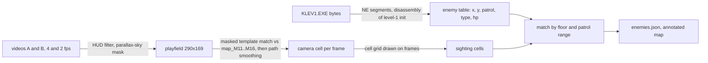
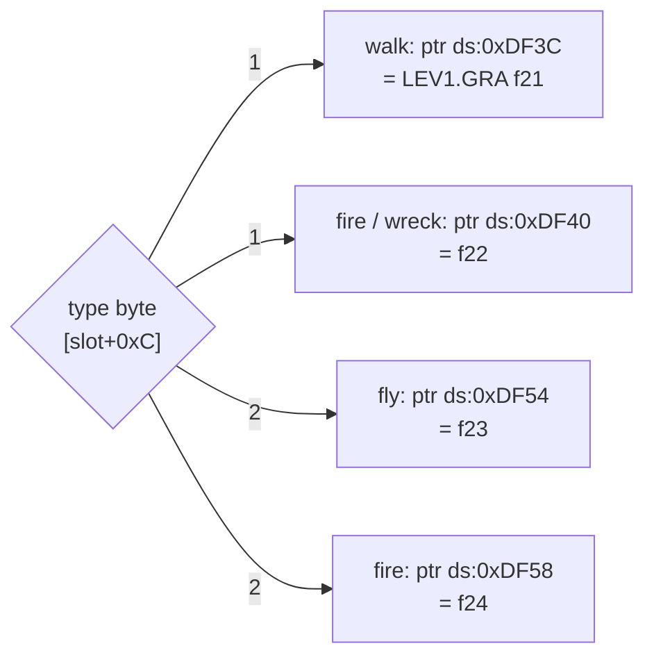

# 10 - Level 1 (mesto) enemy roster and placement

Status: draft. Machine-readable copy: `config/levels/mesto/enemies.json`. Annotated map: `gamedata/png/maps/map_M11_enemies.png`. Evidence frames: `video/enemies/`.

## TL;DR

- **The placement data exists in the game files.** It is hard-coded in `KLEV1.EXE`: the level-1 setup routine fills a fixed enemy table with plain `mov [mem], imm` stores. This overturns the "not found" line in report 09.
- Level 1 has **44 regular enemies: 27 chrome droids (engine type 1) and 17 flyers (type 2)**, plus **two special guards**: one that can only be shot (marker 15) and one that only acid kills (marker 14, drawn as map tiles).
- Every regular enemy has 2.0 hit points and dies below 1.0: **7 machine-gun hits or 3 punches**. The E-blaster beam takes 0.35 per tick from every enemy in range (see `12-eblaster.md`). Each patrols a fixed x range on its own floor.
- 23 of the 44 table entries were matched to a sighting in the two level-1 videos. Every sighting landed inside its entry's patrol range on the right floor.
- No rocket robot, two-legged walker, teleporting flyer or turret appears in level 1. The engine's enemy code only knows types 1 and 2.

## Method

1. **Game data.** `KLEV1.EXE` is a Borland Pascal 7 NE executable. Segment 4 (file base 0x22C00) holds the level-1 setup code right after the strings `m11.map PacIDLO OVLADAc ...` (file offset 0x292D5). It writes:
   - the enemy table at `ds:0x6AEF`: up to 50 slots of 27 bytes. +0/+2 patrol x min/max (16-bit), +4 x and +8 y (32-bit, map cells), +0xC type (1 or 2), +0xD alive flag, +0x15 hit points (6-byte Pascal real, 2.0). Slot 1 is a dummy at (0, 0) that the hit code skips; slots 2, 12 and 16 are unused. Example, slot 3: `mov [0x6b40],0x16`, `mov [0x6b42],0x7d`, `mov [0x6b44],0x26`, `mov [0x6b48],0x35`, `mov byte [0x6b4c],1` (patrol 22-125, x 38, y 53, type 1).
   - a separate table of shootable objects at `ds:0x39B9` (12-byte records): one level-1 entry, x 20, y 10, 80 hit points.
   - player start (x 56, y 53, 350 ammo), item cells and lift columns.
   - Damage code (segment 5, about 0x7D96-0x80F9): weapon 1 (machine gun) takes 0.15 x ammo type per hit (`5:0x7E38`, ammo type 1 in level 1); weapon 2 (fists) takes 0.5 per punch (`5:0x7E79-0x7F63`, constant `cs:0x62E4`), only on the player's floor; weapon 3 (`5:0x7F67-0x80F9`) takes 0.03 per tick from every one of the 40 particles in `ds:0x499E` within 1 cell of the enemy while hp >= 1.0; that table is filled only in levels 3 and 4, so this is the level 3 flamethrower, not the level 1 E-blaster (see `12-eblaster.md`). The death check (`5:0x8102-0x81A1`) kills the enemy once hp < 1.0 (`cs:0x62CC`), so the machine gun kills in 7 hits (2.0 - 7 x 0.15 = 0.95), fists in 3 and the flamethrower in about 34 particle-ticks. See Fists below.
   - No other file holds placement data. The CD image adds only `INSTALL.EXE` and `INSTAL.INI`. `MAPY/*.MAP` files are exactly 25600 bytes. No downloaded program was run.
2. **Coordinate frame.** The engine's x is 6 cells left of the map column where the object is drawn. Checks: the player start (engine x 56) shows the player at map column 62 on the first gameplay frame; the corpse (engine 10) is at column 16; the E-blaster (34) is picked up at column 40; the street-to-metro lift (73) is at column 79; the flyer e26 (engine 129, patrol 127-134) was seen at columns 134-136. Engine y is the top row of a 7-row floor band. Ground enemies stand in row y+5 (floor plank at y+6). Flyers are lifted 4 rows at setup and hover around row y+3. All cells below use **map cells = engine x + 6** and those rows.
3. **Video.** Video A (5r7Yie502C0, native 320x200) at 4 fps from 3:20, video B (KkPeKkoohvk, 640x360 game area rescaled to 320x200) at 2 fps. Frames whose HUD did not match were dropped (cutscenes, inventory, map). The parallax sky (`LEV1.GRA` frame 0) was matched first, so pixels that are just sky are masked out. The rest was matched against `map_M11..M16.png` (grayscale, masked squared difference, coarse search at 1/4 scale, fine search at full scale). A path-smoothing pass picked the most consistent candidate per frame, and broken stretches were re-searched inside the known floor band. Then a 24-px cell grid with map coordinates was drawn on the frames (`video/enemies/*_grid.png`) and each enemy's cell was read off by eye.
4. **Join.** Each sighting was assigned to the table entry on that floor whose patrol range covers it, in order of approach.

## Roster

| Type | Engine type | Count | Look | Behaviour | Hits to kill |
|---|---|---|---|---|---|
| Chrome droid | 1 | 27 | Silver humanoid, same build as the player (`LEV1.GRA` f21-22) | Walks its patrol range on the floor, comes up to the player, fires fast orange bolts. Ignores a hidden player and walks right up to him (A 3:49, 4:21, 5:17). Dies in a big orange explosion and leaves scrap. | 7 machine-gun or 3 punches |
| Flyer | 2 | 17 | Grey-green pod with a nose gun and wing (`LEV1.GRA` f23-24) | Hovers about 3 rows above the floor and patrols with the droids. Fires missiles; one hit killed the player at 10% energy (A 10:09). Can be shot down (A 5:24, 5:43, 6:24, 9:15; B 14:24, 14:38, 14:55). | 7 machine-gun or 3 punches |
| Shoot-only guard (marker 15) | separate table | 1 | Not seen in footage | Stands at the crane level; the crane key lies behind him. Only hurt from the same floor and only by the E-blaster. | 80 hp, 4 per E-blaster hit, about 20 hits |
| Acid-only guard (marker 14) | map tiles | 1 | Tiles in `M11`, replaced by wreckage in `M16` | Blocks the corridor; normal weapons do nothing. The tap handle on the acid tank one floor up kills it ("KYSELINOU JSI POLIL STRAZCE"). | acid only |

Notes:
- The roster in reports 06 and 07 lists plain robots, rocket robots, a two-legged walker, flyers and teleporting flyers for the whole game. Only plain (chrome) robots and flyers are in level 1.
- Type 1 = droid and type 2 = flyer is read from behaviour, not from tracing the draw code: every type-2 entry hovers (y lowered by 4 cells) and every matched sighting agrees.
- The "brownish armoured soldier" in report 08 is the hidden player (the dark hide sprite), not an enemy. `LEV1.GRA` f25 (dark green humanoid with gun) probably holds those hide frames.

## Enemies by floor

| Floor band (engine y) | Area | Entries |
|---|---|---|
| 53 | Long street, start, rebel | e03, e04, e05 (flyer), e06, e07 (flyer), e08, e11 |
| 64 | Metro platform | e09, e10 |
| 69 | Metro tunnel | e15 |
| 45 | Graffiti wall, girder bridge | e13, e17, e18 (flyer), e19, e32 (flyer) |
| 38 | Crowbar ledge (e14), east block above the controller | e14 (flyer), e27, e28, e29, e30, e31 |
| 31 | Bar street | e20 (flyer), e21, e22 (flyer), e23, e24 (flyer), e25, e26 (flyer) |
| 24 | Upper floors | e33, e34 (flyer), e35, e36 (flyer), e42 (flyer), acid guard |
| 17 | Card-door floor | e37, e38 (flyer), e39, e40 (flyer), e41 |
| 10 | Crane level (top) | e43, e44 (flyer), e45, e46 (flyer), e47, e48 (flyer), shoot-only guard |

Floors 24, 17 and 10 most likely open only after the damaged lift (marker 13) is repaired. Neither video reaches them. Their positions come from the table alone.

## Per-enemy table

Cell = map cell [x, y] on the 160x80 grid: for ground enemies the cell they stand in, for flyers the usual hover cell. Patrol = map columns. Times are video time (A = 5r7Yie502C0, B = KkPeKkoohvk), accurate to about 0.5 s.

Confidence: **high** = table entry matched to a video sighting; **medium** = table entry only (spawn cell and patrol exact, type read from the type code, not seen in footage); **low** = position partly inferred.

| id | type | cell [x, y] | patrol x | floor / area | confidence | near marker | first sighting | seen in video |
|---|---|---|---|---|---|---|---|---|
| e03 | chromeDroid | 30, 58 | 11-131 | long street (floor 53) | high | 1 | A 3:57 | Walked in from the left to the hidden player at x 44, killed there (A 4:02). Ammo 324 to 300. |
| e04 | chromeDroid | 44, 58 | 28-131 | long street (floor 53) | high | 1 | A 3:46 | Walked in from the left past the hidden player to x 58, turned back, killed at x 54-55 (A 3:52). Ammo 350 to 324. |
| e05 | flyer | 87, 56 | 11-131 | long street (floor 53) | high | - | A 6:31 | Flyer that follows the player into the colonnade from the left (x about 115). Could swap identity with e07. |
| e06 | chromeDroid | 102, 58 | 81-131 | long street (floor 53) | high | 3 | A 6:17 | Walks left to the fuel tank at x 99-100, killed (A 6:20). |
| e07 | flyer | 113, 56 | 81-131 | long street (floor 53) | high | 3 | A 6:22 | Flies in from the right at x 107-108 above the fuel tank pipes, fires, shot down (A 6:24). Could swap identity with e05. |
| e08 | chromeDroid | 127, 58 | 81-131 | long street (floor 53) | high | 3 | A 6:31 | Walks left through the colonnade (x 116-123) with a flyer, killed (A 6:37). |
| e09 | chromeDroid | 67, 69 | 58-76 | metro platform (floor 64) | high | 4 | A 6:56 | Metro platform, walks right toward the lift at x 74-75, killed (A 6:58). |
| e10 | chromeDroid | 62, 69 | 58-76 | metro platform (floor 64) | high | 4 | A 7:00 | Metro platform, walks in front of the train at x 68-69, killed (A 7:03). |
| e11 | chromeDroid | 14, 58 | 8-23 | long street (floor 53) | high | 1 | A 4:15 | Comes from the left right after the rebel cutscene (A 4:06-4:14), likely the robot shown shooting the rebel. Walks right from x 19-20 to the hidden player, killed at x 21 (A 4:23) for 16 rounds. |
| e13 | chromeDroid | 28, 50 | 26-32 | floor 45 | high | 2 | A 5:05 | Seen from the lift while riding up, then walks left from x 28-29 to the lift, killed at x 28-30 (A 5:09). |
| e14 | flyer | 26, 41 | 24-33 | floor 38 | high | 2 | A 5:22 | Flies at x 29-32 about 3 rows above the floor next to the crowbar spot, fires, shot down (A 5:24). |
| e15 | chromeDroid | 33, 74 | 28-46 | metro tunnel (floor 69) | high | 8 | A 7:41 | Metro tunnel, walks left from x 32-33 firing, killed at x 30-31 (A 7:46). Also B 10:00. |
| e17 | chromeDroid | 46, 50 | 36-67 | floor 45 | high | - | A 5:14 | Walks left from x 46-47 past the graffiti wall to the hidden player at x 39-41, killed (A 5:18). |
| e18 | flyer | 54, 48 | 36-67 | floor 45 | high | - | A 5:40 | Flies at x 49-52 under the girder bridge, shot down while the player hides (A 5:43). |
| e19 | chromeDroid | 56, 50 | 36-67 | floor 45 | high | - | A 5:45 | Walks up to the hidden player at x 56-57, killed at x 59-60 (A 5:49). |
| e20 | flyer | 38, 34 | 29-53 | bar street (floor 31) | high | 9 | A 9:12 | Flies left to the hidden player at x 50-54 near the street lift, shot down (A 9:15). |
| e21 | chromeDroid | 35, 36 | 29-53 | bar street (floor 31) | high | 9 | A 9:18 | Walks to the hidden player under the BAR sign at x 45-46, killed (A 9:22). In B it was killed with the E-blaster at x 53 (B 13:04). |
| e22 | flyer | 78, 34 | 70-130 | bar street (floor 31) | high | 13 | A 10:08 | Flies in from the right at x 82-84 and its shot kills the player at 10% energy (A 10:09, KONEC HRY). In B a flyer is shot down with the E-blaster near x 97-101 (B 14:24), either this one or e24. |
| e23 | chromeDroid | 89, 36 | 70-130 | bar street (floor 31) | high | - | B 14:22 | Stands at x 84-85 by the gantry building east of the bar. |
| e24 | flyer | 104, 34 | 70-130 | bar street (floor 31) | high | 11 | B 14:34 | Flies at x 110-111, shot down with the E-blaster (B 14:38). |
| e25 | chromeDroid | 121, 36 | 70-130 | bar street (floor 31) | high | - | B 14:42 | Walks left at x 115-116 by the fence, killed (B 14:44). |
| e26 | flyer | 135, 34 | 133-140 | bar street (floor 31) | high | - | B 14:53 | Flies at x 134-136 near the lift down, shot down with the E-blaster (B 14:55). |
| e27 | chromeDroid | 128, 43 | 104-130 | floor 38 | high | 11 | B 15:18 | One of two droids waiting at x 127-130 when the player rides the lift down from floor 31. They kill him (B 15:18). |
| e28 | chromeDroid | 111, 43 | 104-130 | floor 38 | medium | 11 | B 15:18 | Probably the second droid in the B 15:18 lift ambush (e28 or e29). |
| e29 | chromeDroid | 107, 43 | 104-130 | floor 38 | medium | 11 | B 15:18 | Possibly the second droid in the B 15:18 lift ambush (e28 or e29). |
| e30 | chromeDroid | 87, 43 | 86-102 | floor 38 | medium | 11 | - | - |
| e31 | chromeDroid | 99, 43 | 86-102 | floor 38 | medium | 11 | - | - |
| e32 | flyer | 103, 48 | 84-113 | floor 45 | medium | 12 | - | - |
| e33 | chromeDroid | 59, 29 | 57-67 | floor 24 | medium | 13 | - | - |
| e34 | flyer | 42, 27 | 35-54 | floor 24 | medium | 17 | - | - |
| e35 | chromeDroid | 48, 29 | 35-54 | floor 24 | medium | 17 | - | - |
| e36 | flyer | 52, 27 | 35-54 | floor 24 | medium | 17 | - | - |
| e37 | chromeDroid | 42, 22 | 35-47 | floor 17 | medium | 17 | - | - |
| e38 | flyer | 45, 20 | 35-47 | floor 17 | medium | 17 | - | - |
| e39 | chromeDroid | 57, 22 | 56-84 | floor 17 | medium | 17 | - | - |
| e40 | flyer | 72, 20 | 56-84 | floor 17 | medium | 17 | - | - |
| e41 | chromeDroid | 75, 22 | 56-84 | floor 17 | medium | 17 | - | - |
| e42 | flyer | 81, 27 | 75-84 | floor 24 | medium | - | - | - |
| e43 | chromeDroid | 64, 15 | 54-121 | top floor 10 (crane level) | medium | - | - | - |
| e44 | flyer | 66, 13 | 54-121 | top floor 10 (crane level) | medium | - | - | - |
| e45 | chromeDroid | 78, 15 | 54-121 | top floor 10 (crane level) | medium | - | - | - |
| e46 | flyer | 95, 13 | 54-121 | top floor 10 (crane level) | medium | - | - | - |
| e47 | chromeDroid | 103, 15 | 54-121 | top floor 10 (crane level) | medium | 14 | - | - |
| e48 | flyer | 112, 13 | 54-121 | top floor 10 (crane level) | medium | 14 | - | - |
| g15 | guardShootable | 26, 15 | - | top floor 10 (crane level) | low | 15 | - | Second guard (marker 15). Separate shootable-object table: 80 hit points, 4 per hit (about 20 hits), only hurt from the same floor. The crane key lies behind him. Cell assumes the same +6 x offset as the enemy table; without it he would stand at x 20. Never seen in footage. |
| acid14 | guardAcid | 110, 29 | - | floor 24 | medium | 14 | - | Guard robot that normal weapons cannot kill (marker 14). Drawn as map tiles at x 109-111, y 28-30, not as a sprite. Using the tap handle on the acid tank one floor up (x 113-117, y 18-23) pours acid on it; map variant M16 swaps it for wreckage. Never seen in footage. The full art is `LEV1.GRA` frame 9 (map sheet 5) tiles 75-77, 88-90 and 101-103: a two-legged walker facing left with a domed head, red visor slit, twin barrels and bird-like feet. The map places only tiles 75, 76, 87-89 and 100-102, so 87 and 100 add a concrete block and the right column is missing. The kill clip `ZABIJ.ANM` (61 frames) shows the same walker from the front: an egg-shaped body, two box gun pods on short arms firing, stubby legs and wide feet. |

## Task markers used

Marker cells come from the item table in the same routine (+6 x offset), the map variant diffs (`M12` train door, `M13` water valve, `M14` card door, `M15` plasma, `M16` acid guard) and the video:

| Marker | What | Cell | Source |
|---|---|---|---|
| 1 | dying rebel | 33, 58 | video A 4:15 |
| 2 | crowbar | 25, 43 | item table (19, 38) |
| 3 | wire box | 127, 57 | video A 6:40 |
| 4 | second switchboard | about 66, 69 | estimate, metro platform |
| 5 | train door | 60, 68 | M12 diff |
| 6 | water valve | 20, 73 | M13 diff |
| 7 | corpse | 16, 69 | item table (10, 64) |
| 8 | E-blaster | 40, 74 | item table (34, 69), video A 7:49 |
| 9 | bar | about 42, 36 | video A 9:19 |
| 10 | crashed ship | about 11, 40 | hull trigger x < 8 (engine), y 35 |
| 11 | plasma | 103, 42 | M15 diff |
| 12 | controller | 112, 50 | item table (106, 45) |
| 13 | damaged lift | 56, 36 | lift table (50, no travel), video B 12:58 |
| 14 | acid tank | 113-117, 18-23 | M14/M16 diff |
| 15 | guard | about 23-26, 13-15 | shootable table (20, 10) |
| 16 | crane | about 26, 11 | crane key at item (15, 10) |
| 17 | card door | 49, 20-22 | M14 diff |

## Hazards and traps seen in level 1

- **Flyers at lifts.** Lifts are the most dangerous spots: flyers patrol right next to them and the player cannot hide while riding. Death in A (10:09, flyer e22 near the damaged lift) and B (15:18, two droids e27 and e28/e29 waiting at the bottom of the lift down from the bar street).
- **Plasma fire (marker 11).** A plasma beam blocks the way to the controller until the decoder is used on the code lock ("VYPNUL JSI PLAZMOVY OHEN"). Whether it damages the player was not seen.
- **Dark metro tunnel.** "NEMUZES JIT DO TUNELU METRA. NENI TAM SVETLO": the tunnel is closed until the switchboard is wired (marker 4).
- **Running water.** "KOHOUTEM JSI UZAVREL PROUDICI VODU": water flows from the valve at marker 6 until closed. Its effect on the player was not seen.
- **Explosive barrels.** The engine has "ZNICIL JSI BAREL S VYBUSNINOU" and `barelbum.anm`. Barrels stand on the street (A 3:48), but no barrel was shot in the footage, so it is unknown whether these are explosive in level 1.
- No mines, spikes or pits in level 1 (mines first appear in level 3 per report 06).

## Unknowns

- Whether type 1 and type 2 have different speeds, fire rates or damage. The table stores none, so they are probably set per type in code.
- How a patrol range drives behaviour: droids clearly walk out of their spawn toward the player, but whether they stop at the range ends was not tested.
- e05 vs e07 and e28 vs e29 could swap identity in the matched sightings; their table positions are unaffected.
- The robot that shoots the rebel in the opening cutscene is not a separate table entry; e11 arrives right after the cutscene and is the best match.
- Two small coordinate tables were not identified: `ds:0x52EF` with (17,38) (17,45) (52,64) (16,69) (98,38) and `ds:0x515F` with (7,35) (33,64). They may be lift calls or trigger zones.
- The shoot-only guard's cell assumes the same +6 x offset as the enemy table. Without it he stands at x 20.
- Floors 24, 17 and 10 were never reached in footage. Only the table describes them.

## Confidence

- Enemy count, types, spawn cells and patrol ranges: HIGH. Decoded from code, with 23 entries confirmed by the footage at the predicted floor and range.
- x offset of +6 cells: HIGH. Five independent checks (player start, corpse, E-blaster, lift, flyer e26).
- Hit points: HIGH for the formula, consistent with the 16 rounds counted for e11 (A 4:23).
- Type names (droid, flyer): HIGH from behaviour; draw code not traced.
- Guard positions: MEDIUM (acid, from map tile diffs) and LOW (shoot-only, from a one-entry table never seen in play).

## Verification (static analysis)

Both inferred conclusions were checked against `KLEV1.EXE` bytes only; no game program was run. All 12 code segments were re-disassembled with `tools/enemies/dis2.py` (it decodes the Borland FPU-emulator `INT 34h-3Dh` opcodes) and the NE relocation tables were resolved, so every `lcall 0:0xffff` placeholder below has a known target. Addresses are `segment:offset` inside the NE segment (seg 4 file base 0x22C00, seg 7 0x54E00, seg 3 0xED00, seg 2 0x9E00, seg 1 0x1000).

Code reads the enemy table with `imul di, slot, 0x1B` and a base of `ds:0x6AD4`, so slot n starts at `0x6AD4 + 27*n` (slot 1 = `0x6AEF`, as above). Fields: +4 x, +8 y, +0xC type (`[di+0x6AE0]`), +0xD state counter (dword `[di+0x6AE1]`), +0x11 pixel x offset, +0x13 pixel y offset, +0x15 hit points. Small fix to the Method text: the "slot 3" store example (`0x6b40...0x6b4c`, patrol 22-125, x 38) is really slot 4 (e04). The JSON already lists those values under e04.

### Q1 - engine type 1 = chrome droid, type 2 = flyer: CONFIRMED (high)

- **Which sprite each type draws.** Per tick, seg 4 `0xD2A2` tests the type. While the state counter is 1-0x18, type 1 calls the sprite routine `4:0xAB47` with the far pointer `ds:0xDF3C` and type 2 with `ds:0xDF54` (`0xD2B6-0xD2E5`). States 0x3E9-0x400 go to the second routine `4:0xB102`, with the same two pointers (`0xD6E2-0xD73B`). Fire states 0x19-0x21 use `ds:0xDF40` for type 1 and `ds:0xDF58` for type 2 (`0xDB39`, `0xDEAF`), and so do states 0x401-0x409, 0x64-0x6C, 0x44C-0x454, 0x6D-0x7B and 0x455-0x463 (`0xE306`, `0xEAC2`, `0xECD8`, `0xEEEF`, `0xEFCA`).
- **Pointer to GRA frame.** Seg 1 `0x01D4-0x0372` allocates 0xFD20-byte buffers (800-byte header + 320x200) and stores their selectors in a 1-based table at `ds:0xDE84` (`0x03CA-0x04DE`). The `ds:0xDF3C`, `ds:0xDF40`, `ds:0xDF54` and `ds:0xDF58` buffers sit in entries 22, 23, 24 and 25. The GRA loader `2:0x2386` (called from seg 1 `0x0526-0x0534` with start 1 and count 0x1D) copies FLI frame k (counted from 1) into entry k at buffer offset 0x320 (`2:0x2471-0x24A2`, `mov si,[di-0x217E]`, `rep movsw` of 0x7D00 words). Entry 22 is therefore 0-based `LEV1.GRA` frame 21, and so on: **type 1 draws f21 and f22, type 2 draws f23 and f24.**
- **Sprite layout inside a frame.** `4:0xAB47` picks animation frame n (1-24) at offset `((n-1) mod 6)*0x480 + ((n-1) div 6)*0x3C00`. It then blits four 24x24 tiles at +0x320, +0x320+0x240 (right), +0x320+0x1E00 (below) and +0x320+0x1E00+0x240. The blitter `8:0x35A4` copies 576 contiguous bytes, with 0 as transparent. So each 24-row band of a GRA frame holds 13 serialised 24x24 tiles, and an enemy frame is a 48x48 sprite from tiles 2k and 2k+1 of two neighbouring bands. Rebuilding the frames this way gives clean sprites: f21 = 24-frame chrome droid walk cycle; f22 = 9 firing frames with an orange muzzle fireball, then 15 frames of a scrap pile; f23 = 24 frames of the grey-green pod; f24 = 9 firing frames with a nose-gun flash, then empty frames.
- **Screen position.** `4:0xAB47`: screen x = (x - player x)*24 + pixel x offset + 0x7C - `[0xDB44]`; screen y = (y - player y)*24 + pixel y offset + 0x7A - `[0xDB48]`.
- **Hover.** Hovering is not tied to the type byte at run time. The level-1 setup (`4:0x79FB-0x7A38`) copies each slot's y into a per-slot pair `ds:0x7465` (top) and `ds:0x7469` (bottom). It then subtracts 4 from both the current y and the top value for slots 2, 5, 7, 12, 14, 16, 18, 20, 22, 24, 26, 32, 34, 36, 38, 40, 42, 44, 46 and 48 (starting at `0x7A3A`). The update (`4:0xD149-0xD27E`) moves the enemy's pixel y offset between the two rows, toward the player's row. The 17 slots whose type byte is 2 all get the lift, and no slot with type 1 does. The only other lifted slots, 2, 12 and 16, are unused. So in level 1 every type-2 enemy has a 4-row vertical range (engine y-4 to y), and type-1 enemies stay on their floor row.
- **Weapons.** Neither type spawns a moving projectile. Each fire state lasts 9 frames. On each tick of that state while the player is within reach (`0xDB84`, `0xDEF6`), the code takes damage straight off player energy (the comp at `ds:0xDB54`). The amount is `(6 - [0xDB32]) / 6 * c`, with c picked by level number `[0xDC78]`. In level 1, c = 0.6 for type 1 (`0xDC50`) and 0.8 for type 2 (`0xDFD8`); the constants are in seg 4 at `0xBA65-0xBAF2`. `[0xDB32]` is the shield count (0-5, drawn at seg 1 `0x2C88-0x2D48` as the 5 shield lights, capped at 5 at seg 3 `0xF6A7`). A new level 1 game sets it to 0 (`4:0x6B6C`). An impact spark goes into table slots 51-89 at the player's x: on fire frame 0x1A for type 1, and on frames 0x1A and 0x1B for type 2 (two flashes per burst). In level 1 only type 2 plays the extra sound 0x1C on frame 0x1B (`0xE282`). So the flyer's "missile" is an instant hit, as is the droid's bolt. Per hit the flyer does about a third more damage and shows two impact flashes.
- **Wreck.** States 0x6D-0x7B loop sheet frames 10-24 (`sub ax,0x6C; add ax,9` at `0xEF0B`). For type 1 these frames are the scrap pile seen in the videos; for type 2 they are empty, so a flyer leaves nothing.
- **Player energy.** Energy is a comp (64-bit integer) at `ds:0xDB54`; a new level 1 game sets it to 98 (`4:0x6C87`, float at `4:0x66D0`), and the HUD shows it as a percent. Each tick `4:0x0199` checks it: below 10 with a shield left it sets energy to 90 (`4:0x97`) and spends a shield (`4:0x01C6`); with no shield the player dies at energy 0 or below, not below 10 (corrected in `11-reserve-energy.md`). This matches A 10:09 (dead at 10% from one flyer burst). The damage constants are `(6 - shields) / 6` times c = 0.6 (`4:0xBA69`) for the droid and 0.8 (`4:0xBAB3`) for the flyer, applied on all 9 fire ticks in reach. The game never sets the FPU control word, so each tick rounds to the nearest integer (`fistp`): with 0 shields both types take 1 per tick, 9 per burst (about 10 bursts from full to dead). With 1 shield the droid takes 0 or 1 per burst; with 2 or more it takes nothing. The flyer keeps 9 per burst up to 2 shields, then nothing. Not checked in the running game.
- **Speed.** During the walk states, `4:0xD2EA-0xD602` adds a pixel x step by level and type. In level 1 (`0xD5AD-0xD602`) the step is 3 px per tick for type 1 and 6 px per tick for type 2, so flyers move twice as fast as droids. Other levels use other pairs (level 7: +3 and +1).

### Q2 - marker-15 guard uses the same x frame (map column = x + 6): CONFIRMED (high)

- **Field order.** In the level-1 record (`4:0x6D6E-0x6D8B`), dword +0 (`0x39C5`) = 10, dword +4 (`0x39C9`) = 20 and byte +8 = 80 hp. The consumers below compare +4 against the player x and +0 against the player y `[0xDB25]`, so x = 20 and y = 10, as the main report says.
- **Where x is used.** Only in collision and hit tests; no draw code reads `ds:0x39B9`:
  - Player blocking, seg 3 `0x614D-0x6356`: `(gx+1)*24` against `px*24 + [0xDB52] + [0xDB44]`. A guard with hp above 0 stops the player.
  - Shot hits, seg 7 `0x050F-0x068C` (level 1 only, `0x008E`): passes if `-144 <= gx*24 - (px*24 + [0xDB44] + [0xDB52]) <= 0` and `gy == player y`. It then subtracts 4 hp and puts an impact spark into the shared effect table `ds:0x4E70` at x = gx, y = gy-1. The routine runs only when the weapon selector `[0x5487]` is 3 (`7:0x0098`), the E-blaster (see Fists below for the weapon ids). A second routine (`7:0x0F46`, levels 2, 5, 6, 7 and 8) takes 6 hp per hit.
- **Comparison with regular enemies.** Enemy targeting (`4:0xCE90-0xCFDB`) uses the same reference, `px*24 + [0xDB52] + [0xDB44]`, against `ex*24 + pixel x offset`. The enemy hit spark (`5:0x7DA0-0x7E0B`) fills the same `ds:0x4E70` effect record the same way (x = enemy x, y = enemy y - 1). Both tables are measured against the same player x with no extra offset, so they share one coordinate frame. The +6 is a property of that frame (player start, items and lifts already show it), so the guard stands at **map column 26, row 10 band** (cell [26, 15]). The bare x 20 would be wrong.

### Fists (static analysis, not checked in the running game)

- **Weapon ids** in `[0x5487]` (seg 1 `0x40A4-0x437B`): 1 = machine gun (ammo `[0xDB36]`, HUD `b31.gra`), 2 = fists (HUD `b32.gra`, key 0xB at any time, forced when both ammo counts are 0), 3 = bonus weapon, in level 1 the E-blaster (key 0xC only after the pickup sets `[0x5486]=1`; the E-blaster pickup at `4:0xA64E-0xA78F` gives 400 ammo, the block at `3:0x9706` with 500 ammo is the level 3 flamethrower, see `12-eblaster.md`). An empty E-blaster switches back to 1; an empty gun switches to 3.
- **Animation** (seg 7 `0x843C-0x8496`): fire with weapon 2 picks `Random(10)`: 0-1 state 0x25, 2-5 state 0x2F, 6-9 state 0x39. Each punch runs about 10 states, then returns to stand (0x19). Ducking uses states 0x63 and 0x6D; the other facing adds 1000.
- **One hit per punch** (seg 3 `0xC0F7-0xC25C`): the damage routine `5:0x62F2` runs once per punch, on frame 0x26, 0x30, 0x3A, 0x63 or 0x6D (and their mirrors), with the punch sound.
- **Target** (seg 4 `0xCDD7-0xD13C`): `d = (ex*24 + enemy px offset) - (px*24 + [0xDB52] + [0xDB44])`, needs -34 <= d <= 34 px (about 1.4 cells), enemy y == player y and the facing side; the nearest wins (`[0x5485]`).
- **Damage** (seg 5 `0x7E79-0x7F63`): an impact spark and `hp -= 0.5` (`cs:0x62E4`). 2.0, 1.5, 1.0, then 0.5 < 1.0 kills on the 3rd punch. Level 1 hp 2.0 is the Real48 at `4:0x6DD8`.
- **Other levels:** a second actor table at `ds:0x39F6` (23-byte records, 20 slots, used when `[0xDC6E]==1`) takes 1.0 per punch with a 50 px reach (`5:0x7A6B-0x7B93`).
- Constant pool at seg 5 `0x62C8`: `0x62CC` 1.0, `0x62D0` 0.1, `0x62DA` 0.15, `0x62E4` 0.5, `0x62E8` 0.03.
- Earlier versions of this report read the fists path as "E-blaster 0.5 per hit" and missed the 1.0 death threshold (14 gun hits, 4 E-blaster hits). The 16 and 26 rounds counted per kill in the videos still fit 7 hits, as the gun spends 1 ammo per call and shots miss.

### Gun, tick rate and enemy reactions (static analysis, not checked in the running game)

Addresses are in `docs/research/gamedata/disasm/verify/`.

- **Tick rate depends on the CPU.** The game step does not use the PIT or retrace waits. Each frame (`7:0xAD5A`) ends with 7 busy loops of `speed*3000` iterations (`7:0xCAB8-0xCCE6`), where speed `[0xDFCC]` is 0-9. With no `data\rychlost.dat`, `1:0x5C03-0x5D24` raises speed while 50 frames take under 1 s, so the target is at most about 50 ticks per s. RYCHLOST HRY sets it by hand (`3:0x2300-0x235E`). Video A spends about 16 rounds per s, so it runs at about 32 ticks per s.
- **Gun rate.** One shot every 2 ticks while fire is held: state 0x25-0x42 loops, and each even state spends 1 ammo and calls the hit routine `5:0x62F2` (`7:0x8496`, `7:0x929F-0x92E5`, `3:0xBFDF-0xC25C`).
- **Hit test.** Instant hit-scan, no random chance. The target (`4:0xCB11-0xCD74`) is the nearest live enemy (hp >= 1.0) in the active window (±12 cells, ±3 rows), on the facing side, in the player row or one row above (below when ducking). Random(12) only scatters the spark (`5:0x7D8C-0x7E75`). Shots with no target in front are spent for nothing, and fire does not stop at a kill. This explains the 16-26 rounds per kill seen in the videos.
- **Hit reaction: none.** A hit changes hp and adds a spark; state changes only on death (`5:0x8158-0x8195`).
- **Turning.** A player behind the enemy at 20-120 px (left) or 44-144 px (right) turns it with chance 1/7 per tick, about 7 ticks on average (`4:0xBD92`, `4:0xBE35-0xC17E`).
- **Firing.** The enemy faces the player, the gap is 40-136 px (player to the left) or 8-118 px (player to the right), rows within ±1, player not hidden (`[0x3BD9]`). Then a burst starts with chance 1/13 per tick (`4:0xC3B2`, `4:0xC41E-0xC7EE`). A burst lasts 9 ticks, then the enemy walks again, so a cycle averages about 22 ticks: about 0.41 energy per tick with 0 shields.
- Not determined: the `[0xDB48]`/6 check and the `[0xE3D2]` condition before an enemy fires.

### Changes

- `config/levels/mesto/enemies.json`: cells and types unchanged. g15 confidence goes from low to medium (code confirms the offset, but he was never seen in play), and its behaviour text now names the weapon id 3 condition.
- Confidence lines above: "Type names: HIGH from behaviour; draw code not traced" is superseded. Type names are now HIGH from the draw code. The shoot-only guard position is now MEDIUM.
