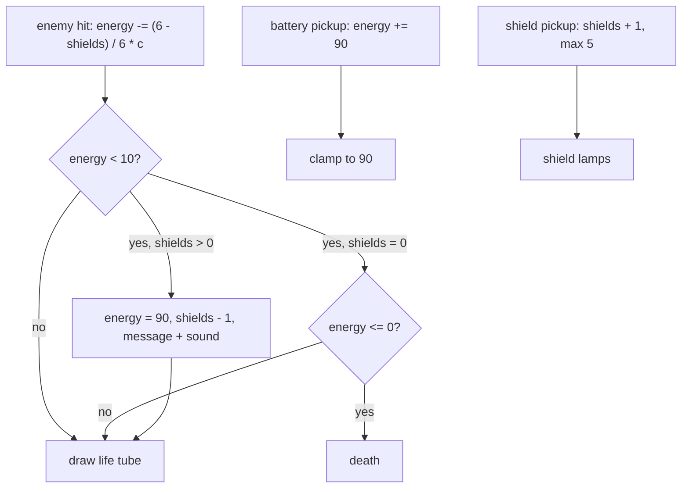

# 11 - Reserve energy, life energy and shields

Question: what the right-side HUD glass tube ("zasobni energie", reserve energy) does in the original, and how it ties to life energy and shields.

Sources: `KLEV1.EXE` disassembly in `docs/research/gamedata/disasm/verify/` (`sN.asm` = segment N; addresses below are `seg:offset`), the HUD image `LEV1.GRA` frame 3 (dumped with `tools/dumpframes.py`), video A (`5r7Yie502C0.mp4`, native 320x200, gameplay 3:44-10:11, sampled at 2 fps) and video B (`KkPeKkoohvk.mp4`, level 1 from 5:00, sampled at 1 fps). Pixel positions are in the 320x200 screen.

Tags: **[code]** read in the disassembly, **[footage]** measured in the videos, **[inferred]** not proven.

## Short answer

- There is no separate reserve variable. The right thin tube is static art in the HUD image and never changes. **[code + footage]**
- The "reserve" the reviews describe is the shield mechanic. When life energy drops below 10 and a shield is left, the game spends one shield and sets energy to 90 (the max) in one step, and shows "DEAKTIVOVANY OCHRANNE STITY. ENERGIE DOPLNENA ZE ZALOZNICH ZDROJU" ("Defensive shields deactivated. Energy replenished from spare resources"). With no shield left nothing refills, and the player dies when energy reaches 0. **[code]**
- The 5 shield lamps under the thin tube on the right (`S` key) are the reserve display. Each lit lamp is one stored refill. **[code]**

## Variables

| What | Where | Notes |
|---|---|---|
| Life energy | comp (64-bit int) at `ds:0xDB54` | max 90 |
| Shields (reserve refills) | dword at `ds:0xDB32` (high word `0xDB34`) | 0-5 |
| Last drawn energy | Real48 at `ds:0xE3D6` | the life tube redraws only when energy changes |
| Battery / battery / shield pickup taken | bytes `ds:0x5156`, `0x5157`, `0x5158` | cleared at each level start |

## Life tube (left, `E`) - seg 4 `0x0131-0x0369` **[code]**

- Once per tick a counter `[0xDC79]` runs 0-40. When it is 1 and energy < 20 (float 20.0 at `4:0x008F`) a sound call runs (`4:0x0166-0x016D`): the low-energy warning beep, about once per 40 ticks. **[code; sound role inferred]**
- If energy equals the last drawn value, the routine stops here (`4:0x0182-0x0196`).
- **Shield refill** (`4:0x0199-0x01FE`): if energy < 10.0 (`4:0x0093`) and shields != 0: energy = 90.0 (`4:0x0097`), shields -= 1, message timer `[0x4991]` = 250, a sound call, and the message string at `4:0x009B` is copied into the message line `ds:0x4891`. The English string sits next to it at `4:0x00DF`.
- **Empty** (`4:0x0203-0x022B`): if energy <= 0.0 (`4:0x0125`) a two-call sequence runs on the HUD image `[0x2F4C]` and the screen `[0x95A]`. **[code; that this is the death trigger is inferred, see footage]**
- **Cap** (`4:0x022D-0x024F`): if energy > 90.0 it is set to 90. There is no other cap.
- **Draw** (`4:0x02E0-0x034C`): the tube is 2 px wide at x 6-7, y 73-164 (screen offset `0x5B46`). It blanks `91 - energy` rows from the top to black, then copies `energy + 1` rows of the full tube from the HUD image (`[0xDF04]`). So the fill rises from the bottom, 1 px per energy point.
- Below 29.0 (`4:0x0129`) and above 0 a second check on `[0xDB41]` decides if the tube redraws this tick (`4:0x0282-0x02C4`). Not decoded; it may be a blink. **[inferred]** Footage A at energy 9 shows no visible blink at 2 fps.
- At energy <= 0 the tube does not redraw, so it freezes at its last level. **[code]**

## Start values, new level 1 game **[code]**

- Energy: 98.0 (`4:0x6C87`, float at `4:0x66D0`). The cap brings it to 90 on the first tube update.
- Shields: 0 (`4:0x6B6C`).
- Other level setups in seg 4 set shields to 3, 4 or 5 (`4:0x0DAA`, `0x1C11`, `0x2A7F`, `0x382B`, `0x5CEA`) and 1 (`4:0x4D52`), and `7:0xD4F5` sets 1. These are probably the `-levelN` start parameters, and they fit the cheat note "level start params give full energy and shields". **[inferred]**

## What fills energy and shields **[code]**

| Pickup | Code | Effect | Level 1 position (engine x, y) |
|---|---|---|---|
| Battery 1 (`[0x5156]`) | `5:0x4F0E-0x50C1` | energy += 90.0 (`5:0x49CB`), then the cap makes it 90: a full refill | x 120, y 17 (map column 126 with the +6 offset from report 10) |
| Battery 2 (`[0x5157]`) | `5:0x51CC-0x5366` | same, + sound | none in level 1 (0, 0) |
| Shield (`[0x5158]`) | `5:0x5D0B-0x5EEB` | shields += 1, capped at 5, + sound | x 18, y 17 (map column 24) |

- Each pickup triggers when the player stands within about 10 px of it (`5:0x502D-0x503C`) on the same row (`[0xDB25]`). It sets its flag, so it is taken once per level.
- Shields also cap at 5 in the lamp draw (`3:0xF69E-0xF6CF`).
- No energy regeneration was found. Only the 4:0x0199 refill, the two batteries and level-start values raise energy. **[code, scan of every `fistp [0xDB54]` site]**

## What drains energy **[code]**

- Enemy fire: `energy -= (6 - shields) / 6 * c` per fire tick in reach (report 10). So every shield also cuts damage by 1/6.
- The same `(6 - shields) / 6` scaling appears at other damage sites (`3:0xD85B`, `3:0xE694`, the seg 4 and seg 5 blocks around `0xDC57-0xE9A0` and `0x16EB-0x2D36`). These are hazards or other enemy types; not mapped one by one.
- Shields only drain through the refill at energy < 10. Nothing else lowers `[0xDB32]`.

## Shield lamps (right, `S`) - seg 3 `0xF69A-0xF81C` **[code]**

- Clamps shields to 0-5.
- Draws 5 unlit lamps, 6 x 9 px at x 311, y 115 + 10*i (i = 0-4), copied from the same spot in the HUD image.
- Then draws `shields` lit lamps from the bottom up: lamp i at y 115 + 10*i + 10*(5 - shields), copied from the lit lamp painted at y 155 in the HUD image. So 1 shield lights the bottom lamp.

## Right thin tube (the "reserve" tube) **[code + footage]**

- In `LEV1.GRA` frame 3 (the HUD image, buffer `ds:0xDF04` = GRA table entry 4) it is a thin brown-pink tube at about x 309-310, y 55-108, above the lamps. It looks half lit and is painted, not drawn.
- No code draws into that area. Every routine that copies from the HUD image (`[0xDF04]`) was checked: the life tube (`4:0x02E0`), the shield lamps (`3:0xF6D2`), the weapon and ammo plates (`6:0x99CC-0x9CAB`) and full-frame redraws (`1:0x5F70`, `1:0x6268`, `3:0x4F07`, `7:0xCD6B`). The only other column loops with a 320-byte stride (`8:0x3380-0x34A9`) are generic sprite blitters.
- Footage A 3:44-10:11: the tube's pixel column (x 309-310, y 50-112) stays the same while life drops from 90 to 9, apart from compression noise. Video B level 1 (5:00-15:23): same.
- Only `KLEV1.EXE` was checked. `COLONY28.EXE` runs the later levels and might use the tube. **[open]**

## Displayed percent **[code + footage]**

- The inventory screen "X-BOT STATISTIKA" (seg 1 `0x2780-0x2E52`) prints `ENERGIE` as `energy / 90 * 100` % (`1:0x2DCF`, floats 90.0 and 100.0 at `1:0x2224`, `1:0x2228`) and `STITY` as a glyph bar (`1:0x2C81-0x2D6C`, strings `kkkkkl` empty, `m` to `mpqvw` for 1-5).
- Footage: B inventory (frame `frames-best/L1_KkPeK_t0901_inventory_energy10pct_ammo501_extra324.png`) shows "ENERGIE 10%" with an empty shield bar = energy 9.

## Footage checks

| Time | Life tube rows (energy + 1) | Lamps | Meaning |
|---|---|---|---|
| A 3:44 | 91 | all unlit | start energy 98 capped to 90, 0 shields **[footage + code]** |
| A 4:18-7:45 | 86, 82, 73, 55, 46, 37, 28, 20, 10 | all unlit | drops in steps of about 9 = one burst **[footage]** |
| A 7:45-10:08 | 10 (energy 9) | all unlit | alive below 10 with 0 shields for over 2 minutes **[footage]** |
| A 10:08 | 3, then death | all unlit | missile hit; tube freezes as energy <= 0 is not drawn **[footage + code]** |
| B 5:00-15:23 | - | all unlit (one 1 s blip at 8:29 is not gameplay) | no shield is ever picked up or spent **[footage]** |

No video shows a battery pickup, a shield pickup, a lit lamp or a shield refill, so the refill and pickups are code-only. **[open]**

## Corrections to earlier notes

- Report 10 and `docs/requirements.md` say the player dies "below 10 with no shield". The code kills at energy <= 0. Below 10 only triggers the shield refill. Footage A 7:45-10:08 confirms: energy 9, 0 shields, still alive.
- The max energy is 90, not 98 or 100. 98 is only the raw start value, capped on the first tick. The HUD percent scales by 90, so a full tube reads 100%.
- The reviews' "reserve energy bar" is not a separate store. It is the shield lamps plus the refill message.
