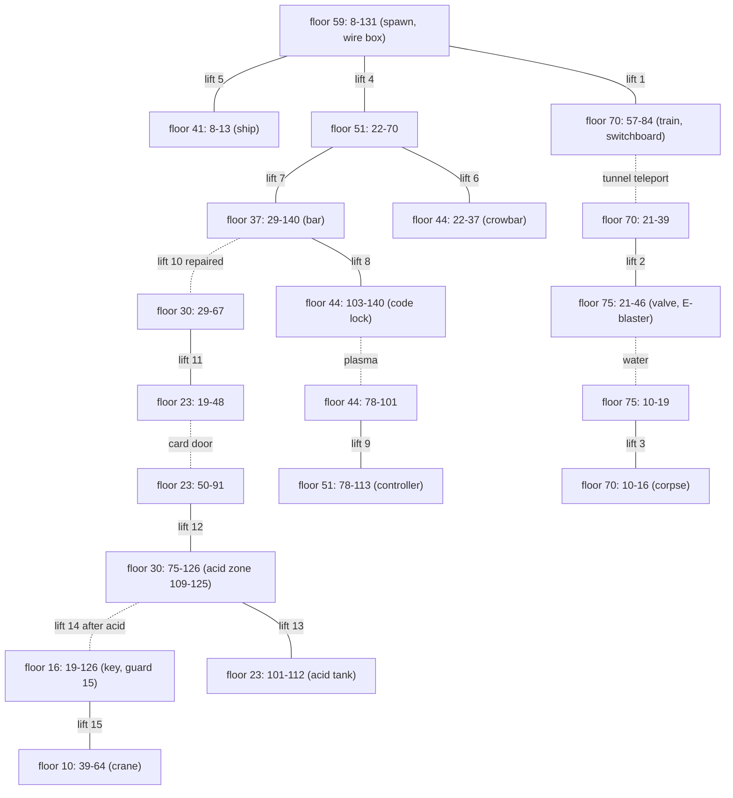

# 13 - Level 1 (mesto) layout: lifts, items, blocking

Status: draft. Machine-readable copy (local only): `gamedata/disasm/level1_layout.json`. Addresses are `segment:offset` in `gamedata/disasm/verify/a*.asm`. Tags: **[code]** read in the disassembly, **[map]** checked against `MAPY/M11..M16.MAP`, **[inferred]** not checked in the running game.

## TL;DR

- **15 lifts**, one 24-byte slot each at `ds:0x4C90 + 0x18 * (n - 1)`. 14 have two stops, lift 14 has three. Lift 10 is the damaged lift: no travel until repaired. Every stop row shows the lift deck tiles `(9,2) (9,3) (9,4)` at exactly the lift columns: 15 of 15 lifts, 31 of 31 stops. **[code] [map]**
- **Items** sit in an 11-record table (`0x111` bytes per record). Five lie on the map: crowbar, controller, crane key, the corpse card and the E-blaster. The other six are given by tasks. **[code]**
- **No floor collision and no ladders.** The hero moves along floor bands only. The row changes only by lifts and two scripted teleports (the metro tunnel). **[code]** Recheck: the engine has a per-level floor tile list with falling (level 1 list at `7:0xC9C8`, reports 14-16). **[open]**
- **Horizontal blocking** comes from three sources: a per-level list of wall tiles checked in the hero stand row, two small wall tables (the two "unknown" tables of report 10), and a code zone for the acid guard. **[code]**

## Coordinate frame

Same frame as report 10: map column = engine x + 6, floor (plank) row = engine y + 6, stand row = engine y + 5. Floors: 10, 16, 23, 30, 37, 44, 51, 59 (street), 70 and 75 (metro). Lift 5 adds a stop at row 41 (crashed ship deck). Map clamp (`1:0x403A-0x40A4`): engine x 1-151 (columns 7-157), engine y 1-71. Spawn: engine (56, 53) = cell (62, 59). **[code]**

The tile wall scan (`3:0x5013`) reads a 14-column window that starts at map column = engine x and draws the hero 141 px into it, so the hero sits 5.9 cells right of engine x. This is where the +6 comes from. **[code]**

## Lifts

Slot fields: +0 pixel offset (word), +2 current row, +6 x, +0xA top, +0xE mid, +0x12 bottom (dwords), +0x16 speed (word). Update loop `7:0x51CF`, 15 slots. **[code]**

| Lift | Engine x | Columns | Stops (floor rows) | Start | Notes |
|---|---|---|---|---|---|
| 1 | 73 | 78-80 | 59, 70 | 59 | street to metro |
| 2 | 20 | 25-27 | 70, 75 | 70 | metro |
| 3 | 5 | 10-12 | 70, 75 | 75 | metro west, corpse side |
| 4 | 19 | 24-26 | 51, 59 | 59 | |
| 5 | 3 | 8-10 | 41, 59 | 59 | ship deck, passes 44 and 51 without stopping |
| 6 | 29 | 34-36 | 44, 51 | 51 | crowbar floor |
| 7 | 62 | 67-69 | 37, 51 | 51 | passes 44 |
| 8 | 126 | 131-133 | 37, 44 | 37 | |
| 9 | 77 | 82-84 | 44, 51 | 44 | |
| 10 | 50 | 55-57 | 37 (after repair 30, 37) | 37 | damaged lift, marker 13 |
| 11 | 28 | 33-35 | 23, 30 | 30 | |
| 12 | 79 | 84-86 | 23, 30 | 23 | |
| 13 | 99 | 104-106 | 23, 30 | 30 | |
| 14 | 117 | 122-124 | 16, 23, 30 | 30 | three stops |
| 15 | 47 | 52-54 | 10, 16 | 16 | crane floor |

- **Damaged lift.** At init lift 10 has top = mid = bottom = 31 (one stop). The repair handler (`5:0xD51B-0xD686`: hero engine x 50-54, row 31, controller selected) rewrites the slot to top 24, mid 31, bottom 31. That is the only way to the floors above 37. **[code]**
- **Ride rules.** The lift works when `-18 <= heroPx - x*24 < 38` and the hero row is between top and bottom. Up starts when the lift is stopped, not at top, and the hero row is mid or bottom. Down mirrors it. The lift stops on any of its stops. Speed ramps 8, 6, 4, 1 px per tick near a stop. **[code]**
- **No remote call.** The lift moves only with the hero on it. A hero at a stop where the lift is not cannot bring it. Start stops matter. **[code]**
- No slot has a flag check apart from the repair. `enabledBy` is `flag:upperFloorsOpen` for lift 10 and null for the rest. **[code]**

## Items

Record n (1-based): x at `0x548A + 0x111n`, y +4, name +8 (string), owned flag +0x108 (`0x5592 + 0x111n`). The selected inventory slot `[0x5154]` is the record number. Pickup (`4:0x8B02`): hero engine x is X-2, X-1 or X, same row, not owned. **[code]** This settles the record layout: report 10 paired names and cells the same way.

| Record | Item | Engine | Cell (col, floor row) | Marker |
|---|---|---|---|---|
| 1 | crowbar | 19, 38 | 25, 44 | 2 |
| 2 | controller | 106, 45 | 112, 51 | 12 |
| 4 | crane key | 15, 10 | 21, 16 | 16 (key; the crane is on floor 10) |
| 6 | card (at the corpse) | 10, 64 | 16, 70 | 7 |
| 11 | E-blaster | 34, 69 | 40, 75 | 8 (out of mission scope) |

Not on the map (x = y = 200), given by tasks: 3 ship part, 5 wires (wire box), 7 holo plan (set together with record 6, `4:0xA601`), 8 ship plan, 9 decoder (bar), 10 tap handle (valve spot). Each item cell is inside a walk segment that a lift or the spawn reaches. **[code] [map]**

## Blocking

### Wall tiles (stand row only)

`3:0x5013` scans map rows engine y .. y+7 and acts only on row y+5 (the stand row), and on row y+6 while a lift moves. A tile blocks when its `(sheet, tile)` is in the level list, about 0.6-1.4 cells ahead in the facing direction (`3:0x5E79` pushes the hero back). Level 1 list (`3:0x5898-0x594C`): **[code]**

| Sheet | Tiles |
|---|---|
| 6 | 65, 68, 78, 81, 91, 94, 104 |
| 7 | 28-33, 40-43 |
| 10 | 28, 30, 32, 53 |
| 11 | 89, 90 |
| 12 | 17-25, 30-38, 44-55, 68, 81, 94 |

43 of these 56 pairs occur in M11. Wall tiles outside the stand rows (for example columns 46 and 66 on row 54) do not block in the original. **[code] [map]**

### Wall tables (report 10 unknowns)

`ds:0x52EF` and `ds:0x515F` are 20-entry wall tables, 8 bytes per entry (x, y). They apply when the hero row is y, y-1 or y-2 (`3:0x6549-0x678F`). A west entry pushes the hero right while he is within 5 cells left of x: he cannot walk left past it. An east entry is the mirror. **[code]** Column equivalents are the column a wall tile would need to stop the hero at the same pixel (offsets rounded to whole cells). **[inferred]**

| Table | Engine | Floor | Solid column | Meaning | Removed by |
|---|---|---|---|---|---|
| west | 17, 38 | 44 | 21 | ship hull, east side | - |
| west | 17, 45 | 51 | 21 | ship hull, east side | - |
| west | 52, 64 | 70 | 56 | metro tunnel, east end | - |
| west | 16, 69 | 75 | 20 | running water | valve closed, M13 (`5:0xE230`) |
| west | 98, 38 | 44 | 102 (beam art 103) | plasma | decoder, M15 (`5:0xD0E2`) |
| east | 7, 35 | 41 | 14 | ship deck end | - |
| east | 33, 64 | 70 | 40 | metro tunnel, west end | - |

The water and plasma columns match the M13 and M15 diffs (columns 20 and 103). **[code] [map]**

### Scripted blocks

- **Metro tunnel.** Columns 41-55 of floor 70 have no walkable access. Use at engine x 53-57, row 64 (columns 59-63) teleports to engine x 31 (column 37) once the switchboard is wired and the train door is open. Otherwise the "no light" message plays. Use at columns 36-40 teleports back to column 60 (`5:0xDF05-0xE012`, `5:0xE369-0xE426`). **[code]**
- **Acid guard.** While the map is not M16, a hero on floor 30 at engine x 103-119 (columns 109-125) triggers the kill clip and is pushed back one cell (`3:0xDF10-0xE429`). Lift 14 stands in that zone, so floors 16 and 10 open only after the acid. **[code]** Whether the clip kills or only hurts was not traced. **[inferred]**
- **Card door.** Map tile wall: the stand-row tile at column 49, row 22 is `(10,32)` (solid) in M11 and `(10,31)` (open) in M14. **[map]**
- **Train door.** It does not block walking. It gates the tunnel teleport. **[code]**

## Map variants

Order follows the task chain: M11 start, M12 train door, M13 valve, M15 plasma, M14 card door, M16 acid guard dead. Each variant keeps the earlier changes. **[map]**

| Variant | Object | Changed cells (cols x rows) | Blocking effect |
|---|---|---|---|
| M12 | train door | 60-61 x 67-69 | none |
| M12 | art beside acid guard | 112-115 x 24-29 | none |
| M13 | valve, water | 20 x 73-74 | water wall column 20 gone |
| M15 | plasma | 103 x 42-43 | plasma wall column 102 gone |
| M14 | card door | 49 x 20-22 | door tile wall at column 49 gone |
| M14 | acid tank and guard | 108-118 x 18-29 | tank walls move from 113-116 to 115-118, guard tiles from 109-111 to 113-115 |
| M16 | acid guard wreck | 113-115 x 21-29 | none (the code zone ends) |

## Floors and lifts

Reached walk segments in M11 (columns) and their links. Dashed links open with a task.

Lift 14 also stops on floor 23 (columns 117-126).

## Notes for the port

- The original has no holes in floors: the plank row inside every walk segment counts as solid, whatever tile it shows. Shaft cells (lift columns from top stop to bottom stop) are open. Lifts 5 and 7 pass floors 44 and 51 only inside segments no lift reaches, so no reached floor has an open shaft.
- The task web in `config/levels/mesto/tasks.json` lists "openDoor vs acidGuard ordering" as unconfirmed. Reach settles it: the card door comes first (the acid tank is reached through it).
- The original lifts cannot be called. The clone may differ, but start stops then decide which routes exist.

## Our blockers

Our hero falls, and floors sit 7 rows apart, the same as `fallDeathCells`: a hole in a floor is a survivable drop. The lift reach rule (`src/game/level/reach.test.ts`) finds two shaft holes that join floors past a lift. `docs/research/tools/mestomap.py` (`SHAFT_FLOORS`) puts an invisible `|` row under each bottom stop:

| Cells (col, row) | Lift | Drop it stops |
|---|---|---|
| 52-54, 17 | 15 (crane floor, bottom 16) | floor 16 to floor 23, past lifts 12 and 14 |
| 33-35, 31 | 11 (bottom 30) | floor 30 to floor 37, past the damaged lift 10 |

With the deck away the hero drops one row into a 3-wide pit. A walk or standing jump does not get out, a running jump does from any pit cell, both ways (tested in `reach.test.ts`). The deck cannot come down on him: lifts move only with the hero on them. Drops down a lift's own shaft count as riding it. Drops of more than `fallDeathCells` kill the hero and reset the map, so they stay open. The route test (`src/game/level/route.test.ts`) runs the whole task web from the spawn with lift positions tracked (no remote call).

## Confidence

- Lift table, stops, start rows, damaged-lift repair: HIGH. Decoded from code, every stop matches the deck tiles in M11.
- Item cells and record identities: HIGH. Record layout from the pickup and inventory code, identities from the use handlers.
- Wall tile list and stand-row rule: HIGH (code). Exact stopping distance in px: MEDIUM.
- Wall-table column equivalents: MEDIUM (whole-cell rounding of pixel offsets).
- Acid guard zone: HIGH for the range, LOW for its effect on energy.
- No ladders or stairs: HIGH (the hero row changes only in lift and teleport code).
