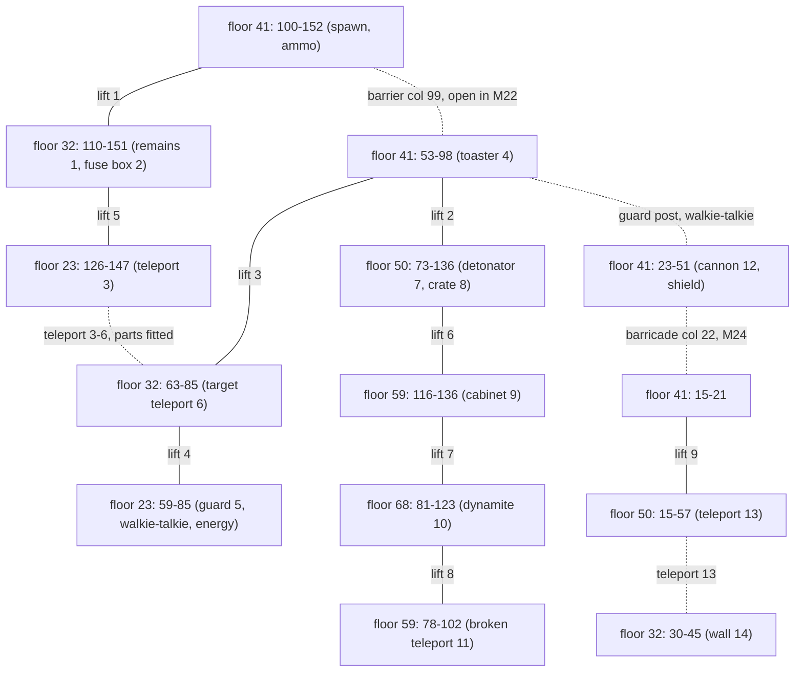

# 14 - Level 2 (vesnice) layout, tasks and enemies

Status: draft. Machine-readable copies (local only): `gamedata/disasm/level2_layout.json`, `gamedata/disasm/level2_enemies_decoded.json`. Config: `config/levels/vesnice/` (`level.json`, `enemies.json`, `objects.json`). Addresses are `segment:offset` in `gamedata/disasm/verify/a*.asm`. Tags: **[code]** read in the disassembly, **[map]** checked against `MAPY/M21..M24.MAP`, **[inferred]** not checked in the running game, **[open]** not decoded.

## TL;DR

- `COLONY28.EXE` starts `klev1.exe -level2` for `vesnice`. The level-2 init is `4:0x4A9C-0x59DF` (right after the strings `m21.map`, `mapy\`, item names); it sets the level byte `[0xDC78] = 2`. Every later level-2 branch tests that byte. **[code]**
- **Floors are 9 rows apart** (plank rows 23, 32, 41, 50, 59, 68), not 7 as in level 1. Engine y = plank row - 6, map column = engine x + 6, as in level 1. **[code] [map]**
- **9 lifts** (two stops each), **8 item records**, **28 regular enemies** (15 rocket robots, 13 grey troopers, all ground, no flyers) and **one shootable guard**. **[code]**
- Blocking: a per-level stand-row wall tile list (`3:0x594C`), one code wall (the guard post at the bridge), plus a per-level **floor support tile list** (`7:0xC719`): where the plank tile is not in that list the hero falls. M22 removes the bridge planks this way. **[code] [map]**
- Four map variants: M21 start, M22 power off, M23 power back (tile-identical to M21), M24 barricade blasted. **[map]**

## Coordinate frame and start

- Same frame as reports 10 and 13. Floor rows 23, 32, 41, 50, 59, 68 = engine y 17, 26, 35, 44, 53, 62. Map clamp is shared code (`1:0x403A`). **[code]**
- Spawn: engine (146, 33) = column 152, row 39. That is 2 rows above floor 41 with no plank under it, so the hero drops onto floor 41 (column 152) at the start. **[code]** for the values, **[inferred]** for the drop.
- Started with `-level2`: energy 98, shields 1, ammo 350 and 350 (`[0xDB36]`, `[0xDB3A]`), no bonus weapon, holo plan owned (map screen available). With `-level1 loadmision` these are kept from the save. **[code]**

## Lifts

Same 24-byte slots at `ds:0x4C90` and the same update code as level 1. Columns are x+5..x+7 (centre x+6). Every stop row shows the deck tiles `(10,1) (10,2) (10,3)` at exactly the lift columns: 18 of 18 stops. **[code] [map]**

| Lift | Engine x | Columns | Stops (floor rows) | Start |
|---|---|---|---|---|
| 1 | 110 | 115-117 | 32, 41 | 41 |
| 2 | 84 | 89-91 | 41, 50 | 41 |
| 3 | 75 | 80-82 | 32, 41 | 41 |
| 4 | 66 | 71-73 | 23, 32 | 32 |
| 5 | 138 | 143-145 | 23, 32 | 32 |
| 6 | 127 | 132-134 | 50, 59 | 50 |
| 7 | 112 | 117-119 | 59, 68 | 59 |
| 8 | 79 | 84-86 | 59, 68 | 68 |
| 9 | 13 | 18-20 | 41, 50 | 41 |

No repair or enable logic. The only lift write after init: the marker-3 teleport resets lift 3 to its top stop (row 32) (`3:0x9F6B`). **[code]**

## Items

Record n: x at `0x548A + 0x111n`, y +4, name +8, owned +0x108 (as level 1). A task marks an item as fitted by setting its x = y = 1. **[code]**

| Record | Name in init | Renamed on pickup | Engine | Cell (col, floor) | Marker |
|---|---|---|---|---|---|
| 1 | TORZO | MALÝ KLÍČ (small key) | 105, 26 | 111, 32 | 1 |
| 2 | VYSÍLAČKA (walkie-talkie) | - | 54, 17 | 60, 23 | 5 |
| 3 | BEDNA (crate) | PROJEKTIL (projectile) | 109, 44 | 115, 50 | 8 |
| 4 | ROZBUŠKA (detonator) | - | 73, 44 | 79, 50 | 7 |
| 5 | DYNAMIT | - | 93, 62 | 99, 68 | 10 |
| 6 | NAV. OBVOD (navigation circuit) | - | not on map | given by marker 11 | 11 |
| 7 | POJISTKA (fuse) | - | not on map | given by marker 9 | 9 |
| 8 | HOLOG. PLÁN | - | not on map | owned at start | - |

Pickup rule as level 1 (`4:0x8B02`). Level 2 adds one check: the dynamite can no longer be picked once placed (x is no longer 93, `4:0x8BCC`). **[code]**

Bonus pickups (one each, separate code, same pixel reach test): **[code]**

| What | Engine | Cell | Effect | Code |
|---|---|---|---|---|
| TOASTER (bonus weapon, slot 3) | 55, 35 | 61, 41 | 250 ammo, "NAŠEL JSI TOASTER" | `5:0x49F4` |
| energy | 77, 17 | 83, 23 | +90 | `5:0x4F33` |
| ammo | 123, 35 | 129, 41 | +350 machine-gun ammo, cap 999 | `5:0x5493` |
| shield | 35, 35 | 41, 41 | +1, cap 5 | `5:0x5D30` |

None of the bonus pickups shows in the map tiles; how they are drawn is **[open]**.

## Blocking

### Wall tiles (stand row only)

Same rule as level 1 (`3:0x5013`). Level 2 list (`3:0x594C-0x59A5`): **[code]**

| Sheet | Tiles | Seen as |
|---|---|---|
| 10 | 4, 9, 17, 22, 30, 35 | floor-end walls (riveted blocks) |
| 8 | 50, 63, 76 | barricade post at column 22 (removed in M24) |
| 1 | 1, 2, 3, 4 | electric barrier at column 99 (removed in M22) |

All 13 pairs occur in M21. Stand-row wall columns: floor 23: 58, 86, 125, 148; floor 32: 29, 46, 62, 86, 109, 152; floor 41: 14, 22, 99, 153; floor 50: 14, 58, 72, 137; floor 59: 77, 103, 115, 137; floor 68: 80, 124. **[map]**

### Floor support tiles and falling

Each frame the game clears `[0xDB42]` (`7:0xB06C`) and sets it to the plank tile under the hero (row y+6) only when that tile is in the level list (`7:0xC719-0xC792`). With no support and not in a jump, the hero enters the fall state (`0x5B` / `0x443`) and drops 6 px per tick (`7:0x8A38-0x8AB7`). **[code]**

Level 2 support list: sheet 7 tiles 1-12, 14-22, 27-29, 31-33; sheet 10 tiles 1-3 (lift decks); sheet 6 tiles 1-4; sheet 2 tiles 1-3 (bridge planks). In M21 every support tile lies on a floor row, so floors are exactly the plank rows. **[code] [map]**

Level 1 has its own list in the same routine (`7:0xC9C8`). Report 13 says the original has no falling; that claim should be rechecked against this routine. **[open]**

### Code wall (guard post)

The west wall table `ds:0x52EF` has one level-2 entry: engine (48, 35), floor 41. It blocks the hero walking west from about column 52. At engine x 48 the game says "NEMŮŽEŠ JÍT DÁL, NA DRUHÉ STRANĚ MOSTU JE HLÍDKA" (`3:0x5E2A`). The walkie-talkie removes it (sets the entry to 200, 200). The east table `ds:0x515F` is empty. **[code]** The column equivalent uses the same whole-cell rounding as level 1. **[inferred]**

### Shootable guard (marker 5)

Shootable table record at `ds:0x39C5`: engine x 56, y 17 (cell 62, floor 23), 70 hp. **[code]**
- Only the toaster hurts him: 6 hp per hit, guard 0-6 cells left of the hero on his row (`7:0x1574-0x171B`, levels 2, 5, 6, 7, 8), so 12 hits. He blocks the hero while alive (`3:0x614D`). **[code]**
- The shared per-tick guard routine `5:0x24A4` has no level check: it draws `LEV2.GRA` frame 25 (a bulky olive armoured soldier with a rifle, 8 frames of 3x3 tiles, faces right; rebuilt in `gamedata/png/enemy-sprites/lev2_guard_f25_frames.png`) and fires the same burst as the level-1 guard. **[code]**
- The walkthrough map puts marker 5 on floor 32 and marker 6 on floor 23. Code puts the guard on floor 23 and the target teleport on floor 32. **[code]**

### Bridge gap

At engine y 36 and x 41-50 (columns 47-56), one row below floor 41, the game plays `padves.anm` (`3:0xDE13`). The hero gets there only by falling through the missing bridge in M22. **[code]** Whether this kills or the hero lands on floor 50 (support exists below, columns 15-57) is **[open]**: no damage code sits next to the clip, and the clip is missing from the local `GRAFIKA` folder.

## Walk segments (M21)

Support columns minus stand-row walls and the code wall:

| Floor | Segments |
|---|---|
| 23 | 55-57, 59-85, 87-89, 123-124, 126-147, 149-150 |
| 32 | 7-28, 30-45, 47-48, 59-61, 63-85, 87-89, 106-108, 110-151, 153-155 |
| 41 | 10-13, 15-21, 23-51, 53-98, 100-152, 154-155 |
| 50 | 11-13, 15-57, 59-61, 69-71, 73-136, 138-139 |
| 59 | 74-76, 78-102, 104-105, 113-114, 116-136, 138-140 |
| 68 | 77-79, 81-123, 125-126 |

M22 floor 41: 10-13, 15-21, 23-44, 57-152, 154-155 (barrier gone, bridge gap). M24 floor 41: 10-13, 15-51, 53-98, 100-152, 154-155. **[map]**

## Tasks (use handlers `3:0x9EE1-0xBF0F`)

Every handler checks a hero engine x range, row, and usually the selected item `[0x5154]` and the current map name. **[code]**

| Marker | Object | Spot (cols, floor) | Use | Effect |
|---|---|---|---|---|
| 1 | smouldering remains | 111, 32 | pickup | small key ("U TLEJÍCÍCH ZBYTKŮ JSI NAŠEL MALÝ KLÍČ") |
| 2 | fuse box | 146-150, 32 | nothing, map m21 | smash fuses, load M22 ("ZNIČIL JSI POJISTKY...") |
| 2 | fuse box | 146-150, 32 | fuse, map m22 | fuse fitted, load M23 ("...SPUSTIL JSI ELEKTRÁRNU") |
| 3 | teleport | 127-130, 23 | nothing | to engine (59, 26) if circuit and fuse fitted; else "CÍLOVÝ TELEPORT JE POŠKOZEN" or "ELEKTRÁRNA JE VYŘAZENA Z PROVOZU" |
| 4 | toaster | 61, 41 | pickup | bonus weapon |
| 4 | bridge east end | 52-57, 41 | walkie-talkie | guard post gone ("VYSÍLAČKOU JSI ODVOLAL STRÁŽE...") |
| 5 | guard | 62, 23 | toaster shots | guard dead, walkie-talkie reachable |
| 6 | target teleport | 63-67, 32 | navigation circuit | repaired; then to engine (122, 17) while both parts fitted |
| 7 | detonator | 79, 50 | pickup | |
| 8 | crate | 115, 50 | pickup | projectile |
| 9 | electric cabinet | 122-126, 59 | small key | fuse; else "ELEKTRICKÁ SKŘÍŇ JE ZAMČENA" |
| 10 | dynamite | 99, 68 | pickup | |
| 11 | broken teleport | 93-98, 59 | nothing | navigation circuit, once |
| 12 | cannon | 31-38, 41 | projectile | load M24 ("DĚLEM JSI ROZSTŘELIL PŘEKÁŽKU") |
| 13 | teleport pair | 50-54, 50 and 40-44, 32 | nothing | two-way, no condition |
| 14 | wall | 29-32, 32 | dynamite, then detonator | level end: `[0xDC78] = 3`, jungle data loads in the same process |

Order the code forces: fuses smashed (M21 only) before the fuse can be fitted (M22 only); the fuse needs the key from marker 1; the teleport link needs both parts. The cannon reloads M24 whole, so firing it before smashing the fuses would leave the fuse box in a map that is neither m21 nor m22. Whether that soft-locks the level is **[open]**.

## Map variants

| Variant | Trigger | Changed cells (cols x rows) | Effect |
|---|---|---|---|
| M22 | fuses smashed | 99 x 37-40; 45-56 x 41 | barrier wall gone; bridge planks gone (fall) |
| M23 | fuse fitted | none (equal to M21) | barrier and bridge back; the map name gates the teleports and fuse box |
| M24 | cannon shot | 22-23 x 38-40 | barricade wall at col 22 gone |

M21 is the base. **[map] [code]**

## Enemies

Enemy table as level 1 (`ds:0x6AD4 + 27n`). Slots 2-29 used, slot 1 is the dummy. All 2.0 hp. **[code]**

- **Types draw `LEV2.GRA` frames 21-24** (same pointer table as level 1). Type 1 = rocket robot: blue-steel humanoid with a shoulder launcher, kneels to fire, leaves a burning wreck. Type 2 = grey trooper: bulky grey armoured soldier with a rifle, leaves a scrap pile. Rebuilt in `gamedata/png/enemy-sprites/lev2_types_f21_f24.png`. **[code]**
- **No hover.** The level-2 init never fills the hover rows `ds:0x7465/0x7469`, so with a fresh start no enemy leaves its floor row. **[code]** After an in-process jump from level 1 the old values would remain **[open]**.
- Speed 3 px per tick for both types (`4:0xD547`). Fire damage per fire tick is `(6 - shields) / 6 x c`, with c = 2.2 for type 1 and 2.4 for type 2 (`4:0xDC93`, `4:0xE040`), rounded per tick: 18 per 9-tick burst with 0 or 1 shield. **[code]**
- Kills: 7 machine-gun hits, 3 punches (level-1 constants, not level-gated), or 2 toaster hits (1.0 per hit, `7:0x19D7`). **[code]**

| Floor | Segment | Rocket robots (cell col) | Grey troopers (cell col) |
|---|---|---|---|
| 23 | 59-85 | e23 (77) | - |
| 23 | 126-147 | - | e08 (137) |
| 32 | 30-45 | e29 (36) | e28 (30) |
| 32 | 110-151 | e05 (122), e07 (134) | e06 (131) |
| 41 | 53-98 | e20 (65), e21 (72) | e22 (74) |
| 41 | 100-152 | e03 (120) | e02 (125), e04 (104) |
| 50 | 15-57 | e25 (33), e27 (50) | e24 (24), e26 (36) |
| 50 | 73-136 | e09 (82), e11 (106), e13 (125) | e10 (74), e12 (112) |
| 59 | 78-102 | e19 (79) | - |
| 59 | 116-136 | - | e14 (126) |
| 68 | 81-123 | e15 (110), e17 (96) | e16 (99), e18 (88) |

Patrol ranges are in `config/levels/vesnice/enemies.json`. None of these entries has been matched to footage. **[code]**

## Differences from level 1 a converter must handle

- Floor spacing 9 rows. Floors come from the support tile list, not from a fixed spacing.
- Per-level tile lists: walls (`3:0x5013` chain) and floor support (`7:0xC4A9` chain). Deck tiles differ (`(10,1-3)` here, `(9,2-4)` in level 1).
- Map variants can remove floor (the bridge) as well as walls.
- Teleports are use handlers with conditions on items fitted (x = 1) and the current map name.
- The bonus weapon and the energy, ammo and shield pickups sit in separate per-level tables.
- The shootable guard needs a weapon id (3) and a per-level damage (6 here, 4 in level 1).
- Spawn may be in the air (y 33).

## Confidence

- Lifts, items, enemies, guard, wall and support lists, task handlers: HIGH (code), lifts and lists checked against the map.
- Code-wall column 52: MEDIUM (rounding as level 1).
- Falling: HIGH that the routine exists, MEDIUM for its exact trigger; fall outcome at the bridge: open.
- Object art for the pickups and the marker-13 teleport pads: open.
