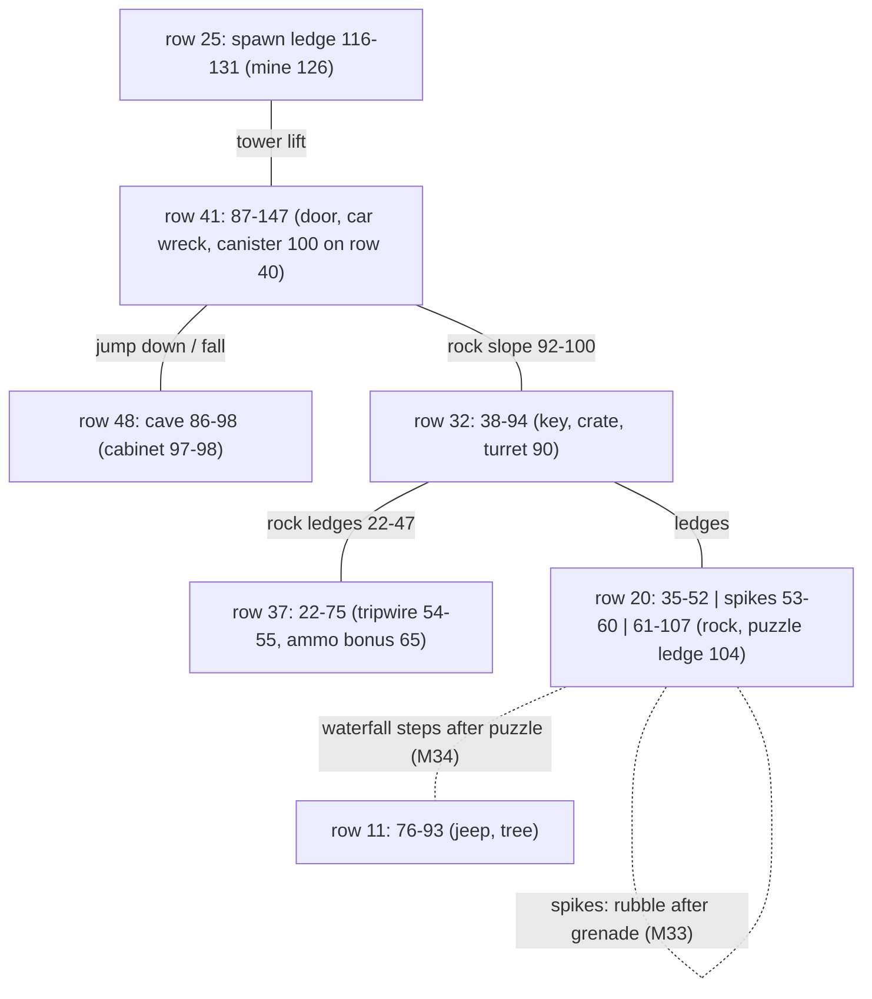
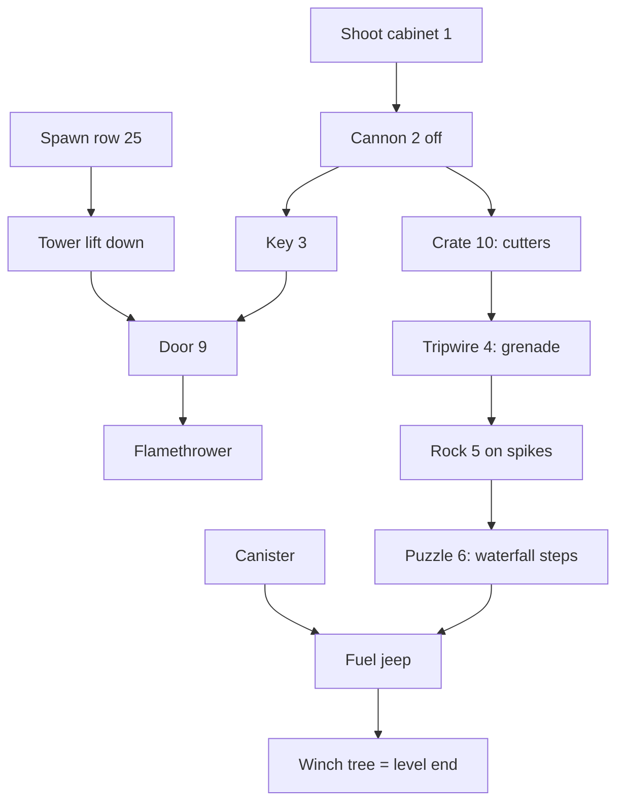

# 15 - Level 3 (jungle) layout, tasks and enemies

Status: draft. Machine-readable copies (local only): `gamedata/disasm/level3_layout.json`, `gamedata/disasm/level3_enemies_decoded.json`. Config: `config/levels/jungle/`. Addresses are `segment:offset` in `KLEV1.EXE`. Tags: **[code]** read in the disassembly, **[map]** checked against `MAPY/M31..M34.MAP`, **[inferred]** not checked in the running game, **[open]** not decoded.

## TL;DR

- `KLEV1.EXE` holds every level. `[0xDC78]` is the level number (set from `-levelN` at `1:0x4C00-0x4DD6`). The dispatch `4:0x80D6` calls the level init. Level 3 init is `7:0xD4B5-0xE226`, in segment 7 and not in segment 4 like the others. **[code]**
- **No lift slots.** One scripted tower lift is a cutscene teleport. **[code]**
- **Gravity, jumps and falls exist**, unlike report 13's level 1 reading. Floors are cells whose tile is in a per-level floor tile list (`7:0xC508`). The jump rises 32 px, so the hero climbs ledges one row high. Floor rows are not 7 apart. **[code] [map]**
- **5 item records**, all on the map: canister, crate (gives cutters), two tripwire cells, small key. The grenade and the flamethrower are given by tasks. **[code]**
- **26 enemies**: 15 rocket droids (type 1, 2.0 hp) and 11 crawlers (type 2, 3.0 hp). All walk; none hover. Hazards are code zones: a cannon, spikes, a chasm, a tripwire and 3 mines. **[code]**
- **Map variants:** M32 (cabinet shot), M33 (grenade on rock), M34 (stone puzzle). Each one is a full map file loaded by a task. **[code] [map]**

## Coordinate frame and start

Same as report 13: column = engine x + 6, plank row = engine y + 6, stand row = engine y + 5.

- Spawn: engine (124, 19) = cell (130, 25), on the east end of the ledge under the red excavator. **[code] [map]**
- Without `-level1 loadmision` args, the init sets 1 shield, 350 ammo, ammo type 1, energy 98 and no bonus ammo (`7:0xD4C3-0xD687`). **[code]** A run carried over from level 2 keeps its values. **[inferred]**

## Floors and movement

Main plank rows (engine y): 11 (5), 20 (14), 25 (19), 32 (26), 37 (31), 41 (35), 48 (42, cave). The west rock ledges sit on rows 22-37, one row apart. `floorRuns` in the JSON lists every floor-tile run per row and variant. **[map]**

- **Gravity.** `7:0x8A2E`: the hero is not on a lift, not jumping and has no floor tile under him, so the pixel y offset grows 6 px per tick. `3:0x67D0` turns each 24 px into a row change. **[code]**
- **Floor test.** `7:0xC49F-0xC687`: the tile in the plank row (y + 6) under the hero, about ±14-28 px. It must be in the level list `7:0xC508`: sheets 5-12, 100+ tiles, listed in the JSON. Level 1 has its own list (`7:0xC9C8`), so report 13's "no floor collision" needs a recheck. **[code]**
- **Jump.** States 0x43-0x5A rise 5,5,4,4,3,3,2,2,1,1,1,1 px (32 px), then fall back. That climbs one row. **[code]** Fall damage: **[open]**.
- **Tower lift.** `7:0x815E`:
  - Up at engine x 134-137, y 35 (cells 140-143, row 41) plays `vytnah.anm` and puts the hero at (112, 19) = cell 118, row 25.
  - Down at x 110-113, y 19 plays `vytdol.anm` back to (135, 35).
  - Both need no other key held. No deck, no slot. **[code]**

The links other than the tower lift are walk, jump and fall over floor-tile runs. Which jumps the hero can actually make is **[inferred]** from the tile runs, not traced.

## Items

Record n: x at `0x548A + 0x111n`, y +4, name +8, owned +0x108. Not-placed records sit at (0,0) after the common init (`4:0x0743`); used ones go to (1,1). Pickup reach: engine x X-2..X, same row (`4:0x8B02`). **[code]**

| Record | Name | Engine | Cell | Marker | Pickup |
|---|---|---|---|---|---|
| 1 | KANYSTR (canister) | 94, 34 | 100, 40 | 8 | `kanistr.anm`, NALEZL JSI KANYSTR S PALIVEM |
| 2 | BEDNA (crate) | 77, 26 | 83, 32 | 10 | `bedna.anm`, renamed STIPACKY (cutters) |
| 3 | NAPNUTY DRAT (tripwire) | 48, 31 | 54, 37 | 4 | refused: owned reset on level 3 (`4:0xA79A`) |
| 4 | NAPNUTY DRAT | 49, 31 | 55, 37 | 4 | refused |
| 5 | KLIC (small key) | 48, 26 | 54, 32 | 3 | `klic.anm`, V TRAVE JSI NASEL MALY KLIC |

Given by tasks: the grenade (record 3 renamed GRANAT by the cutters) and the flamethrower (weapon 3, 500 ammo). **[code]**

## Tasks (use handler `3:0x92A0-0x9EE1`, markers from report 06)

| Marker | Task | Where (cells, row) | Needs | Effect | Code |
|---|---|---|---|---|---|
| 1 | Shoot cabinet | from 93+ on row 48 | gun, fire, facing it | `delo.anm`, cannon off `[0x5481]=1`, load M32 | `5:0x704B` |
| 2 | (cannon) | 90-98, row 32 | - | see Hazards | `3:0xE42D` |
| 3 | Take key | 54, 32 | - | key | `4:0xA2EC` |
| 9 | Open door | 119-123, row 41 | key | key used; `dvere.anm`; flamethrower `[0x5486]=1`, `[0xDB38]=500` | `3:0x95EC` |
| 10 | Open crate | 83, 32 | - | cutters | `4:0x9FCF` |
| 4 | Cut tripwire | 52-55, row 37 | cutters | cutters used, grenade; `sebgra.anm`, `granat.anm` | `3:0x92A0` |
| 5 | Blow rock | 46-54, row 20 | grenade | grenade used; `hodgra.anm`, `skala1/2.anm`; load M33 | `3:0x9C75` |
| 6 | Stone puzzle | 104-105, row 17 | - | panel screen; solved: load M34 | `3:0x9795`, `6:0xB514` |
| 8 | Take canister | 100, 40 | - | canister | `4:0x8D1E` |
| 8 | Fuel jeep | 78-84, row 11 | canister | canister used; `[0xDB2D]=1`; `napln.anm` | `3:0x94A4` |
| 8 | Winch tree | 76-80, row 11 | jeep fueled | `5:0x433F` (`navijak.anm`, `sutr.anm`), `[0xDC78]=4`, level 4 init | `3:0x97CC` |

A wrong item at a task spot prints the "cannot use" text, or MOHUTNY KAMEN at the rock, or DVERE JSOU ZAMCENE at the door. **[code]**

Whether the cannon really blocks the key and the crate (the turret zone covers cells 90-98 on row 32; the key is at 54 and the crate at 83) is **[inferred]** from position, not traced.

### Stone puzzle (`6:0xB514`)

4 stones, all raised at start. Left/right moves over raised stones, Enter presses one. A counter c runs 1-4 (it steps after each press) with a flag f (starts 0). The full rule table is in the JSON. With all four pressed the game prints Z VODOPADU NAD TEBOU SE VYSUNULY DVA KAMENNE BLOKY and loads M34. Otherwise it prints NIC SE NESTALO. **[code]** A search over those rules gives the shortest solution: press 3, 4, 2, 1, 3. **[inferred]**

## Blocking

- **Wall tiles.** The stand-row list has one entry, `(8,27)`, in the 15-45 px check `[0xDFCD]` (`3:0x5AB3`). It occurs once, at cell (84, 46) in the cave. **[code] [map]**
- **Wall tables** (rule as in report 13). The column equivalents (west x+4, east x+7) are **[inferred]**.
  - West `ds:0x52EF`, 18 stores:
    - x 17 at y 10, 16, 19, 22, 25, 28, 31: the west edge, column 21. Entry 13 is written twice, (17,13) then (17,10).
    - (71,5): column 75, the tree.
    - (112,19): column 116, the spawn ledge west end.
    - (77,32/35/38/41), (77,41), (78,41), (78,42), (79,43), (81,44): the rock west of the cave, columns 81-85.
  - East `ds:0x515F`, 10 entries:
    - x 100 at y 3, 5, 8, 11, 14: column 107, the pillar east of the waterfall.
    - (124,19): column 131, the spawn ledge east end.
    - (141,35): column 148.
    - (59,31): column 66.
    - (81,38) and (89,42): columns 88 and 96, the cave steps.
  - No task removes an entry. **[code]**
- No code zone blocks walking. Hazards hurt or kill instead.

## Hazards

| What | Zone (engine) | Cells | Effect | Code |
|---|---|---|---|---|
| Cannon | y 26, x 84-92, while `[0x5481]==0` | 90-98, row 32 | `strilna.anm`, 3 blasts, (6-shields)/6 x 30 energy, hero x+1 and y+1 | `3:0xE42D` |
| Spikes | y 15, x 45-59 | fall into 53-60 of row 20 | `OSTNY.anm`, game over | `3:0xE9F7` |
| Chasm | y > 42, x > 77 | below the cave floor | `propast.anm`, game over | `3:0xE6CD` |
| Tripwire | x 49, y 31, record 3 not owned and not at x 1 | 55, row 37 | 45 blast rounds, game over | `3:0xE742` |
| Mines | (120,19), (102,35), (91,29), flags `0x515C-E` | 126,25; 108,41; 97,35 | once: (6-shields)/6 x 15, 3 blasts | `7:0x9EAE` |

Bonus pickups (`seg 5`, one shot):
- energy +90 at cell 25,31
- second ammo type +350 at cell 65,37
- shield +1 at cell 29,25

**[code]** The mine picture (far pointer `ds:0xDF00`) is **[open]**.

## Enemies

Table `ds:0x6AEF`, 27-byte slots as in report 10. The common init `4:0x04AE` sets every slot to hp 2.0. Level 3 sets hp 3.0 for type 2 (and for slot 16). The y copy loop `7:0xE01D` has no hover lift. **[code]**

| Type | Name | Count | Sprite | hp | Gun / fists to kill | Burst damage c |
|---|---|---|---|---|---|---|
| 1 | Rocket droid | 15 | `LEV3.GRA` f21-22: light-blue humanoid, shoulder rocket tube, burning scrap | 2.0 | 7 / 3 | 1.8 |
| 2 | Crawler | 11 | f23-24: grey-green hunched bot, dome hull, two bent legs, nose gun | 3.0 | 14 / 5 | 2.0 |

- Both types move at 3 px per tick (`4:0xD4E1-0xD96A`).
- Damage per fire tick is (6 - shields)/6 x c. With no shields that is about 18 per burst, double the level 1 rate. c is read at `4:0xDCD6` and `4:0xE05E`.
- Burst chance is 1/11 per tick (`4:0xC3CA`). Turn chance is 1/6 (`4:0xBDAA`). **[code]**
- Kill counts use report 10's damage rule. **[inferred]**
- `f25` holds a dome turret sprite (8 frames, fires right). Level 3 does not use it: the guard tables `ds:0x39B9` and `ds:0x39F6` stay empty. **[code]**

| Engine y (plank) | Slots: type, x, patrol (engine x) |
|---|---|
| 35 (41) | 2: 1, 105; 3: 1, 115; 5: 1, 100; 6: 1, 95; 8: 1, 90; 9: 1, 86. All patrol 81-140 |
| 26 (32) | 11: 2, 60, 32-88; 12: 2, 50; 13: 2, 41; 14: 1, 35; 16: 1, 45 (hp 3.0); 18: 1, 68. These patrol 33-88. 15: 2, 27, 26-30 |
| 31 (37) | 21: 1, 21; 22: 1, 30; 23: 2, 40; 24: 2, 35. These patrol 19-44. 25: 1, 54, 49-56; 26: 2, 52, 49-56 |
| 14 (20) | 27: 1, 60, 54-95; 28: 2, 70, 54-95; 29: 1, 80, 57-95; 30: 2, 90, 57-95; 19: 2, 98, 54-99 |
| 5 (11) | 17: 1, 73, 72-86; 20: 2, 85, 79-86 |

- Slot 16 is written twice: first type 2 at x 55, then type 1 at x 45 with hp 3.0 kept. **[code]**
- No enemy is matched to footage. The demo video shows blue droids and grey crawlers, but the demo build may differ from M31. **[open]**

## Map variants

| Variant | Loaded by | Changed cells | Effect |
|---|---|---|---|
| M32 | cabinet shot (`5:0x6290`) | (90,31) turret off, (97-98,46) cabinet broken, plus about 200 cells: tree and jeep erased, stone stairs at cols 62-70 rows 3-11, building on row 20 replaced, boulder at 49-52 x 16-19, column 74 x 39-50 | turret tiles only matter to the code flag |
| M33 | grenade (`3:0x7165`) | (90,31), (97-98,46) as M32; 54-59 x 20 rubble on the spikes | floor cells 57-58 on row 20 |
| M34 | puzzle (`6:0xB4D6`) | M33 plus (96,12) and (98,13) stone steps | steps from row 20 up to row 11 |

- The order the data supports is M31, then M32, then M33, then M34. Each task loads a whole file, so M33 and M34 assume the cabinet was shot first. **[map]**
- The extra M32 cells look like a stale design: they erase the jeep and the tree. Shooting the cabinet after the grenade would load M32 and drop the rubble and the steps. Whether the original allows that order is **[open]**.

## Notes for a generic converter (vs level 1)

- The init lives in a different segment per level (`4:0x80D6` dispatch). The table addresses are the same: enemies `0x6AEF`, items `0x548A`, wall tables `0x52EF` and `0x515F`, lifts `0x4C90`.
- Floors come from the per-level floor tile list (`7:0xC508`), not from a fixed set of plank rows. Gravity and a one-row jump replace the "lift only" model. Floor rows are irregular and there are ledges.
- There are no lifts. There is a scripted teleport lift, keyed on up or down.
- The wall tables include vertical stacks: the same x at rows 3 apart cover cliffs.
- Hazards are code zones (death, damage, push). Mines and bonuses sit at hard-coded per-level cells.
- Item records are renamed in place (BEDNA to STIPACKY, NAPNUTY DRAT to GRANAT). Some records cannot be picked up.
- A map variant is a whole-file load per task, not a cumulative patch. M32 is not a subset of M33.
- Type 2 is a ground crawler here, not a flyer. Type meaning, hp, speed and damage are per level.

## Confidence

- Init tables (spawn, items, enemies, wall tables), use handlers, pickup renames, scripted lift: HIGH.
- Hazard zones and variant loads: HIGH (code). Cabinet cell from the map diff: MEDIUM.
- Floor tile list and jump arc: HIGH (code). The reach graph between ledges: LOW (not traced).
- Enemy looks: HIGH (sprites rebuilt from `LEV3.GRA`). Names are ours.
- Puzzle rules: HIGH (code). The solution: MEDIUM (simulated).
