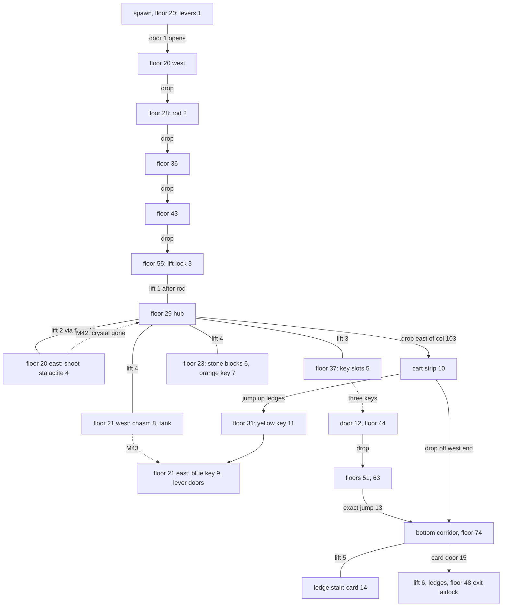

# 16 - Level 4 (jeskyne) layout, objects and enemies

Status: draft. Machine-readable copies (local only): `gamedata/disasm/level4_layout.json`, `gamedata/disasm/level4_enemies_decoded.json`. Config: `config/levels/jeskyne/`. Addresses are `segment:offset` in `gamedata/disasm/verify/a*.asm`. Tags: **[code]** read in the disassembly, **[map]** checked against `MAPY/M41..M43.MAP`, **[inferred]** derived, not checked in the running game, **[open]** not decoded.

## TL;DR

- **One executable for all levels.** `KLEV1.EXE` reads `level4` / `-level4` from the command line and sets the level byte `[0xDC78] = 4` (`1:0x4C92`). The init dispatcher `4:0x80D6` then calls the level-4 init `4:0x0A3A-0x1836` (`m41.map`, item names right after it). Level 3 hands over at `3:0x984C`. Level 4 hands over to level 5 at `3:0xEBCF`. **[code]**
- **Floors are tiles, not bands.** Level 4 has a per-level floor tile list. The hero falls wherever no listed tile lies under his feet, and he jumps one row up onto ledges. Floors sit at any row, not on the 7-row grid of level 1. **[code] [map]**
- **6 lifts** (lift 1 locked until the rod is used), **5 items** on the map, **3 bonus pickups**, **7 lever/key/card doors**, **2 stone blocks**, **17 table enemies** (two new types) and **8 troopers** in a second actor table. **[code]**
- **Map variants** M41, then M42 (stalactite shot), then M43 (tank shot). Nothing else loads a map. **[code] [map]**
- **Dead ends.** Five scripted death zones (game over), a one-way start chain that strands a hero who skipped the rod, and a one-way lower half. Details at the end. **[code] [inferred]**

## Coordinate frame

Same frame as reports 10 and 13: map column = engine x + 6, floor (plank) row = engine y + 6, stand row = engine y + 5. Every item, enemy and trooper of the init lies on a floor tile at (x + 6, y + 6) in M41 (30 of 30). **[code] [map]**

Spawn is engine (28, 8), cell (34, 14). This is inside a vertical shaft with no floor tile until row 20, so the hero starts with a fall onto floor 20 (columns 19-39). **[code] [inferred]**

## Movement rules (new compared with level 1)

- **Floor tiles** (`7:0xC69B`, plank row under the hero), as (sheet, tile) pairs: sheet 7 tiles 1-4, 22-23, 26, 61-63, 103-104; sheet 8 tiles 97-100; sheet 2 tiles 2, 4, 6-8; sheet 1 tiles 5-7. **[code]**
- **Fall.** With no floor tile and the hero not hidden, the fall state starts (0x5B / 0x443) and the hero drops 6 px per tick (`7:0x95E5`, `7:0x9ADF`). Landing needs a floor tile at a whole row (`7:0x8B00`). There is no fall damage: nothing in `7:0x8000-0x9E00` touches energy. **[code]**
- **Jump.** States 0x43-0x5A rise 32 px (5, 5, 4, 4, 3, 3, 2, 2, 1, 1, 1, 1) and fall back the same way (`7:0x9387-0x9542`). At the top the y offset wraps into the row above (`3:0x67D0`). On the way down the offset passes 0, so a floor tile there ends the jump one row up. **[code]** Horizontal drift is 3 px per tick walking and 6 px per tick running. That gives a reach of about 3 or 6 cells, which fits the ledge stairs (ledges one row apart, offset 1-3 columns). **[inferred]**
- **Mine carts.** A floor tile (2,2), (2,4) or (2,6) under the hero carries him east 5 px per tick, plus 1 on odd ticks (`7:0x8875`). The cart strip is rows 38-39, columns 97-130. **[code] [map]**
- **Clamp.** Engine y is clamped to 71 (`1:0x4081`). **[code]**

## Lifts

Same 24-byte slots at `ds:0x4C90 + 0x18 * (n - 1)` and the same ride rules as level 1 (no remote call). **[code]** Deck tiles (7,61), (7,62), (7,63) appear at upper stops only. Bottom stops show plain floor. Every stop has tile (10,36) in the stand row of the centre column. **[map]**

| Lift | Engine x | Columns | Stops (floor rows) | Start | Notes |
|---|---|---|---|---|---|
| 1 | 44 | 49-51 | 55; after the rod 29, 44, 55 | 55 | locked, marker 3 |
| 2 | 39 | 44-46 | 20, 44 | 44 | |
| 3 | 67 | 72-74 | 29, 37 | 29 | |
| 4 | 77 | 82-84 | 21, 23, 29 | 29 | top and mid stops two rows apart |
| 5 | 92 | 97-99 | 66, 74 | 74 | |
| 6 | 122 | 127-129 | 56, 74 | 74 | exit route |

- **Lift lock.** Rod used at engine x 28-30, y 49 (columns 34-36, floor 55). The rod is consumed, `XTYC.anm` plays with TYCI JSI PREPNUL MECHANICKOU POJISTKU, and slot 1 is rewritten to top 23, mid 38, bottom 49 (`5:0xECB7`). **[code]**
- **Lift 4 snap.** While the hero is at engine x 96-118, y 30-33 (the cart stretch), lift 4's current row is set to its top every tick (`7:0x87A5`). This puts the lift at floor 21 for a hero who comes back west over chasm 8. **[code]** Purpose **[inferred]**. The routine `5:0x81DF` called after it is **[open]**.

## Items and bonuses

Same record layout and pickup rule as level 1 (`0x548A + 0x111n`, hero x X-2..X, same row). A used item gets x = y = 1. **[code]**

| Record | Item | Engine | Cell (col, floor row) | Marker | Use |
|---|---|---|---|---|---|
| 1 | rod (TYC) | 21, 22 | 27, 28 | 2 | lift lock, consumed |
| 2 | yellow key | 129, 25 | 135, 31 | 11 | key slots, consumed |
| 3 | orange key | 66, 17 | 72, 23 | 7 | key slots, consumed |
| 4 | blue key | 111, 15 | 117, 21 | 9 | key slots, consumed |
| 5 | entry card | 93, 46 | 99, 52 | 14 | card door, consumed |

No item is given by a task. Pickup clips: `sebtyc.anm`, `sebk41-44.anm` (`4:0x9D3A-0x9FB2`). **[code]**

Bonuses (`5:0x49xx-0x5Dxx`): energy at (13, 66), cell (19, 72); +350 type-1 ammo (cap 999) at (53, 57), cell (59, 63); +1 shield (cap 5) at (83, 60), cell (89, 66). **[code]**

## Blocking

### Wall tiles

Push-back list (`3:0x584E`, flag `[0xDFCD]`), stand row as in level 1: **[code]**

| Sheet | Tiles |
|---|---|
| 9 | 61-64, 66-69 (rock fill) |
| 7 | 64, 65, 77, 78 (explosive tank, M42 only), 103, 104 (floor end caps) |

A second list at `3:0x5C2D` (flag `[0xDFCE]`) drops 7/64-65 and 7/77-78. Its reader was not found. **[open]**

### Wall tables

| Table | Engine | Floor rows | Meaning | Removed by |
|---|---|---|---|---|
| west `ds:0x52EF` | 120, 12 | 16-18 | ledge stair edge near column 126 | - |
| east `ds:0x515F` | 78, 18 | 22-24 | east end of floor 23 (orange key floor) | - |
| east `ds:0x515F` | 56, 23 | 27-29 | crystal on floor 29 (columns 62-64) | stalactite shot |

### Doors and levers

Door table (`7:0x3609-0x3D21`): 49-byte records at `0x3BA9 + 0x31n`. Fields: +0 y, +4 x, +8 frame (0 closed, 12 open), +0xD open flag, +0xE..+0x1D four lever (y, x) pairs, +0x29..+0x2C states, +0x2D..+0x30 target. A reset loop (`4:0x08BB`) sets the target to [1,0,0,0] and the states to 0 before the init. A door opens when the states equal the target and closes when they differ. A closed door pushes the hero back on rows y-4..y (`3:0x5F25`). Doors and levers are sprites, not map tiles. **[code]**

| Rec | Door col, floor | Opened by | Marker |
|---|---|---|---|
| 1 | 26, 20 | levers at columns 28, 30, 38, 40 (same floor), combination [0,1,1,1]: leave the leftmost, pull the three right ones | 1 |
| 2 | 55, 44 | all three keys in the slots (`3:0xEB14`) | 12 |
| 3 | 130, 21 | one lever at column 132 | [open] |
| 4 | 125, 21 | one lever at column 123 | [open] |
| 5 | 104, 74 | entry card at engine x 93-97, y 68 | 15 |
| 6, 7 | 133 and 141, 48 | open at start, closed by the exit zone | exit |

The lever key is action code 9 (`push 9; lcall 8:14309`). Whether that is ENTER is **[open]**.

### Stone blocks

Table `ds:0x3DB7 + 0xD*n`, two entries at engine (75, 17) and (75, 18), column 81, floor rows 23-24. Only fists break them: 5 punches each, then the frame runs to 12 and the block stops blocking (`7:0x3236`, `3:0x6369`). Marker 6; the orange key lies behind them. **[code]**

### Key slots and card door

- **Key slots.** Engine x 51-53, y 31 (columns 57-59, floor 37). Each key plays `vkart1-3.anm` with POUZIL JSI ZLUTY/ORANZOVY/MODRY KLIC. **[code]**
- **Card door.** OTEVREL JSI DVERE plays on success. Without the card: NEMAS U SEBE NIC CIM BY JSI OTEVREL DVERE. **[code]**

## Shots that change the map

- **Stalactite** (marker 4) **[code] [map]**
  - Trigger: gun, facing right, hero x 50-55, y 14 (east end of floor 20), once (`5:0x7294`).
  - Effect: `krapnik1.anm` with SESTRELIL JSI KRAPNIK, M42 loads, and the crystal wall-table entry moves to (200, 200).
  - In M42 the stalactite (columns 62-63, rows 16-18) and the crystal (columns 62-64, rows 27-28) are gone.
- **Explosive tank** (marker 8) **[code] [map]**
  - Trigger: gun, facing right, map M42, hero x 92-93, y 15. This is the middle platform at column 99 (`5:0x63ED`).
  - Effect: `barelbum.anm` with ZNICIL JSI BAREL S VYBUSNINOU, then M43 loads.
  - The tank exists only in M42, at columns 103-104, rows 19-20. Its tiles are wall tiles, so it blocks floor 21 on the way to the blue key.
  - Shooting from x 94-98 is game over (`5:0x6959`).

## Zones

Checked every tick (`3:0xCA1A-0xCE37`, `3:0xEA6F-0xEBCF`): **[code]**

| Zone | Engine | Cells | Effect |
|---|---|---|---|
| chasm under the stalactite | x 54-61, y 15-17 | columns 60-67, rows 21-23 | `propast.anm`, game over |
| chasm 8 under the middle platform | x 85-98, y 16 | columns 91-104, row 22 | game over |
| cart crush | x 117-119, y 31-35 | columns 123-125, rows 37-41 | `zabvozik.anm`, game over |
| bottom lava | y above 68 | rows 75 and below | `lava.anm`, game over |
| exit airlock | x 130-133, y 41-49 | columns 136-139, floor 48 | doors 6 and 7 close; when 7 is shut, level 5 starts |

## Map variants

| Variant | Event | Changed cells (cols x rows) | Blocking effect |
|---|---|---|---|
| M42 | stalactite shot | 62-63 x 16-18, 62-64 x 27-28, 103-104 x 19-20 | crystal wall gone, tank wall appears |
| M43 | tank shot | 103-104 x 19-20, 65 x 28, 16-17 x 61-62, 102 x 72 | tank wall gone |

M43 restores the M41 stalactite art at rows 16-18 (the crystal stays gone). This looks like a data quirk. The M43 cells at 16-17 x 61-62 and 102 x 72 are **[open]**. **[map]**

## Enemies

**[code]**, sprites rebuilt from `LEV4.GRA`. Kill counts assume the level 1 hit rule **[inferred]**.

| Kind | Table | Count | Look | hp | Speed | Damage per fire tick |
|---|---|---|---|---|---|---|
| spider walker | `ds:0x6AEF`, type 1 | 7 | box body on thin legs, forward gun (f21, f22) | 5.0 | 2 px | (6 - shields)/6 x 1.2 |
| pod walker | `ds:0x6AEF`, type 2 | 10 | grey domed pod on bent green legs (f23, f24) | 3.0 | 3 px | x 1.4 or 2.4 by facing |
| trooper | `ds:0x39F6`, 23-byte records | 8 | blue humanoid soldier with a rifle (f27 walk, f28 other) | 10.0 | [open] | x 3.0, knockback |

- **Table enemies.**
  - Turn chance 1/5 (`4:0xBDB6`), fire chance 1/10 (`4:0xC3D6`).
  - Level 4 lifts no slot by 4 rows: pod walkers stay on their floor. The hover range stays 0, and what the hover update does with it is **[open]**.
  - Kill counts: about 27 gun hits or 9 punches for a spider walker, 14 or 5 for a pod walker.
- **Troopers.** A gun hit takes the ammo type value, a punch takes 1.0 (50 px reach), and the level 3 flamethrower particle takes 0.1.
- **No special guard.** The shoot-only guard table (`ds:0x39B9`) is empty in level 4. No map-tile guard exists.

Full list with cells and patrols: `config/levels/jeskyne/enemies.json`. By floor (map rows):

| Floor | Entries |
|---|---|
| 15 (top, above the lever doors) | e04, e05 (pods), e06 (spider) |
| 21, 28, 29, 31 | t05; e02 (on the rod); e03, t03; t04 (yellow key) |
| 36, 37, 43, 44 | t01; e07 (key slots); t02; e09 (door 12) |
| 55, 56, 58 | e08 (lift lock); t08; e17 |
| 63, 64, 66 | e11-e14; e10, t06; t07 |
| 74 (bottom corridor) | e15, e16 (pods), e18 (spider) |

## Task chain and routes

Markers from the Score 44 map (`sources/cz-walkthroughs/img/4.jpg`) match the decoded cells. Arrows are one-way drops unless marked as a lift.

The keys and door 12 are the long way round. Dropping off the west end of the cart floor reaches the bottom corridor, and from there the card and the exit, without any key. This matches the walkthrough's shortcut (`zkratka.gif`). **[inferred]**

## Dead ends

Score 44 warns that level 4 allows an unrecoverable mistake. The data gives these causes:

1. **Death zones.** The two chasms, the cart crush, the bottom lava and the tank shot fired from too close are all instant game over (table above). The review's "stalactite lookout where one must not fall" is the drop east of floor 20. **[code]**
2. **Marker 13** (west end of floor 63). Walking off the west end drops into the left shaft (columns 12-15). The first floor tile there is the ledge at row 75, which lies in the lava band (y 69 is above 68), so the hero dies. The safe target is the ledge at row 72 (columns 16-20, energy bonus) under the end of floor 63, and the walkthrough's curved arrow shows the jump. Floor 63 covers that ledge, so reaching it takes an exact jump. **[code]** for the lava rule, **[inferred]** for the path.
3. **Start chain without the rod.** Floor 20 west, 28, 36, 43 and 55 connect only by drops of 7 to 12 rows. Lift 1 on floor 55 is the only way out, and it needs the rod from floor 28. A hero who walks past the rod is stranded and must reload. **[inferred]**: reach model over the floor tiles, jumps of one row up and up to 6 columns across.
4. **One-way lower half.** Floors 48-74 have no lift or jump chain back up. They are entered by drops: from door 12 into floors 51/63, from the west end of the cart floor into floors 59-61 or 74, and from floors 36, 43 and 55. Everything still needed down there (card, card door, exit) is in that half, so the drop costs nothing on the shortcut. **[inferred]**
   - After door 12 (floors 51 and 63) the only way on is the marker-13 jump.
   - Drops from floors 36, 43 or 55 before the rod also land on floor 63.
5. **Lift 4 snap** is not a dead end. The cart route that triggers it also leads back to lift 4 from the east, and the cart route can be repeated. **[inferred]**

The reach model is a script over the floor runs, not the game, so items 3 and 4 need a play test.

## Notes for the port

- A generic converter can no longer derive floors from 7-row bands. It needs the per-level floor tile list, falling, jumping one row up, a death rule per zone and a lava row.
- Doors, levers and stone blocks are sprites driven by tables, not map tiles; only the tank and the crystal change the map.

## Confidence

- Lifts, items, bonuses, spawn, enemy and trooper cells: HIGH (init stores; all 30 placements sit on floor tiles).
- Floor tile list, fall, cart carry, zones, door and block logic, use and shot handlers: HIGH (code).
- Jump reach in cells and the reach-model dead ends: MEDIUM.
- Enemy names and looks: MEDIUM (sprites rebuilt, never seen in footage). Trooper speed and burst: [open].
