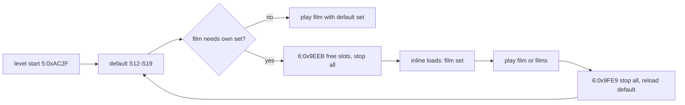

# 17 - Sound effects

How the original plays sound effects, which sound each game event and each mission 1 film uses, and what each sound is like. Sources: static analysis of `KLEV1.EXE` (addresses are NE `segment:offset`, same as `09-gamedata.md` and `12-eblaster.md`), the 144 `.SND` files in `ZVUKY/` of the CD image, and the audio of footage A-E (`08-video-level1.md`). Tags: **[code]** read in the disassembly, **[footage]** matched in video audio, **[inferred]** not checked.

Tools: `docs/research/tools/sound/` (see [Tools](#tools)). SND files: `docs/research/gamedata/raw/CD/ZVUKY/` (local only).

## Summary

| Item | Value | Tag |
|---|---|---|
| File format | Raw 8-bit unsigned mono PCM, no header, silence = 128 | code |
| Recorded rate | About 11025 Hz (most calls play near it) | inferred |
| Play call | `play(id, vol 1-63, rateHz)` at `3:0x4F8E`; each call passes its own rate | code |
| Rate check | `STRELBA` matches footage only at 15000 Hz (NCC 0.83), so the rate argument is the true playback rate | footage |
| Mixer | MIDAS, 44100 Hz output | inferred |
| Channels | Stop-all plays the empty `NIC` sample 8 times (`6:0x9F21`), so 8 voices | inferred |
| Sound ids | 31; id `n` reads handle `ds:0xDF68 + 2*(n-1)` | code |
| Fixed ids | 1-11, 20-31 load at level start (`5:0xAC2F`) | code |
| Swapped ids | 12-19 (slots S12-S19) swap per film; id 26 is `MRIZ2` (levels 1-4) or `VRATA2` | code |
| Film cues | per-frame table `[0xC1D + 3*frame] = id, rate`; `0x32` = no sound; played at vol 63 (`2:0x695`) | code |

## 1. Sound ids

| Id | SND | Id | SND | Id | SND |
|---|---|---|---|---|---|
| 1 | `SIGNAL` | 12-19 | slots S12-S19 | 25 | `ZKRAT` |
| 2 | `VRATA` | 20 | `STRELBA` | 26 | `MRIZ2` / `VRATA2` |
| 3 | `KROK3` | 21 | `HROM` | 27 | `ODLET` |
| 4 | `IKONA` | 22 | `VYTAH1` | 28 | `LASER2` |
| 5 | `P1_CANN` | 23 | `VYTAH2` | 29 | `VRATA1` |
| 6 | `LASER3` | 24 | `DVERE2` | 30 | `VRATA2` |
| 7 | `UDER` | | | 31 | `SLOW` |
| 8 | `SIRENA3` | | | | |
| 9 | `VYBUCH6` | | | | |
| 10 | `VYBUCH2` | | | | |
| 11 | `NIC` (174 bytes of silence) | | | | |

`play()` forces id 9 (`VYBUCH6`) to rate `8000 + Random(2000)` whatever the caller passes. **[code]**

## 2. Slot loading

Slots S12-S19 are handles `0xDF7E`-`0xDF8C`. A film that needs other sounds frees the slots and loads its own set inline, plays, then restores the default set.

- `6:0x9EEB` frees S12-S19 and id 26, then plays `NIC` (id 11, vol 0) on 8 channels: every sound stops. **[code]**
- `6:0x9FE9` does the same, then loads the default set. **[code]**
- Default set (level start `5:0xAE3F`, restore `6:0xA072`): S12 `HYDRA`, S13 `DVERE`, S14 `PROPAST`, S15 `GATE`, S16 `PLAM`, S17 `INVEND`, S18 `SMICH`, S19 `UDER`. **[code]**
- Inventory open (`1:0x2738`) reloads S17 with `INVEND` before it plays. **[code]**

Film sets used by mission 1 films (each range is straight-line code, no exits between load and restore):

| Set | Load / restore | S12 | S13 | S14 | S15 | S16 | S17 | S18 | S19 | Films |
|---|---|---|---|---|---|---|---|---|---|---|
| intro | `1:0x53DC` / `1:0x5AC8` | `EL` | `DVERE` | `ZAZEH` | `PRULET2` | `PLAM` | `SYSTEM` | `PRELET` | `UDER` | missionStart |
| rebel | `3:0xDA23` / `3:0xDDE9` | `HYDRA` | `HEK` | `BUCH` | `NAPIS` | `GATE` | `OHEN` | `PRIJEZD` | `UDER` | rebelShot |
| dying rebel | `5:0xC514` / `5:0xC848` | `HYDRA` | `DEAD1` | `DEAD2` | `DEAD3` | `DEAD4` | `PLECHY` | `FAJN` | `UDER` | talkRebel |
| bar | `5:0xC989` / `5:0xCE69` | `HYDRA` | `TOHLE` | `COTUCH` | `TOTED` | `KDES` | `PLECHY` | `FAJN` | `UDER` | tradeHoloPlan |
| bar refusal | `5:0xC1A6` / `5:0xC3DE` | `HYDRA` | `VYPADNI` | `COTUCH` | `TOTED` | `KDES` | `PLECHY` | `FAJN` | `UDER` | none (barman says get out, `OTEVRID` at `5:0xC3D9` f20) |
| decoder | `5:0xD18B` / `5:0xD423` | `HYDRA` | `DECO` | `HEJTY` | `DELEJ` | `PLAM` | `SYSTEM` | `SMICH` | `UDER` | unlockPlasma |

Every other mission 1 film plays with the default set. Segment 4 (pickup films) has no slot loads. **[code]**

## 3. Event table

`vol` is out of 63; missing vol = 63. Video times are seconds in footage A-E, NCC score in brackets.

| Event | SND @ rate (vol) | Code | Footage | Conf. |
|---|---|---|---|---|
| Hero gun shot | `STRELBA` @ `16500 - 1500*ammoType` (15000 / 13500 / 12000) | `3:0xC051`-`0xC305`, even walk-fire and stand-fire states | A 285.06 (0.83, only at 15000), C 337.50 | high |
| Droid shot, mission 1 | none | level 1 skips `P1_CANN` (`4:0xE24A`) | A 230.2: only hero shots heard | high |
| Droid shot, missions 2-4 | `P1_CANN` @15000 | enemy fire frame 0x1B, `4:0xE258` / `0xEA12` | D 132.17 (0.60) | high |
| Flyer shot (level 1) | `LASER2` @15000 | type 2 enemy fire frame 0x1B, `4:0xE290` | A 322.85, 608.56 | high |
| E-Blaster beam | `LASER3` @8000, every firing tick | `7:0x1D6`, `7:0x988` | B 878.38 (0.69) | medium-high |
| Level 2 bonus weapon | `LASER2` @12000 | `7:0x10F1` | - | medium |
| Level 3 flamethrower | `PLAM` (S16) @6500 | `7:0x2A60` / `0x2C1A` | D 228.95 (0.69) | high |
| Punch, hit or miss | `UDER` @13000 | punch states 0x26/0x30/0x3A/0x63/0x6D (+0x3E8) with weapon 2, `3:0xC14D`.. | C 390.75 (0.96) | high |
| Enemy explosion | `VYBUCH6` @ random 8000-9999 | enemy states 0x64.., `4:0xDC4B`.., `4:0xEC6A` | B 199.44 (0.66), C 290.95 (0.65), A 323.18 | high |
| Taunt after wreck, 1 in 3 | `SMICH` (S18) @11000 | enemy state 0x6C, `Random(3) == 2`, `4:0xEC98` | not heard in level 1 | low |
| Low energy (< 20) | `SIRENA3` @8500 (34), every 40 ticks | `4:0x16D` | A 543-553 repeating (0.72) | high |
| Shield spent, energy refilled | `GATE` (S15) @20000 | `4:0x1EC` | - | medium-high |
| Ammo, shield, battery pickup | `GATE` (S15) @20000 | `5:0x4CF0`-`0x5EE6` | B 897.84 (0.69) | high |
| Footstep, walk and run | `KROK3` @10000 / @9400 (33), alternating | walk states 3 and 15 (+0x3E8), not while firing, `3:0xBF9E` / `0xBFD7`; on plank tiles 0x23-0x25 S18 at vol 1 (muted) | all videos, hundreds of hits (0.85-0.95) | high |
| Jump landing | `SIGNAL` @8500 (44) | jump to 0x5D or 0x5C, `7:0x8B8C`, `7:0x95DD` | not isolated | medium |
| Lift start | `VYTAH1` @8000 | moving flag `[0x3BD9] = 1`, `7:0x5A28`, `7:0x5B7A` | A 280.44 (0.85), B 545.64 (0.97) | high |
| Lift stop | `VYTAH2` @8000 | `[0x3BD9] = 0`, `7:0x5411` | A 282.73, B 547.31 (0.93) | high |
| Door object | `DVERE` (S13) @11000 / @8000 | map anim types 0x15 (frame 0x14) / 0x19, `5:0x2635` / `0x269F` | - | medium |
| Door at hero row | `DVERE2` @12000 | door table `0x3BB2`, `7:0x3703`-`0x3A8A` | - | medium |
| Grate | `MRIZ2` (id 26) @18000 | `7:0x3B11` / `0x3B60` | - | medium |
| Item pickup, item use | film cues (`HYDRA` S12 @11000 at frame 1 and about 24) | `seb*.anm` and use films | A 245.44 (0.81), B 804.84 (0.95) | high |
| Weapon switch | `IKONA` @20000 (45) | `1:0x40C9`-`0x4376` | A 483.62 (0.80), E 176.59 (0.90) | high |
| Ammo type cycle | `IKONA` @20000 (45), @10000 (62) when empty | `1:0x3AF0` / `0x3B24` | - | medium |
| Inventory open | `INVEND` (S17) @8000, after stop-all | `1:0x2700` `NIC`, `1:0x2760` | A 425.31 (0.84), B 557.46 (0.93) | high |
| Quit dialog keys | `IKONA` @5500 (33) | `3:0x29D6`-`0x2A51` | - | medium |
| Teleport (level 2) | `TELEPORT` (S15 via film) @13000 | `teleport.anm` f2 | - | medium |
| Thunder, level 1 | `HROM` @9000, random | flag `[0x5489]`, `7:0xD1AF` | A 225.72, B 242.22 (0.89) | high |
| Electric short (level 4 zone) | `ZKRAT` @12000, every 10th tick | x 0x5F-0x77, rows 0x1E-0x21, `7:0x87FA` | - | medium |
| Lift film (levels 3+) | `VRATA` @10000 | `vytnah.anm`, `vytdol.anm` | D 32.14 (0.93) | high |

No play call, no sound: bullet hits wall, enemy hit (`5:0x62F2`), hero hit, hero death (game-over music only, A 608.5), jump start (`7:0x85D2`), ladder, lift travel, flyer engine, inventory cursor and close (A 583-596), pause menu keys, map screen, subtitle text.

## 4. Film cues

Frames are 1-based (`2:0x559` starts the counter at 1). Every film cue plays at vol 63. Film to ANM comes from each `config/cutscenes/<kebab>.json` `source`; `crowbarDoor` plays `METROPAC.ANM`. Table address = the film's play call. Voice = speech line, stays silent in our port.

### missionStart

Intro set. `PRILET2` (`1:0x5AC3`) has no cues.

| ANM | Frame | SND | Rate | Vol | Voice |
|---|---|---|---|---|---|
| ODNAK (`1:0x5615`) | 2, 24, 32, 49, 73 | `KROK3` | 13000 | 63 | no |
| NAKLAD (`1:0x56B8`) | 7, 17, 27, 37, 47 | `VRATA1` | 6000 | 63 | no |
| NAKLAD | 25 | `ZAZEH` (S14) | 14000 | 63 | no |
| NAKLAD | 52 | `VRATA2` | 8000 | 63 | no |
| NAKLAD | 96 | `ODLET` | 13000 | 63 | no |
| RAKOD1 (`1:0x570E`) | 133 | `PRULET2` (S15) | 7000 | 63 | no |
| SESTREL (`1:0x5785`) | 30, 63, 78 | `LASER2` | 8000 | 63 | no |
| SESTREL | 80 | `VYBUCH2` | 8000 | 63 | no |
| ROBBLIK (`1:0x57F1`) | 5 | `EL` (S12) | 18000 | 63 | no |
| ROBBLIK | 31 | `EL` (S12) | 12000 | 63 | no |
| ROBBLIK | 46 | `EL` (S12) | 17000 | 63 | no |
| UPAD (`1:0x585D`) | 1 | `VYBUCH6` | 20000 | 63 | no |
| UPAD | 23, 38 | `EL` (S12) | 17000 | 63 | no |
| RUCE (`1:0x594D`) | 20, 21, 40, 50-54, 56, 58, 89, 90, 119-121 | `ZKRAT` | 6000 | 63 | no |
| MONITOR (`1:0x5A22`) | 91, 135, 145, 171, 181, 194, 206 | `SIGNAL` | 13000 | 63 | no |
| PRILET1 (`1:0x5A78`) | 20 | `PRELET` (S18) | 10000 | 63 | no |

`VYBUCH6` here is a film cue, so `play()` still forces its rate to random 8000-9999. **[code]** Footage B 169.87 (0.98) and C 262.64 (0.96) match `VRATA1` @6000; B 174.76 (0.94) and C 267.48 (0.93) match `ODLET` @13000. **[footage]**

### rebelShot

Rebel set.

| ANM | Frame | SND | Rate | Vol | Voice |
|---|---|---|---|---|---|
| OTOC (`3:0xDC2C`) | 1 | `HYDRA` (S12) | 11000 | 63 | no |
| POSTREL (`3:0xDC8D`) | 1 | `HYDRA` (S12) | 8000 | 63 | no |
| POSTREL | 10, 30 | `UDER` | 13000 | 63 | no |
| POSTREL2 (`3:0xDCEE`) | 1 | `UDER` | 13000 | 63 | no |
| POSTREL2 | 13 | `LASER2` | 8000 | 63 | no |
| POSTREL2 | 15 | `HEK` (S13) | 10000 | 63 | yes |
| POSTREL3 (`3:0xDDE4`) | 1 | `HYDRA` (S12) | 11000 | 63 | no |
| POSTREL3 | 22, 33 | `LASER2` | 8000 | 63 | no |
| POSTREL3 | 37, 39, 41, 43, 45 | `STRELBA` | 13000 | 63 | no |

`HEK` is a human grunt (Czech interjection) two frames after the laser hits the rebel; counted as voice. **[inferred]**

### talkRebel

Dying rebel set.

| ANM | Frame | SND | Rate | Vol | Voice |
|---|---|---|---|---|---|
| REBMRT (`5:0xC7CE`) | 1 | `DEAD1` (S13) | 11000 | 63 | yes |
| REBMRT | 55 | `DEAD2` (S14) | 11000 | 63 | yes |
| REBMRT | 105 | `DEAD3` (S15) | 11000 | 63 | yes |
| REBMRT | 145 | `DEAD4` (S16) | 11000 | 63 | yes |

Footage B 388.87 (0.88) matches `DEAD1` @11000. **[footage]**

### pullWires

| ANM | Frame | SND | Rate | Vol | Voice |
|---|---|---|---|---|---|
| VYTDRAT (`5:0xE104`) | 1, 14 | `HYDRA` (S12) | 16000 | 63 | no |
| VYTDRAT | 28 | `STRELBA` | 30000 | 63 | no |
| VYTDRAT | 40, 41, 42 | `ZKRAT` | 30000 | 63 | no |

### wireSwitchboard

| ANM | Frame | SND | Rate | Vol | Voice |
|---|---|---|---|---|---|
| DRATVLOZ (`5:0xE6AB`) | 1, 22 | `HYDRA` (S12) | 11000 | 63 | no |

### takeTapHandle

| ANM | Frame | SND | Rate | Vol | Voice |
|---|---|---|---|---|---|
| OTOCKOH (`5:0xE1CC`) | 1 | `KROK3` | 10000 | 63 | no |
| SEBKOH (`5:0xE339`) | 1 | `KROK3` | 10000 | 63 | no |

### searchCorpse

| ANM | Frame | SND | Rate | Vol | Voice |
|---|---|---|---|---|---|
| SEBPLAN (`4:0xA5F6`) | 1 | `KROK3` | 7000 | 63 | no |

### tradeHoloPlan

Bar set. `OTEVRID` here is the second table (`5:0xCBBC`); the first (`5:0xC3D9`) is the refusal.

| ANM | Frame | SND | Rate | Vol | Voice |
|---|---|---|---|---|---|
| OTEVRID (`5:0xCBBC`) | 10 | `COTUCH` (S14) | 12000 | 63 | yes |
| UKAZHOLO (`5:0xCCFA`) | 1, 31 | `HYDRA` (S12) | 11000 | 63 | no |
| UKAZHOLO | 10 | `TOHLE` (S13) | 12000 | 63 | yes |
| UKAZHOLO | 45 | `KDES` (S16) | 12000 | 63 | yes |
| UKAZHOLO | 75 | `TOTED` (S15) | 12000 | 63 | yes |
| DEJSOU1 (`5:0xCDF4`) | 2 | `DVERE2` | 9000 | 63 | no |
| DEJSOU1 | 10 | `FAJN` (S18) | 12000 | 63 | yes |
| DEJSOU1 | 32, 60 | `HYDRA` (S12) | 11000 | 63 | no |
| DEJSOU1 | 45 | `KROK3` | 13000 | 63 | no |

### tradeShipPart

DEJSOU1 (`5:0xCF59`): no cues. The table is cleared to `0x32` and left empty before play. **[code]**

### unlockPlasma

Decoder set.

| ANM | Frame | SND | Rate | Vol | Voice |
|---|---|---|---|---|---|
| DEKOD1 (`5:0xD3C0`) | 7, 19, 32 | `HYDRA` (S12) | 11000 | 63 | no |
| DEKOD1 | 28 | `UDER` (S19) | 13000 | 63 | no |
| DEKOD1 | 53 | `DECO` (S13) | 13000 | 63 | yes |

### repairLift

VYTAHOP (`5:0xD59E`): no cues, table cleared and left empty. **[code]** The other VYTAHOP table (`6:0x4B34`, `HYDRA` S12 @11000 at frames 1 and 30) belongs to a later level.

### openDoor

| ANM | Frame | SND | Rate | Vol | Voice |
|---|---|---|---|---|---|
| OTDVER1 (`5:0xD806`) | 1 | `GATE` (S15) | 13000 | 63 | no |

### useAcidTank

| ANM | Frame | SND | Rate | Vol | Voice |
|---|---|---|---|---|---|
| KYSELINA (`5:0xDA48`) | 1, 12, 24 | `HYDRA` (S12) | 11000 | 63 | no |
| KYSELINA | 17 | `NIC` | 30000 | 63 | no |
| KYSELINA | 23 | `DVERE2` | 18000 | 63 | no |

`NIC` is 174 bytes of silence: the cue plays nothing.

### hullCover

SEBSOUC has two identical tables (`5:0x6EDC`, `5:0x702E`).

| ANM | Frame | SND | Rate | Vol | Voice |
|---|---|---|---|---|---|
| SEBSOUC | 15, 25 | `KROK3` | 10000 | 63 | no |
| SEBSOUC | 40, 42, 44, 46, 48, 50, 52 | `P1_CANN` | 12000 | 63 | no |

### pickShipPart

| ANM | Frame | SND | Rate | Vol | Voice |
|---|---|---|---|---|---|
| SEBSOU (`4:0xA56C`) | 1 | `KROK3` | 7000 | 63 | no |

### pickCraneKey

| ANM | Frame | SND | Rate | Vol | Voice |
|---|---|---|---|---|---|
| SEBKL1 (`4:0xA3DC`) | 1 | `KROK3` | 7000 | 63 | no |

### pickCrowbar

| ANM | Frame | SND | Rate | Vol | Voice |
|---|---|---|---|---|---|
| SEBPACID (`4:0xA46B`) | 2, 22 | `HYDRA` (S12) | 16000 | 63 | no |

### pickController

| ANM | Frame | SND | Rate | Vol | Voice |
|---|---|---|---|---|---|
| SEBOVL (`4:0xA4EF`) | 1 | `KROK3` | 7000 | 63 | no |

### pickEBlaster

| ANM | Frame | SND | Rate | Vol | Voice |
|---|---|---|---|---|---|
| EBLAST (`4:0xA6AE`) | 1, 30 | `HYDRA` (S12) | 11000 | 63 | no |

### repairCrane

| ANM | Frame | SND | Rate | Vol | Voice |
|---|---|---|---|---|---|
| MESTOKO (`5:0x2E95`) | 8, 33 | `HYDRA` (S12) | 11000 | 63 | no |
| MESTOKO | 64, 84, 104, 124, 144, 164, 184 | `KROK3` | 13000 | 63 | no |
| SKALA3 (`5:0x2F02`) | 82 | `HYDRA` (S12) | 11000 | 63 | no |

### crowbarDoor

| ANM | Frame | SND | Rate | Vol | Voice |
|---|---|---|---|---|---|
| METROPAC (`5:0xE50A`) | 1, 23 | `KROK3` | 13000 | 63 | no |
| METROPAC | 27, 41 | `HYDRA` (S12) | 11000 | 63 | no |

### Film-only sounds

SND files used by mission 1 film cues that are not voices and not in the event table:

| SND | Films | Rates |
|---|---|---|
| `EL` | missionStart | 12000, 17000, 18000 |
| `ZAZEH` | missionStart | 14000 |
| `PRULET2` | missionStart | 7000 |
| `PRELET` | missionStart | 10000 |
| `VRATA1` | missionStart | 6000 |
| `VRATA2` | missionStart | 8000 |
| `ODLET` | missionStart | 13000 |
| `VYBUCH2` | missionStart | 8000 |
| `DVERE2` | tradeHoloPlan, useAcidTank | 9000, 18000 |

`DVERE2` has an event row (door at hero row) but that table is not in the port's event list; mission 1 reaches it only through films. `NIC` needs no sound.

Voices (silent in our port): `HEK`, `DEAD1`-`DEAD4`, `COTUCH`, `TOHLE`, `KDES`, `TOTED`, `FAJN`, `DECO`.

## 5. Acoustics

`dur` and `attack` in s, `centroid` in Hz, `bands` = energy share 0-300 / 300-1000 / 1000-3000 / 3000+ Hz, `env` = RMS envelope at 10 even points (0-1), from `describe.py` at the given rate.

| SND @ rate | Dur | Attack | Centroid | Bands | Env | Character |
|---|---|---|---|---|---|---|
| `STRELBA` @15000 | 0.87 | 0.02 | 842 | .53 .26 .12 .09 | .01 .84 .28 .14 .08 .10 .05 .01 .01 .01 | sharp crack, noisy tail rising in pitch |
| `STRELBA` @30000 | 0.44 | 0.01 | 1684 | .27 .46 .09 .18 | .37 .79 .29 .14 .09 .09 .06 .01 .01 .01 | same, octave up |
| `P1_CANN` @15000 | 1.27 | 0.02 | 714 | .74 .10 .07 .08 | .58 .88 .83 .21 .32 .06 .15 .15 .05 .10 | bright crack falling to low boom |
| `P1_CANN` @12000 | 1.59 | 0.17 | 571 | .78 .09 .06 .07 | .66 .93 .79 .27 .31 .08 .13 .16 .06 .06 | same, lower |
| `LASER2` @15000 | 1.16 | 0.71 | 197 | .86 .11 .03 .00 | .71 .82 .93 .94 .90 .81 .61 .11 .07 .05 | zap falling to a low tonal hum |
| `LASER2` @8000 | 2.17 | 1.28 | 105 | .92 .07 .01 .00 | .68 .77 .86 .79 .98 .98 .25 .15 .02 .01 | same, slower |
| `LASER3` @8000 | 0.48 | 0.05 | 1076 | .06 .50 .42 .02 | .79 .98 .41 .25 .18 .12 .09 .11 .14 .08 | noisy buzz, fast decay |
| `UDER` @13000 | 0.31 | 0.12 | 70 | 1.0 0 0 0 | .71 .74 .84 .89 .94 .87 .25 .13 .12 .18 | low thump, near-sine 50 Hz |
| `VYBUCH6` @9000 | 3.30 | 0.03 | 337 | .67 .26 .06 .01 | .01 .32 .54 .21 .13 .12 .04 .02 .01 .00 | rumbling blast, long decay |
| `VYBUCH6` @20000 | 1.49 | 0.01 | 749 | .44 .34 .18 .04 | .65 .42 .55 .21 .12 .11 .03 .02 .01 .01 | same, short and bright |
| `VYBUCH2` @8000 | 5.96 | 0.02 | 230 | .76 .22 .03 .00 | .89 .83 .78 .83 .63 .58 .28 .17 .02 .04 | long heavy explosion |
| `SIRENA3` @8500 | 1.33 | 0.68 | 1345 | .00 .08 .91 .01 | .05 .51 .40 .45 .90 .63 .77 .38 .03 .00 | tonal alarm about 1.2 kHz, rising |
| `GATE` @20000 | 1.39 | 0.17 | 652 | .74 .09 .11 .06 | .04 .61 .86 .94 .80 .84 .83 .64 .67 .04 | swelling energy hum, abrupt end |
| `GATE` @13000 | 2.14 | 0.68 | 424 | .78 .08 .12 .02 | .04 .54 .89 .94 .75 .83 .75 .51 .61 .01 | same, lower |
| `KROK3` @10000 | 0.92 | 0.03 | 494 | .86 .03 .05 .07 | .36 .93 .56 .25 .18 .17 .04 .04 .04 .04 | metal footfall clank, short |
| `KROK3` @13000 | 0.71 | 0.03 | 642 | .83 .04 .02 .10 | .39 .92 .56 .25 .19 .18 .04 .04 .04 .04 | same, higher |
| `KROK3` @7000 | 1.32 | 0.05 | 345 | .87 .02 .09 .03 | .36 .92 .56 .24 .17 .17 .04 .04 .04 .04 | same, lower |
| `SIGNAL` @8500 | 0.55 | 0.05 | 227 | .95 .04 .01 .00 | .88 .99 .29 .58 .88 .77 .85 .32 .66 .17 | low tonal beep about 200 Hz, pulsing |
| `SIGNAL` @13000 | 0.36 | 0.01 | 347 | .17 .81 .01 .00 | .92 .99 .34 .53 .88 .74 .84 .35 .72 .19 | same, about 310 Hz |
| `VYTAH1` @8000 | 0.76 | 0.12 | 284 | .67 .31 .02 .01 | .29 .70 .35 .51 .63 .46 .23 .25 .17 .19 | motor start clunk |
| `VYTAH2` @8000 | 0.80 | 0.00 | 452 | .55 .36 .09 .00 | 1.0 .36 .31 .47 .40 .36 .22 .19 .13 .07 | stop clunk, hit then fade |
| `DVERE` @11000 | 1.61 | 0.42 | 47 | .98 .01 0 0 | .03 .81 .71 .40 .30 .12 .06 .04 .08 .01 | deep low slide rumble |
| `DVERE2` @12000 | 1.51 | 0.36 | 93 | .97 .02 .01 0 | .74 .41 .90 .95 .83 .70 .47 .41 .23 .02 | low heavy door rumble |
| `DVERE2` @9000 | 2.02 | 0.42 | 69 | .97 .02 0 0 | .82 .38 .84 .79 .75 .51 .55 .42 .20 .02 | same, lower |
| `DVERE2` @18000 | 1.01 | 0.21 | 139 | .94 .04 .02 0 | .61 .44 .91 .80 .76 .71 .64 .38 .36 .02 | same, higher |
| `MRIZ2` @18000 | 0.94 | 0.07 | 994 | .04 .64 .31 .01 | .50 .38 .47 .30 .76 .81 .33 .26 .11 .01 | metal grate rattle |
| `IKONA` @20000 | 0.08 | 0.02 | 1752 | 0 0 .93 .06 | flat, cut at end | short tonal click about 1.5 kHz |
| `IKONA` @5500 | 0.30 | 0.08 | 481 | .01 .94 .06 0 | flat, cut at end | same, about 420 Hz |
| `INVEND` @8000 | 0.33 | 0.25 | 527 | .81 .06 .12 .01 | .53 .53 .41 .32 .66 .58 .62 .89 .90 .45 | low tonal blip about 260 Hz |
| `HROM` @9000 | 2.33 | 0.99 | 479 | .38 .53 .08 0 | .48 .31 .24 .12 .90 .26 .47 .42 .55 .10 | thunder crack and roll |
| `TELEPORT` @13000 | 3.84 | 1.64 | 1197 | .30 .32 .26 .13 | .79 .78 .84 .80 .72 .84 .66 .27 .05 0 | noisy sweep rising in pitch |
| `ZKRAT` @12000 | 0.13 | 0.11 | 798 | .22 .49 .28 .01 | rising to end | electric snap |
| `ZKRAT` @6000 | 0.25 | 0.24 | 399 | .43 .54 .04 0 | rising to end | same, lower |
| `ZKRAT` @30000 | 0.05 | 0.03 | 1996 | .12 .15 .48 .24 | flat | same, tick |
| `HYDRA` @11000 | 0.62 | 0.00 | 665 | .24 .42 .33 0 | 1.0 .40 .50 .47 .53 .37 .50 .69 .39 .41 | servo whine, hiss on attack |
| `HYDRA` @16000 | 0.43 | 0.00 | 967 | .23 .39 .38 .01 | 1.0 .51 .57 .60 .66 .45 .60 .82 .52 .49 | same, higher |
| `PLAM` @6500 | 1.03 | 0.07 | 218 | .79 .19 .02 0 | .18 .69 .80 .74 .62 .53 .32 .14 .09 .12 | flame roar |
| `SMICH` @11000 | 1.85 | 0.20 | 1037 | .08 .61 .28 .02 | .10 .97 .77 .80 .74 .73 .45 .48 .17 .04 | laugh (voice) |
| `VRATA` @10000 | 1.79 | 1.07 | 796 | .40 .40 .15 .05 | .58 .92 .89 .87 .96 .94 .87 .82 .57 .14 | noisy gate grind |
| `LAVA` @13000 | 1.97 | 0.24 | 256 | .82 .14 .03 0 | .05 .55 .06 .16 .46 .19 .32 .10 .46 .02 | bubbling pops |
| `EL` @18000 | 1.23 | 0.01 | 3527 | .38 .01 .07 .54 | .73 .66 .64 .78 .59 .51 .33 .24 .13 .01 | electric crackle, bright hiss with hum |
| `ZAZEH` @14000 | 3.25 | 1.81 | 849 | .56 .17 .16 .11 | .01 .19 .33 .62 .60 .72 .70 .63 .11 0 | engine ignition building to roar |
| `PRULET2` @7000 | 4.31 | 2.00 | 570 | .55 .24 .19 .01 | .96 .05 .15 .58 .88 .77 .57 .09 .08 .08 | click, then fly-by swell |
| `PRELET` @10000 | 6.26 | 2.97 | 505 | .44 .47 .09 .01 | 0 .07 .40 .62 .79 .79 .62 .40 .07 0 | fly-over, symmetric swell and fade |
| `VRATA1` @6000 | 0.59 | 0.53 | 107 | .95 .05 0 0 | flat, loud | low hatch clank |
| `VRATA2` @8000 | 1.08 | 0.19 | 236 | .84 .13 .01 .02 | .71 .80 .84 .92 .86 .53 .33 .24 .09 .04 | heavy door shut |
| `ODLET` @13000 | 4.75 | 3.60 | 246 | .82 .13 .04 .01 | .72 .75 .82 .80 .67 .79 .86 .70 .74 .08 | ship take-off rumble, abrupt end |

## Synth scores

Recipes in `src/game/sound/recipes/` against their original, both as sample streams at 11025 Hz (`npm run sound:compare`). `envCorr` = 10 ms RMS envelope correlation, `specDist` = mean band power distance (16 bands, floor -50 dBFS), `level` = RMS ratio synth / original. Targets: envCorr >= 0.9, specDist <= 8 dB, samples ratio 0.95-1.05.

| Recipe | Original | Samples ratio | envCorr | specDist dB | Level |
|---|---|---|---|---|---|
| `gunShot` | `STRELBA` | 1.00 | 0.992 | 3.0 | 1.08 |
| `cannon` | `P1_CANN` | 1.00 | 0.926 | 3.8 | 1.00 |
| `laser` | `LASER2` | 1.00 | 0.967 | 3.7 | 1.03 |
| `beam` | `LASER3` | 1.00 | 0.969 | 3.0 | 1.08 |
| `punch` | `UDER` | 1.00 | 0.975 | 2.6 | 0.99 |
| `explosion` | `VYBUCH6` | 1.00 | 0.944 | 2.8 | 1.03 |
| `step` | `KROK3` | 1.00 | 0.964 | 3.5 | 1.06 |
| `land` | `SIGNAL` | 1.00 | 0.987 | 3.7 | 0.95 |
| `click` | `IKONA` | 1.00 | 0.985 | 3.3 | 0.93 |
| `inventory` | `INVEND` | 1.00 | 0.978 | 3.0 | 1.00 |
| `power` | `GATE` | 1.00 | 0.959 | 3.7 | 1.02 |
| `siren` | `SIRENA3` | 1.00 | 0.968 | 4.6 | 0.90 |
| `liftStart` | `VYTAH1` | 1.00 | 0.975 | 4.1 | 1.05 |
| `liftStop` | `VYTAH2` | 1.00 | 0.957 | 3.9 | 1.03 |
| `door` | `DVERE` | 1.00 | 0.960 | 3.5 | 1.01 |
| `grate` | `MRIZ2` | 1.00 | 0.960 | 2.5 | 1.04 |
| `thunder` | `HROM` | 1.00 | 0.949 | 2.9 | 1.02 |
| `teleport` | `TELEPORT` | 1.00 | 0.974 | 3.7 | 0.96 |
| `spark` | `ZKRAT` | 1.05 | 0.922 | 2.2 | 0.97 |
| `servo` | `HYDRA` | 1.02 | 0.960 | 3.5 | 0.99 |
| `crackle` | `EL` | 1.01 | 0.977 | 2.8 | 0.95 |
| `ignition` | `ZAZEH` | 1.00 | 0.974 | 2.9 | 0.92 |
| `flyby` | `PRULET2` | 1.00 | 0.979 | 2.7 | 0.98 |
| `flyover` | `PRELET` | 1.00 | 0.965 | 2.5 | 0.92 |
| `hatch` | `VRATA1` | 1.05 | 0.948 | 2.4 | 0.98 |
| `slam` | `VRATA2` | 1.01 | 0.992 | 2.5 | 0.99 |
| `takeoff` | `ODLET` | 1.00 | 0.965 | 3.0 | 0.99 |
| `blast` | `VYBUCH2` | 1.00 | 0.982 | 3.1 | 0.95 |
| `heavyDoor` | `DVERE2` | 1.00 | 0.971 | 3.8 | 1.01 |

Noise recipes (`cannon`, `explosion`) keep the seed with the best envCorr of seeds 1-40; other seeds score 0.87-0.92 (`cannon`) and 0.92-0.94 (`explosion`). Recipes with a recorded hiss floor in the original (`punch`, `beam`, `cannon`, `laser`, about -55 to -70 dB per band) add white noise at that level; it sits under the -50 dB metric floor, so it shows only in the spectrogram pictures.

World and UI recipes (`step` to `spark`) take their level from the original's 10 ms RMS envelope: breakpoints simplified in the square-root domain, or one value per 10 ms window for the short ones (`land`, `click`, `inventory`, `spark`). Noise and mixed carriers pass through `steady` (normalized to unit RMS over a 5-10 ms window), so the envelope alone sets each window's level and scores barely move with the seed: over 8 seed sets every recipe stays within 0.01 envCorr and 0.3 dB, except `spark` (0.920-0.940). `siren` is one harmonic series on a rising 470-880 Hz fundamental under a fixed formant peak at 1.6 kHz; that is why its loudest partial jumps from the 3rd to the 2nd harmonic. `spark` stops at full level in the original. The recipe adds 10 ms of silence after the cut (samples ratio 1.05), so playback ends without a click. That costs envCorr in the last window.

Film recipes (`servo` to `heavyDoor`, `src/game/sound/recipes/film.ts`) cover every non-voice film cue sound without an earlier recipe: `HYDRA` plus the `Film-only sounds` table. `NIC` gets no recipe: its cue plays silence, so the film cue is left out. Level comes from the original's 10 ms RMS envelope on the 110-sample window grid of the metric (a 0.01 s grid drifts one window every 4.5 s); `takeoff` (`ODLET`), a steady rumble whose level changes every window, takes one value per window. The carrier is shaped noise: `sweptLow` (two one-pole lowpasses on a cutoff curve) for the pass-by and blast brightness, band resonances for `ignition` (2.45 kHz nozzle after the 1.53 s ignition crack) and `flyover` (330 Hz drone), and `driven` (clip, then unit RMS again) for the heavily clipped originals (`hatch`, `slam`, `takeoff`, `blast`, `heavyDoor`). `servo` is noise under 1.1 kHz plus harmonics 2, 5, 7, 8 and 10 of a 175-216 Hz arc; `heavyDoor` is 57, 94, 40 and 83 Hz hums after a 12 Hz swell. `flyby` and `heavyDoor` start with the same 7 ms negative pulse their originals open with. `hatch` and `takeoff` end on a 10 ms linear fade instead of the original's hard cut; the last `hatch` level step is raised to keep that window's RMS. Over 8 seed sets every film recipe stays within 0.02 envCorr and 0.4 dB; the lowest envCorr is `servo` at 0.945.

## Tools

All in `docs/research/tools/sound/`. Run Python with `-I`.

| Script | Use |
|---|---|
| `isosnd.py <iso> <outdir>` | Extract `ZVUKY/*.SND` from the CD image (needs pycdlib); prints the count (144) |
| `nedis.py <exe> <seg> <start> <end>` | Disassemble an NE segment range with relocations resolved (needs capstone); write `seg<n>.txt` per segment |
| `calls.py <disdir>` | List every `play()` call with id, vol, rate |
| `films.py <exe> <disdir>` | List film sound tables per ANM |
| `loads.py <exe> <disdir>` | List inline SND loads per handle |
| `describe.py <snd@rate>...` | Acoustic summary (duration, attack, centroid, bands, envelope, pitch) |
| `extract.py <video> <out.npy>` | Video audio to mono 22050 Hz array (needs imageio-ffmpeg) |
| `match.py`, `wmatch.py <npy> <t0> <t1> <snd@rate>...` | Spectrogram and waveform NCC of an SND against video audio |
| `scan.py <npy> <t0> <t1> <thr> <snddir>` | Try every SND at 5500-30000 Hz against a video window |
| `short.py <npy> <t0> <t1> <dur> <snd@rate>...` | Waveform NCC with a short template, for clipped sounds |
