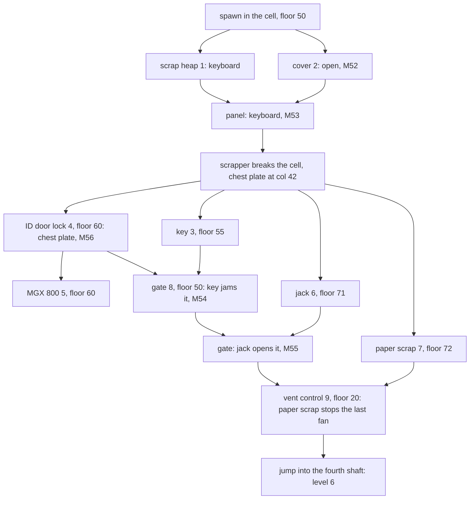

# 18 - Level 5 (vezeni) layout, objects and enemies

Status: draft. Config: `config/levels/vezeni/`. Addresses are `segment:offset` in `gamedata/disasm/verify/a*.asm`. Tags: **[code]** read in the disassembly, **[map]** checked against `MAPY/M51..M56.MAP`, **[walkthrough]** from the Score 44 text and map (`sources/cz-walkthroughs/img/5.jpg`, report 06), **[inferred]** derived, not checked in the running game, **[open]** not decoded.

## TL;DR

- **Init** `4:0x1889-0x27DA`, called from the dispatcher `4:0x80D6` for level byte 5. Map `m51.map` in `mapy\`, music `vezeni.s3m`, tileset `lev5.gra`. Level 4 hands over at `3:0xEBCF`. Level 5 hands over to level 6 at `3:0xEE74`. **[code]**
- **11 lifts** (all unlocked, one with three stops), **5 items**, **1 special weapon** (MGX 800), **3 bonuses**, **28 table enemies** of two kinds. No trooper or guard table. **[code]**
- **One linear chain of map variants**: M51 → M52 (cover opened) → M53 (keyboard, scrapper breaks the cell) → M56 (ID door opened) → M54 (key jams the gate) → M55 (jack opens the gate). Every use checks the current map name, so the order is forced. **[code] [map]**
- **Exit**: the fourth vent shaft on floor 20, after the vent control is fed the paper scrap. The other shafts kill. **[code]**

## Coordinate frame

Same frame as reports 13-16: map column = engine x + 6, floor (plank) row = engine y + 6. Lift columns are x + 5 to x + 7. **[code] [map]**

Spawn is engine (36, 44), cell column 42 on floor 50 (`4:0x1D01-0x1D13`). The hero starts locked in a prison cell. **[code]**

## Movement rules

Floors are tiles, as in level 4. Level 5 list (`7:0xC792`, sheet, tiles): sheet 7 tiles 1, 79-91, 100-102; sheet 6 tiles 66-75; sheet 8 tiles 99-103; sheet 11 tiles 34-39, 53-59; sheet 12 tiles 53-65, 79-82; sheet 10 tiles 99-104. **[code]**

Push-back wall tiles (`3:0x5A2C`, flag `[0xDFCD]`): **[code]**

| Sheet | Tiles | Where |
|---|---|---|
| 7 | 11-12, 24-25 | [open] |
| 12 | 5, 18, 31, 44, 57 | cell bars, column 45, rows 46-50 (M51, M52 only) |
| 8 | 47-48, 60-61, 73-74, 86-87 | closed or jammed door leaves (ID door, gate) |
| 11 | 89-90 | [open] |

The second list (`3:0x5CF2`, flag `[0xDFCE]`) drops sheets 12 and 8. Its reader is still **[open]** (same as report 16).

West wall table `ds:0x52EF`: one entry, engine (33, 44), floor 50. It keeps the hero in the cell on the west side. **[code]**

## Lifts

Same 24-byte slots at `ds:0x4C90 + 0x18 * (n - 1)`. No slot is locked and no task rewrites one. Every stop shows deck tiles (7,100) (7,101) (7,102); bottom stops add tile (10,36) on the stand row of the centre column. **[code] [map]**

| Lift | Engine x | Columns | Stops (floor rows) | Start |
|---|---|---|---|---|
| 1 | 75 | 80-82 | 60, 65 | 60 |
| 2 | 28 | 33-35 | 55, 60 | 55 |
| 3 | 28 | 33-35 | 65, 71 | 65 |
| 4 | 85 | 90-92 | 60, 65, 71 | 71 |
| 5 | 103 | 108-110 | 65, 71 | 65 |
| 6 | 75 | 80-82 | 50, 55 | 50 |
| 7 | 95 | 100-102 | 55, 60 | 60 |
| 8 | 111 | 116-118 | 60, 72 | 60 |
| 9 | 113 | 118-120 | 50, 55 | 55 |
| 10 | 85 | 90-92 | 45, 50 | 50 |
| 11 | 45 | 50-52 | 38, 45 | 45 |

Lifts 2/3, 1/6 and 4/10 share columns: they stack in one shaft.

## Items, weapon and bonuses

Item records at `0x548A + 0x111n` (x, y, name, owned flag +0x108). Pickup rule as in level 1. Inventory preview per record (`1:0x2F1C-0x3588`). **[code]**

| Rec | Name (cp852) | Engine | Cell (col, floor) | Marker | Preview | Pickup |
|---|---|---|---|---|---|---|
| 1 | SKLÁDKA, renamed KLÁVESNICE | 34, 44 | 40, 50 | 1 | PRKLAV | `skladka.anm`, PO PROHLEDÁNÍ SKLÁDKY JSI NAŠEL KLÁVESNICI |
| 2 | HRUDNÍ PLÁT | 200, 200, then 36, 44 | 42, 50 | - | PRPLAT | `sebplat.anm`, ZE ZEMĚ JSI SEBRAL HRUDNÍ PLÁT |
| 3 | KLÍČ | 53, 49 | 59, 55 | 3 | PRKLIC | `sebkvez.anm`, NAŠEL JSI MALÝ KLÍČ |
| 4 | ÚTRŽEK | 116, 66 | 122, 72 | 7 | PRKOD | `sebkod.anm`, NAŠEL JSI ÚTRŽEK PAPÍRU S ČÍSLEM |
| 5 | MECH. ZVEDÁK | 97, 65 | 103, 71 | 6 | PRZVED | `sebzved.anm`, NAŠEL JSI MECHANICKÝ ZVEDÁK |

- Record 1 is the scrap heap itself. Picking it plays the search film and renames the record to KLÁVESNICE (`4:0xA087-0xA122`, level 5 only). **[code]**
- Record 2 starts off the map (200, 200). The keyboard use moves it to (36, 44), next to the cell, where the scrapper crushed a guard robot (`6:0x5195`). **[code]**
- No handler clears an item after use: every item stays in the inventory. **[code]** (the use handlers never write the records; the generic clear is **[open]**).
- Previews: keyboard = light grey keyboard; chest plate = pale cyan bent armour plate with an engraved number; key = small silver key with a round bow; scrap = white torn paper with "56133" written on it; jack = grey trolley jack with a long handle (the ZVEDVRAT film shows a post jack instead).

Weapon and bonuses (`5:0x4A3D-0x5DE9`, hero within 10 px, same row): **[code]**

| Pickup | Engine | Cell | Effect |
|---|---|---|---|
| MGX 800 (marker 5) | 44, 54 | 50, 60 | special weapon, HUD plate `DESKA5.GRA`, NAŠEL JSI MGX 800 |
| energy | 113, 39 | 119, 45 | as level 4 |
| ammo | 32, 65 | 38, 71 | as level 4 |
| shield | 50, 32 | 56, 38 | as level 4 |

The MGX 800 HUD icon is a grey heavy gun with a white-blue muzzle burst. Its fire rules are **[open]**.

## Use handler (`6:0x45A2-0x549D`)

Each branch tests hero x range, y, the current map name `[0xDB5C]`, the owned flag and the selected item `[0x5154]`. **[code]**

| Object | Hero engine | Cells | Needs | Effect |
|---|---|---|---|---|
| cover (marker 2) | x 35-37, y 44 | 41-43, floor 50 | map m51, no item | `otplech1.anm`, POD KRYTEM JSI OBJEVIL OVLÁDACÍ PANEL, M52 |
| panel under the cover | x 35-37, y 44 | 41-43, floor 50 | map m52, keyboard | M53, chest plate placed, `srot.anm`, ŠROTOVAČEM JSI SI UVOLNIL CESTU VEN |
| ID door lock (marker 4) | x 34-37, y 54 | 40-43, floor 60 | map m53, chest plate | M56, `vezdver.anm`, DO POČÍTAČE JSI ZADAL IDENTIFIKAČNÍ ČÍSLO Z HRUDNÍHO PLÁTU |
| ID door lock, other item | same | same | map m53 | POČÍTAČ U DVEŘÍ TĚ POŽÁDAL O ZADÁNÍ TVÉHO IDENTIFIKAČNÍHO ČÍSLA |
| gate (marker 8) | x 105-109, y 44 | 111-115, floor 50 | map m56, key | M54, `rozdvere.anm`, MECHANISMUS U DVEŘÍ SE ZASEKL |
| gate, other item | same | same | map m56 | U DVEŘÍ JE ZDÍŘKA NA KLÍČ |
| gate, jammed | same | same | map m54, jack | M55, `zvedvrat.anm`, MECHANICKÝM ZVEDÁKEM SE TI PODAŘILO DVEŘE OTEVŘÍT |
| gate, jammed, other item | same | same | map m54 | NEMÁŠ DOSTATEK SÍLY NA OTEVŘENÍ DVEŘÍ |
| vent control (marker 9) | x 98-102, y 14 | 104-108, floor 20 | scrap, flag `[0x5481]` clear | sets `[0x5481]`, `vytahop.anm` then `vrtstop.anm`, V POSLEDNÍ VĚTRACÍ ŠACHTĚ SE ZASTAVIL VĚTRÁK |
| vent control, other item | same | same | `[0x5481]` clear | DO OVLÁDACÍHO PANELU MUSÍŠ ZADAT NĚJAKÉ HESLO |

- The vent control reuses the level 1 lift repair film `vytahop.anm` before `vrtstop.anm`. **[code]** Report 17 files the `6:0x4B34` sound table under a later level; it belongs to this branch.
- The gate needs map m56, so the key does nothing before the ID door is open. **[code]**
- Films found in `GRAFIKA`: only `ROZDVERE.ANM` and `ZVEDVRAT.ANM`. The other level 5 films are missing from the shipped files. **[code]**

## Zones (`3:0xEE20-0xF699`)

All on floor 22 (engine y 16), checked every tick. **[code]**

| Zone | Engine x | Columns | Condition | Effect |
|---|---|---|---|---|
| exit | 77-85 | 83-91 | fan stopped | level byte 6, `lev6.gra`, level 6 starts |
| fan death | 47-95 | 53-101 | fan running | `zabvet.anm`, game over |
| fan death | 47-76 | 53-82 | always | `zabvet.anm`, game over |

The four shafts drop from floor 20 at columns 67-69, 72-74, 77-79 and 85-87, each with a small fan motor box on row 19 (columns 68, 73, 78, 86). Only the fourth shaft (85-87) leads out. **[map] [inferred]** for the shaft-to-zone match.

## Map variants

| Variant | Event | Changed cells (cols x rows) | Effect |
|---|---|---|---|
| M52 | cover opened | 41-44 x 49-50 | control panel shows under the cover |
| M53 | keyboard on the panel | 41-48 x 46-50; 43-44 x 56-60; 111-113 x 46-50 | scrapper (grey tracked vehicle) sits in the broken cell wall at 45-48, guard wreck at 41-44; cell bars (col 45 wall tiles) gone; ID door closed at 43-44 (wall tiles 8/47-86); gate closed at 111-113 (wall tiles at 112) |
| M56 | chest plate on the lock | 44 x 56-60 | ID door open |
| M54 | key on the gate | 112 x 46-50; 43-44 x 56-60 | gate jammed (still wall tiles 8/48-87); ID door cells revert to the M52 plain wall art (no wall tiles, so passable) |
| M55 | jack on the gate | 112 x 46-50; 106 x 19 | gate open (no wall tiles); one walkway tile at (106, 19) changes |

- M54 drops the ID door art. This looks like a data quirk (as M43 in report 16). **[map]**
- The ID door and the gate do not exist in M51/M52: those cells hold plain cell-block wall art. They appear with the scrapper (M53). **[map]**
- The (106, 19) tile in M55 sits next to the vent control. Its meaning is **[open]**.

## Enemies

Table `ds:0x6AEF`, 27-byte slots. Slot 1 is the dummy; slots 2-29 are used; the init sets hp 3.0 for every slot 2-29 (`4:0x25FB-0x261B`). Types draw `LEV5.GRA` frames 21-24: type 1 = silver humanoid droid with an orange muzzle fireball (f21-f22), type 2 = yellow armoured robot with a rifle firing short bolts (f23-f24). **[code]** for table and frames, **[inferred]** for the type-to-frame match (same pointer table as levels 1-4). Damage, speed and hover rules are **[open]** for level 5.

| Floor | Entries (column, type) | Patrol columns |
|---|---|---|
| 20 (top hall) | 36 t1, 48 t1, 64 t1 | 32-66 |
| 38 | 38 t1 | 32-49 |
| 45 | 61 t2, 69 t2, 77 t1, 85 t2 | 52-89 |
| 45 | 95 t2, 98 t1 | 92-122 |
| 50 | 63 t1, 77 t1 | 51-79 |
| 55 | 42 t1, 54 t1, 73 t2 | 35-79 |
| 55 | 108 t1, 113 t2 | 102-117 |
| 60 | 59 t1, 67 t2, 76 t1 | 50-79 |
| 60 | 108 t2 | 102-115 |
| 65 | 37 t2, 48 t2, 73 t2 | 36-79 |
| 71 | 47 t1, 56 t1, 65 t2, 83 t1 | 36-89 |

16 type 1 and 12 type 2. **[code]**

## Task chain

Markers from `img/5.jpg` match the decoded cells. **[walkthrough] [code]**

How the hero gets from floor 50 east of the gate up to floor 20 (lifts 10 and 11, floors 45 and 38) is **[inferred]** from the lift table; the reach model was not run.

## Not decoded

- MGX 800 fire rules, enemy damage constants and hover for level 5.
- Readers of the second wall tile list.
- The sheet 7 tiles 11-12 / 24-25 and sheet 11 tiles 89-90 wall positions.
- The (106, 19) tile in M55.
- Looks of the films other than ROZDVERE and ZVEDVRAT (files missing).

## Confidence

- Lifts, items, weapon, bonuses, spawn, enemy cells, use and zone handlers: HIGH (init stores and code).
- Variant meanings: HIGH for the order and wall effect (code plus wall list), MEDIUM for the art reading (the map renders of sheet 8 tiles are partly garbled).
- Enemy looks: MEDIUM (sprite tiles seen, not rebuilt).
