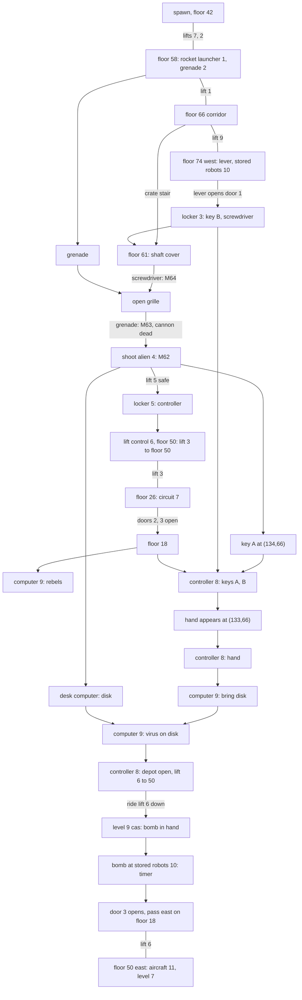

# 19 - Level 6 (sklad) layout, objects and enemies

Status: draft. Machine-readable copies (local only): `gamedata/disasm/level6_layout.json`, `gamedata/disasm/level6_enemies_decoded.json`. Addresses are `segment:offset` in `gamedata/disasm/verify/a*.asm`. Tags: **[code]** read in the disassembly, **[map]** checked against `MAPY/M61..M64.MAP` and `M91.MAP`, **[inferred]** derived, not checked in the running game, **[open]** not decoded.

## TL;DR

- **Init.** The dispatcher `4:0x80D6` calls the level-6 init `4:0x354F-0x447E` (`m61.map`, item names right after it at `4:0x351B`). Level 5 hands over at `3:0xEE74`. Like every init it first calls `4:0x04AE`, which holds the door reset loop. **[code]**
- **`cas` is level 9.** Riding lift 6 down after the munitions depot opens starts level 9 (`3:0xCE37`, init `4:0x44AA`, `m91.map`, `LEV9.GRA`), with the bomb already in the inventory. Level 9 hands over to level 7 at `5:0xE957`. **[code]**
- **8 lifts in use** (lift 3 and lift 6 locked), **7 item records** (1 on the map), **1 bonus weapon** (rocket launcher), **3 bonuses**, **3 doors**, **21 table enemies**, **9 troopers**, **1 shoot-only guard**, plus the map-tile **cannon** and **alien**. **[code]**
- **Map variants** M61, then M64 (shaft cover unscrewed), M63 (grenade kills the cannon), M62 (alien shot). M91 is level 9. **[code] [map]**
- **Floors** lie every 8 rows: 18, 26, 34, 42, 50, 58, 66, 74. **[map]**

## Coordinate frame

Same frame as reports 13-16: map column = engine x + 6, floor row = engine y + 6, stand row = engine y + 5. Spawn, grenade, rocket launcher, 3 bonuses, 21 table enemies, 9 troopers and the guard all lie on floor tiles of M61. **[code] [map]**

Spawn: engine (29, 36), cell (35, 42), on floor 42 (columns 33-72), facing right (`[0x760D] = 0x401`, `4:0x38EE`). **[code]**

## Movement rules

- **Floor tiles** (`7:0xC876`; level 9 identical at `7:0xC8E4`): (7,1); (8,71-72) shaft cover; (9,2-4) lift deck; (9,76-77), (9,80), (9,82-83), (9,86-87), (9,95-98) crate tops and the open grille. Fall, jump and the absent fall damage are the shared rules of report 16. **[code]**
- **Wall tiles** (`3:0x5ACE`, flag `[0xDFCD]`): (7,50), (7,51), (7,100), (9,79). The second list (`3:0x5D2C`, `[0xDFCE]`) has only (7,50), (7,51). **[code]** They form vertical wall lines; the ones that split floors: col 62 (floor 18), col 70 and 84 (floor 26), col 80 (floors 34, 42), col 84 and 90 (floor 50), col 98 (floor 50 east end), col 94 and 129 (floor 61). **[map]**
- **Crate stair.** Floor 66 → ledge 65 (cols 99-102) → 64 (93-94) → 63 (95-96) → 62 (96-97) → floor 61 (100-128), one row per jump. This is the walkthrough's "climb crates to the shaft". **[map] [inferred]**
- Columns 30-32, rows 9-23 are a stack of floor tiles no walk reaches (scenery). Floors 26, 34, 42 east (cols 93-114) are depot shelves seen only from lift 6. **[map] [inferred]**

## Lifts

Slot layout as report 13 (`ds:0x4C90 + 0x18 * (n - 1)`). Deck tiles (9,2-4) mark every stop. **[code] [map]**

| Lift | Engine x | Columns | Stops (floor rows) | Start | Notes |
|---|---|---|---|---|---|
| 1 | 52 | 57-59 | 58, 66 | 58 | |
| 2 | 31 | 36-38 | 50, 58 | 50 | |
| 3 | 76 | 81-83 | 18, 26; deck parked at row 46 | 46 | locked: deck above floor 50, unreachable |
| 4 | 50 | 55-57 | 26, 34 | 34 | no deck, no floor there: unused slot **[map]** |
| 5 | 128 | 133-135 | 66, 74 | 66 | inside the cannon and alien zones |
| 6 | 97 | 102-104 | 18 only | 18 | locked; deck tiles at 18, 26, 34, 42, 50 |
| 7 | 50 | 55-57 | 42, 50 | 42 | |
| 8 | - | - | - | - | slot `ds:0x4D38` not written; keeps the previous level's values **[open]** |
| 9 | 31 | 36-38 | 66, 74 | 66 | |

- **Lift 3 unlock** (marker 6): controller OVLADAC used at the lift control, engine x 71-75, y 44 (cols 77-81, floor 50). `oprvyt2.anm`, PRIVOLAL JSI VYTAH ("you called the lift"); slot becomes top 12, mid 20, bottom 44, current 44: stops 18, 26, 50, deck at 50. Controller consumed. Without it: MUSIS PRIVOLAT VYTAH (`3:0x8897-0x8A77`). **[code]**
- **Lift 6 unlock** (marker 8): virus disk at the lift controller opens 18 ↔ 50 (`3:0x8446`, see below). **[code]**

## Items

Record layout as report 13 (`0x548A + 0x111n`). A used item gets x = 199 (`0xC7`), not 1 as in level 4; the lift controller tests x = 199 to know which items went in. **[code]**

| Rec | Name | English | Start | How obtained | Use |
|---|---|---|---|---|---|
| 1 | GRANAT | grenade | engine (82, 52), cell (88, 58), marker 2 | pickup, `sebgran2.anm`, NASEL JSI GRANAT | open grille (M64), consumed |
| 2 | DISKETA | floppy disk | off map | alien desk computer, M62 only | computer 9 (virus), then lift controller 8 |
| 3 | RUKA | hand | off map | appears at engine (127, 60), cell (133, 66), once both keys are in the controller; pickup `sebruku.anm`, MRTVEMU MIMOZEMSTANOVI JSI USTRELIL RUKU | lift controller 8 |
| 4 | KLIC A | key A | off map | appears at engine (128, 60), cell (134, 66), when the alien dies; pickup `sebBkl.anm`, NASEL JSI DRUHY BEZPECNOSTNI KLIC | lift controller 8 |
| 5 | KLIC B | key B | off map | locker 3 | lift controller 8 |
| 6 | SROUBOVAK | screwdriver | off map | locker 3 | shaft cover (M61 → M64), consumed |
| 7 | OVLADAC | lift controller | off map | locker 5 | lift control 6 (lift 3), consumed |

Item pickups by name: `4:0x956F` (KLIC A), `4:0x9662` (RUKA). The walkthrough's "shoot off his hand" is the pickup subtitle; no shot handler places the hand. **[code]**

**Rocket launcher** (marker 1): bonus weapon at engine (74, 52), cell (80, 58), 8 columns west of the grenade. Picked within about 1.5 cells on the same row; sets `[0x5486]`, ammo `[0xDB38] = 250`, NASEL JSI RAKETOMET, HUD `deskar.gra` (`5:0x4A58`). **[code]**

**Bonuses** (`5:0x4F0E-0x5F00`): energy (battery 1, `[0x5156]`) at engine (113, 68), cell (119, 74); +350 ammo type 3 (`[0xDB3E]`, cap 999, `[0x515B]`) at (35, 36), cell (41, 42); +1 shield (cap 5, `[0x5158]`) at (62, 36), cell (68, 42). Battery 2 and ammo types 1 and 2 are (0, 0), unused. **[code]** Which weapon ammo type 3 feeds is **[open]**.

## Objects and use spots

Use handler `3:0x7594-0x92A0` (level 6 branch), string table `3:0x692D-0x7593`. Hero ranges are engine x on the hero row y. **[code]**

| Marker | Object | Engine | Cells (cols, floor) | Effect, film, subtitle |
|---|---|---|---|---|
| 3 | locker | x 68-76, y 68 | 74-82, 74 | key B + screwdriver, `sebskr2.anm`, VE SKRINI JSI NALEZL KLIC A SROUBOVAK ("a key and a screwdriver"; Czech "a" = "and") |
| 5 | locker | x 114-120, y 68 | 120-126, 74 | controller, `sebskr2.anm`, VE SKRINI JSI NALEZL OVLADAC VYTAHU |
| - | shaft cover over the cannon | x 113-119, y 55 | 119-125, 61 | M61 + screwdriver: `otplech2.anm`, ODSROUBOVAL JSI KRYT SACHTY, M64 loads. M61 other: KRYT SACHTY JE PEVNE PRISROUBOVAN K PODLAZE. M64 + grenade: `granvyb.anm`, ZNICIL JSI DELO, M63 loads. M64 other: PRES SACHTU VIDIS SPODNI PATRO. STOJI TAM DELO |
| 4 | alien | shot from x 119-122, y 60 | 125-128, 66; alien art cols 129-133 | map M63, gun (weapon 1), facing right (`5:0x69BC`): `mimoz01.anm`, `zabijmim.anm`, ZABIL JSI MIMOZEMSTANA, M62 loads, key A appears |
| 4 | alien desk computer | x 123-127, y 60 | 129-133, 66 | map M62, disk not yet taken: `sebdisk.anm`, Z POCITACE JSI VYTAHL DISKETU, gives the disk |
| 6 | lift control | x 71-75, y 44 | 77-81, 50 | see Lifts |
| 7 | electric circuit | x 65-69, y 20 | 71-75, 26 | puzzle `6:0x9055` (arrow-key path, `xzacatek/xnahoru/xdolu/xvpravo/xvlevo/xkonec.gra`; solution `obvod.gif`). Solved: AKTIVOVAL JSI OBVOD, doors 2 and 3 open (`6:0x9976`). Failed: NIC SE NESTALO. Needs `[0x5481] = 0` |
| 9 | computer | x 62-66, y 12 | 68-72, 18 | see below |
| 8 | lift controller (ID device) | x 99-103, y 12 | 105-109, 18 | see below |
| 10 | stored robots | - | 6-66, 74 | bomb spot, level 9 only |
| 11 | aircraft exit | - | 125-129, 50 | level 9 only |

**Computer (marker 9)** **[code]**
1. First use (`[0x332E] = 0` and `[0x332F] = 0`): `comp01.anm`, SPOJIL JSI SE S REBELY. MUSIS OTEVRIT MUNICNI SKLAD ("you contacted the rebels; open the munitions depot"). Sets `[0x332E]`.
2. Keys A, B and hand used at the controller, `[0x332F] = 0`: `comp02.anm`, MAS PRINEST DISKETU ("bring the floppy"). Sets `[0x332F]`. Does not test `[0x332E]`, so step 1 can be skipped. **[code]**
3. `[0x332F]` set, disk selected, name still DISKETA: `diskuse.anm`, NA DISKETU JSI NAHRAL VIR; renames the disk DISK S VIREM.
4. `[0x332F]` set, other item, plain disk: DO POCITACE MUSIS VLOZIT DISKETU.

**Lift controller (marker 8)** **[code]**
- Key A: `ksklad1.anm`, POUZIL JSI KLIC A. Key B: `ksklad2.anm`, POUZIL JSI KLIC B. The second key adds NYNI MUSIS PRILOZIT RUKU K CIDLU and places the hand at (133, 66).
- Hand (both keys in): `pouzruku.anm`, K CIDLU JSI PRILOZIL USTRELENOU RUKU. POCITAC TE POZADAL O HESLO.
- Virus disk (keys and hand in): `diskuse.anm`, OTEVREL SE MUNICNI SKLAD; lift 6 gets stops 18 and 50; disk consumed.
- Refusals: fewer than two keys: DO IDENTIFIKACNIHO PRISTROJE MUSIS VLOZIT DVA BEZPECNOSTNI KLICE; keys in, no hand: POKUSIL JSI SE K CIDLU PRILOZIT VLASTNI RUKU... NIC SE NESTALO; all in, plain disk or other item: MUSIS ZADAT HESLO PRO OTEVRENI SKLADU.

## Doors

Door table as report 16 (`0x3BA9 + 0x31n`, reset by `4:0x08BB` inside `4:0x04AE` on every init). **[code]**

| Rec | Door col, floor | Opened by |
|---|---|---|
| 1 | 67, 74 | lever at col 64 (west side), target [1,0,0,0]; locker 3 lies east of it |
| 2 | 80, 18 | circuit puzzle |
| 3 | 86, 18 | circuit puzzle; level 9: see below |

Lift 3's top stop (cols 81-83) lies between doors 2 and 3. West of door 2: the guard robot (col 73) and computer 9. East of door 3: lift 6 and controller 8. **[map]**

## Zones

| Zone | Map | Engine | Cells | Effect |
|---|---|---|---|---|
| cannon | M61, M64 | x 112-130, y 60 | cols 118-136, floor 66 | `delozab.anm`, 3 blast sparks, energy hit `(6 - shields)/6 x c` (c **[open]**), hero pushed 1 cell west per tick (`3:0xD5C8`) |
| alien | M63 | x 122-130, y 60 | cols 128-136, floor 66 | `elzab.anm`, game over (`3:0xD2E0`) |
| hand-over | any | x 93-101, y 29 | cols 99-107, row 35 (lift 6 shaft) | level 9 starts (`3:0xCE37`) |
| background | any | x > 90, y 31-45 | east of col 96, rows 37-51 | `[0x5489] = 2`, else 1 (`7:0xD0C6`); meaning **[open]** |

Lift 5 (cols 133-135) lies inside both floor-66 zones, so locker 5 is reached safely only in M62. **[inferred]**

## Map variants

| Variant | Event | Changed cells (cols x rows) | Effect |
|---|---|---|---|
| M64 | screwdriver at the cover | 122-123 x 61: (8,71-72) → (9,80) | open grille, still floor |
| M63 | grenade through the grille | 122-124 x 63-65 | cannon → wreck; cannon zone off, alien zone on |
| M62 | alien shot | 122-123 x 61 → (7,101); 129-133 x 63-65 | hole in floor 61 over the wreck; dead alien; zones off |
| M91 | level 9 map | M62 plus sheet-4 tiles at 102-105 x 16-17, 49-52 x 47-49, 33-34 and 39-41 x 54-57, 62-65 x 56-57 | meaning **[open]**, probably alarm lights |

The handlers test the current map name (`[0xDB5C]`), so the variant is the story state. **[code] [map]**

## Level 9 (`cas`)

Init `4:0x44AA`. **[code]**
- Spawn engine (97, 44), cell (103, 50): on lift 6 at floor 50, facing right. Item record 1 BOMBA, owned. Lift 3 stops 18, 26, 50 (start 18), lift 6 stops 18, 50 (start 50), lift 7 starts at 50.
- No table enemy, trooper or guard record is written; what the tables hold after the hand-over is **[open]**.
- **Bomb** (marker 10): BOMBA used at engine x 0-60, y 68 (floor 74, cols 6-66, the stored robots): `polbomb.anm`, SPUSTIL JSI CASOVANOU BOMBU. MUSIS SE CO NEJRYCHLEJI DOSTAT VEN. Sets `[0x5481]` and the timer digits to 1, 1, 4, 0 (`5:0xE732`).
- **Timer** `7:0xCE64`, called each tick while `[0x5481]` is set and `[0x332F]` clear: draws `[0x3324][0x3326]:[0x3328][0x332A]` and counts down; at zero `vybuch.anm` and game over. The time per count is **[open]**.
- While the timer runs, door 3 is moved off the map (open). At hero x ≥ 81, y ≤ 12 (floor 18, east of col 86) the game sets `[0x332F]`, puts door 3 back and closes it (`7:0xD31E`).
- **Exit** (marker 11): hero x 119-123, y 44 (cols 125-129, floor 50) with `[0x332F]` set starts level 7 (`raketa.s3m`, `LEV7.GRA`). Without it: JESTE MUSIS ZNICIT SKLAD S ROBOTY (`5:0xE8D7`).
- **Gap.** The door reset runs in the level-9 init too, so door 3 starts closed and the spawn area (floor 50 east, lift 6, floor 18 cols 87-110) does not reach the bomb spot in the reach model. How the original lets the hero out is **[open]**.

## Enemies

**[code]** unless tagged. Full list: `level6_enemies_decoded.json`. Looks not rebuilt from `LEV6.GRA` **[open]**.

| Kind | Table | Count | hp | Speed | Damage per fire tick |
|---|---|---|---|---|---|
| type 1 walker | `ds:0x6AEF`, type 1 | 10 | 3.0 | 2 px | (6 - shields)/6 x 4.0 (`4:0xBA9B`) |
| type 2 walker | `ds:0x6AEF`, type 2 | 11 | 1.0 | 1 px | (6 - shields)/6 x 6.8 (`4:0xBADF`) |
| trooper | `ds:0x39F6` | 9 | 10.0 | as report 16 | (6 - shields)/6 x 5.0 |
| guard robot | `ds:0x39B9` | 1 | byte 100 | - | shoot-only guard (report 10) **[inferred]** |

- Table enemies: turn chance 1/4 (`4:0xBDCE`), fire chance 1/8 (`4:0xC3EE`); damage is the same both facings (`4:0xDD9F`, `0xE124`, `0xE56D`, `0xE8DD`). Other rules as report 14.
- Guard robot: engine (67, 12), cell (73, 18), between computer 9 and door 2.

| Floor | Table enemies (cell col) | Troopers (cell col, patrol cols) |
|---|---|---|
| 18 | t2 at 93, 99 (patrol 92-109) | - |
| 26 | - | 74 (71-80) |
| 42 | - | 60 (57-71) |
| 50 | t1 47, 66; t2 61 | 76 (57-80) |
| 58 | t1 43, 49; t2 67, 74 | - |
| 66 | t1 48, 71, 97, 101; t2 42, 68, 83, 112 | 40 (38-56), 70 and 110 (59-125) |
| 74 | t1 54, 81; t2 42, 52 | 50 (38-63), 79 (72-84), 126 (117-131) |

## Task chain

## Confidence

- Init values (lifts, items, doors, enemies, spawn), use handler, shot handler, zones, variant triggers: HIGH (code).
- Map cell diffs: HIGH. Meaning of the M91 tiles: LOW.
- Route order and lift 5 safety: MEDIUM (reach script over floor runs, not the game). Level 9 door 3 route: OPEN.
- Timer duration, cannon damage constant, ammo type 3 owner, enemy looks: OPEN.
