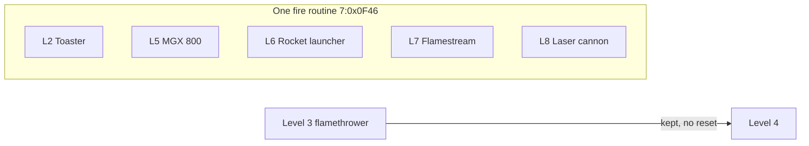

# 20 - Special weapons, all levels

Status: draft. Addresses are `segment:offset` in `gamedata/disasm/seg*.asm`. Tags as in report 16: **[code]** read in disassembly, **[data]** read in game files, **[inferred]** derived.

## Summary

Every level 1-8 has one special weapon in slot 3 (key 3). Level 4 has no own one: it keeps the level 3 flamethrower. Level 9 (first-person dungeon) has none. **[code]**

| Level | Mission | Weapon (pickup text) | Source | Ammo | Fire code | Damage per hit | HUD plate |
|---|---|---|---|---|---|---|---|
| 1 | mesto | E-BLASTER | ground, cell (40, 74) | 400 | own beam, `7:0x008E` (report 12) | droid dies in 5 ticks | `DESKA3.GRA` |
| 2 | vesnice | TOASTER | ground, cell (61, 41) | 250 | shared shot, `7:0x0F46` | 1.0 | `DESKA4.GRA` |
| 3 | jungle | PLAMENOMET (flamethrower) | task, door 9 | 500 | own particles, `7:0x28D7` (report 15) | 0.1 per particle tick vs troopers | `DESKA2.GRA` |
| 4 | jeskyne | none, keeps the level 3 flamethrower | carried over | what is left | same as level 3 | same | `DESKA2.GRA` |
| 5 | vezeni | MGX 800 | ground, cell (50, 60) | 250 | shared shot | 1.0 | `DESKA5.GRA` |
| 6 | sklad | RAKETOMET (rocket launcher) | ground, cell (80, 58) | 250 | shared shot, own sprite | 1.4 | `DESKAR.GRA` |
| 7 | raketa | FLAMESTREAM | ground, cell (77, 14) | 250 | shared shot | 1.4 | `DESKA6.GRA` |
| 8 | finis | LASEROVÉ DĚLO (laser cannon) | ground, cell (56, 45) | 250 | shared shot | 2.0 | `DESKA7.GRA` |
| 9 | dun | none | - | - | - | - | - |

Cells are map cells (engine x + 6, engine y + 6).

## Sharing

- **Levels 3 and 4 share the flamethrower.** Every level init clears the owned flag `[0x5486]` (L1 `4:0x6B92`, L2 `4:0x4DB0`, L3 `7:0xD553`, L5 `4:0x1C86`, L6 `4:0x3889`, L7 `4:0x5D49`, L8 `4:0x2ADF`, L9 `4:0x4823`), except level 4 (`4:0x0A3A`). The level 3 to 4 hand-over (`3:0x984C`) only sets `[0xDC78] = 4` in the same process, so flag and ammo `[0xDB38]` stay. A fresh `-level4` start sets the flag with 0 ammo (`4:0x0DFF-0x0E09`). The flamethrower code runs for level 3 or 4 (`7:0x28D7`), and the HUD reload picks `deska2.gra` for both (`3:0x16E7`, `3:0x1722`). This settles the walkthrough tip "save it, it lasts to the next level" (report 07). **[code]**
- **Five weapons share one fire routine.** `7:0x0F46` runs for levels 8, 7, 2, 5, 6: one shot per 7-tick cycle (`[0xE3D4]` 0-6), 1 ammo per cycle, same 6-frame flight and range as the toaster (report 14). Per level only these differ: **[code]**
  - Sound on frame 1 (`play(id, vol, rate)`): L2 `0x1C, 63, 12000`; L5 `0x1F, 63, 28000`; L6 `0x16, 63, 20000`; L7 `0x1F, 63, 28000` (every fire tick, not only frame 1); L8 `0x1C, 43, 18000`. So L7 uses the MGX 800 sound and L8 the toaster sound at a higher rate.
  - Damage (`7:0x18D5-0x1AB1`, constants at `7:0x004C-0x005A`): L2 and L5 1.0 (f32 at `0x56`), L6 and L7 1.4 (f80 at `0x4C`), L8 2.0 (f32 at `0x5A`).
  - Sprite: the shot frames come from the level bank (`LEVn.GRA` f8); L6 swaps in its own rocket sprite pointer (`[0xDEEC]` into `[0xDEF0]`, `7:0x1127`).

## Pickup table

`5:0x49CD`: per level ground pickup cell (engine x, y): L2 (55, 35), L5 (44, 54), L6 (74, 52), L7 (71, 8), L8 (50, 39); L1, L3, L4 (0, 0) = none here (L1 picks the E-Blaster in its own code, L3 gets it from door 9). Each sets `[0x5486] = 1` and `[0xDB38] = 250` (`5:0x4B66`). **[code]**

## Looks

- HUD plates `DESKA*.GRA` slot 3 (crops `video/frames-best/GRA_DESKA*_hud_slot3_*.png`): flamestream a chrome ringed barrel with a white-hot jet in orange fire; laser cannon a chrome body with scope, thin rail, two brown cells and a pale cyan bolt fading to deep blue. **[data]**
- Shot frames: `LEV5.GRA`, `LEV7.GRA`, `LEV8.GRA` f8, read as 24 px column strips (`tools/rewidth.py <f008.npy> 24`). MGX 800 a white crescent with a blue ragged edge; flamestream a fire strip over the whole 6 cell range in every frame, big yellow blobs in the first frame; laser cannon a white flash ball, then a white bolt that thins to dashes. Crops `video/frames-best/GRA_LEV{5,7,8}_f008_*_shot_6frames.png`. **[data]**
- Ground pickup sprites of levels 5-8 are not decoded; the spikes design them from the HUD plates. **[open]**

## Open

- Rocket sprite location (`[0xDEEC]` bank and frame).
- Which weapon the level 6 type 3 ammo bonus feeds (report 19).
- Pickup sprites of levels 5-8.
