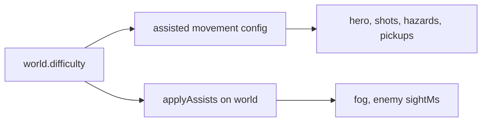

# Difficulty assists - effects

Goal: each pick in `world.difficulty` changes the game as `docs/requirements.md` Difficulty says. Settings UI, config and spike art exist (`config/difficulty.json`, `src/game/difficulty.ts`).

## Shape

- `assisted(cfg, difficulty)` in `src/game/assists.ts`: pure, cached per config and difficulty. Returns the movement config with every config-side pick applied. `run.ts` reads movement only through it.
- `applyAssists(world)`: world-side picks (enemy `sightMs`). Runs at load and in `resetWorld`.
- Fog follows the FOG OFF pick on start, restart and load.

## Batch A - config switches

| Pick | Change |
|---|---|
| extraShield | `energy.shields` + 1 |
| moreAmmo | `ammo`, `bonuses.ammo.add`, `bonuses.ammo.cap`, `blaster.ammo`, `toaster.ammo` x 1.5 |
| halfDamage | `damageScale` 0.5: every hit and hazard drain |
| strongPunches | `punch.damage` x 2 |
| lateEnemies off | enemy `sightMs` 250 instead of 400 |

## Batch B - existing systems

| Pick | Change |
|---|---|
| fogOff | no fog, as cheat `c2080iseverywhere` |
| noFallDeath | no fall kills; off: `fallDeathCells` 7 in every mission |

## Batch C - art and logic

- ENEMY HEALTH BARS: port spike `healthBar`, draw over every hit, live enemy.
- ENEMIES DROP ENERGY: port spike `energyDrop`; a special kind kill (`role` in `config/enemies/kinds.json`, flyer by its `flight`) leaves one, +50 energy on touch.

## Checks

Unit tests per pick, `npm test`, lint, typecheck, in-game look at the health bar and the drop.
