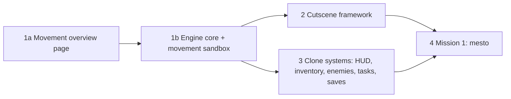

# colony2080 design

Browser remake of Colony 28 (1996/97 Czech DOS cinematic side-scroller). Decision log: `docs/requirements.md`. Research: `docs/research/README.md`. This doc says what gets built and in what order. Phase 1 (hero movement) is detailed. Later phases are outlined only and get their own spec.

## Intent

Bring Colony 28 back as a web game that feels like the original (Flashback-style cinematic platformer, hide-and-shoot combat, free-roam levels with task webs) but looks new: detailed flat vector art drawn as code, view scaled to the device.

The engine is reusable for other 2D platformers. Colony 28 is its first game.

## Goals

- Reusable 2D platform engine in plain TypeScript on Canvas 2D.
- Hero robot that matches the agreed design (`spikes/robot-design/`, `spikes/shared/xbot.js`) and moves with a full movement set.
- Colony 28 clone with mission 1 (`mesto`) playable end to end.
- Every tunable part of the game defined as JSON in `config/`.

## Non-goals

- Pixel art, original assets, 320x200 canvas, DOS emulation, three.js, Next.js, server backend.
- Cutscenes in phase 1. The cutscene framework comes later (the crowbar spike proved the format).
- Kick. Melee is punches only.
- Ledge hang and climb, roll, swimming. Add only if a later level needs them.
- Levels 2-9 before mission 1 ships.

## Anti-goals

- Movement that feels floaty or generic (modern precision platformer). The original is weighty and deliberate.
- Engine code that imports React or game-specific Colony 28 logic.
- Tuning values hard-coded in TypeScript instead of `config/`.

## Constraints

- Stack: TypeScript, Vite, React only for UI shell (menus, HUD, inventory, debug panels), Zustand bridges engine state to UI.
- Engine loop, physics, rendering and animation: plain TypeScript, no React.
- Robot model: port `spikes/shared/xbot.js` (part tree, named rig joints, hand, back and foot hooks, `locate()`) to TypeScript. Look must stay identical to the agreed design sheet at rest pose.
- Config JSON in `config/`, imported by the app. Drafts carry `"status"` and `"source"`.

## Phases

## Phase 1: hero movement

### Movement set

Full set lives in the engine. Mission 1 later uses only what level 1 needs. Sources: report 07 (controls, running jump, unarmed mode, duck), report 08 (walk, hide, kneel, lift ride).

| Move | Input (original layout) | Page | Evidence |
|---|---|---|---|
| Idle | - | movement | footage |
| Turn | opposite arrow | movement | footage |
| Walk | Left / Right | movement | footage |
| Run | Alt + Left / Right | movement | manual |
| Standing jump | Up | movement | assumed |
| Running jump | Alt + direction + Up | movement | manual, community |
| Fall, land | walk off edge | movement | later levels |
| Fall death | fall higher than limit | movement | manual (pit deaths) |
| Duck | hold Down | movement | manual |
| Hide into background, step out | Shift | movement | footage, manual |
| Ladder climb | Up / Down at ladder | movement | assumed, level 1 shaft rail |
| Lift ride | stand on platform, Up / Down | movement | footage |
| Kneel to pick up or search | Down on item | interaction | footage |
| Use / interact pose | Enter at target | interaction | footage |
| Punch / shoot | Ctrl | fight | manual, footage |
| Duck punch / duck shoot | Down + Ctrl | fight | manual |
| Weapon switch | 1 / 2 / 3 | fight | manual |
| Hit reaction | taking damage | fight | footage |
| Death | energy runs out | fight | footage |

Every move exists with fists and with the gun.

Move details:

- **Idle:** fully still, no breathing motion (it is a robot).
- **Turn:** switches views directly (side, front, other side), no squash.
- **Hide:** robot turns to front view and gets a dark desaturated tint (as in the original footage). Steps out by turning back to side view.
- **Ladder:** back view. Hands reach rungs by arm IK (upper arms move too), forearms render behind biceps and shoulders, thumbs behind the hand, opposite leg steps up.
- **Punch:** arms only, legs and body stay still.
- **Shoot:** legs and body stay still, only muzzle flash and tracers move.
- **Death and fall death:** robot drops the gun and falls on its back; shoulders and legs rest on the floor, feet point along the shin.
- **Weapons:** slot 1 = gun, slot 2 = fists (punches are a selectable weapon), slot 3 = level bonus weapon. Ctrl fires the selected weapon.
- **Lift:** moves while the hero stands on it and holds Up or Down (Claude's call, Flashback convention; check against the original when level 1 is built).

### Gun

Six-barrel rotary gun (cutscene ZABIJMIM), held in the right hand. Model and hold poses in `spikes/shared/gun.js`.

- Shape: short receiver with top handle, rear cap, grip and feed below, three visible barrels of one length with two clamp rings.
- Side carry (gameplay sprites): upper arm hangs straight down with the elbow next to the hip, forearm level and drawn in front of the gun body, support hand under the barrels. Shooting uses the same pose.
- Front (hide, turn): gun across the chest, gun-hand forearm in front of the gun, support arm behind it.
- Ladder: slung diagonally across the back.

### Controls

Original layout from `config/controls.json`, except inventory moves from Tab to `I`. Keys are configurable. Browser conflicts in the original layout: Alt + Left / Right is browser Back / Forward, Alt alone focuses the menu bar in some browsers, Ctrl + W / T / N / 1-3 close or switch tabs and cannot be blocked. The original layout stays the default until the user tries it in the sandbox.

### 1a: movement overview and design pages (built)

Same spike rules as `spikes/robot-design/` (plain HTML, classic scripts, open from `file://`).

- `spikes/movement/movement.html`, `interaction.html`, `fight.html`: one page per category from the table above, sharing `moves.js` and `style.css`. Fists / Gun switch at the top, remembered in `localStorage`.
- Grid of small cells, one per move. Not interactive: every cell loops its move forever, on a minimal stage (ledge, gap, ladder, lift, crate and barrel, wall panel, punch bag, target).
- Cells draw the in-game robot: `xbot.js` game LOD (`lod: true`) drops parts below the `config/robots/xbot.json` `gameLod` size limits, keeps four plain finger blocks, and uses three-tone shading (`render(..., { simple: true })`).
- `spikes/gun-design/index.html`: gun side view, held side, held front, slung back (ladder pose), game-size versions and original references.
- `spikes/robot-design/index.html` adds a game-size row with the simplified robot.

Rig additions in `xbot.js` (rest pose unchanged): side ankle joints and heel / toe hooks to plant feet; back-view leg joints (`legL/R`, `thighL/R`, `shinL/R`) that take pose objects (`{ rot, dx, dy, sx, sy }`); `solve()` for two-joint arm IK; options `propBehindArm` (side, front), `rightArmFirst` (front), `thumbsBehind`, `forearmsUnder` (back).

Purpose: agree how each move looks before engine work. Keyframe values in the pages are first guesses and move into config when the engine is built.

### 1b: engine core and movement sandbox (planned)

Plan: `docs/superpowers/plans/2026-10-17-engine-core-movement-sandbox.md`.

Not started. Scope when picked up:

1. Project setup: Vite + TypeScript, lint, unit tests.
2. Engine core: fixed-step loop (60 Hz, render interpolates), input mapping from `config/controls.json`, tile collision, camera, vector renderer.
3. Robot model ported to TypeScript.
4. Movement state machine with the full set above.
5. Movement sandbox: one playable screen with test geometry (step, platform, gap, pit, ladder, lift, hide props, targets), overlays (hitboxes, tiles, joints, state, velocity, input log), pause, frame step, slow motion, live tuning panel with JSON export, input record and replay.

Movement model:

- Animation-led, like Flashback: each move is a committed pose clip on the rig (keyframes per joint with easing). Root motion comes from the clip; physics handles gravity, collision and lift carry.
- One explicit state machine: allowed transitions, input buffer window, cancel points per clip.
- Timing, speeds, jump arcs, gravity, fall-death height, cancel windows, hitboxes and clip keyframes live in `config/` (Claude's call: keyframes in JSON, as for the crowbar clip; no clip editor).
- World units are cells (24 original px). Hero height and floor height (7 cells) keep the original ratio.

Phase 1 is done when the user signs off on how moves look (1a) and feel in the sandbox (1b).

## Later phases (outline)

- **Phase 2, cutscene framework:** runtime and authoring for shots with camera keyframes and keyframe tracks, based on `config/cutscenes/crowbar-door.json`.
- **Phase 3, clone systems:** HUD, inventory, weapons and ammo, enemies (`config/levels/mesto/enemies.json`), task web (`config/levels/mesto/tasks.json`), saves (5 manual slots), automap, camera limit and fog of war (`config/camera.json`).
- **Phase 4, mission 1:** level `mesto` built from decoded map, tasks and cutscenes. Collision source (decoded map data or hand-authored) is decided here; phase 1 tile collision must accept either.

## Spikes after the port

`spikes/robot-design/` and `spikes/crowbar-scene/` stay frozen as visual reference (Claude's call). The TypeScript port is checked against them by screenshot.

## Left to the builder

- Folder layout, module boundaries, test runner, lint rules.
- Further rig extensions (head, torso lean) as long as the agreed look is unchanged at rest pose.
- Collision method (tile AABB or swept), as long as moves feel as tuned in the sandbox.
- First-guess tuning values; real values come from sandbox tuning with the user.
