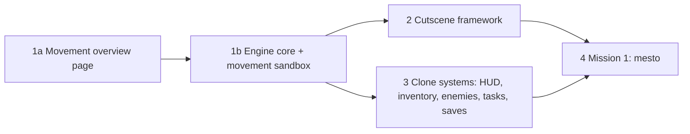
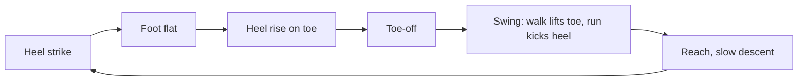
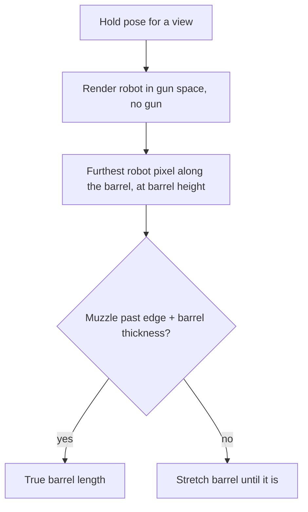

# colony2080 design

Browser remake of Colony 28 (1996/97 Czech DOS cinematic side-scroller). Decision log: `docs/requirements.md`. Research: `docs/research/README.md`. This doc says what gets built and in what order. Phase 1 (hero movement) is detailed. Later phases are outlined only and get their own spec.

## Intent

Bring Colony 28 back as a web game that feels like the original (Flashback-style cinematic platformer, hide-and-shoot combat, free-roam levels with task webs) but looks new: detailed flat vector art drawn as code, view scaled to the device.

The engine is reusable for other 2D platformers. Colony 28 is its first game.

## Goals

- Reusable 2D platform engine in plain TypeScript on Canvas 2D.
- Hero robot that matches the agreed design (`spikes/robot-design/`, `spikes/shared/xbot.js`) and moves with a full movement set.
- Colony 28 clone with mission 1 (`mesto`) playable end to end.
- Every tunable part of the game defined as JSON in `config/`.

## Non-goals

- Pixel art, original assets, 320x200 canvas, DOS emulation, three.js, Next.js, server backend.
- Cutscenes in phase 1. The cutscene framework comes later (the crowbar spike proved the format).
- Kick. Melee is punches only.
- Ledge hang and climb, roll, swimming. Add only if a later level needs them.
- Levels 2-9 before mission 1 ships.

## Anti-goals

- Movement that feels floaty or generic (modern precision platformer). The original is weighty and deliberate.
- Engine code that imports React or game-specific Colony 28 logic.
- Tuning values hard-coded in TypeScript instead of `config/`.

## Constraints

- Stack: TypeScript, Vite, React only for UI shell (menus, HUD, inventory, debug panels), Zustand bridges engine state to UI.
- Engine loop, physics, rendering and animation: plain TypeScript, no React.
- Robot model: port `spikes/shared/xbot.js` (part tree, named rig joints, hand, back and foot hooks, `locate()`) to TypeScript. Look must stay identical to the agreed design sheet at rest pose.
- Config JSON in `config/`, imported by the app. Drafts carry `"status"` and `"source"`.

## Phases

## Phase 1: hero movement

### Movement set

Full set lives in the engine. Mission 1 later uses only what level 1 needs. Sources: report 07 (controls, running jump, unarmed mode, duck), report 08 (walk, hide, kneel, lift ride).

| Move | Input (original layout) | Page | Evidence |
|---|---|---|---|
| Idle | - | movement | footage |
| Turn | opposite arrow | movement | footage |
| Walk | Left / Right | movement | footage |
| Run | Alt toggles run mode (press once to run, again to walk), then Left / Right | movement | manual, user |
| Standing jump | Up | movement | assumed |
| Duck jump | hold Down, then Up | movement | assumed |
| Walking jump | direction + Up | movement | assumed |
| Jump, turn twice | direction + Up, then opposite, then back | movement | assumed |
| Running jump | direction + Up in run mode | movement | manual, community |
| Fall, land | walk off edge | movement | later levels |
| Fall death | fall higher than limit | movement | manual (pit deaths) |
| Duck | hold Down | movement | manual |
| Hide into background, step out | Shift | movement | footage, manual |
| Ladder climb | Up / Down at ladder | movement | assumed, level 1 shaft rail |
| Ladder dismount | Left / Right on ladder, falls off | movement | user |
| Lift ride | stand on platform, press Up / Down | movement | footage |
| Kneel to pick up or search | Down on item | interaction | footage |
| Use / interact pose | Enter at target | interaction | footage |
| Punch / shoot | Ctrl | fight | manual, footage |
| Duck punch / duck shoot | Down + Ctrl | fight | manual |
| Weapon switch | 1 / 2 / 3 | fight | manual |
| Hit reaction | taking damage | fight | footage |
| Hit in running jump | taking damage mid-air | fight | assumed |
| Hit while punching / shooting | taking damage during Ctrl | fight | assumed |
| Death | energy runs out | fight | footage |
| Death in running jump | energy runs out mid-air | fight | assumed |
| Jump into pit | running jump falls short | fight | manual (pit deaths) |

Every move exists with fists and with the gun.

Move details:

- **Idle:** fully still, no breathing motion (it is a robot).
- **Response (arcade style):** input acts at once, with no wind-up frames. Playability beats natural motion.
- **Turn:** flips straight from one side view to the other, no front view between, no squash.
- **Jumps:** leave the floor on the press frame, no crouch before takeoff. Every jump (standing, duck, walking, running) shares one arc and one blend (`JUMP` in `spikes/movement/moves.js`): 52 px high, 0.55 s in the air, 0.08 s blend into the leap pose after takeoff, 0.06 s out after touchdown. No shadow while airborne (jumps and falls). Landing (jumps, fall and land) is instant too: touchdown goes straight to stand or back into the gait, no crouch.
- **Hide:** hold Shift, anywhere except on a moving lift. Robot snaps to front view with a dark desaturated tint (as in the original footage) on the press frame. Steps out on release, straight back to side view. No fade either way. An arrow while hidden turns the hero to that side without leaving cover; the head and face plate shift toward it, and the hero steps out facing that way. Shoot still held on release resumes the attack at once, gun or fists.
- **Ladder:** back view. Hands reach rungs by arm IK (upper arms move too), forearms render behind biceps and shoulders, thumbs behind the hand, opposite leg steps up. Rungs every 22 px; each hand and foot stays locked on its rung while the body climbs, then moves up two rungs (`rungHeight`). The climb starts with one foot on the floor and the other on the first rung.
- **Air control:** opposite arrow mid-air flips the robot (same instant flip as Turn) and reverses horizontal speed at once. Arc height and air time stay unchanged.
- **Duck jump:** ducks, holds, then the standing jump launches straight from the duck pose. The 52 px arc is the feet arc, so the head also gains the duck depth.
- **Duck:** one leg pose (`crouch` in `spikes/movement/moves.js`) for duck, duck jump, duck punch, duck shoot and kneel. Duck leans the body 16, kneel 70 so the picking hand (near with fists, far with the gun) reaches the floor item. Both bend down in 0.25 s and stand up in 0.3 s (`ACTION_TIME`), so the legs match frame by frame. Kneel picks the item up at the bottom and stands straight up, no hold. Use reaches the panel on the same timing, no hold, and switches it when the hand touches it (`use` clip event). Ducked arms are leveled (see Punch).
- **Walk and run (gaits):** one gait engine in `spikes/movement/moves.js` drives both. A gait is a data object (`WALK`, `RUN`); leg geometry lives in `LEG`.
  - Stance leg is solved by two-bone IK, not keyed. The foot stays planted: heel strike (toe up), flat foot, then heel rises around the toe to toe-off. IK uses the real hip point, so the far leg accounts for its hip offset rotating with the lean.
  - Body moves at constant speed. Height is one sine wave per step, phased on the moment the foot passes under the hip.
  - Swing leg is a Hermite spline over hip, knee and foot angle keys (`swing`). Its ends match the stance IK value and rate at toe-off and at contact, so the foot lifts off and touches down with no jump in speed. An optional `landing` key (stance IK traced back in time, foot raised) keeps the heel above the floor while the body still sinks before contact.
  - Fists swing arms opposite to the same-side leg. With the gun, arms hold the carry pose, compensated for lean, so the gun stays level (a robot aims steadily).

| | Walk | Run |
|---|---|---|
| Speed, cycle | 110 px/s (about 0.75 robot heights per second), 1.1 s | 300 px/s (about 2.1 heights per second), 0.66 s |
| Foot on floor | 60% of cycle, both feet down 20% | 34% of cycle, both feet up twice per cycle |
| Heel strike, toe-off | -14°, 30° | -6°, 44° |
| Body height | highest with foot under hip, 5.2 px range | lowest with foot under hip, highest mid-flight, 4.8 px range |
| Knee in stance | 9° contact, 23° loading, 12° mid, 43° before toe-off | 25° contact, 49° mid, 22° before toe-off |
| Swing | toe clears floor by about 1.3 px mid-swing | heel kick with foot near perpendicular to shin, knee drive, reach |
| Upper body | upright | lean 12° ±1.5° (most at toe-off) |

- **Walking jump:** walk pace and cycle, short forward hop over a 58 px gap. Walking jump and jump, turn twice share `walkingJumpAt`. The walk clock is shifted before takeoff and re-phased mid-air, so takeoff and landing feet stay off the gap.
- **Running jump:** run pose and speed; its gap sits between takeoff and landing.
- **Jump leap pose (all jumps):** every jump uses one pose (`LEAP`), legs and arms (`arm -40, armFar 30, fore -40, foreFar -50`). Legs stay close, about 45-55° between thighs. Front knee drives high with the shin hanging near vertical and the foot tipped toe-down, never pointing forward. Back leg trails with a bent knee.
- **Fall and land:** walks off the ledge at walk pace, fall starts from the walk height and keeps walk speed; touchdown goes back into the walk. Fall and land and fall death share one fall pose (`FALL`).

- **Punch:** arms only, legs and body stay still. Standing and duck punch run one animation (`punchPose`): guard, jab, cross, 1.2 s loop (`PUNCH_PERIOD`). Arm angles are leveled to the punch stance body lean (`levelArms`), so a leaning duck throws fists at the same world angle as standing. The bag hangs just inside jab reach and swings away only as far as a fist pushes it.
- **Shoot:** legs and body stay still, only muzzle flash and tracers move. The target is sized to reach above the muzzle line. Look from `fire()` in `spikes/movement/moves.js`: a spark at the muzzle on every other shot, one yellow tracer per shot, and an impact spark where it stops. Gun cells loop on `SHOOT_PERIOD` (18 shots at `FIRE_RATE` 12, a whole number of muzzle and impact spark cycles) so the loop is seamless. In the sandbox each shot is a real bullet (`shot.speed` in `config/hero/movement.json`) from the muzzle of the current pose. Bullets collide with what blocks the hero: they stop at walls and pass through props. They never hit the hero. With the gun, Shoot plus an arrow walks (or runs) and fires, Shoot alone stands and fires, and switching keeps the fire cadence. Duck shooting turns in place.
- **Hits (hit reaction, hit in running jump, hit while punching / shooting):** a hit never interrupts the ongoing action. The robot keeps standing, jumping, punching or shooting exactly as in the base move; the hit only adds the incoming bullet, a star at the impact point (moves with the robot), a bright flash on the hit part only (`chest` upper torso) and the head, and a damped head snap back (`head` joint, about 10°, settles in 0.35 s). Body, limbs and position stay those of the base move. In `spikes/movement/moves.js` each hit cell calls its base draw (`runningJump`, `punchOrShoot`) with `hitLook(t, hitT)` pose extras, then overlays `hitFx`. Impact sits `HIT_HEIGHT` (100 px) above the feet in every hit, death hits included. The flash and head snap apply in side view only - on the ladder (back view) a hit shows the star only.
- **Death and fall death:** robot drops the gun and falls on its back (`FLAT_BACK`). Back and heels rest on the floor (hips bent 6.5° up), toes point up (ankles 0°). Every death folds into `FLAT_BACK` in `COLLAPSE` (0.4 s), drops the gun the same way (`dropGun`: slides back 20 px in 0.3 s) and raises the same landing dust (`landingDust`). The lowest pixel of the falling body stays on the floor (`settle`). With the gun, arms keep the carry until the drop, then ease into the death pose in 0.3 s (`letGo`). Death in running jump keeps run speed and the jump arc after the hit, then slides to a stop.
- **Gun lowered and reach:** use lowers the gun (`GUN_REST`); the armed reach uses the `REACH` arm values on the far arm. Kneel keeps the gun in carry and picks up with the far hand. Weapon switch starts and ends in `STAND`.
- **Weapons:** slot 1 = gun, slot 2 = fists (punches are a selectable weapon), slot 3 = level bonus weapon. Ctrl fires the selected weapon.
- **Lift:** one Up or Down press while the hero stands on it starts a ride to the next stop; the lift stops there on its own. On the lift Up and Down only call the lift, no jump or duck (user). While it moves the hero cannot jump, hide or step off (stops at the deck edge) but can walk, run and shoot on the deck (user).

### Gun

Six-barrel rotary gun (cutscene ZABIJMIM), held in the right hand. Model and hold poses in `spikes/shared/gun.js`.

- Shape: short receiver with top handle, rear cap, grip and feed below, three visible barrels of one length with two clamp rings.
- Side carry (gameplay sprites): upper arm hangs straight down with the elbow next to the hip, forearm level and drawn in front of the gun body, support hand under the barrel root (`SUPPORT`, the furthest point the far arm reaches). Shooting uses the same pose.
- Front (hide, turn): gun across the chest, gun-hand forearm in front of the gun, support arm behind it.
- Barrel length per view: the barrel keeps its true length unless the held robot covers the muzzle in that view. Then the barrel stretches until the muzzle clears the robot silhouette by one barrel thickness (height of `barrelBack`). The side view keeps 196, the front view comes out at 247 (260 at game LOD, wider shoulder domes). Every future gun follows the same rule, so only its true size is designed by hand.

- Ladder: slung diagonally across the back, drawn at the back-view `back` hook so it follows the body.

### Controls

Original layout from `config/controls.json`, except inventory moves from Tab to `I`. Keys are configurable. Browser conflicts in the original layout: Alt + Left / Right is browser Back / Forward, Alt alone focuses the menu bar in some browsers, Ctrl + W / T / N / 1-3 close or switch tabs and cannot be blocked. The original layout stays the default until the user tries it in the sandbox. Run is a toggle on Alt, so no Alt + arrow chord is held.

### 1a: movement overview and design pages (built)

Same spike rules as `spikes/robot-design/` (plain HTML, classic scripts, open from `file://`).

- `spikes/movement/movement.html`, `interaction.html`, `fight.html`: one page per category from the table above, sharing `moves.js` and `style.css`. Fists / Gun switch at the top, remembered in `localStorage`.
- Grid of small cells, one per move. Not interactive: every cell loops its move forever, on a minimal stage (ledge, gap, ladder, lift, crate and barrel, wall panel, punch bag, target). Moving cells enter and leave off screen, gun muzzle included (`entering`), so the loop seam never pops.
- Cells draw the in-game robot: `xbot.js` game LOD (`lod: true`) drops parts below the `config/robots/xbot.json` `gameLod` size limits, keeps four plain finger blocks, and uses three-tone shading (`render(..., { simple: true })`). Game LOD limbs are bulkier (`gameLod.bulk`): shoulder and elbow domes 1.3x wide in every view, legs (thigh, knee, shin) 1.45x in side views only. Forearms, hands and feet keep the design width. Game-size side views show far limbs on every page.
- Outlines: 1.4 for high-res robot and gun (design sheets, cutscenes, `XBOT.render` and `GUN.draw` defaults), 1 at game size.
- `spikes/gun-design/index.html`: gun side view, held side, held front, slung back (ladder pose), game-size versions and original references.
- `spikes/robot-design/index.html` adds a game-size row with the simplified robot.

Rig additions in `xbot.js` (rest pose unchanged): side ankle joints and heel / toe hooks to plant feet; back-view leg joints (`legL/R`, `thighL/R`, `shinL/R`) that take pose objects (`{ rot, dx, dy, sx, sy }`); `solve()` for two-joint arm IK; options `propBehindArm` (side, front), `rightArmFirst` (front), `thumbsBehind`, `forearmsUnder` (back).

Purpose: agree how each move looks before engine work. Keyframe values in the pages are first guesses and move into config when the engine is built.

### 1b: engine core and movement sandbox (built, re-synced with the arcade and gait spikes, feel signed off 2026-10-19)

Plan: `docs/superpowers/plans/2026-10-17-engine-core-movement-sandbox.md`, re-sync: `docs/superpowers/plans/2026-10-18-sandbox-spike-resync.md`. Walk and run poses come from a port of the spike gait engine; the other moves are keyed clips.

Scope:

1. Project setup: Vite + TypeScript, lint, unit tests.
2. Engine core: fixed-step loop (60 Hz, render interpolates), input mapping from `config/controls.json`, tile collision, device-fitted view (scrolling camera moves to phase 4), vector renderer.
3. Robot model ported to TypeScript.
4. Movement state machine with the full set above.
5. Movement sandbox: one playable screen with test geometry (step, platform, gap, pit, ladder, lift, props, targets, a patrolling enemy to try hit, duck and hide, fog of war), overlays (hitboxes, tiles, joints, state, velocity, input log), pause, frame step, slow motion, live tuning panel with JSON export, input record and replay.

Movement model:

- Animation-led, like Flashback: each move is a committed pose clip on the rig (keyframes per joint with easing). Root motion comes from the clip; physics handles gravity, collision and lift carry.
- One explicit state machine: allowed transitions, input buffer window, cancel points per clip.
- Timing, speeds, jump arcs, gravity, fall-death height, cancel windows, hitboxes and clip keyframes live in `config/` (Claude's call: keyframes in JSON, as for the crowbar clip; no clip editor).
- World units are cells (24 original px). Hero height and floor height (7 cells) keep the original ratio.

Phase 1 is done when the user signs off on how moves look (1a) and feel in the sandbox (1b).

## Later phases (outline)

- **Phase 2, cutscene framework:** runtime and authoring for shots with camera keyframes and keyframe tracks, based on `config/cutscenes/crowbar-door.json`.
- **Phase 3, clone systems:** HUD, inventory, weapons and ammo, enemies (`config/levels/mesto/enemies.json`), task web (`config/levels/mesto/tasks.json`), saves (5 manual slots), automap, camera limit and fog of war (`config/camera.json`).
- **Phase 4, mission 1:** level `mesto` built from decoded map, tasks and cutscenes. Collision source (decoded map data or hand-authored) is decided here; phase 1 tile collision must accept either.

## Spikes after the port

`spikes/robot-design/` and the crowbar cutscene (`spikes/shared/cutscenes.js`) stay frozen as visual reference (Claude's call). The TypeScript port is checked against them by screenshot.

## Left to the builder

- Folder layout, module boundaries, test runner, lint rules.
- Further rig extensions (head, torso lean) as long as the agreed look is unchanged at rest pose.
- Collision method (tile AABB or swept), as long as moves feel as tuned in the sandbox.
- First-guess tuning values; real values come from sandbox tuning with the user.
