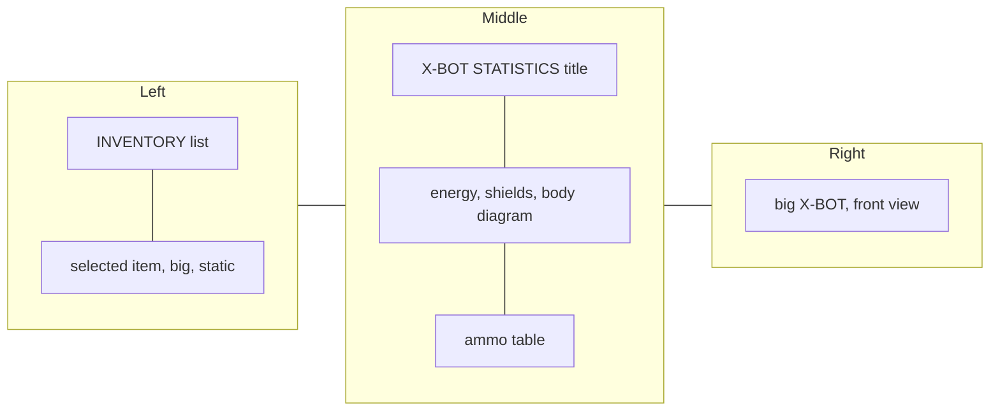

# Inventory screen design

## Intent

Mission 1 shows only the newest picked item in the HUD, and only that item is usable. Some pickup orders soft-lock the level (accepted flaw, `docs/requirements.md`). The original game has an inventory screen ("INVENTAR / X-BOT STATISTIKA", Tab in the original, `I` here) where the player picks the item to hold. This design adds it: preview in the HUD design spike, playable on `I` in the game.

## Goals

- Inventory screen in `spikes/hud-design/index.html`, next to the HUD frame, driven by the existing spike controls plus an item list control.
- `I` opens the screen in `game.html` (and in `sandbox.html`, which shares `startRun`).
- Pick an item there, it becomes the HUD item, usable with ENTER.

## Non-goals

- Rotating item preview (the original spins a 3D render; ours is static).
- Open animation (original `NABEH*.GRA`).
- Mouse control.
- Saves, automap, pause menu.

## Anti-goals

- Czech labels or any original game text or image on the published site.
- Boxes that overlap each other.

## Layout

Matches the original frames (`docs/research/video/frames-best/L1_KkPeK_t0901_inventory_energy10pct_ammo501_extra324.png`, `L1_t0585_inventory_xbot_statistika_screen.png`), redrawn as vector in the HUD style.

- Full screen over the game, game paused behind it.
- Scaling (Claude's call): boxes and robot sit in one fixed 320 x 200 layout, scaled to fit and centred; the room background fills the rest of the screen, so no bars show.
- Background: dark room with a bright lamp, floor grid.
- Left column: `INVENTORY` panel (item names, label at the bottom), selected item drawn big under it.
- Middle column: `C2080` / `STATISTICS` title box (the build rejects the original robot name); stats box with `ENERGY n%`, `SHIELDS:` glyph bar (5 segments), pulse line and level bars, body diagram; ammo box with a gun row (`xN`) and an E-Blaster row (`EXTRA xN`, shown only once the E-Blaster is owned).
- Right: big hero robot, front view, static pose.
- Panels: teal frame, dark backing with grid lines, item names pale yellow, selected row highlighted.
- Gaps between boxes are small and equal, like the HUD plates (2 units). No box overlaps another (the original body diagram crosses its box edge; ours stays inside).
- English labels (user).

## Behaviour

- `I` opens the screen in any live hero state; the game loop pauses.
- Up / Down move the cursor through the list. The cursor starts on the item shown in the HUD.
- ENTER picks the item under the cursor: it becomes the HUD item and the screen closes (user).
- `I` or Esc closes without change.
- Empty inventory: the list is empty, no item picture; ENTER closes.
- List order: newest first.

## Inventory rule change

Today the inventory is a stack: the newest item is shown and `useTop` pops the top. With the screen:

- Picking up an item still makes it the shown item.
- The screen can show any held item. Picking does not reorder the list (Claude's call).
- A use consumes the shown item (not the top), removed from wherever it sits. The newest remaining item becomes shown. Superseded the same day: used items stay unless the task consumes them (mission 1 spec, 2026-10-19 revisit).
- Death still empties the inventory.

This removes the soft-lock flaw. Update `docs/requirements.md` (Stack inventory, Known issues, the `I` open question).

## Building blocks

- Spike: `spikes/hud-design/index.html` gets an inventory screen section. Robot from `xbot.js` (front view), item from `env.js` assets, all inside the SVG/canvas style the sheet already uses.
- Game: an inventory screen builder in `src/game/hud/` (same layout as the spike; change both together), opened by the `inventory` action from `config/controls.json`, shown by a React overlay in `src/play/` and `src/sandbox/`, state through the Zustand store.
- Robot and item drawn with the existing ports (`src/game/robot`, `src/game/env/assets.ts`).
- Energy % = energy / max * 100.

## Left to the builder

- Exact sizes and fonts inside the layout above (fonts: the HUD fonts).
- Body diagram and pulse line art (decorative, our design, after the original).
- Room background art.
- Whether the screen is SVG or canvas.
