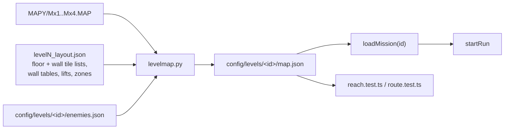

# Levels 2-4 maps - design

Status: draft (2026-10-20). Decision: levels 2-4 layout comes from decoded original data, same as mission 1 (`docs/requirements.md`, Levels 2-4 layout). Research: reports 13-16.

## Goal

One converter turns each level's decoded data into `config/levels/<id>/map.json`, the same schema mesto uses. One generic loader and one set of reach tests cover all four missions. This phase makes each mission walkable end to end (map, lifts, spawn, enemies at their cells, hazards); items, tasks, cutscenes and new env art come in later phases.

## Findings that shape it

- `KLEV1.EXE` runs every level. One shared floor check: a cell is floor when its tile is in the level's floor tile list; the hero falls 6 px per tick otherwise, with no fall damage. The 32 px jump climbs one row onto ledges (report 13 Floor tiles, 14-16).
- Level 1 uses the same check, but its map has no holes, ledges or off-row floors, so `mestomap.py` output stays valid. Only gap: lift stop cells are floor tiles in the original and `.` in ours. No gameplay effect (lifts move only with the hero aboard); kept as is.
- Levels 2-4 differ: floors at any row (9 rows apart in level 2, irregular in 3 and 4), ledge stairs, 6 to 9 lifts or none, scripted teleports, death zones (chasm, spikes, lava), conveyor floors, doors and levers from tables, whole-map variants per task, per-level enemy kinds and stats, mid-air spawns.

## Decisions (Claude's call, 2026-10-20)

| Topic | Decision |
|---|---|
| Converter | `docs/research/tools/levelmap.py <level> ...` replaces `mestomap.py`. Rows come from the floor tile list (`#` on floor cells), the wall tile lists and wall tables (`#` wall columns), code walls and map clamp (`|`). Level 1 runs through it too and must reproduce today's `config/levels/mesto/map.json` byte for byte (regression check); mesto-only extras (`SHAFT_FLOORS`, tunnel end, task walls, lift hints) move into a per-level extras dict |
| One-way floors | Original floor tiles hold the hero only from above. Levels 2-4 floor cells are `=`: one-way, drawn like planks, the hero jumps up through them (ledge stairs). Wall cells stay `#` |
| Fall damage | Original has none. `map.json` gets optional `fallDeathCells`; missing keeps the hero config value (7, mission 1). Levels 2-4 set `null`: no fall death. Deadly drops there are explicit `hazards` |
| Hazards | `map.json` `hazards`: cell rects with `kind` `death` (game over, chasm, spikes, lava band, tripwire) or `damage` (energy per tick, optional `push`). Lava band is a rect over the whole map width. Mines and hidden bonuses wait for the items phase |
| Hazard test | Hazard rects use the stand row (engine y + 5). A hazard hits when the hero centre column and foot cell (`floor(y - 0.001)`) are inside the rect, so the floor under a rect stays walkable and a one-cell tripwire hits only the hero centre |
| Conveyors | `map.json` `conveyors`: floor cell runs with `vx` (cells per s) that carry a standing hero |
| Map variants | Each variant is stored as a cell patch against the base map (`variants: { id: [{ col, row, ch }] }`), limited to blocking cells. A task applies one by id. Jungle M32 stale cells (jeep, tree, stairs) are dropped from its patch: only cells inside the cabinet and turret rect count |
| Doors, levers, stone blocks | Existing prop kinds: `gate` with `solidStates` and `cells`; levers are `object` props whose task sets the gate state; stone blocks are `shootable` gates that take punches. Placed in the items phase |
| Teleports | Task effect `teleport: [x, y]` in the tasks phase. This phase records the pads in `map.json` `teleports` (from, to) so reach tests link them |
| Enemies | `map.json` `enemies` lists `{ kind, cell, patrol }`; each level's `enemies.json` defines its kinds (hp, speed, burst, hover). The game maps every kind onto the existing walker (`level/enemy.ts`) with per-kind tuning and draws it with the droid art until the env/enemy art phase. `droids` / `flyers` stay for mesto |
| Spawn | Converter drops a mid-air spawn to the floor below it |
| Loader | `loadMission(id)` in `src/game/level/missions.ts` generalises `loadMesto`; `game.html?mission=<id>` picks the mission; the home mission bar lists missions that have a `map.json` |
| Reach tests | `reach.test.ts` runs on every mission's map: every floor run reachable from the spawn with the ledge climb, lifts and teleports, except runs behind a task gate (listed per mission). Level 4 one-way drops are expected; the test lists them so the dead end warnings (Dead ends decision) can target them |
| Art | New tiles draw with the existing terrain renderer and mesto palette. Mission backdrops and new objects come later from the env sheet (`?mission=`) |

## Phases

1. This spec: converter, `map.json` x3, generic loader, fall rule, hazards, conveyors, reach tests. Missions 2-4 walkable with enemies.
2. Items and tasks per mission (`world.json`, `tasks.json`, items in `config/items.json`), variants, teleports, doors, puzzle, bonuses, mines.
3. Env art per mission from the env sheet; enemy looks per kind.
4. Cutscenes per mission.

## Out of scope

Levels 5-9 (not decoded). Original sound.
