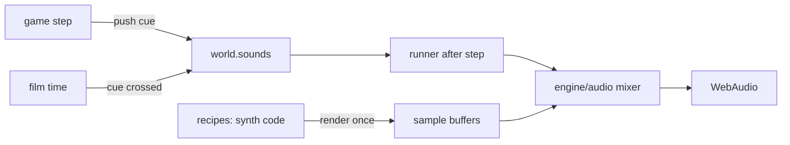

# Sound effects design

## Intent

Game has no sound. Add sound effects (SFX) close to original: same events, same timing, same character. Music is out. Sound plays everywhere: `game.html`, sandbox, films.

Original files must never reach published site (see `scripts/production.ts`). So every sound is synthesized in code, like vector art. Originals serve only as local reference for tuning.

## Goals

- Every original gameplay SFX event (table below) has synthesized sound that matches original in length, envelope, pitch and colour.
- Mission 1 films play their original film sound cues at matching film times.
- HUD: `RUN` text becomes icon; speaker icon joins it on one toggles plate. `S` toggles sound.
- Tuning loop runs without human ear: numeric comparison of synth against original, plus spike page for final listening.

## Non-goals

- Music (original S3M tracks).
- Voice lines (`SMICH` laugh, film voices `DEAD1-4`, `KURVA*`, `OK*` ...). Speech cannot be synthesized close enough; these events stay silent.
- Volume slider, per-category mute.

## Anti-goals

- Any original sample, file name or byte in `dist/`.
- Generic "retro bleeps" that ignore original sounds.
- Sound that blocks start: no audio file download, no wait.

## Original model (research)

Research (`docs/research/reports/17-sound.md`, to write from this session's findings) traced every play call in `KLEV1.EXE` and checked them against gameplay video audio.

- SFX are raw 8-bit unsigned mono PCM `.SND` files on CD (`ZVUKY/`), no header. Recorded about 11025 Hz.
- Each call passes own rate: `play(id, vol 1-63, rateHz)` (`3:0x4F8E`), MIDAS mixes at 44100. Same file plays higher or lower per event.
- Films carry per-frame sound tables (`frame = id @ rate`). Slots 12-19 change per film.

### Event table

`vol` is out of 63; missing vol = 63.

| Event | Original SND @ rate (vol) | Our trigger |
|---|---|---|
| Hero gun shot | `STRELBA` @15000 | each hero `shot` event |
| Droid shot, mission 1 | none (code skips level 1) | silent |
| Droid shot, missions 2-4 | `P1_CANN` @15000 | droid fire frame |
| Flyer shot | `LASER2` @15000 | flyer fire |
| E-Blaster beam | `LASER3` @8000, every firing tick | each `beam` event |
| Punch (hit or miss) | `UDER` @13000 | each punch frame |
| Enemy or guard explosion | `VYBUCH6` @ random 8000-9999 | enemy dies, shootable guard breaks |
| Low energy (< 20) | `SIRENA3` @8500 (34), every 15 s (original: every 40 ticks, slowed on user request) | while live hero energy < 20 |
| Shield spent, energy refilled | `GATE` @20000 | `damage` spends shield |
| Footstep | `KROK3` alternating @10000 / @9400 (33) | gait foot contact, walk and run, not while firing |
| Jump landing | `SIGNAL` @8500 (44) | landing |
| Lift start | `VYTAH1` @8000 | lift starts moving |
| Lift stop | `VYTAH2` @8000 | lift reaches stop |
| Door object opens | `DVERE` @11000 | prop moves to open state (door kind) |
| Grate opens | `MRIZ2` @18000 | prop moves to open state (grate kind) |
| Weapon switch | `IKONA` @20000 (45) | weapon key or auto switch |
| Inventory open | `INVEND` @8000, stops all sounds first | inventory screen opens |
| Dialog keys | `IKONA` @5500 (33) | pause menu and game over move and confirm |
| Thunder ambience, mission 1 | `HROM` @9000, random interval | mesto only, random gaps |
| Teleport | `TELEPORT` @13000 | teleport pad use |
| Electric hazard | `ZKRAT` @12000, every 10th tick | hero in hazard with `sound: "spark"` (original: one jeskyne zone only; field set through `levelmap.py` EXTRAS, other `damage` hazards stay silent) |
| Item pickup, item use | film sound cues (`HYDRA` @11000 servo at frame 1 ...) | film cues |

No sound in original, so none here: bullet hits wall, enemy hit, hero hit, hero death, jump start, ladder, lift travel, flyer engine, map screen, subtitle, inventory cursor and close.

## Design

### Recipes: sound as code

- `src/game/sound/recipes/` holds one recipe per original SND we need, named by English id (`gunShot`, `cannon`, `laser`, `beam`, `punch`, `explosion`, `siren`, `power`, `step`, `land`, `liftStart`, `liftStop`, `door`, `grate`, `click`, `inventory`, `thunder`, `teleport`, `spark`, `servo`, plus film-only sounds).
- Recipe renders plain samples in TypeScript (no WebAudio), deterministic (seeded noise). Output is "file" equivalent: Float32 at base rate 11025 Hz, quantized to 8-bit levels, so it keeps original lo-fi grain.
- Player plays buffer at `rate / 11025` playback rate, same as original per-call rate. So one recipe serves every call rate, like one original file.
- Building blocks (`src/engine/audio/synth.ts`): seeded noise, oscillators, filters (one-pole, biquad), envelopes (attack, decay, segments), pitch sweep, 8-bit quantize. Engine part stays game-agnostic.
- Buffers render once, lazily on first unlock, while idle (`whenIdle`).

### Mixer (`src/engine/audio/`)

- One `AudioContext`, created and resumed on first key or pointer gesture (browser autoplay rule).
- `play(id, { rate, vol })`: buffer source, gain `vol / 63`, into master gain.
- Voice limit 8 (MIDAS channel count, builder confirms); oldest voice drops.
- `stopAll()` for inventory open.
- Master mute from sound toggle. Muted: nothing starts.
- Two buses: world and UI. Loop pauses (pause menu, map, cheat box, inventory): world voices stop, UI bus keeps playing, so inventory and dialog key sounds are heard. Film playing: both run.

### Cues

- Game code pushes cues to `world.sounds` (list of `{ id, rate, vol }`), drained by runner after each step. Replay and record keep working; sounds follow simulation.
- Each trigger in event table sits where event already exists (hero `shot` / `beam` events, `landPunches`, enemy death, `damage`, gait contact, lift state, prop state change, `quickSwitch`, inventory open, menu keys, teleports, hazards).
- Film cues: cutscene config `config/cutscenes/<kebab>.json` gains `sounds: [[t, id, rate, vol?], ...]`. `stepCutscene` pushes cue when film time crosses `t`. Skip drops remaining cues.
- Film cue times come from original film tables, mapped through each film's existing original-frame mapping (`ref` / `ORIGINALS.cutscenes`) to our film time.
- Film slots S12-S19 change per film (loaders swap them per code segment). First plan task resolves slot set of each mission 1 film from `KLEV1.EXE` disassembly; slots holding voice lines stay silent. Result sets film-only recipe list.

### HUD and key

- `S` (`KeyS`) toggles sound: `soundToggle` in `config/controls.json`. Works in game, sandbox, during films.
- State in `localStorage` (`c2080.sound`), default on. Store `soundOn`.
- Top bar: one toggles plate holds sound and run side by side in one grid panel, like the weapons plate (user, after trying separate plates). Speaker with waves when on, with cross when off; running figure instead of `RUN` text. Each slot keeps its key tab (`S`, `ALT`), lit when on. Speaker, runner and empty hand share one icon height (hand 10% smaller than before, user). Inventory stays its own plate (user rejected merging it).
- `spikes/hud-design/` gets same change (layout shared, change both).

### Tuning loop

- First plan task saves research into repo: `docs/research/reports/17-sound.md` (call table, film tables, slot loads, rates, acoustics), extract and match scripts in `docs/research/tools/sound/`, SND files extracted from CD ISO to `docs/research/gamedata/raw/CD/ZVUKY/` (under gitignored `raw/`).
- `tools/sound/compare.ts` (node, dev only): renders each recipe, loads matching original, compares at matching rate: duration, RMS envelope correlation, log-spectrogram distance, spectral centroid curve. Prints score per recipe, writes spectrogram PNG pairs to scratch dir for visual check.
- Each recipe tuned until envelope correlation >= 0.9 and spectrogram distance stops improving; builder sets exact thresholds from first runs.
- `spikes/sound-design/index.html`: list of events, play synth button, original button and spectrogram inside `<!-- originals -->` block (dev only). Recipes reach spike through build step like `spikes/shared/config.js` (builder picks: bundle recipes to classic script or port).

### Tests

- Recipe render: deterministic, length within 5% of original duration, peak in range, 8-bit levels.
- Cue emission: unit tests per trigger (shot, punch, steps alternate rates, land, lift start/stop, low energy cadence, inventory stops all, mesto droid silent, film cue on crossing and not after skip).
- Mute and voice limit in mixer with fake `AudioContext`.
- Build check: no original SND names or bytes in `dist/` (extend `ORIGINAL_GAME` patterns with SND file names).

## Calls made by me

- Key `S`; sound slot left of run slot on the toggles plate; default on.
- Synth at 11025 Hz base, 8-bit quantize, per-call playback rate.
- Mission 1 droids stay silent, as original.
- Voice lines silent.
- Pause screens stop world voices, UI bus plays on; inventory open stops all, then plays its sound (original order).
- Electric spark only on hazards marked `sound: "spark"`.

## Left to builder

- Exact recipe synthesis per sound.
- Door vs grate split per prop asset.
- Thunder interval range.
- Bundling recipes for spike page.
